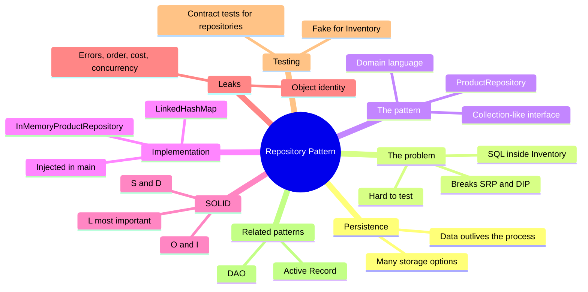
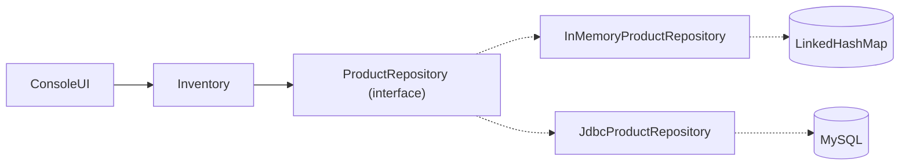
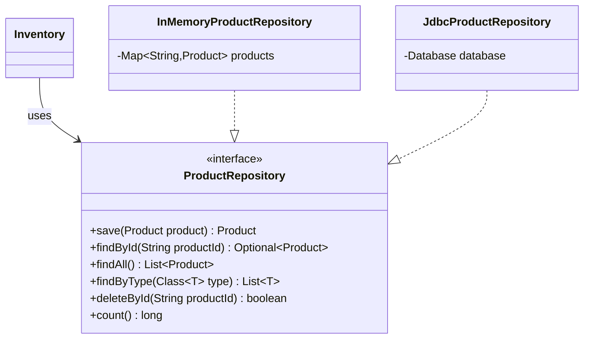
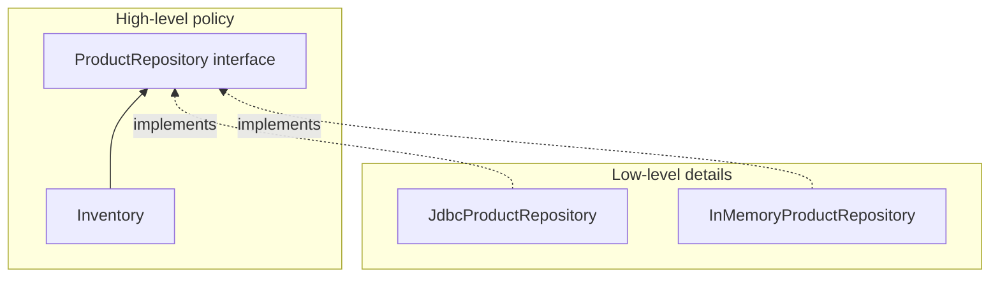
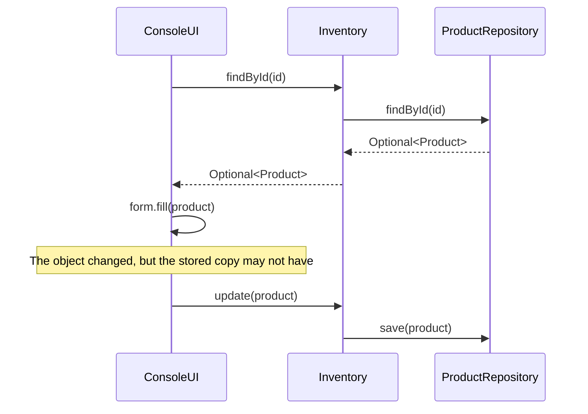
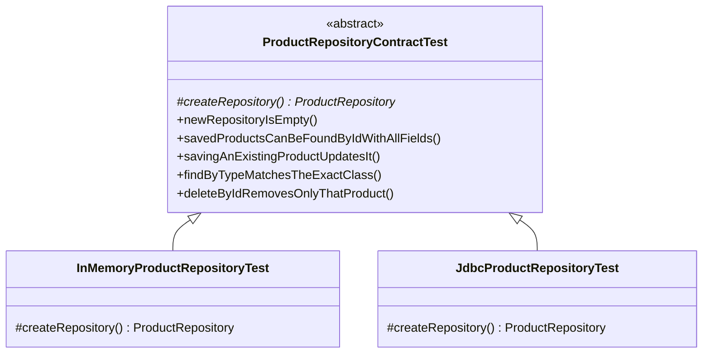
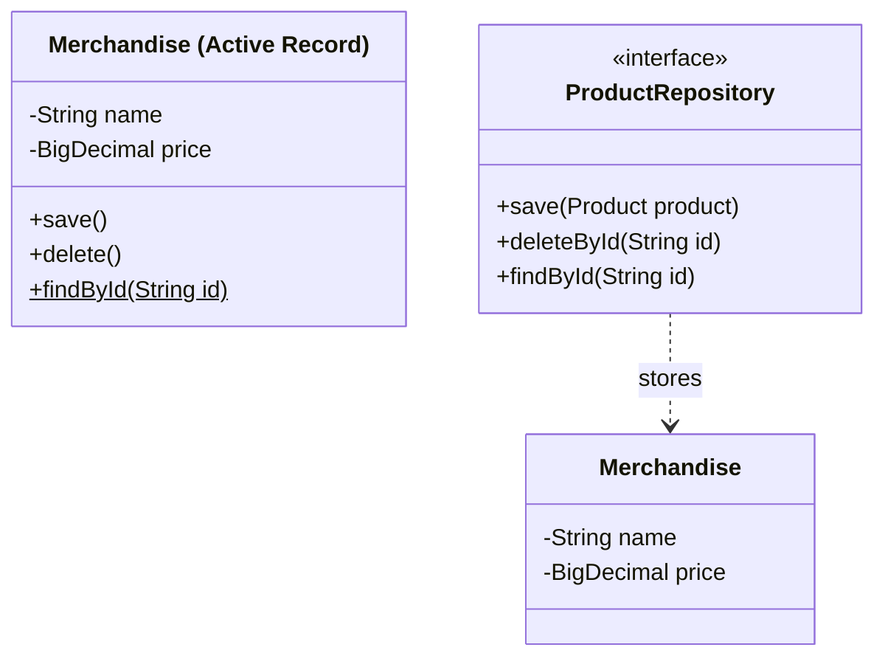

# The Repository Pattern

> [!note] Where this lecture fits
> Lecture 05 ("The Repository Pattern: putting storage behind an abstraction") picks up the bookstore app after the layers were separated. `Inventory` already holds the business rules, but it also holds the data in a plain `List`, so everything disappears when the program closes. This lecture moves storage out of `Inventory` and behind an interface called `ProductRepository`. Today the implementation lives in memory; the next lecture adds a real database with [[JDBC]].

By the end of the lecture you should be able to:

- explain what **[[Persistence]]** is and why storage is a separate responsibility
- describe the **[[Repository Pattern]]** and the problem it solves
- design a small, *collection-like* repository interface in domain language
- implement a repository **in memory** and inject it into the code that uses it
- connect the pattern to **SRP, OCP, LSP, ISP and DIP** ([[SOLID Principles]])
- recognize where the abstraction **leaks** (identity, errors, performance)
- test a repository with a **[[Contract Testing|contract test]]** and test its callers with a **fake**
- tell a repository apart from a **[[Data Access Object (DAO)|DAO]]** and **[[Active Record]]**



---

## Where we are

After separating the layers, `Inventory` holds the rules of the store: **add, find, delete, sell**. It also holds the data itself:

```java
public class Inventory {
    private final List<Product> products = new ArrayList<>();
    private final CashTill cashTill = new CashTill();
    ...
}
```

The list lives in the program's memory. Quit the program and every product is gone.

## Persistence

> [!note] Definition
> **[[Persistence]]** means data *outlives the process* that created it.

A running program is a *process*. When it ends, everything in its memory is released. Persistent data survives that, so the next time you open the app the products are still there. The lecture frames the question like this: **where should the products live when the program is not running?**

### Many places data can live

| Storage | Example |
|---|---|
| In memory | `ArrayList`, `HashMap` (**not persistent!**) |
| Files | CSV, JSON, serialized objects |
| Relational database | MySQL, PostgreSQL, SQLite |
| Document database | DynamoDB, Firestore, MongoDB |
| Remote service | a REST API owned by another team |

Each option has its own strengths, costs and API, and the choice may **change over the life of an application**. A small app might start with a file and move to MySQL a year later. The rules for selling a product should not change when the data moves.

> [!important] Key idea
> Selling a product is a business rule. Where the product is stored is a storage detail. If changing one forces you to rewrite the other, they are tangled together.

## The naive approach

The obvious first try is to put the storage code right where it is needed:

```java
public Product sell(String productId) {
    try (Connection conn = DriverManager.getConnection(URL, USER, PASSWORD);
         PreparedStatement ps = conn.prepareStatement(
             "SELECT * FROM product WHERE product_id = ?")) {
        ps.setString(1, productId);
        ResultSet rs = ps.executeQuery();
        // ... 30 lines turning a row into a Merchandise or Apparel ...
        cashTill.sellItem(product);
        // ... another UPDATE statement to store the new stock ...
    } catch (SQLException e) { ... }
}
```

### What's wrong with that?

- **SRP** ([[Single Responsibility Principle]]): `Inventory` now has three reasons to change: the selling rules change, the table layout changes, or the database product changes.
- **DIP** ([[Dependency Inversion Principle]]): a high-level policy (selling) depends directly on a low-level detail (SQL).
- **Testing:** every `Inventory` test now needs a running database.
- **Duplication:** `sell`, `findById` and `findByType` will all need the same row-to-object code.

> [!warning] The core problem
> The business rule is buried in storage code. One line (`cashTill.sellItem(product)`) is the actual rule; everything around it is about talking to MySQL.

## The Repository pattern

> [!note] Definition (Martin Fowler, *Patterns of Enterprise Application Architecture*)
> "A repository mediates between the domain and data mapping layers using a **collection-like interface** for accessing domain objects."

In plainer words, a repository sits between your business code and your storage code. To the business code it looks like an ordinary collection.

### A collection that remembers

To its callers, a repository looks like a **collection of domain objects**. You can:

- put an object in
- get it back by id
- ask for all of them, or some of them
- remove one

How and where the objects are stored is **hidden behind the interface**. Callers speak the language of the **domain** (`Product`, `productId`), never the language of storage (`ResultSet`, rows, files).

> [!example] Analogy
> Think of a coat check at a theatre. You hand over your coat and get a ticket number. Later you give the number and get the coat back. You never learn whether the coats hang on a rack, sit in boxes, or are stored in another room. If the theatre reorganizes the back room, your experience at the counter stays the same.

### Where it sits



- `ConsoleUI` talks to `Inventory`.
- `Inventory` talks to `ProductRepository`.
- Only the implementations know about maps or MySQL.

## The `ProductRepository` interface

```java
public interface ProductRepository {

    /** Inserts the product, or replaces the stored product with the same productId. */
    Product save(Product product);

    Optional<Product> findById(String productId);

    /** All products. The order depends on the implementation. */
    List<Product> findAll();

    /** Products of exactly this type. Asking for Merchandise does not return Apparel. */
    <T extends Product> List<T> findByType(Class<T> type);

    /** Returns true if a product was deleted. */
    boolean deleteById(String productId);

    long count();
}
```

### Interface design decisions

| Decision | Why |
|---|---|
| `save` is an **upsert** | It may update *or* insert, so callers don't have to track whether an object is "new". |
| `Optional` for "not found" | The type forces callers to handle a missing product instead of getting a surprise `null`. See [[Optional (Java)]]. |
| `boolean` from `deleteById` | "Nothing to delete" is not an error; it's just `false`. |
| Domain types only | No `Connection`, `SQLException` or `ResultSet` in any signature. |
| Comments are part of the contract | "Exactly this type" is a promise every implementation must keep. |

> [!tip] Upsert
> *Upsert* is short for "update or insert". If a product with that `productId` already exists, `save` replaces it; otherwise it adds it.

### The structure



There is **one interface and many implementations**. `Inventory` only knows the interface. Today's implementation is in memory; the next lecture adds JDBC.

## An in-memory implementation

```java
public class InMemoryProductRepository implements ProductRepository {
    // LinkedHashMap keeps insertion order, and replacing a key keeps its original position.
    private final Map<String, Product> products = new LinkedHashMap<>();

    @Override
    public Product save(Product product) {
        products.put(product.getProductId(), product);
        return product;
    }

    @Override
    public Optional<Product> findById(String productId) {
        return Optional.ofNullable(products.get(productId));
    }
    ...
}
```

`Optional.ofNullable(...)` wraps the result: if `get` returns `null` (no such key), you get an empty `Optional`.

### Why a `LinkedHashMap`?

| Requirement | Data structure feature |
|---|---|
| look up by `productId` | `Map` keyed by id: fast lookup |
| `save` replaces an existing product | `put` on an existing key replaces the value |
| stable listing order for the console | `LinkedHashMap` keeps **insertion order** |
| `deleteById` | `remove` returns the old value, or `null` |

With `Inventory`'s old `List`, every lookup was a linear search through every product. Picking the collection is an **implementation detail**, and now that detail is hidden inside the repository. See [[LinkedHashMap]] and [[HashMap]] for more, or the [Java `LinkedHashMap` docs](https://docs.oracle.com/javase/8/docs/api/java/util/LinkedHashMap.html).

### The rest of it

```java
@Override
public <T extends Product> List<T> findByType(Class<T> type) {
    return products.values().stream()
            .filter(p -> p.getClass() == type)   // exact class, not instanceof
            .map(type::cast)
            .toList();
}

@Override
public boolean deleteById(String productId) {
    return products.remove(productId) != null;
}

@Override
public long count() {
    return products.size();
}
```

> [!note] Exact class vs `instanceof`
> `p.getClass() == type` is true only when the object's class is *exactly* `type`. `instanceof` would also accept subclasses. The contract says "exactly this type", so `getClass()` is the right check. `type::cast` then turns each `Product` into a `T` so the list has the right [[Generics|generic]] type.

## Injecting the repository

```java
public class Inventory {
    private final ProductRepository products;
    private final CashTill cashTill = new CashTill();

    public Inventory(ProductRepository products) {
        this.products = products;
    }
    ...
}
```

`Inventory` no longer decides **where** products are stored. It receives a repository through its constructor. This is the same idea as passing a `Scanner` into `ProductForm` last week: **[[Dependency Injection]]**.

### One place makes the choice

```java
public static void main(String[] args) {
    ProductRepository repository = new InMemoryProductRepository();
    Inventory inventory = new Inventory(repository);
    ...
}
```

- `Main` chooses the implementation.
- Switching to a database later is a **one-line change** here.
- Nothing else in the program depends on that choice.
- This place has a name, the **[[Composition Root]]**, which the course will come back to.

## SOLID and the repository

### S and D



- **SRP:** `Inventory` holds the rules; a repository holds storage.
- **DIP:** every arrow points **toward the policy**. The low-level classes depend on the interface, and the interface sits with the high-level code.
- The interface belongs with the code that **uses** it, not with the code that implements it.

### O and I

- **OCP** ([[Open-Closed Principle]]): adding a new storage technology means **adding a class**, not editing `Inventory` or `ConsoleUI`.
- **ISP** ([[Interface Segregation Principle]]): keep the interface to what callers actually need. A report screen that only reads could depend on a narrower interface:

```java
interface ProductReader {
    Optional<Product> findById(String productId);
    List<Product> findAll();
}
interface ProductRepository extends ProductReader {
    Product save(Product product);
    boolean deleteById(String productId);
}
```

> [!tip] When to split
> Split an interface when a real client needs it, not in advance.

### L: the most important one here

`Inventory` works with **any** `ProductRepository`. That is only true if every implementation **behaves the same** from the caller's point of view ([[Liskov Substitution Principle]]).

Suppose `JdbcProductRepository.findByType(Merchandise.class)` also returned `Apparel`:

- it compiles
- it implements the interface
- the "Merchandise" list in the console now shows T-shirts

> [!important] Key idea
> **Implementing an interface is not the same as honouring its contract.** The compiler checks method signatures. It does not check promises written in comments, like "exactly this type".

## Leaky abstractions

> [!quote] Joel Spolsky
> "All non-trivial abstractions, to some degree, are leaky."

A repository hides **how** data is stored, but some consequences of storage still show through. See [[Leaky Abstraction]].

### Leak 1: object identity

```java
Product bag = repository.findById(id).orElseThrow();
bag.setStock(3);
// forgot to call repository.save(bag)

repository.findById(id).orElseThrow().getStock();   // ???
```

| In memory | Database |
|---|---|
| returns **the same object** that is in the map | builds **a new object** from a row each time |
| answer: **3** | answer: whatever is in the row |
| the bug is invisible | the change was **lost** |

In memory, `findById` hands you a reference to the very object stored in the map, so changing it changes the "stored" copy too. A database gives you a fresh copy each time, so changes stay local until you save them. Code that forgets `save` works by accident in memory and breaks with a database.

### Making the contract explicit

The rule: **after changing a product, always `save` it.** Both `Inventory.update(product)` and `Inventory.sell()` call `save`.



### `sell` saves, too

```java
public Product sell(String productId) {
    Product product = findById(productId)
            .orElseThrow(() -> new NoSuchElementException(
                    "No product with id " + productId));
    cashTill.sellItem(product);
    products.save(product); // store the new stock level
    return product;
}
```

In memory, that last line seems pointless. With a database, without it the stock never goes down.

> [!warning] Common mistake
> Removing `products.save(product)` because "the tests still pass". They pass only because the in-memory repository shares the same object. Switch to JDBC and stock stops decreasing.

### Other leaks

- **Errors:** a map never fails; a database can be down. The interface needs a way to report that without exposing `SQLException`.
- **Order:** `findAll` order differs between a `LinkedHashMap` and a SQL query. Either promise an order in the contract, or say clearly that there isn't one (the interface comment does this: "The order depends on the implementation").
- **Cost:** `findAll()` on 10 products is free. On 10 million rows it is not. Query methods like `findByType` let the storage do the filtering.
- **Concurrency:** two users editing the same product at once.

> [!important] Key idea
> A good abstraction doesn't pretend these problems don't exist. It **decides how to handle them** and documents the decision.

## Testing: two questions

1. Does `Inventory` follow its **rules** correctly?
2. Does each repository **keep its contract**?

These are different questions, so they need different tests.

### Testing `Inventory` with a fake

```java
@BeforeEach
void setUp() {
    inventory = new Inventory(new InMemoryProductRepository());
    bag = new Merchandise("Tote Bag", new BigDecimal("50.00"), 10);
    inventory.add(bag);
}

@Test
void sellingReducesStockAndAddsToTill() {
    inventory.sell(bag.getProductId());

    assertEquals(9, inventory.findById(bag.getProductId()).orElseThrow().getStock());
    assertEquals(new BigDecimal("50.00"), inventory.getTillTotal());
}
```

There's no database and no console, so the test is **fast and repeatable**. Here the in-memory repository is acting as a **fake**.

### Test doubles

A *[[Test Double]]* is any object that stands in for a real collaborator during a test.

| Double | What it does |
|---|---|
| **Dummy** | fills a parameter; never actually used |
| **Stub** | returns canned answers to calls |
| **Fake** | a real, working implementation that takes a shortcut (e.g. memory instead of a database) |
| **Mock** | records calls so the test can verify they happened |
| **Spy** | a real object that also records how it was used |

- A repository interface makes **all of these** possible. Mocks come later with [[Mockito]].
- Is `InventoryTest` a unit test or an integration test? It uses a real collaborator. The categories are useful, not rigid (see [[Week 4 - Testing and Dependency Injection]]).

## Contract tests

How do we know **every** implementation behaves the same way?

> [!note] Definition
> A **contract test** is written **once**, against the **interface**, and run against **each** implementation.

### Contract test structure



- The [[Abstract Classes|abstract class]] holds every test.
- Each subclass answers one question: **how do I create an empty repository?**
- Add an implementation, add a 5-line test class, and you get the whole suite.

### The abstract contract test

```java
public abstract class ProductRepositoryContractTest {
    protected ProductRepository repository;

    /** Returns an empty repository. */
    protected abstract ProductRepository createRepository();

    @BeforeEach
    void createEmptyRepository() {
        repository = createRepository();
    }

    @Test
    void findByTypeMatchesTheExactClass() {
        Merchandise bag = new Merchandise("Tote Bag", new BigDecimal("50.00"), 10);
        Apparel shirt = new Apparel("M", "Reading T-Shirt", new BigDecimal("25.00"), 10);
        repository.save(bag);
        repository.save(shirt);

        assertEquals(Set.of(bag.getProductId()), ids(repository.findByType(Merchandise.class)));
    }
    ...
}
```

### One subclass per implementation

```java
class InMemoryProductRepositoryTest
        extends ProductRepositoryContractTest {

    @Override
    protected ProductRepository createRepository() {
        return new InMemoryProductRepository();
    }
}
```

[[JUnit]] runs every inherited `@Test` against this implementation.

> [!important] Key idea
> A **contract test is LSP made executable**: substitutability is checked, not assumed.

### Comparing what comes back

- `assertSame(saved, found)` passes in memory but fails against a database, because the database builds a new object.
- `assertEquals(saved, found)` uses `equals`, which (in this project) only compares `productId`. A repository that lost the `name` field would still pass.
- The contract test checks **type, id, and every field**:

```java
protected static void assertSameProduct(Product expected, Product actual) {
    assertEquals(expected.getClass(), actual.getClass());
    assertEquals(expected.getProductId(), actual.getProductId());
    assertEquals(expected.toString(), actual.toString());  // lists every field
}
```

> [!tip] Choosing assertions
> Choose assertions that would **fail for the bug you are worried about**. If you're worried about lost fields, an `equals` that only checks the id won't catch it.

## Related patterns

| Pattern | Idea | Difference |
|---|---|---|
| **Repository** | collection of domain objects | domain language; one per kind of object |
| **[[Data Access Object (DAO)\|DAO]]** (Data Access Object) | an object that wraps access to a table or data source | often closer to the storage (one per table, CRUD on rows) |
| **[[Active Record]]** | the domain object saves itself: `bag.save()` | no separate storage class at all |

In practice "DAO" and "Repository" are often used loosely and interchangeably.

### Active Record vs Repository



- **Active Record** is simple and popular (Rails, Laravel).
- But then `Merchandise` has two reasons to change: **merchandise rules** and **storage**.
- The course already removed console I/O from the domain. Active Record would put **database I/O** back in.

## Common mistakes

> [!warning] Business rules in the repository
> "`save` also reduces the stock" belongs in `Inventory`. The repository stores; it does not decide.

> [!warning] Storage leaking out of the interface
> Signatures like `findByQuery(String sql)`, `ResultSet findAll()`, or `throws SQLException` tie every caller to SQL.

> [!warning] A method per screen
> `findProductsForTheSaleMenuSortedByPriceWithStock()` mixes one screen's needs into the storage interface.

> [!warning] A generic interface too early
> Writing `Repository<T, ID>` for every type before there is a second type that needs it. ([[Spring Data]] will give the course this later for free.)

> [!warning] Pass-through layers
> A layer that only forwards calls is worth questioning, but `Inventory` holds real rules (like selling), so it earns its place.

## Key takeaways

- **Persistence** is a separate concern from business rules.
- A **repository** is a collection-like interface for domain objects that hides how they are stored.
- Design the interface in **domain language**: `Optional`, upsert `save`, no storage types.
- **Inject** the repository and choose the implementation in **one place**.
- The pattern applies **SRP** and **DIP**, enables **OCP**, and depends on **LSP**.
- The abstraction **leaks**: always `save` after a change, and plan for errors, order and cost.
- Test **callers with a fake** and **implementations with a contract test**.
- Next: a second implementation that really persists, with **JDBC**.

Extra reading: [Martin Fowler on Repository](https://martinfowler.com/eaaCatalog/repository.html), [GeeksforGeeks: Repository design pattern](https://www.geeksforgeeks.org/system-design/repository-design-pattern/), [Java `Optional` docs](https://docs.oracle.com/en/java/javase/17/docs/api/java.base/java/util/Optional.html), [Joel Spolsky, "The Law of Leaky Abstractions"](https://www.joelonsoftware.com/2002/11/11/the-law-of-leaky-abstractions/).

---

## Exercises

### Exercise 1 (Direct application)
Finish `InMemoryProductRepository` by writing `findAll()`. The interface comment says "The order depends on the implementation". What order will yours return, and why?

> [!success]- Answer key
> ```java
> @Override
> public List<Product> findAll() {
>     return new ArrayList<>(products.values());
> }
> ```
> `products` is a `LinkedHashMap`, so `values()` iterates in **insertion order**. Replacing a product with `save` keeps its original position, because `put` on an existing key doesn't move it. Copying into a new `ArrayList` means callers can't change the map by editing the returned list. (`List.copyOf(products.values())` or `.stream().toList()` would also work and return an unmodifiable list.)

### Exercise 2 (Direct application)
A classmate writes this `findByType`:
```java
.filter(p -> type.isInstance(p))
```
Assume `Apparel extends Merchandise`. What does `findByType(Merchandise.class)` now return, and which contract promise does it break?

> [!success]- Answer key
> `type.isInstance(p)` behaves like `instanceof`: it accepts the class *and* its subclasses. If `Apparel` extends `Merchandise`, asking for `Merchandise` returns T-shirts too. The interface comment promises "Products of **exactly** this type. Asking for Merchandise does not return Apparel." The code compiles and still implements the interface, which is the lecture's LSP example: implementing an interface is not the same as honouring its contract. The fix is `p.getClass() == type`. The contract test `findByTypeMatchesTheExactClass` would catch it.

### Exercise 3 (Direct application)
For each method below, say which interface design decision from the lecture it violates:
(a) `Product findById(String id)` that returns `null` when missing
(b) `void deleteById(String id) throws NotFoundException`
(c) `List<Product> findAll() throws SQLException`
(d) `void insert(Product p)` plus `void update(Product p)`

> [!success]- Answer key
> (a) Should return `Optional<Product>`, so the type forces callers to handle "not found" instead of hitting an unexpected `null`.
> (b) "Nothing to delete" is not an error. Return `boolean` instead of throwing.
> (c) Domain types only: `SQLException` is a storage type and ties every caller to SQL.
> (d) `save` should be an upsert, so callers don't need to track whether an object is "new".

### Exercise 4 (Applied variation)
This version of `Inventory.restock` passes all tests with `InMemoryProductRepository`:
```java
public void restock(String productId, int amount) {
    Product p = products.findById(productId).orElseThrow();
    p.setStock(p.getStock() + amount);
}
```
Explain why the tests pass, what happens with `JdbcProductRepository`, and how to fix it.

> [!success]- Answer key
> This is the **object identity** leak. In memory, `findById` returns the same object stored in the map, so `setStock` changes the stored product directly and the tests see the new stock. A JDBC repository builds a new object from a row each time, so the change only exists in a local copy and is lost. Fix: follow the rule "after changing a product, always `save` it":
> ```java
> p.setStock(p.getStock() + amount);
> products.save(p);
> ```

### Exercise 5 (Applied variation)
Write the contract test `deleteByIdRemovesOnlyThatProduct()` for `ProductRepositoryContractTest`. It must work for any implementation.

> [!success]- Answer key
> ```java
> @Test
> void deleteByIdRemovesOnlyThatProduct() {
>     Merchandise bag = new Merchandise("Tote Bag", new BigDecimal("50.00"), 10);
>     Apparel shirt = new Apparel("M", "Reading T-Shirt", new BigDecimal("25.00"), 10);
>     repository.save(bag);
>     repository.save(shirt);
>
>     assertTrue(repository.deleteById(bag.getProductId()));
>
>     assertTrue(repository.findById(bag.getProductId()).isEmpty());
>     assertSameProduct(shirt, repository.findById(shirt.getProductId()).orElseThrow());
>     assertEquals(1, repository.count());
> }
> ```
> It only uses interface methods, so any subclass that supplies `createRepository()` runs it. It checks the return value (`true`), that the deleted product is gone, and that the *other* product survived with all its fields (using `assertSameProduct`, not `assertSame`, which would fail against a database). A second assertion on `deleteById` of a missing id returning `false` would make a good extra test.

### Exercise 6 (Applied variation)
Write `main` so the app uses `JdbcProductRepository` (assume its constructor takes a `Database`). Which other classes need to change? Which SOLID principle explains your answer?

> [!success]- Answer key
> ```java
> public static void main(String[] args) {
>     ProductRepository repository = new JdbcProductRepository(database);
>     Inventory inventory = new Inventory(repository);
>     ...
> }
> ```
> Only `main` (the composition root) changes. `Inventory` and `ConsoleUI` depend on `ProductRepository`, not on any implementation. Adding a storage technology means adding a class, not editing existing ones: that's **OCP**, made possible by **DIP** and dependency injection.

### Exercise 7 (Challenge, from the lecture)
The bookstore wants a loyalty program. A `Customer` has an id, a name, a **unique email**, and a points balance.
1. Design a `CustomerRepository` interface. How is a customer looked up at the till? What happens if the email is not found?
2. Write two contract tests. What must every implementation guarantee?

> [!success]- Answer key
> One reasonable design, following the lecture's rules (domain types, `Optional`, upsert, `boolean` delete):
> ```java
> public interface CustomerRepository {
>     /** Inserts the customer, or replaces the stored customer with the same id. */
>     Customer save(Customer customer);
>     Optional<Customer> findById(String customerId);
>     /** Email is unique, so at most one customer matches. */
>     Optional<Customer> findByEmail(String email);
>     List<Customer> findAll();
>     boolean deleteById(String customerId);
>     long count();
> }
> ```
> At the till the cashier probably asks for an email, so `findByEmail` is the lookup. "Not found" returns an empty `Optional`; the caller decides whether to offer sign-up. How to handle saving a *second* customer with an email that's already taken is a contract decision you must make and document (for example, throw a domain exception like `DuplicateEmailException`, never a `SQLException`).
>
> Two contract tests, in an abstract `CustomerRepositoryContractTest` with `createRepository()`:
> ```java
> @Test
> void savedCustomerCanBeFoundByEmail() {
>     Customer ana = new Customer("Ana", "ana@example.com", 0);
>     repository.save(ana);
>     Customer found = repository.findByEmail("ana@example.com").orElseThrow();
>     assertEquals(ana.getCustomerId(), found.getCustomerId());
>     assertEquals(ana.toString(), found.toString());
> }
>
> @Test
> void unknownEmailReturnsEmpty() {
>     assertTrue(repository.findByEmail("nobody@example.com").isEmpty());
> }
> ```
> Every implementation must guarantee that saved customers come back with every field intact, that unknown lookups return empty instead of `null` or an exception, and whatever uniqueness rule you documented.

### Exercise 8 (Challenge, from the lecture)
(a) A "points report" screen only lists customers and their balances. Which methods does it need? Does that suggest a smaller interface?
(b) Where should the rule "a purchase earns 1 point per dollar" live? Why not in the repository?

> [!success]- Answer key
> (a) It only reads: `findAll()` and maybe `findById`/`findByEmail`. By **ISP** it could depend on a narrower `CustomerReader` interface, with `CustomerRepository extends CustomerReader`, just like `ProductReader`. The lecture's advice applies: split when a real client needs it, so if this screen exists, that's a reason; if not, don't split in advance.
>
> (b) In a domain/service class like `Inventory` (or a `LoyaltyProgram` class). The earning rule is a business rule. Putting it in the repository is the "business rules in the repository" mistake: the rule would have to be copied into every implementation (in memory, JDBC, ...), and changing it would mean editing storage classes, breaking **SRP**. The service computes the points, updates the customer, and calls `save`.

### Exercise 9 (Challenge)
A teammate proposes making `Merchandise` save itself (`bag.save()`, `Merchandise.findById(id)`) "because it's less code". Using the lecture, give one advantage and two disadvantages of this Active Record approach for this project.

> [!success]- Answer key
> Advantage: it's simple and popular (Rails, Laravel use it), with no separate storage class.
> Disadvantages: (1) `Merchandise` gets two reasons to change, merchandise rules and storage, which breaks **SRP**. (2) The course already removed console I/O from the domain; Active Record would put database I/O back into domain objects, so testing `Merchandise` or `Inventory` would again need a database, and there's no interface to swap for a fake or to run contract tests against.

---

## Feynman practice

Write each answer in your own words before looking back at the notes.

### Feynman: Persistence and why storage is separate

- [ ] **1. Explain it to a 12-year-old.** What happens to a game's high score if it's only kept "in memory" and you turn off the console? How is that like `Inventory`'s `ArrayList`? Why should the rule for selling a tote bag not care whether the bag is stored in a file or in MySQL?
- [ ] **2. Find your gaps.** Reread what you wrote and ==highlight== any word a 12-year-old wouldn't know ("process", "persistence", "relational database", "business rule").
- [ ] **3. Go back and simplify.** For each highlighted word, write an analogy or example. Why does the naive `sell` with SQL inside it break both SRP and DIP?
- [ ] **4. Organize and test.** In 3-5 sentences, explain why storage is a separate responsibility, using the "many places data can live" table.

### Feynman: The repository as a collection

- [ ] **1. Explain it to a 12-year-old.** Use a coat check, a library desk, or another everyday example of "hand it over, get it back by number". Map each part to `save`, `findById`, `findAll` and `deleteById`.
- [ ] **2. Find your gaps.** ==Highlight== "interface", "domain", "upsert", "Optional", "implementation".
- [ ] **3. Go back and simplify.** Why does `findById` return `Optional` instead of `null`? Why does `deleteById` return `boolean` instead of throwing?
- [ ] **4. Organize and test.** In 3-5 sentences, explain how `Inventory`, `ProductRepository` and `InMemoryProductRepository` relate, and why only `main` knows which implementation is used.

### Feynman: SOLID and substitutability

- [ ] **1. Explain it to a 12-year-old.** Two phone chargers both fit the same socket. One charges the phone; the other plugs in fine but drains the battery. How is that like a `JdbcProductRepository` whose `findByType(Merchandise.class)` also returns T-shirts?
- [ ] **2. Find your gaps.** ==Highlight== "contract", "substitutable", "high-level policy", "low-level detail".
- [ ] **3. Go back and simplify.** Why does the lecture call L "the most important one here"? What does "every arrow points toward the policy" mean in the S and D diagram?
- [ ] **4. Organize and test.** In 3-5 sentences, explain which SOLID principle each of these supports: moving SQL out of `Inventory`, adding a new storage class, and splitting out `ProductReader`.

### Feynman: Leaky abstractions

- [ ] **1. Explain it to a 12-year-old.** If you edit a photo on your phone but never tap "save", is the edit still there tomorrow? Use that to explain why `bag.setStock(3)` without `save` "works" in memory but is lost with a database.
- [ ] **2. Find your gaps.** ==Highlight== "abstraction", "object identity", "reference", "concurrency".
- [ ] **3. Go back and simplify.** For errors, order, cost and concurrency, give one concrete situation where the in-memory and database versions would behave differently.
- [ ] **4. Organize and test.** In 3-5 sentences, explain what it means that a good abstraction "decides how to handle" leaks and documents the decision.

### Feynman: Fakes and contract tests

- [ ] **1. Explain it to a 12-year-old.** A driving school uses a practice car for lessons, and every real car must pass the same safety inspection. Which one is the fake, and which is the contract test?
- [ ] **2. Find your gaps.** ==Highlight== "test double", "fake", "stub", "mock", "abstract class", "assertSame".
- [ ] **3. Go back and simplify.** Why does each contract test subclass only need `createRepository()`? Why would `assertSame` and `assertEquals` both be poor choices for checking what `findById` returns?
- [ ] **4. Organize and test.** In 3-5 sentences, explain what "a contract test is LSP made executable" means.

---

## Flashcards

An Anki import file for this lecture is at `Flashcards/repository-pattern-flashcards.txt` (tab-separated, tags in column 3). In Anki: **File > Import**, select the file, and check the field mapping.

---

## Tags

#computer_science #programming #java #oop #design_patterns #repository_pattern #persistence #solid #dependency_injection #dependency_inversion #liskov_substitution #interface_segregation #leaky_abstraction #testing #test_doubles #contract_testing #junit #dao #active_record #software_design #csd214 #study_notes
