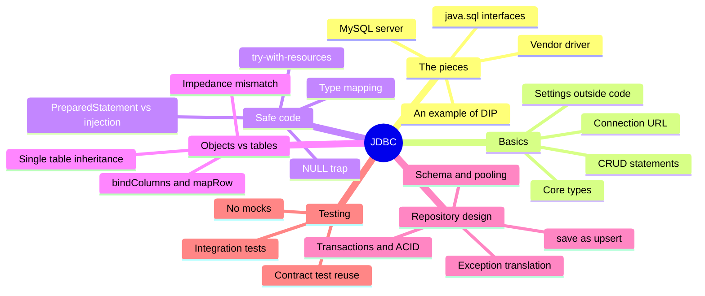
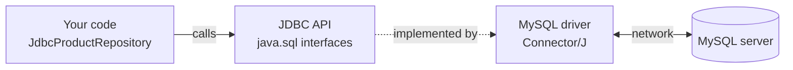
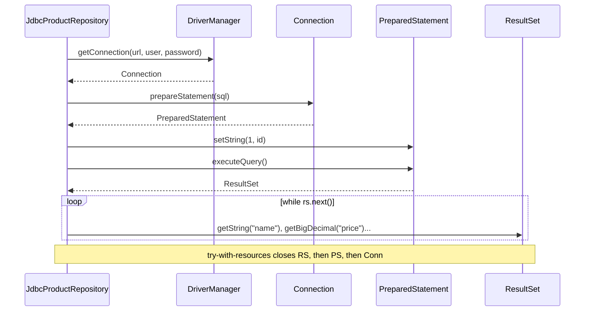
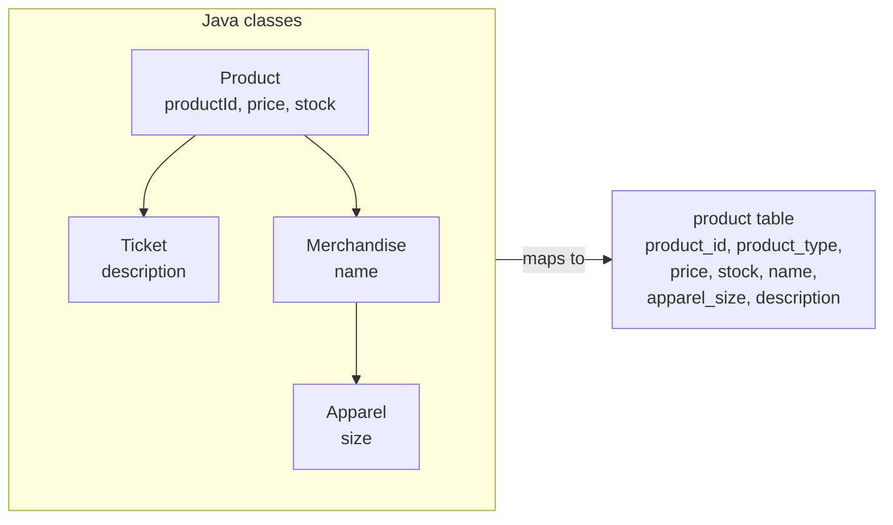
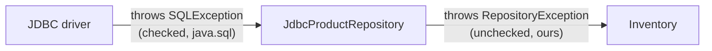
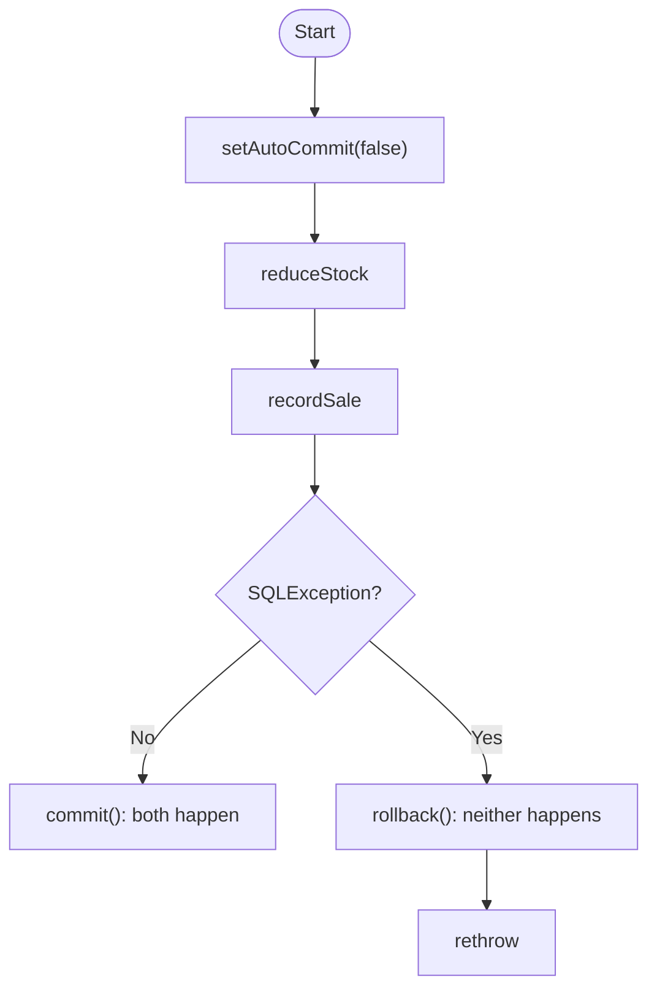
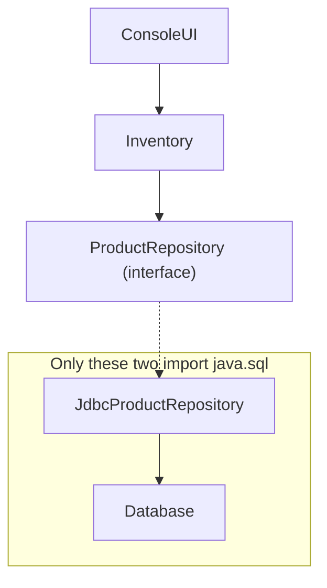

# JDBC

> [!note] Where this lecture fits
> Lecture 06 ("JDBC: talking to a relational database from Java") continues the bookstore app from [[Week 5 - The Repository Pattern]]. `ProductRepository` is an interface, and `InMemoryProductRepository` implements it with a `LinkedHashMap`, so the data still disappears when the program exits. This lecture adds a second implementation, `JdbcProductRepository`, that stores products in MySQL. `Inventory` and `ConsoleUI` **will not change**.

By the end of the lecture you should be able to:

- explain how **[[JDBC]], a driver, and a database** fit together
- open a connection and run SQL with `PreparedStatement`
- read rows from a `ResultSet`, including columns that may be `NULL`
- manage connections and statements safely with **[[Try-with-resources]]**
- explain and prevent **[[SQL Injection]]**
- map a class hierarchy to a table **by hand**
- translate `SQLException` into an exception that belongs to *our* design
- use **[[Database Transactions|transactions]]** when several statements must succeed or fail together
- test JDBC code with **[[Integration Testing|integration tests]]** and a **[[Contract Testing|contract test]]**



---

## What is JDBC?

> [!note] Definition
> **[[JDBC]] (Java Database Connectivity)** is a standard Java API, in the package `java.sql`, for working with **[[Relational Database|relational databases]]**.

- It has been part of the JDK since Java 1.1.
- Your code sends **[[SQL]]** to the database and reads back **rows**.
- Every other Java persistence tool ([[JPA]], [[Hibernate]], [[Spring Data]]) is **built on top of it**.

### How the pieces fit



- Your code depends **only on the interfaces** in `java.sql`.
- A vendor's **driver** implements those interfaces for one specific database.
- Changing database means changing the driver and the URL, not your code (mostly).

> [!example] Analogy
> Think of a wall socket. Your laptop charger only knows the shape of the socket (the interface). The power company behind the wall (the driver and database) can change, and the charger keeps working. If you move to a country with a different socket, you swap the adapter, not the laptop.

### JDBC is itself an example of DIP

- `Connection`, `PreparedStatement`, and `ResultSet` are **[[Interfaces|interfaces]]**.
- Your code never names the real class, such as `com.mysql.cj.jdbc.ConnectionImpl`.
- The driver is a **plug-in**, added as a dependency in `pom.xml` ([[Maven]]):

```xml
<dependency>
    <groupId>com.mysql</groupId>
    <artifactId>mysql-connector-j</artifactId>
    <version>9.7.0</version>
</dependency>
```

This is the same idea the course used for `ProductRepository`, applied by the Java platform itself: high-level code depends on an abstraction, and a low-level detail plugs in underneath ([[Dependency Inversion Principle]]).

> [!warning] The abstraction leaks
> Each database speaks a slightly different **dialect** of SQL. JDBC hides the connection details, but SQL written for MySQL will not always run on another database. This is another [[Leaky Abstraction]], like the ones from last week.

## A quick SQL refresher

- A **table** has typed **columns**; each **row** is one record.
- A **[[Primary Key|primary key]]** uniquely identifies a row.

```sql
CREATE TABLE IF NOT EXISTS product (
    product_id    VARCHAR(36)   NOT NULL PRIMARY KEY,
    product_type  VARCHAR(20)   NOT NULL,
    price         DECIMAL(10,2) NOT NULL,
    stock         INT,          -- NULL means unlimited
    name          VARCHAR(255),
    apparel_size  VARCHAR(20)
);
```

This version is simplified: it shows only the columns `Merchandise` and `Apparel` need. Notice that `stock` has no `NOT NULL`, so it may be empty, and the comment gives `NULL` a meaning: **unlimited** stock. That detail comes back later as "the NULL trap".

### The four CRUD statements

[[CRUD]] stands for Create, Read, Update, Delete. Each one maps to a SQL statement and a JDBC method:

| Operation | SQL | JDBC method | Returns |
|---|---|---|---|
| **Create** | `INSERT INTO product (...) VALUES (...)` | `executeUpdate()` | number of rows affected |
| **Read** | `SELECT * FROM product WHERE ...` | `executeQuery()` | a `ResultSet` |
| **Update** | `UPDATE product SET ... WHERE ...` | `executeUpdate()` | number of rows affected |
| **Delete** | `DELETE FROM product WHERE ...` | `executeUpdate()` | number of rows affected |

There is also `execute()`, which runs anything (for example `CREATE TABLE`) and returns `true` if the result is a `ResultSet`.

> [!tip] How to remember it
> Only reading gives you rows back, so only `SELECT` uses `executeQuery()`. Everything that *changes* data uses `executeUpdate()` and tells you how many rows it touched.

Extra reading: [W3Schools SQL tutorial](https://www.w3schools.com/sql/).

## The core types

| Type | Role |
|---|---|
| `DriverManager` | opens connections from a URL (simple; fine for this course) |
| `DataSource` | a factory for connections, usually **pooled** (production) |
| `Connection` | a session with the database |
| `PreparedStatement` | a precompiled SQL statement with `?` parameters |
| `Statement` | SQL with no parameters |
| `ResultSet` | a cursor over the rows a query returned |
| `SQLException` | anything that went wrong (a **checked** exception) |

## Connecting

```java
String url = "jdbc:mysql://db:3306/csd214-labs";
Connection conn = DriverManager.getConnection(url, "student", "student");
```

The URL has five parts:

```
jdbc:mysql://db:3306/csd214-labs
|    |       |  |    |
|    |       |  |    └ database
|    |       |  └ port
|    |       └ host
|    └ which driver
└ protocol
```

- `db` is the name of the MySQL service in the dev container.
- Outside the container, the host would be `localhost`.
- Old tutorials call `Class.forName(...)` first to load the driver. Modern drivers **register themselves**, so you don't need it.

### Keep settings out of the code

Settings differ between your laptop, the dev container, [[Continuous Integration|CI]], and production. Passwords should **never** be committed to [[Git]].

The default settings live in a properties file:

```properties
# src/main/resources/db.properties
db.url=jdbc:mysql://db:3306/csd214-labs
db.user=student
db.password=student
```

**Environment variables override the file**:

```java
private static String setting(String envName, String fallback) {
    String value = System.getenv(envName);
    return value == null || value.isBlank() ? fallback : value;
}
```

If the environment variable exists and isn't blank, its value wins. Otherwise the value from the file (`fallback`) is used.

> [!important] Key idea
> A `Database` class owns all of this configuration. Repositories don't read URLs or passwords; they just ask the `Database` for a `Connection`.

## The JDBC lifecycle

Every database call follows the same steps: **connect, prepare, bind, execute, read, close**.



### A first query

```java
String sql = "SELECT name, price FROM product WHERE product_type = ?";

try (Connection conn = database.getConnection();
     PreparedStatement ps = conn.prepareStatement(sql)) {

    ps.setString(1, "MERCHANDISE");          // parameters are numbered from 1

    try (ResultSet rs = ps.executeQuery()) {
        while (rs.next()) {                  // move to the next row; false when done
            String name = rs.getString("name");
            BigDecimal price = rs.getBigDecimal("price");
            System.out.println(name + " " + price);
        }
    }
} catch (SQLException e) {
    ...
}
```

Step by step:

1. The SQL has a `?` where the value goes. It is a placeholder, not part of the text.
2. The outer `try (...)` opens a connection and prepares the statement.
3. `ps.setString(1, "MERCHANDISE")` fills in the first `?`. Parameters are numbered **from 1**, not 0.
4. `executeQuery()` runs the `SELECT` and returns a `ResultSet`, opened in its own inner `try (...)`.
5. The `while (rs.next())` loop visits each row and reads columns by name.
6. A `SQLException` from any of these steps is caught at the end.

> [!warning] Off by one
> Java arrays and lists start at index 0, but JDBC parameters (`setString(1, ...)`) and column positions (`getLong(1)`) start at **1**.

## Why try-with-resources?

Connections, statements, and result sets hold **resources on the database server**. Forgetting to close them causes a **leak**:

- it works fine in a quick test
- it fails after a few hundred requests with `"Too many connections"`

**[[Try-with-resources]]** closes them **in reverse order** (result set, then statement, then connection), **even if an exception is thrown**.

```java
// Leaks if executeQuery() throws, and nobody ever closes rs.
Connection conn = database.getConnection();
ResultSet rs = conn.prepareStatement(sql).executeQuery();
```

In that snippet nothing is ever closed. Worse, the `PreparedStatement` is never even stored in a variable, so there is no way to close it later.

> [!important] Rule from the lecture
> Every `Connection`, `PreparedStatement`, and `ResultSet` belongs in a `try (...) { ... }`.

> [!example] Analogy
> Borrowing library books: if you never return them, nothing goes wrong on day one. After a few hundred unreturned books, the library has nothing left to lend. Try-with-resources is like a librarian who takes the books back automatically when you leave, even if you leave in a hurry.

Extra reading: [Oracle: The try-with-resources statement](https://docs.oracle.com/javase/tutorial/essential/exceptions/tryResourceClose.html).

## Reading a `ResultSet`

A `ResultSet` is a **cursor**, not a list.

- It starts **before** the first row.
- `next()` moves forward one row and returns `false` when there are no more rows.

You can read columns **by name** (clearer) or **by position** (1-based):

```java
rs.getString("name")
rs.getBigDecimal("price")
rs.getLong(1)            // e.g. SELECT COUNT(*) FROM product
```

For a result that has at most one row, use `if (rs.next())` instead of `while`.

> [!example] Single row
> ```java
> try (ResultSet rs = ps.executeQuery()) {
>     if (rs.next()) {
>         // found it: read the columns
>     } else {
>         // no row with that id
>     }
> }
> ```

### Mapping SQL types to Java types

| SQL column | Java type | Read / write |
|---|---|---|
| `VARCHAR` | `String` | `getString` / `setString` |
| `INT` | `int` or `Integer` | `getInt`, `getObject(col, Integer.class)` / `setInt` |
| `DECIMAL(10,2)` | `BigDecimal` | `getBigDecimal` / `setBigDecimal` |
| `DATE` | `LocalDate` | `getDate(col).toLocalDate()` / `setDate(i, Date.valueOf(d))` |
| `BOOLEAN` | `boolean` | `getBoolean` / `setBoolean` |

- `DECIMAL` maps to `BigDecimal`. That is why the course moved money off `double`: `DECIMAL` stores exact values, and so does [[BigDecimal]].
- `DATE` is a calendar day. `java.util.Date` is a moment in time; storing it in a `DATE` column **silently drops the time**. Use `LocalDate`.

### The `NULL` trap

`stock` is nullable, and `NULL` means **unlimited**.

```java
int stock = rs.getInt("stock");        // NULL becomes 0!
```

`getInt` returns a primitive `int`, so it **can't** return `null`. A ticket with unlimited stock is now **sold out**.

The fix is to ask for an `Integer` object, which can be `null`:

```java
Integer stock = rs.getObject("stock", Integer.class);   // NULL stays null
```

Writing has the same problem in reverse. You have to set `NULL` explicitly:

```java
if (p.getStock() == null) ps.setNull(4, Types.INTEGER);
else                      ps.setInt(4, p.getStock());
```

> [!warning] Common mistake
> Using `getInt` on a nullable column. The code compiles and runs with no error; the data is simply wrong. Primitives (`int`, `long`, `double`) can't hold `null`, so a `NULL` turns into `0`. See [[Wrapper Classes]].

## SQL injection

Why not just build the SQL with `+`?

```java
String sql = "SELECT * FROM product WHERE name = '" + name + "'";
```

Suppose a user searches for this "name":

```
' OR '1'='1
```

The database receives:

```sql
SELECT * FROM product WHERE name = '' OR '1'='1'
```

`'1'='1'` is always true, so **every row** matches. With other inputs an attacker can read other tables, bypass logins, or change data.

> [!important] Key idea
> The input was treated as **code**, when it should have been treated as **data**. That is [[SQL Injection]].

### The fix: parameters

```java
String sql = "SELECT * FROM product WHERE name = ?";
try (PreparedStatement ps = conn.prepareStatement(sql)) {
    ps.setString(1, name);
    ...
}
```

- The SQL and the values are sent **separately**.
- `' OR '1'='1` is now just an odd product name that matches nothing.
- Bonus: no quoting bugs with names like `O'Brien`. With concatenation, the apostrophe in `O'Brien` would end the string early and break the query.

> [!important] Rule from the lecture
> **Never concatenate user input into SQL.** Always use `?` parameters.

### Injection and testing

The testing lecture's **[[Security Testing|security testing]]** and **[[Fuzz Testing|fuzz testing]]** look for exactly this problem. Good fuzz inputs for any search box:

```
'
' OR '1'='1
O'Brien
'; DROP TABLE product; --
```

- MySQL's driver rejects multiple statements by default, so the last one fails. Don't rely on that.
- A test that searches for `O'Brien` is cheap and catches concatenated SQL immediately.

Extra reading: [OWASP SQL Injection Prevention Cheat Sheet](https://cheatsheetseries.owasp.org/cheatsheets/SQL_Injection_Prevention_Cheat_Sheet.html), [Oracle: Using prepared statements](https://docs.oracle.com/javase/tutorial/jdbc/basics/prepared.html).

## Objects vs tables

Objects and tables don't line up perfectly. This is called the **[[Object-Relational Impedance Mismatch|object-relational impedance mismatch]]**.

| Objects have... | Tables have... |
|---|---|
| identity (`==`) and `equals` | a primary key |
| inheritance | no inheritance |
| references to other objects | [[Foreign Key|foreign keys]] |
| `null`, `Optional`, `BigDecimal` scale | `NULL`, `DECIMAL(10,2)` |
| behaviour | only data |

Every repository based on a database has to bridge these gaps. In this lecture we bridge them **by hand**. Next time a tool ([[JPA]] / [[Hibernate]]) will do much of it.

### Mapping inheritance

The bookstore has a class hierarchy, but a table can't inherit from another table.



The bookstore uses **[[Single Table Inheritance|single table]]** mapping:

- Every type goes in **one table**.
- A **discriminator** column (`product_type`) records which class each row is.
- Columns that don't apply to a type are `NULL` (a `Ticket` row has no `name` or `apparel_size`).

### Three inheritance strategies

| Strategy | Tables | Trade-off |
|---|---|---|
| **Single table** | one for the whole hierarchy | simple, fast queries; many nullable columns |
| **Table per concrete class** | one per leaf class | no unused columns; "find all" must combine tables |
| **Joined** | one per class, linked by key | normalized; every read needs joins |

- The bookstore uses **single table**.
- JPA has names for all three: `SINGLE_TABLE`, `TABLE_PER_CLASS`, `JOINED`.

### Writing an object to a row

```java
private static void bindColumns(PreparedStatement ps, Product p) throws SQLException {
    ps.setString(1, typeName(p.getClass()));          // "MERCHANDISE", "APPAREL", ...
    ps.setBigDecimal(2, p.getPrice());
    ps.setNull(3, Types.INTEGER);                      // stock
    ps.setNull(4, Types.VARCHAR);                      // name
    ps.setNull(5, Types.VARCHAR);                      // apparel_size
    ps.setString(6, p.getProductId());

    if (p.getStock() != null) ps.setInt(3, p.getStock());
    if (p instanceof Merchandise m) ps.setString(4, m.getName());
    if (p instanceof Apparel a) ps.setString(5, a.getSize());
}
```

- Start everything as `NULL`, then fill in what applies.
- `Apparel` **is a** `Merchandise`, so it gets a `name` too. Both `instanceof` checks are true for an `Apparel`.
- `p instanceof Merchandise m` is [[Pattern Matching for instanceof|pattern matching]]: it checks the type and creates the variable `m` in one step.

### Discriminator values

```java
private static final Map<Class<? extends Product>, String> TYPE_NAMES = Map.of(
        Merchandise.class, "MERCHANDISE",
        Apparel.class, "APPAREL",
        ...);
```

Why not store `getClass().getName()` (for example `bookstore.domain.Apparel`)? Because if you rename or move a class, **every existing row breaks**.

> [!tip] Stable values
> Stored data should outlive refactoring. Use **stable** values that you control, like `"APPAREL"`, instead of names the compiler or a refactoring tool can change.

### Reading a row back as an object

```java
private static Product mapRow(ResultSet rs) throws SQLException {
    String type = rs.getString("product_type");
    Product product = switch (type) {
        case "MERCHANDISE" -> new Merchandise();
        case "APPAREL" -> {
            Apparel apparel = new Apparel();
            apparel.setSize(rs.getString("apparel_size"));
            yield apparel;
        }
        ...
        default -> throw new SQLException("Unknown product_type: " + type);
    };
    product.setProductId(rs.getString("product_id"));
    product.setPrice(rs.getBigDecimal("price"));
    product.setStock(rs.getObject("stock", Integer.class));
    if (product instanceof Merchandise m) m.setName(rs.getString("name"));
    return product;
}
```

1. Read the discriminator first to decide **which class** to create.
2. The `switch` expression builds the right object. In a block case, `yield` gives the value back to the `switch`.
3. Set the fields every `Product` has. `stock` uses `getObject(..., Integer.class)` to avoid the NULL trap.
4. Set `name` for anything that is a `Merchandise`, which includes `Apparel`.

### Notice

- The `switch` is over a `String`, so the compiler **can't** check that it covers every type: the `default` is required.
  - Compare this with the sealed `switch` in `ProductForm`, where the compiler **does** check. See [[Sealed Classes]].
- Adding a product type means four edits: a constant in `TYPE_NAMES`, columns in the table, lines in `bindColumns`, and a case in `mapRow`.
  - The **contract test** is what tells you if you missed one.
- One method writes and one method reads, so **all the mapping lives in one place**.

## `save`: insert or update?

The `ProductRepository` contract says `save` is an **upsert** (update or insert). JDBC has to choose which SQL to run:

```java
public Product save(Product product) {
    try (Connection conn = database.getConnection()) {
        String sql = exists(conn, product.getProductId()) ? UPDATE : INSERT;
        try (PreparedStatement ps = conn.prepareStatement(sql)) {
            bindColumns(ps, product);
            ps.executeUpdate();
        }
        return product;
    } catch (SQLException e) {
        throw new RepositoryException("Could not save product " + product.getProductId(), e);
    }
}
```

- `exists(...)` checks whether a row with that id is already there, then `save` picks `UPDATE` or `INSERT`.
- `INSERT` and `UPDATE` list the columns **in the same order**, so one method (`bindColumns`) binds both. That's why `product_id` is parameter 6: it comes last, matching `WHERE product_id = ?` at the end of the `UPDATE`.
- Alternative: MySQL's `INSERT ... ON DUPLICATE KEY UPDATE` does it in one statement, but it is **MySQL-only** SQL (the dialect leak again).

## Exception translation



```java
public class RepositoryException extends RuntimeException {
    public RepositoryException(String message, Throwable cause) {
        super(message, cause);
    }
}
```

- `SQLException` is **checked** and is part of `java.sql`.
- If `save` declared `throws SQLException`, the **interface** would mention JDBC, which violates [[Dependency Inversion Principle|DIP]]. The in-memory version would also have to pretend it could throw it.
- The fix: wrap it, **keep the cause**, and add context.

> [!note] Checked vs unchecked
> A **checked** exception must be caught or declared with `throws`; the compiler enforces it. An **unchecked** exception extends `RuntimeException` and has no such rule. Making `RepositoryException` unchecked keeps `throws` clauses out of the `ProductRepository` interface. See [[Exception Handling]] and [[Checked and Unchecked Exceptions]].

> [!warning] Keep the cause
> Passing `e` as the second argument keeps the original `SQLException` inside the new exception. Without it, the stack trace loses the real reason (wrong password, bad SQL, server down) and debugging becomes guesswork.

## Transactions

`save` runs two statements: a `SELECT` (inside `exists`), then an `INSERT` or `UPDATE`.

- What if something else **changes the row in between**?
- What if a sale must reduce stock **and** record the sale, but **the second step fails**?

### ACID in one slide

A **[[Database Transactions|transaction]]** groups statements into one unit of work. Its guarantees are called **[[ACID]]**:

| Letter | Meaning |
|---|---|
| **Atomic** | all of it happens, or none of it does |
| **Consistent** | the database moves from one valid state to another |
| **Isolated** | concurrent transactions don't see half-finished work |
| **Durable** | once committed, it survives a crash |

By default JDBC is in **auto-commit** mode: every statement is its own transaction.

> [!example] Analogy
> A bank transfer takes money from one account and adds it to another. If the system crashes between the two steps, money would vanish. A transaction makes both steps count as one: either the transfer fully happens or the accounts look like nothing happened.

### A transaction in JDBC

```java
try (Connection conn = database.getConnection()) {
    conn.setAutoCommit(false);
    try {
        reduceStock(conn, productId);     // UPDATE product ...
        recordSale(conn, productId);      // INSERT INTO sale ...
        conn.commit();                    // both happen
    } catch (SQLException e) {
        conn.rollback();                  // neither happens
        throw e;
    }
}
```



- Both statements must use the **same** `Connection`. That's why `reduceStock` and `recordSale` receive `conn` as a parameter instead of opening their own.
- Which layer should decide where a transaction starts and ends? The lecture's hint: **not the repository**. The course will come back to this with services.

Extra reading: [Oracle: Using transactions](https://docs.oracle.com/javase/tutorial/jdbc/basics/transactions.html).

## Creating the schema

```sql
-- schema.sql: safe to run every time the app starts
CREATE TABLE IF NOT EXISTS product ( ... );
```

- `IF NOT EXISTS` **never changes** a table that already exists.
  - Add a field to a class and the matching column is **not** added.
- During development, a `reset.sql` drops the table and then recreates it.
  - Fine for sample data, **unacceptable** for real data.
- Real projects use **[[Database Migrations|migration tools]]** (Flyway, Liquibase): numbered scripts like `V2__add_apparel_size.sql`, each applied exactly once.

> [!warning] Common mistake
> Adding a new field to `Apparel`, seeing the app start without errors, and assuming the database was updated. `CREATE TABLE IF NOT EXISTS` skips the whole statement because the table is already there, so the new column never appears.

## Connections are expensive

- `DriverManager.getConnection` opens a new network connection, logs in, and sets up a session. **Every call.**
- That's fine for a console app, but too slow for a web server handling many requests.
- A **[[Connection Pooling|connection pool]]** (for example HikariCP) keeps connections open and lends them out:

```java
DataSource ds = new HikariDataSource(config);
try (Connection conn = ds.getConnection()) {   // borrowed
    ...
}                                              // returned to the pool, not closed
```

Code written against `getConnection()` plus try-with-resources **doesn't change** when you switch to a pool. Spring Boot uses HikariCP by default.

## Testing JDBC code

Should we **mock** `Connection`, `PreparedStatement`, and `ResultSet`? **Usually not.**

### Why not mock JDBC?

- A mock-based test just **repeats the implementation**: "expect `setString(4, "Tote Bag")`".
- It **can't** catch the bugs that actually happen:
  - a typo in a column name
  - invalid SQL
  - parameters bound in the wrong order
  - `getInt` turning `NULL` into 0
  - a `DATE` column dropping the time
- Only a real database can tell you the SQL works.

> [!important] Key idea
> JDBC code is tested with **[[Integration Testing|integration tests]]** against a **real database**.

### Reuse the contract test

The `ProductRepositoryContractTest` from last week already holds every test. The JDBC version only needs to say how to create an empty repository:

```java
class JdbcProductRepositoryTest extends ProductRepositoryContractTest {

    @Override
    protected ProductRepository createRepository() {
        Database database = Database.fromProperties();
        Assumptions.assumeTrue(database.isReachable(),
                "MySQL is not reachable at " + database.getUrl());

        database.createSchema();
        try (Connection conn = database.getConnection();
             Statement stmt = conn.createStatement()) {
            stmt.executeUpdate("DELETE FROM product");   // every test starts empty
        } catch (SQLException e) {
            throw new IllegalStateException(e);
        }
        return new JdbcProductRepository(database);
    }
}
```

### What that test setup is doing

The **same tests** that the in-memory version passes now run against MySQL.

- `assumeTrue`: if there is no database, the tests are **skipped**, not failed.
  - It works as a smoke check: is the environment healthy enough to run these at all?
- `DELETE FROM product` before each test makes tests **independent** and **repeatable**.
  - This empties the table. Real projects use a separate test database.
- **Contract test**: if the JDBC version passes, it is **substitutable** for the in-memory one ([[Liskov Substitution Principle|LSP]]).

`Statement` (not `PreparedStatement`) is fine here because `DELETE FROM product` has no parameters and no user input.

### Other options for test databases

| Option | Idea | Trade-off |
|---|---|---|
| **Shared dev database** | simple, single database | tests can clobber your data |
| **H2 in memory** | an embedded Java database | very fast; a different SQL dialect than MySQL |
| **Testcontainers** | start a real MySQL in Docker for the tests | realistic and isolated; slower to start |

The closer the test database is to production, the more the test proves.

## Keeping JDBC contained

Where does the `java.sql` package appear in the bookstore?

- `bookstore.database.Database`
- `bookstore.repository.JdbcProductRepository`
- **nowhere else**



That is a design rule you can **test**, just like `ArchitectureTest` checks that the domain never uses `Scanner` or `System.out`. If `ConsoleUI` ever imports `java.sql`, the layers have started to blur.

## That was a lot of code

One table and six types needed:

- a 12-column `INSERT` and `UPDATE`
- `bindColumns` and `mapRow`
- try/catch/translate in every method

Most of it is **boilerplate**: the same shape in every repository. Tools that build on JDBC remove it:

| Tool | What it does |
|---|---|
| **JdbcTemplate** (Spring) | removes the try/close/translate boilerplate |
| **[[JPA]] / [[Hibernate]]** | maps classes to tables from annotations |
| **[[Spring Data]]** | writes the repository implementation for you |

They all still use JDBC underneath. When they fail, **knowing JDBC is how you debug them**.

## Key takeaways

- **JDBC** is a set of interfaces; a vendor **driver** implements them (DIP).
- **Connect, prepare, bind, execute, read, close**, with **try-with-resources**.
- **Always use `?` parameters.** Concatenated SQL invites injection.
- Watch types: `NULL` vs `getInt`, `BigDecimal`, `LocalDate`.
- **Single-table inheritance** with a discriminator bridges classes and tables.
- **Translate `SQLException`** so JDBC never leaks past the repository.
- **Transactions** make several statements succeed or fail together.
- Test against a **real database** and reuse the **contract test** (LSP).

Extra reading: [Oracle JDBC tutorial](https://docs.oracle.com/javase/tutorial/jdbc/basics/index.html), [`java.sql` package docs](https://docs.oracle.com/en/java/javase/17/docs/api/java.sql/java/sql/package-summary.html), [GeeksforGeeks: Introduction to JDBC](https://www.geeksforgeeks.org/java/introduction-to-jdbc/).

---

## Exercises

### Exercise 1 (Direct application)
For each task, name the JDBC method you would call on the `PreparedStatement` and what it returns:
(a) add a new product, (b) list all apparel, (c) change a price, (d) remove a product, (e) run `CREATE TABLE`.

> [!success]- Answer key
> (a) `INSERT` with `executeUpdate()`, returns the number of rows affected.
> (b) `SELECT` with `executeQuery()`, returns a `ResultSet`.
> (c) `UPDATE` with `executeUpdate()`, returns the number of rows affected.
> (d) `DELETE` with `executeUpdate()`, returns the number of rows affected.
> (e) `execute()`, which runs any SQL and returns `true` only if the result is a `ResultSet` (so `false` here).
> The pattern: only reading gives back rows, so only `SELECT` uses `executeQuery()`.

### Exercise 2 (Direct application)
Label each part of `jdbc:mysql://localhost:3306/bookstore`. Which part would change if you ran the app inside the dev container, and to what?

> [!success]- Answer key
> `jdbc` is the protocol, `mysql` says which driver, `localhost` is the host, `3306` is the port, and `bookstore` is the database. Inside the dev container the host becomes `db`, the name of the MySQL service there. Ideally you don't edit code for this at all: the URL lives in `db.properties` and an environment variable overrides it.

### Exercise 3 (Direct application)
The `product` table has a row for a concert ticket with `stock = NULL` (unlimited). This code runs before the ticket is sold:
```java
int stock = rs.getInt("stock");
if (stock == 0) throw new IllegalStateException("Sold out");
```
What happens, and how do you fix both the reading and the writing side?

> [!success]- Answer key
> `getInt` returns a primitive `int`, which can't be `null`, so `NULL` becomes `0` and the unlimited ticket is reported as **sold out**. Read with
> ```java
> Integer stock = rs.getObject("stock", Integer.class);   // stays null
> ```
> and treat `null` as unlimited. When writing, set `NULL` explicitly:
> ```java
> if (p.getStock() == null) ps.setNull(3, Types.INTEGER);
> else                      ps.setInt(3, p.getStock());
> ```
> Otherwise the same bug happens in reverse.

### Exercise 4 (Direct application)
Rewrite this method so it can't be injected and never leaks resources. Assume `mapRow` exists.
```java
public Optional<Product> findById(String id) throws SQLException {
    Connection conn = database.getConnection();
    ResultSet rs = conn.createStatement()
        .executeQuery("SELECT * FROM product WHERE product_id = '" + id + "'");
    return rs.next() ? Optional.of(mapRow(rs)) : Optional.empty();
}
```

> [!success]- Answer key
> ```java
> public Optional<Product> findById(String id) {
>     String sql = "SELECT * FROM product WHERE product_id = ?";
>     try (Connection conn = database.getConnection();
>          PreparedStatement ps = conn.prepareStatement(sql)) {
>         ps.setString(1, id);
>         try (ResultSet rs = ps.executeQuery()) {
>             return rs.next() ? Optional.of(mapRow(rs)) : Optional.empty();
>         }
>     } catch (SQLException e) {
>         throw new RepositoryException("Could not find product " + id, e);
>     }
> }
> ```
> Four fixes: a `?` parameter instead of concatenation (no injection); every resource in a try-with-resources, so they close in reverse order even on exceptions; `if`-style `rs.next()` because a primary key matches at most one row; and `SQLException` translated to `RepositoryException` with the cause kept, so the method signature no longer mentions JDBC and still matches the `ProductRepository` interface.

### Exercise 5 (Applied variation, from the lecture: Spot the bugs)
Find every problem in this method:
```java
public List<Merchandise> findByName(String name) {
    List<Merchandise> found = new ArrayList<>();
    try {
        Connection conn = database.getConnection();
        ResultSet rs = conn.createStatement()
            .executeQuery("SELECT * FROM product WHERE name = '" + name + "'");
        while (rs.next()) {
            Merchandise m = new Merchandise();
            m.setName(rs.getString("name"));
            m.setStock(rs.getInt("stock"));
            found.add(m);
        }
    } catch (SQLException e) {
        throw new RuntimeException(e);
    }
    return found;
}
```

> [!success]- Answer key
> 1. **SQL injection**: `name` is concatenated into the SQL. `' OR '1'='1` returns every row, and `O'Brien` breaks the query.
> 2. **Leaked resources**: the `Connection`, `Statement`, and `ResultSet` are never closed. It works in a quick test and fails later with "Too many connections".
> 3. **NULL stock**: `getInt` turns `NULL` (unlimited) into `0`.
> 4. **Missing fields**: `productId` and `price` are never read, so the objects come back incomplete.
> 5. **Apparel rows**: it ignores `product_type` and always creates a `Merchandise`, so `Apparel` rows lose their class and their size.
> 6. **Exception type**: a bare `RuntimeException` with no message. It should be a `RepositoryException` with context ("Could not find products named ...") and the cause kept.

### Exercise 6 (Applied variation, from the lecture: Write it properly)
Fix every problem from Exercise 5, reusing `mapRow`. Then answer: which version fails a test that searches for `O'Brien`?

> [!success]- Answer key
> ```java
> public List<Merchandise> findByName(String name) {
>     String sql = "SELECT * FROM product WHERE name = ?";
>     List<Merchandise> found = new ArrayList<>();
>     try (Connection conn = database.getConnection();
>          PreparedStatement ps = conn.prepareStatement(sql)) {
>         ps.setString(1, name);
>         try (ResultSet rs = ps.executeQuery()) {
>             while (rs.next()) {
>                 if (mapRow(rs) instanceof Merchandise m) found.add(m);
>             }
>         }
>     } catch (SQLException e) {
>         throw new RepositoryException("Could not find products named " + name, e);
>     }
>     return found;
> }
> ```
> `mapRow` reads the discriminator, so `Apparel` rows come back as `Apparel` (which is a `Merchandise`) with their size, and it reads `stock` with `getObject(..., Integer.class)`, so `NULL` stays `null`. Every field is filled in one place.
>
> The **original** version fails the `O'Brien` test: the apostrophe closes the string literal early, producing invalid SQL (`... name = 'O'Brien'`) and a `SQLException`. The parameterized version sends the name separately, so it just works.

### Exercise 7 (Applied variation)
A sale must run `UPDATE product SET stock = stock - 1 ...` and `INSERT INTO sale ...`. A teammate writes:
```java
reduceStock(database.getConnection(), productId);
recordSale(database.getConnection(), productId);
```
with auto-commit left on. What goes wrong if `recordSale` fails, and how do you fix it?

> [!success]- Answer key
> In auto-commit mode each statement is its own transaction, so the `UPDATE` is already committed when the `INSERT` fails: stock went down but no sale was recorded. Also, the two calls use **different** connections, so they can't share one transaction anyway (and neither connection is ever closed). Fix:
> ```java
> try (Connection conn = database.getConnection()) {
>     conn.setAutoCommit(false);
>     try {
>         reduceStock(conn, productId);
>         recordSale(conn, productId);
>         conn.commit();
>     } catch (SQLException e) {
>         conn.rollback();
>         throw e;
>     }
> }
> ```
> One connection, auto-commit off, `commit` when both succeed, `rollback` if either fails. That gives the **atomic** part of ACID.

### Exercise 8 (Challenge)
The store adds a new product type, `Book extends Merchandise`, with an `isbn` field. List every change needed in the JDBC code, and explain how the schema change should reach a database that already has real data.

> [!success]- Answer key
> Following the lecture's "Notice" slide, four places change:
> 1. `TYPE_NAMES`: add `Book.class, "BOOK"` (a stable value, not `getClass().getName()`).
> 2. The table: an `isbn` column (nullable, since other types don't have it, which is the single-table trade-off).
> 3. `bindColumns`: start `isbn` as `NULL`, then `if (p instanceof Book b) ps.setString(n, b.getIsbn());`. The `INSERT` and `UPDATE` must both list the new column in the same order.
> 4. `mapRow`: a `case "BOOK" -> { Book book = new Book(); book.setIsbn(rs.getString("isbn")); yield book; }`. Because the `switch` is over a `String`, the compiler won't tell you if you forget it; you'd hit the `default` and get "Unknown product_type".
>
> `Book` is a `Merchandise`, so the existing `instanceof Merchandise` lines already handle `name`.
>
> For the schema: `CREATE TABLE IF NOT EXISTS` won't add the column to the existing table, and `reset.sql` would delete real data. Use a migration tool (Flyway or Liquibase) with a new numbered script like `V3__add_isbn.sql` containing an `ALTER TABLE`, applied exactly once. Then add a `Book` case to the contract test (save a book, find it, compare all fields) so a missing step shows up as a failing test.

### Exercise 9 (Challenge)
A teammate writes a unit test for `JdbcProductRepository.save` using mocks: it checks that `ps.setString(4, "Tote Bag")` was called. The test passes, but the app crashes against MySQL with "Unknown column 'nmae'". Explain why the test didn't catch it, and describe a better test setup, including what happens when no database is available.

> [!success]- Answer key
> The mock test only **repeats the implementation**: it checks which methods were called, not whether the SQL is valid. A typo in a column name, invalid SQL, parameters in the wrong order, `getInt` turning `NULL` into 0, or a `DATE` dropping the time all pass a mock test. Only a real database can say the SQL works.
>
> Better: an **integration test** that reuses the contract test. `JdbcProductRepositoryTest extends ProductRepositoryContractTest` and overrides `createRepository()` to load `Database.fromProperties()`, call `Assumptions.assumeTrue(database.isReachable(), ...)` so the tests are **skipped** (not failed) without a database, create the schema, run `DELETE FROM product` so each test starts empty, and return a new `JdbcProductRepository`. The same tests the in-memory version passes now run against MySQL; passing them shows the JDBC version is substitutable (LSP). For more isolation, Testcontainers starts a real MySQL in Docker; H2 is faster but speaks a different dialect, so it proves less.

### Exercise 10 (Challenge)
Someone proposes adding `ResultSet findAllRaw()` to `ProductRepository` "so the UI can format rows however it wants", and changing `save` to `throws SQLException`. Using the lecture, explain two problems and how you'd check automatically that this never happens.

> [!success]- Answer key
> 1. **JDBC leaks past the repository.** `ResultSet` and `SQLException` are `java.sql` types. Putting them in the interface makes high-level code depend on a low-level detail (DIP violated), and `ConsoleUI` would need to import `java.sql`, which the lecture calls the layers starting to blur.
> 2. **The in-memory version can't honour it.** `InMemoryProductRepository` has no `ResultSet` to return and would have to pretend it can throw `SQLException`. The interface stops being a storage-neutral contract.
>
> Also, a `ResultSet` is a cursor that has to be closed inside a try-with-resources; handing it out of the repository means the connection's lifetime is no longer controlled in one place.
>
> Instead, translate to `RepositoryException` (unchecked, keeps the cause) and return domain types. To check it automatically, add a rule to `ArchitectureTest` that only `bookstore.database.Database` and `bookstore.repository.JdbcProductRepository` may import `java.sql`, the same way it already checks that the domain never uses `Scanner` or `System.out`.

---

## Feynman practice

Write each answer in your own words before looking back at the notes.

### Feynman: JDBC, drivers, and DIP

- [ ] **1. Explain it to a 12-year-old.** Your code only talks to `Connection`, `PreparedStatement`, and `ResultSet`, yet it ends up talking to MySQL. Who is actually doing the work, and why can you change databases by changing a line in `pom.xml` and a URL?
- [ ] **2. Find your gaps.** Reread what you wrote and ==highlight== any word a 12-year-old wouldn't know ("API", "interface", "driver", "dialect", "dependency").
- [ ] **3. Go back and simplify.** For each highlighted word, write an analogy or example. Why does the lecture say JDBC "is itself an example of DIP", and where does the abstraction leak?
- [ ] **4. Organize and test.** In 3-5 sentences, walk through the lifecycle "connect, prepare, bind, execute, read, close" for finding one product by id.

### Feynman: Closing resources and the NULL trap

- [ ] **1. Explain it to a 12-year-old.** Why would a program that forgets to close connections work in a quick test but crash after a few hundred requests? What everyday situation behaves the same way?
- [ ] **2. Find your gaps.** ==Highlight== "resource", "leak", "cursor", "primitive", "nullable".
- [ ] **3. Go back and simplify.** Why does try-with-resources close things in reverse order? Why can't `getInt` return `null`, and what does that do to a ticket with unlimited stock?
- [ ] **4. Organize and test.** In 3-5 sentences, explain how to read and write a nullable `INT` column safely.

### Feynman: SQL injection

- [ ] **1. Explain it to a 12-year-old.** Imagine a form where you write your name and someone reads it aloud as an instruction. How does `' OR '1'='1` turn a search into "show me everything"?
- [ ] **2. Find your gaps.** ==Highlight== "concatenate", "parameter", "code vs data", "fuzz testing".
- [ ] **3. Go back and simplify.** Why does sending the SQL and the values separately make the attack harmless? Why does `O'Brien` break concatenated SQL even when nobody is attacking?
- [ ] **4. Organize and test.** In 3-5 sentences, explain the rule "never concatenate user input into SQL" and a cheap test that catches violations.

### Feynman: Objects vs tables

- [ ] **1. Explain it to a 12-year-old.** A family tree (Product, Merchandise, Apparel) has to fit into a single spreadsheet. How do you know which kind of thing each row is, and what goes in the cells that don't apply?
- [ ] **2. Find your gaps.** ==Highlight== "impedance mismatch", "discriminator", "inheritance", "normalized", "join".
- [ ] **3. Go back and simplify.** Compare single table, table per concrete class, and joined using one concrete query ("find all products"). Why store `"APPAREL"` instead of the full class name?
- [ ] **4. Organize and test.** In 3-5 sentences, explain what `bindColumns` and `mapRow` each do and why keeping them as one writer and one reader helps.

### Feynman: Exceptions, transactions, and testing

- [ ] **1. Explain it to a 12-year-old.** A sale must lower stock and record the sale. What could go wrong if only the first part happens? How is a transaction like an "all or nothing" promise?
- [ ] **2. Find your gaps.** ==Highlight== "checked exception", "auto-commit", "rollback", "ACID", "integration test", "substitutable".
- [ ] **3. Go back and simplify.** Why does the repository wrap `SQLException` in `RepositoryException` instead of declaring `throws SQLException`? Why does the lecture prefer a real database over mocks for testing JDBC?
- [ ] **4. Organize and test.** In 3-5 sentences, explain how reusing the contract test proves the JDBC repository can replace the in-memory one.

---

## Flashcards

An Anki import file for this lecture is at `Flashcards/jdbc-flashcards.txt` (tab-separated, tags in column 3). In Anki: **File > Import**, select the file, and check the field mapping.

---

## Tags

#computer_science #programming #java #jdbc #sql #mysql #databases #relational_database #persistence #repository_pattern #prepared_statement #try_with_resources #sql_injection #security #orm #impedance_mismatch #inheritance_mapping #exception_handling #transactions #acid #connection_pooling #integration_testing #contract_testing #dependency_inversion #liskov_substitution #software_design #csd214 #study_notes
