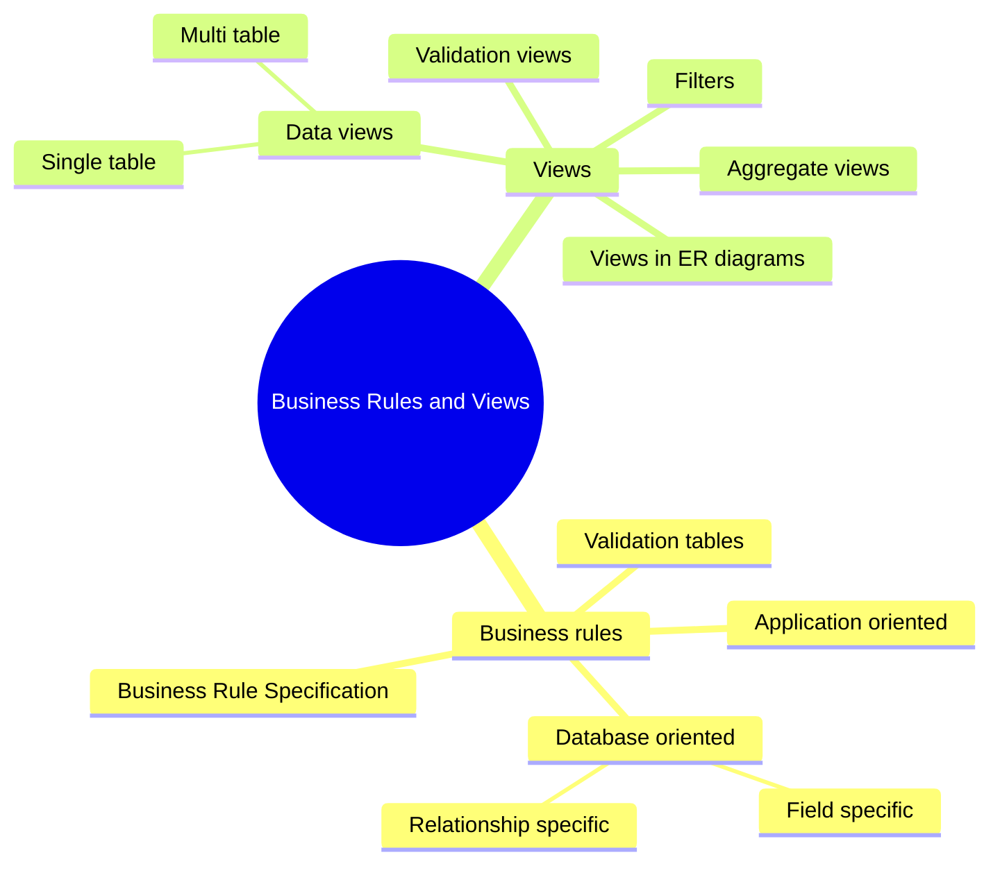
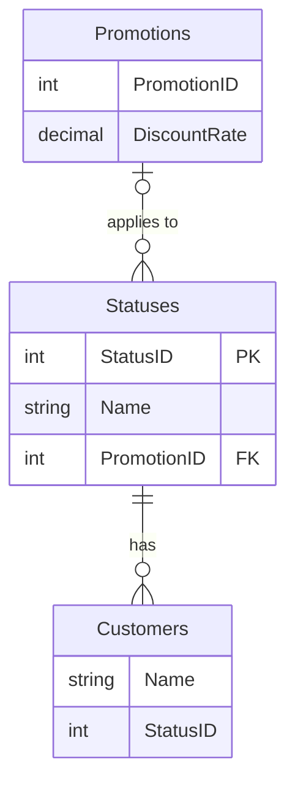
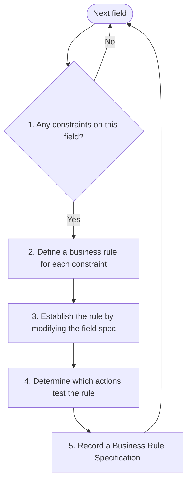
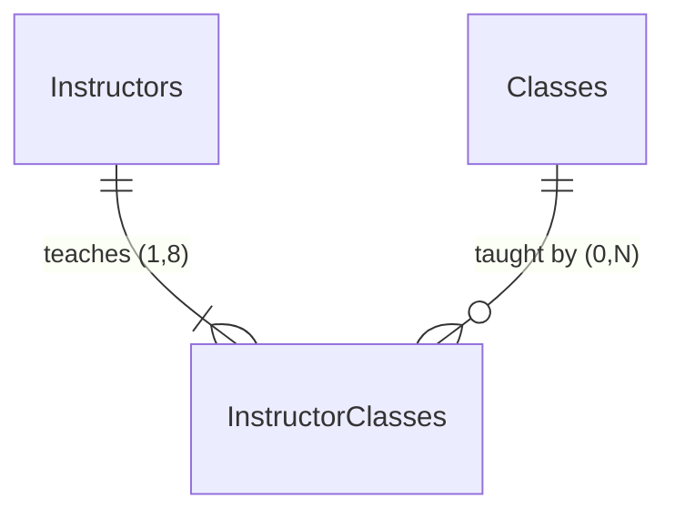
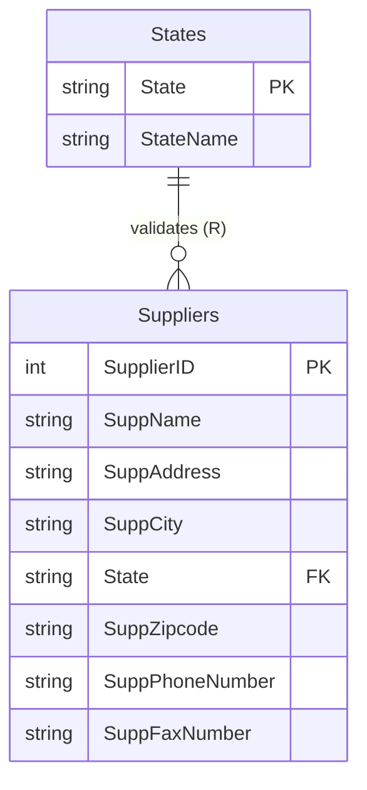
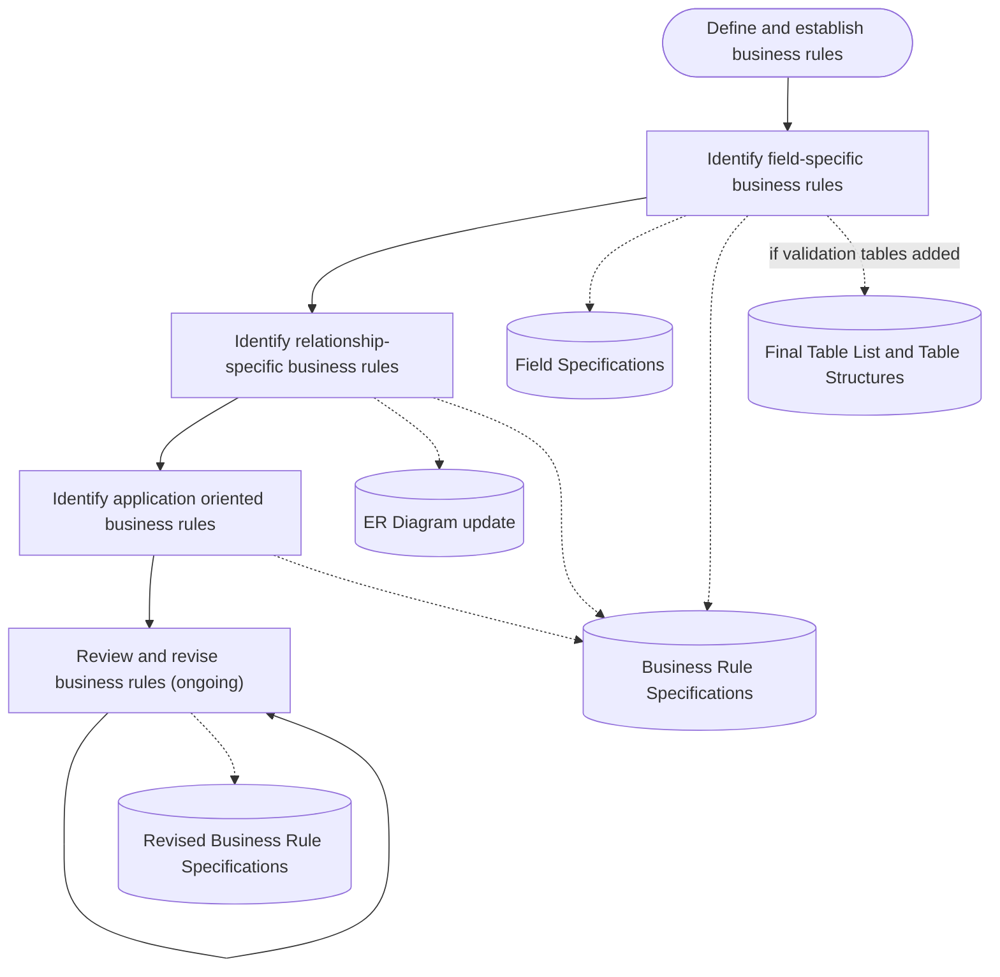
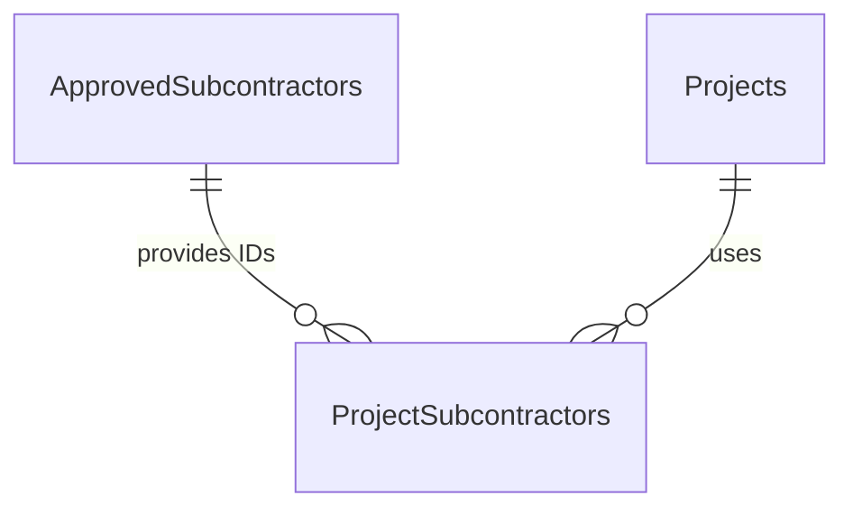
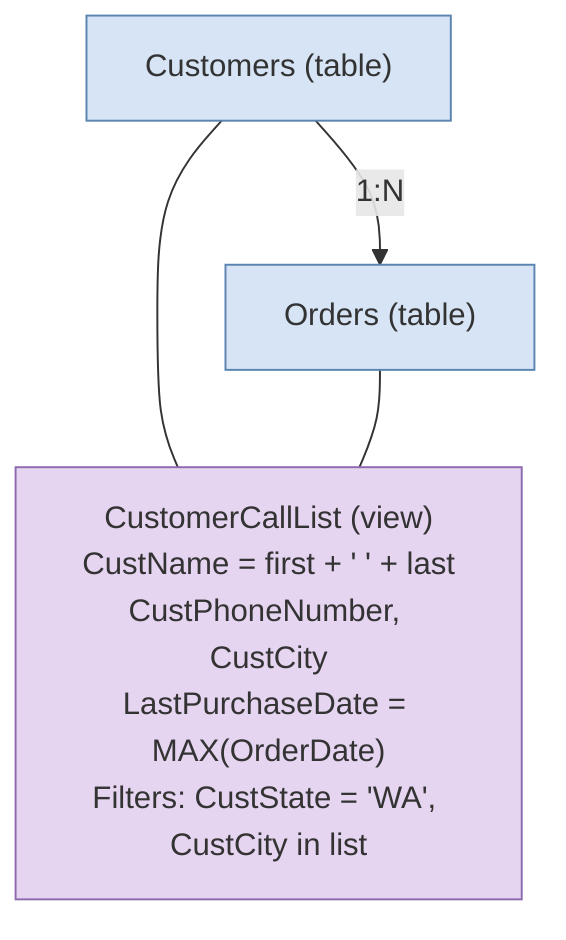
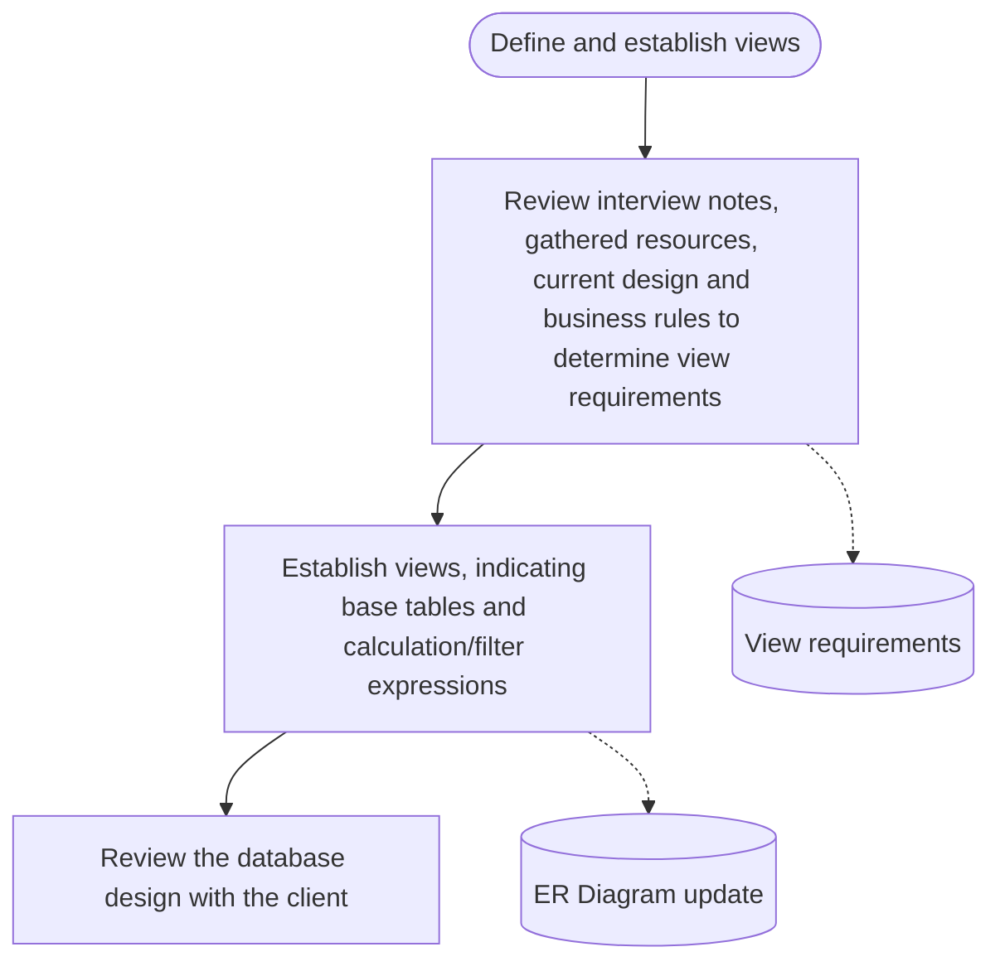

Recommended reading: *Database Design for Mere Mortals*, Chapters 11 and 12.

By the end of this lesson, you should be able to:
- Distinguish between application and database business rules
- Establish and document field and relationship business rules
- Create Business Rule Specifications
- Describe the nature of a View and how it is distinct from a Table
- Distinguish between data, aggregate, and validation views
- Annotate views in an ER diagram

In [[Week 4 - Defining Tables and Fields]] you wrote field specifications, and in [[Week 5 - Establishing Relationships]] you connected the tables and set deletion rules, participation type, and participation degree. This week you go back over those same structures and tighten them so they match the way the organization actually works. That is what **business rules** are for. The second half of the lesson covers **views**, which let you present the data in different shapes without storing it twice.



## Business rules

> [!note] Definition
> A [[Business Rules|business rule]] is a **constraint on some aspect of data**.

Business rules are **unique to each organization**. You find them in the way an organization perceives and uses its data. Two companies can have a Customers table with identical fields and still have completely different rules about what goes in them.

> [!example] Business rule examples from the slides
> - A SHIP DATE cannot be prior to an ORDER DATE for any given order.
> - A student cannot have more than two instruments checked out at the same time.

### Types of business rules

There are two types, and the difference is *where* the rule can be enforced.

| | Database oriented | Application oriented |
|---|---|---|
| Can it be set in the **logical design**? | Yes | No |
| How is it established? | By adjusting field specifications, relationship type/participation/degree, or deletion rules | In the **physical database** or in **application code** |

A **database oriented** business rule can be built into the logical design by adjusting one or more of:
- [[Field Specifications|Field specifications]]
- Relationship type, participation, or degree
- [[Deletion Rules|Deletion rules]]

An **application oriented** business rule *cannot* be established in the logical design. It must be established in the physical database or in application code.

> [!example] Database business rule
> "We conduct business exclusively with vendors from the Pacific Northwest."
>
> You can establish this by restricting the **range of values** in the field specification for the vendor's state.

#### The textbook's application rule, and why the instructor disagrees

The textbook gives this as an application oriented rule: *A customer with a "Preferred" status receives a 15% discount on all purchases.*

The instructor points out that this example isn't great, because the following design could handle it inside the database:



Each customer has a status, and each status can point to a promotion that holds the discount rate. "Preferred" would simply be a status linked to a promotion with a 15% `DiscountRate`.

Better examples of application rules are:
- A student cannot be in two sections of the same class.
- A room cannot have overlapping bookings.

These are difficult (maybe impossible) to enforce using only field and relationship specifications. Checking for an overlap means comparing a new booking against every other booking for the same room, and no field spec or participation degree can express that.

> [!warning] Common mistake
> A rule that *sounds* like application logic (discounts, statuses) can often be modelled with tables and relationships. Before labelling a rule "application oriented", ask whether field specs, relationships, or deletion rules could enforce it.

### Record all rules, establish database rules

> [!important] Key idea
> - **Record** every business rule, both application and database. The list helps with application design as well as database design.
> - **Establish** the database business rules. This course focuses on database design, so that is the part you implement here.

## Field-specific database business rules

**Field-specific** rules impose constraints on the elements of a field specification. How many elements a rule affects depends on the rule.

> [!example] Field-specific rule examples
> | Rule | Elements affected |
> |---|---|
> | Order dates cannot be earlier than May 16, 2018, when our business was formed. | **Range of values** in the OrderDate field of the Orders table |
> | We must be able to store zip codes for both Canadian and American customers. | **Data type**, **length**, and **character support** of the ZipCode field in the Customers table |
>
> The second rule touches three elements at once. Canadian postal codes contain letters (for example `P6A 2G4`), so the field needs alphanumeric character support and a length that fits both formats.

### Defining and establishing field-specific rules

Repeat the following five steps for **each table**:



**1. Review each field for constraints.** Ask: *are there any constraints for any elements of this field?* If yes, go to step 2. If no, start at step 1 on the next field. This will probably require interviewing the client.

**2. Define the business rule.** For each constraint you found, write a concise rule that clearly states it. Examples:
- A county must be associated with each customer.
- The only counties that can be entered into the CustCounty field are King, Kitsap, Pierce, and Snohomish.

**3. Establish the rule by modifying the field specification.** Each field-level rule requires a constraint on one or more elements of the field specification. For the two county rules above, the logical elements of CustCounty become:

| Logical element | Setting |
|---|---|
| Key Type | Non |
| Uniqueness | Non-unique |
| Null Support | **No Nulls** |
| Values Entered By | User |
| Required Value | **Yes** |
| Range of Values | **King, Kitsap, Pierce, Snohomish** |
| Edit Rule | **Enter Now, Edits Allowed** |

The bold settings are the ones the business rules changed.

**4. Determine what actions test each rule.** Ask: *will this rule be violated if I...*
- **Enter** a value into the field?
- **Do NOT enter** a value into the field?
- **Change** the value in the field?
- **Delete** the value from the field?

Note your answers. They go into the Business Rule Specification.

**5. Record a Business Rule Specification.** Write down everything you just worked out (see [[#Business Rule Specifications]] below).

## Relationship-specific database business rules

**Relationship-specific** rules impose constraints on **relationship characteristics**: deletion rule, type of participation, and degree of participation. The number of relationships a rule affects depends on the rule.

> [!example] Relationship-specific rule example
> "Each class must have a minimum of five students, but cannot have more than 20."
>
> This affects the **degree of participation** on the relationship between Students and Classes, which becomes (5,20).

### Defining and establishing relationship-specific rules

The steps mirror the field-specific ones. Repeat them for **each relationship**:

1. **Review the relationship for constraints.** Ask: *are there any limits for any aspect of this relationship?* If yes, go to step 2. If no, start at step 1 on the next relationship. This will probably require interviewing the client.
2. **Define the business rule.** Write a concise rule that clearly states the constraint. Example: *An instructor must teach one class, but no more than eight classes.*
3. **Establish the rule by modifying relationship characteristics.** Each relationship-specific rule requires a constraint on one or more characteristics of the relationship.
4. **Determine what actions test each rule.**
5. **Record a Business Rule Specification.**

> [!example] Establishing the instructor rule
> Instructors and Classes are related many-to-many through the linking table Instructor Classes (Instructor ID and Class ID are each CPK/FK).
>
> Two changes are made on the Instructors to Instructor Classes line:
> - **Type of participation** at the Instructor Classes end changes to mandatory (a hash mark replaces the circle).
> - **Degree of participation** at the Instructor Classes end changes to **(1,8)**.
>
> The other ends stay as they were: (1,1) with a Restrict (R) deletion rule next to Instructors and Classes, and (0,N) on the Classes to Instructor Classes line.



For step 4, the questions change because you are now dealing with whole records instead of field values. Ask: *will this rule be violated if I...*
- **Enter a new record** into one of the tables in the relationship?
- **Do NOT enter a new record** into one of the tables in the relationship?
- **Delete a record** from one of the tables in the relationship?

> [!important] Deletions can break relationship rules
> If your business rule is violated by a deletion, you may need to set a [[Deletion Rules|deletion rule]]. In the instructor example, deleting the only Instructor Classes record for an instructor would leave them teaching zero classes, which breaks the "at least one class" rule. That is why a Restrict deletion rule was added.

## Business Rule Specifications

A [[Business Rule Specification]] is the document where you record a rule and everything you did to establish it.

| Element | Description |
|---|---|
| Statement | The text of the business rule |
| Constraint | A description of how the rule applies in terms of tables and fields |
| Type | Database / Application |
| Category | Field / Relationship |
| Tested on | Insert / Delete / Update |
| Structures affected | Name of the affected field, or names of the affected tables in the relationship |
| Elements / characteristics affected | Which elements of the field, or characteristics of the relationship, are affected |
| Action taken | A description of what changes were made to establish the rule |

The form on the slides groups these into boxes: *Rule Information* (statement, constraint, type, category, test on), *Structures Affected* (field names, table names), *Field Elements Affected* (physical elements: data type, length, character support; logical elements: key type, key structure, uniqueness, null support, values entered by, required value, range of values, edit rule), *Relationship Characteristics Affected* (deletion rule, type of participation, degree of participation), and *Action Taken*.

> [!example] Field-specific specification: CustCounty
> - **Statement:** A county must be associated with each customer.
> - **Constraint:** An entry must be made into the CustCounty field; it cannot be null.
> - **Type:** Database oriented. **Category:** Field specific. **Test on:** Insert, Delete.
> - **Field names:** CUSTCOUNTY. **Table names:** (none)
> - **Field elements affected:** Null Support, Required Value, Edit Rule (all logical)
> - **Relationship characteristics affected:** none
> - **Action taken:** 06/11/20 by Bill C.: Required Value was set to "Yes". Null Support was set to "No Nulls". Edit Rule was set to "Enter Now, Edits Allowed".

> [!example] Relationship-specific specification: instructor teaching load
> - **Statement:** An instructor must teach one class, but no more than eight (8) classes.
> - **Constraint:** The participation of INSTRUCTORS within the relationship is Mandatory. Also, a single record in INSTRUCTORS can be related to only eight (8) records in INSTRUCTOR CLASSES.
> - **Type:** Database oriented. **Category:** Relationship specific. **Test on:** Insert, Delete.
> - **Field names:** (none). **Table names:** INSTRUCTORS, INSTRUCTOR CLASSES
> - **Field elements affected:** none
> - **Relationship characteristics affected:** Deletion Rule, Type of Participation, Degree of Participation
> - **Action taken:** 06/21/20 by Katherine V.: The type of participation for the INSTRUCTOR CLASSES table was changed to Mandatory. The degree of participation for the INSTRUCTOR CLASSES table was changed to (1,8). A new Restrict deletion rule was added to the relationship for the INSTRUCTOR CLASSES table.

> [!tip] Reading the "Test on" boxes
> The test-on answers come straight from step 4. The county rule is tested on Insert (you could add a customer with no county) and Delete (you could erase the county). The instructor rule is tested on Insert and Delete for the same reasons at the record level.

## Validation tables

In some field specs, the range of values is a **limited set** of valid values (like the four counties above). If that set becomes too large, consider using a validation table.

> [!note] Definition
> A [[Validation Tables|validation table]] stores data used specifically to ensure that valid data is entered in some other table(s).
> - It helps implement [[Data Integrity|data integrity]].
> - It is also known as a **lookup table** or **category table**.

Validation tables usually contain only a [[Primary Key|primary key]] and a name/label, but they may contain more columns.

> [!example] Two validation tables
> **Categories**
> | Category ID (PK) | Category |
> |---|---|
> | 60001 | Architects |
> | 60002 | General Contractors |
> | 60003 | Attorneys |
> | 60004 | Computer Consultants |
>
> **States**
> | State (PK) | State Name |
> |---|---|
> | AL | Alabama |
> | AK | Alaska |
> | AR | Arkansas |
> | CA | California |
>
> In each, the first column is the primary key field and the second is the non-key field.

### Validation table example: Suppliers and States

The Suppliers table has Supplier ID (PK), SuppName, SuppAddress, SuppCity, SuppState, SuppZipcode, SuppPhone Number, and SuppFax Number. The business rule is:

*Any supplier we use must be based in one of the 11 contiguous western states, Alaska, or Hawaii.*

That is 13 valid values. Typing them all into the range of values would work, but this is a good scenario for a validation table.

**1. Create a new validation table.** Create States with State (PK) and State Name. In the book's ER diagrams, a validation table is drawn with curved left and right sides so it stands out from ordinary tables.

> [!warning] Don't forget
> Update the **Final Table List** and add new **Field Specifications** for the new table.

**2. Establish the relationship.** States becomes the parent of Suppliers. SuppState is renamed to State and becomes a [[Foreign Key|foreign key]], so its field spec must be updated.



The States end is (1,1) with a Restrict deletion rule; the Suppliers end is (0,N).

**3. Establish the business rule.** Update any necessary field or relationship characteristics, and create or update the Business Rule Specification.

> [!example] Validation table specification
> - **Statement:** Any supplier we use must be based in one of the eleven contiguous western states, Alaska, or Hawaii.
> - **Constraint:** Entries for the State field in the SUPPLIERS table are limited to existing values of the State field in the STATES table.
> - **Type:** Database oriented. **Category:** Field specific. **Test on:** Insert, Update.
> - **Field names:** STATE. **Table names:** SUPPLIERS, STATES
> - **Field elements affected:** Range of Values
> - **Relationship characteristics affected:** Deletion Rule, Type of Participation, Degree of Participation
> - **Action taken:** 07/01/20 by M. Jordan: The Range of Values was set to "Any value within the State field of the STATES table." The type of participation for each table was changed: STATES is Mandatory, SUPPLIERS is Optional. The degree of participation for each table was changed: SUPPLIERS is (0,N), STATES is (1,1). A Restrict deletion rule was defined for the relationship between SUPPLIERS and STATES.

> [!tip] Why this works
> The FK can only hold values that already exist in the States PK. To allow a new state, you add a row to States. You never have to touch the Suppliers field spec again.

## Reviewing business rules

- Business rules often **change over time**.
- It is important to document these changes in the Business Rule Specifications.
- Business rules help form a complete picture of application constraints.

## Process diagram: business rules



## Views

> [!note] Definition
> A [[Views|view]] is a **stored query** that involves fields from other tables or views.
> - It does not store data, only the query structure.
> - The [[RDBMS]] recreates the view every time it is read from.

> [!note] Materialized views
> Some RDBMSs support **materialized views**, which do cache the query results. See [PostgreSQL: Materialized Views](https://www.postgresql.org/docs/current/rules-materializedviews.html).

Think of a view as a saved question. The tables hold the answers; the view holds the question and asks it again each time you open it, so the result is always current.

### Why use views?

- To view data from multiple tables at the same time. Views are often the basis for reports.
- They can be customized to fit the needs of specific individuals or groups.
- They can implement data integrity (a **validation view**).
- They can implement security and confidentiality measures, by showing some users only the columns or rows they are allowed to see.

### Kinds of views

There are three kinds: **data**, **aggregate**, and **validation**.

### Data views

- **Single-table** data views are made of fields from a single table.
- **Multi-table** data views are made of fields from multiple tables.

> [!example] Single-table data view: Employee Phone List
> Base table **Employees**: Employee ID (PK), EmpFirst Name, EmpLast Name, EmpStreet Address, EmpCity, EmpState, EmpZipcode, EmpHome Phone.
>
> View **Employee Phone List**: Employee ID, EmpFirst Name, EmpLast Name, EmpPhone Number.
>
> The view shows only what someone needs to phone an employee. The address fields stay hidden.

> [!example] Multi-table data view: Class Roster
> Base tables: **Students** (Student ID PK, name, address, phone, email), **Students Classes** (linking table: Student ID and Class ID, both CPK/FK), and **Classes** (Class ID PK, Class Name, Class Description, Instructor ID FK, Category).
>
> View **Class Roster**: Class Name, StudFirst Name, StudLast Name.
>
> The class name comes from Classes, the student names come from Students, and Students Classes connects them.

### Views vs tables

Because views are not tables and do not store data:

| Rule for tables | Views |
|---|---|
| Avoid repeating fields (redundancy) | **May repeat fields** that already exist in other tables or views, with no data redundancy concern |
| Every table needs a primary key | **Do not require a primary key** |
| No calculated fields in tables | (Aggregated) views **may include calculated fields** |

> [!warning] Common misconception
> A view that repeats CustPhoneNumber is not a [[Normalization|normalization]] problem. Nothing is stored twice; the view reads the one copy in the base table every time.

### Aggregated views

An **aggregated view** incorporates calculated fields that involve an aggregation (a count, sum, maximum, and so on). It will ultimately be implemented using a `GROUP BY` query.

> [!example] Aggregated view: Class Registration
> Base tables: **Classes** and **Students Classes**.
>
> View **Class Registration**: Class Name, **Total Students Registered** (a calculated field).

The slides stay at the design level, but here is roughly what the query behind that view would look like in [[SQL]]:

```sql
CREATE VIEW ClassRegistration AS
SELECT c.ClassName,
       COUNT(sc.StudentID) AS TotalStudentsRegistered
FROM Classes c
LEFT JOIN StudentsClasses sc ON sc.ClassID = c.ClassID
GROUP BY c.ClassName;
```

More on `GROUP BY`: [W3Schools SQL GROUP BY](https://www.w3schools.com/sql/sql_groupby.asp).

### Validation views

A **validation view** has a similar purpose to a validation table: it helps implement data integrity by setting a specific range of values. It usually involves a single-table view.

> [!example] Validation view: Approved Subcontractors
> **Subcontractors** (Subcontractor ID PK, SCName, SCStreet Address, SCCity, SCState, SCZipcode, SCPhone Number, SCEmail) provides the range of values for the Subcontractor ID field in the linking table **Project Subcontractors** (Subcontractor ID and Project ID, both CPK/FK), which links to **Projects** (Project ID PK, Project Name, Project Start Date, Project End Date, Category ID FK).
>
> Suppose the other data displayed needs to be restricted. A validation view called **Approved Subcontractors** (Subcontractor ID PK, SCName, SCPhone Number, SCEmail) replaces Subcontractors as the source of values. Project Subcontractors still gets the same range of Subcontractor IDs, but users only see the name, phone, and email.



### View filters

Some views need **filtering**. For example, a Customer Call List for all customers from Washington. All filter expressions should be clearly indicated in the view diagram.

In many applications you will want the user to **choose** the filter criteria **at run-time**, such as letting the user filter the Customer Call List by state. That is an **application-level** concern, typically handled in application code or with a [[Stored Procedures|stored procedure]].

> [!tip] Fixed filter vs run-time filter
> A filter that never changes (always Washington) belongs in the view design. A filter the user picks each time (whichever state they choose) belongs in the application.

### View specifications

The textbook says each view must be accompanied by a view specification. The instructor crossed this out: in this course, **just incorporate view information into your ER diagram**.

## Views in ER diagrams

Views should be documented in ER diagrams, and it helps to make them visually distinct from tables. Each view should indicate:
- Its **base tables**
- Any **calculated field expressions**
- Any **filter expressions**

> [!example] CustomerCallList in an ER diagram
> - **Customers**: CustomerId (PK), CustFirstName, CustLastName, CustStreetAddress, CustCity, CustState, CustZipcode, CustPhoneNumber, Stats
> - **Orders**: OrderNumber (PK), CustomerId (FK1), OrderDate, ShipDate, EmployeeId (FK2)
> - Customers to Orders is one-to-many.
>
> The view **CustomerCallList** is drawn in a different colour (purple, while the tables are blue). Plain lines join it to Customers and Orders. Its contents:
> ```
> CustName = CustomerFirstName + " " + CustomerLastName
> CustPhoneNumber
> CustCity
> LastPurchaseDate = MAX(OrderDate)
>
> Filters:
> - CustState = "WA"
> - CustCity in ("Bellevue", "Olympia", "Redmond", "Seattle", "Spokane", "Tacoma")
> ```

The slides highlight four things in this diagram:
1. The view is **visually distinct** from tables.
2. Base tables are connected with **NON-relationship lines** (plain lines with no crow's feet or hash marks, since a view isn't a relationship).
3. The **calculation** for each calculated field is written out (CustName, LastPurchaseDate).
4. **All filter expressions** are listed.



An SQL version of the same view could look like this (string concatenation syntax varies between RDBMSs):

```sql
CREATE VIEW CustomerCallList AS
SELECT CONCAT(c.CustFirstName, ' ', c.CustLastName) AS CustName,
       c.CustPhoneNumber,
       c.CustCity,
       MAX(o.OrderDate) AS LastPurchaseDate
FROM Customers c
JOIN Orders o ON o.CustomerId = c.CustomerId
WHERE c.CustState = 'WA'
  AND c.CustCity IN ('Bellevue', 'Olympia', 'Redmond', 'Seattle', 'Spokane', 'Tacoma')
GROUP BY c.CustomerId, c.CustFirstName, c.CustLastName, c.CustPhoneNumber, c.CustCity;
```

Because LastPurchaseDate uses `MAX`, this view is also an aggregated view. See [W3Schools SQL CREATE VIEW](https://www.w3schools.com/sql/sql_view.asp) or [PostgreSQL CREATE VIEW](https://www.postgresql.org/docs/current/sql-createview.html).

## Determining views

When deciding which views are required, consider:

| Source | What it may reveal |
|---|---|
| Interview / discussion notes | Data views may be mentioned directly |
| Data entry / report samples | Often reveal important data views |
| Tables / subjects | The need for restricted views |
| Relationships | The need for multi-table views |
| Business rules | The need for validation views |

## Process diagram: views



## Summary

- Business rules document the limitations and requirements of data.
- Business rules may be implemented at a database level (field specs, relationship characteristics, deletion rules) or an application level (physical database or application code).
- Field-specific and relationship-specific rules follow the same five steps: review, define, establish, determine test actions, record a Business Rule Specification.
- Validation tables (lookup/category tables) may help implement data integrity when the list of valid values is large.
- Views are stored queries that can consolidate data from many tables. They store no data, need no primary key, and can repeat fields.
- Views can be the basis of certain screens and reports in the application, and they can help enforce data security and confidentiality.
- Views may include calculated and duplicate fields. Aggregated views use `GROUP BY`.
- In the ER diagram, draw views so they look different from tables, connect them to base tables with non-relationship lines, and list every calculation and filter.

See also [[Week 4 - Defining Tables and Fields]] for field specification elements and [[Week 5 - Establishing Relationships]] for participation and deletion rules.

Further reading:
- [W3Schools SQL CHECK constraint](https://www.w3schools.com/sql/sql_check.asp) (one way a range-of-values rule ends up in the physical database)
- [MySQL: Using Views](https://dev.mysql.com/doc/refman/8.0/en/views.html)
- [GeeksforGeeks: SQL Views](https://www.geeksforgeeks.org/sql-views/)

## Exercises

### Exercise 1 (Direct application)
Classify each rule as database oriented or application oriented. For database rules, say whether it is field specific or relationship specific.
a) A product's price cannot be negative.
b) A customer may place at most 10 open orders.
c) A doctor cannot have two appointments that overlap in time.
d) Every employee must belong to exactly one department.

> [!success]- Answer key
> a) **Database, field specific.** Set the range of values for the Price field to values of 0 or more.
>
> b) **Database, relationship specific.** It limits how many Orders records one Customers record can relate to. The participation degree at the Orders end becomes (0,10). (Strictly, "open" orders adds a condition that a degree alone can't see, so you could argue part of it belongs in the application. Recording that reasoning in the specification is part of the job.)
>
> c) **Application.** Like the "room cannot have overlapping bookings" example, detecting an overlap means comparing each new appointment against the others. Field specs and relationship characteristics can't express that.
>
> d) **Database, relationship specific.** Departments' participation is mandatory, and the degree at the Departments end is (1,1).

### Exercise 2 (Direct application)
For the rule "Every student must have an email address, and it must be unique", list the field elements of StudEmail that change and the actions that test the rule.

> [!success]- Answer key
> **Elements:** Null Support = No Nulls, Required Value = Yes, Uniqueness = Unique. Edit Rule would likely be "Enter Now, Edits Allowed" (the email must be there when the record is created, but students can change it).
>
> **Tested on:**
> - *Do NOT enter* a value (Insert): leaving it blank violates the rule.
> - *Enter* a value (Insert): entering an email that another student already has violates uniqueness.
> - *Change* the value (Update): changing it to an existing email violates uniqueness.
> - *Delete* the value (Delete): erasing it leaves the field null.
>
> So the specification's Test on boxes are Insert, Update, and Delete.

### Exercise 3 (Direct application)
A view called *Product Price List* shows ProductName, Category, and Price from a single Products table. Which kind of view is it? Does it need a primary key? Is repeating the Price field a redundancy problem?

> [!success]- Answer key
> It is a **single-table data view**. It does **not** need a primary key; views are exempt. Repeating Price is **not** a redundancy problem because views don't store data. The RDBMS reads Price from Products every time the view is opened.

### Exercise 4 (Applied variation)
A gym's Members table has a MembershipType field. Right now the allowed values are Basic, Premium, and Student, but management adds new plans every few months. What should you do, and what documents change? Write the Business Rule Specification's Statement, Constraint, Type, Category, and Test on.

> [!success]- Answer key
> The list keeps growing, so create a **validation table**, MembershipTypes, with MembershipType (PK) and a description column. MembershipType in Members becomes an FK to it. New plans become new rows; the Members field spec doesn't change again.
>
> **Documents:** add MembershipTypes to the Final Table List and Table Structures, write field specs for its fields, update the MembershipType field spec in Members (now an FK, range of values = any value in MembershipTypes), and update the ER diagram (MembershipTypes (1,1) with Restrict, Members (0,N)).
>
> **Specification:**
> - Statement: Each member must have one of the membership types the gym offers.
> - Constraint: Entries for MembershipType in MEMBERS are limited to existing values of MembershipType in MEMBERSHIPTYPES.
> - Type: Database oriented. Category: Field specific. Test on: Insert, Update. (Same pattern as the Suppliers/States example.)

### Exercise 5 (Applied variation)
Design (in ER diagram terms) an aggregated view called *Instructor Load* that lists each instructor's full name and how many classes they teach. Use the Instructors, Instructor Classes, and Classes tables from the lesson. List the base tables, calculated fields with their expressions, and any filters.

> [!success]- Answer key
> - **Base tables:** Instructors and Instructor Classes. (Classes isn't strictly needed to count classes, since each Instructor Classes row is one class. Include it only if you also want class details.)
> - **Fields:**
>   - InstructorName = InstFirst Name + " " + InstLast Name
>   - TotalClasses = COUNT(Class ID)
> - **Filters:** none.
> - Draw it in a different colour or shape from the tables, joined to its base tables with plain lines (no relationship symbols).
>
> It is an aggregated view because TotalClasses uses COUNT, so it would be implemented with `GROUP BY` on the instructor.

### Exercise 6 (Applied variation)
A Patients table contains name, phone number, address, diagnosis, and insurance number. Reception staff should only see names and phone numbers. Which reason for using views does this match, and what would you design?

> [!success]- Answer key
> This is the **security/confidentiality** reason (and also "customized to fit the needs of specific groups"). Design a single-table data view, for example *Patient Contact List*, with PatientID, name fields, and phone number. Reception staff get access to the view and not to the Patients table, so diagnosis, address, and insurance data stay hidden.

### Exercise 7 (Challenge)
A conference centre has Rooms and Bookings (Rooms 1:N Bookings). The client states three rules:
1. Each room has a capacity between 10 and 500 people.
2. A room cannot be deleted while it still has bookings.
3. A room cannot be booked twice for the same time.

For each, give the type, category (if database), what you would change, and the "Test on" actions.

> [!success]- Answer key
> **Rule 1:** Database, field specific. Range of values on Capacity is 10 to 500. Test on Insert (entering a value outside the range, or leaving it blank if it's required) and Update (changing to a value outside the range).
>
> **Rule 2:** Database, relationship specific. Set a **Restrict** deletion rule on the Rooms to Bookings relationship. Test on Delete. This is the "IMPORTANT" case from the slides: a rule violated by a deletion needs a deletion rule.
>
> **Rule 3:** **Application oriented.** It is the slide's "a room cannot have overlapping bookings" example. You still *record* it in a Business Rule Specification (Type: Application oriented) so the developers know to enforce it in the physical database or application code, but you can't establish it in the logical design.

### Exercise 8 (Challenge)
The sales manager wants a screen showing, for every customer in Ontario, their full name, phone number, total number of orders, and the date of their first order. A second screen should let a salesperson pick any province and see the same list. Using Customers (CustomerId, CustFirstName, CustLastName, CustProvince, CustPhoneNumber) and Orders (OrderNumber, CustomerId, OrderDate), describe the view as it would appear in the ER diagram, and explain how the second screen should be handled.

> [!success]- Answer key
> **View: OntarioCustomerSummary** (drawn visually distinct, plain lines to Customers and Orders)
> - CustName = CustFirstName + " " + CustLastName
> - CustPhoneNumber
> - TotalOrders = COUNT(OrderNumber)
> - FirstOrderDate = MIN(OrderDate)
> - Filters: CustProvince = "ON"
>
> It's a multi-table view and also an aggregated view (COUNT and MIN), so it would use `GROUP BY` on the customer.
>
> **Second screen:** the user chooses the province at run-time. That is an **application-level** concern, handled in application code or a stored procedure (for example, one that takes the province as a parameter). You don't create one view per province, and you don't put a run-time choice in the ER diagram.

## Feynman practice

Write the answers in your own words. Don't look at the note while writing step 1.

### Feynman: Database vs application business rules

- [ ] **1. Explain it as if to a 12-year-old.** Your school has rules like "every student has a homeroom" and "nobody can be in two places at once". Which of those could a well-designed form enforce just by how its boxes are set up, and which needs someone to check every time? How is that like database and application rules?
- [ ] **2. Find the gaps.** Reread what you wrote. Mark with `[?]` any word a 12-year-old wouldn't understand (for example "constraint", "logical design", "physical database").
- [ ] **3. Go back to the source and simplify.** For each `[?]`, write an analogy or example. Why does the instructor say the "Preferred customer discount" is a weak example of an application rule?
- [ ] **4. Organize and test.** Rewrite the explanation in 3 to 5 sentences. Could you sort a new rule into the right type in under a minute?

### Feynman: The five steps and the Business Rule Specification

- [ ] **1. Explain it as if to a 12-year-old.** Pretend you're making the rules for a library card form. Walk through the five steps for the "phone number" box, from asking whether it has limits to writing down what you changed.
- [ ] **2. Find the gaps.** Mark with `[?]` terms like "field specification", "range of values", "test on", "action taken".
- [ ] **3. Go back to the source and simplify.** For each `[?]`, use the CustCounty example. Why is that rule tested on Insert and Delete but not Update? How do the step 4 questions change for a relationship rule?
- [ ] **4. Organize and test.** Rewrite in 3 to 5 sentences. Could someone fill in a specification using only your explanation?

### Feynman: Validation tables

- [ ] **1. Explain it as if to a 12-year-old.** A sign-up form has a drop-down list of countries. Where does that list come from, and why is it easier to keep it in its own table than to type it into every form?
- [ ] **2. Find the gaps.** Mark with `[?]` terms like "lookup table", "foreign key", "data integrity".
- [ ] **3. Go back to the source and simplify.** For each `[?]`, use the Suppliers and States example. Which documents had to be updated when States was added, and why did SuppState become an FK?
- [ ] **4. Organize and test.** Rewrite in 3 to 5 sentences. When would you *not* bother with a validation table?

### Feynman: What a view is

- [ ] **1. Explain it as if to a 12-year-old.** Compare a photo of a whiteboard with a window looking at the whiteboard. Which one is a table and which one is a view? What happens when someone writes something new on the board?
- [ ] **2. Find the gaps.** Mark with `[?]` terms like "stored query", "base table", "materialized view", "redundancy".
- [ ] **3. Go back to the source and simplify.** For each `[?]`, give an example. Why can a view repeat fields and skip the primary key when a table can't?
- [ ] **4. Organize and test.** Rewrite in 3 to 5 sentences, including at least two reasons to use views.

### Feynman: Kinds of views and drawing them

- [ ] **1. Explain it as if to a 12-year-old.** Describe the Employee Phone List, the Class Registration count, and the Approved Subcontractors list. What makes each one a different kind of view?
- [ ] **2. Find the gaps.** Mark with `[?]` terms like "aggregate", "calculated field", "filter expression", "non-relationship line".
- [ ] **3. Go back to the source and simplify.** For each `[?]`, use the CustomerCallList diagram. Why are its lines plain instead of crow's feet? Why does a run-time filter not go in the diagram?
- [ ] **4. Organize and test.** Rewrite in 3 to 5 sentences. Could you draw CustomerCallList from memory with all four required parts?

## Flashcards

Copy the block below into a `.txt` file and import it into Anki (File > Import), mapping column 1 to Front, column 2 to Back, and column 3 to Tags.

```
#separator:tab
#html:false
#tags column:3
What is a business rule?	A constraint on some aspect of data.	csd216 week-06
Why are business rules unique to each organization?	They come from the way an organization perceives and uses its data.	csd216 week-06
What three things can you adjust to establish a database oriented business rule?	Field specifications; relationship type/participation/degree; deletion rules.	csd216 week-06
Where must an application oriented business rule be established?	In the physical database or in application code (not the logical design).	csd216 week-06
Why is "Preferred customers get a 15% discount" a weak example of an application rule?	It can be modelled in the database with Customers, Statuses, and Promotions (DiscountRate) tables.	csd216 week-06
Give an example of a true application oriented business rule from the lesson.	A room cannot have overlapping bookings (or: a student cannot be in two sections of the same class).	csd216 week-06
Which business rules should you record, and which does this course establish?	Record all rules (application and database); establish the database rules.	csd216 week-06
What do field-specific business rules constrain?	Elements of field specifications.	csd216 week-06
Which field elements does "store zip codes for Canadian and American customers" affect?	Data type, length, and character support of ZipCode.	csd216 week-06
Which field element does "order dates cannot be earlier than May 16, 2018" affect?	Range of values of OrderDate.	csd216 week-06
What question starts step 1 of defining field-specific rules?	Are there any constraints for any elements of this field?	csd216 week-06
What will reviewing fields and relationships for constraints probably require?	Interviewing the client.	csd216 week-06
For a field rule, what four actions do you check to see if the rule is violated?	Entering a value, not entering a value, changing the value, deleting the value.	csd216 week-06
What do relationship-specific business rules constrain?	Relationship characteristics: deletion rule, type of participation, degree of participation.	csd216 week-06
Which characteristic does "each class has 5 to 20 students" affect?	Degree of participation between Students and Classes.	csd216 week-06
For a relationship rule, what three actions do you check?	Entering a new record, not entering a new record, deleting a record in one of the related tables.	csd216 week-06
If a relationship business rule is violated by a deletion, what may you need?	A deletion rule.	csd216 week-06
What participation degree establishes "an instructor must teach one class but no more than eight"?	(1,8) at the Instructor Classes end, with mandatory participation.	csd216 week-06
Name the eight elements of a Business Rule Specification.	Statement, constraint, type, category, tested on, structures affected, elements/characteristics affected, action taken.	csd216 week-06
In a Business Rule Specification, what are the two possible values of Type?	Database or Application.	csd216 week-06
In a Business Rule Specification, what are the two possible values of Category?	Field or Relationship.	csd216 week-06
What does the Action Taken section of a Business Rule Specification record?	What changes were made to establish the rule (with date and author).	csd216 week-06
What is a validation table?	A table that stores data used specifically to ensure valid data is entered in other table(s).	csd216 week-06
What are two other names for a validation table?	Lookup table and category table.	csd216 week-06
When should you consider a validation table instead of listing values in the range of values?	When the limited set of valid values becomes too large.	csd216 week-06
What columns does a validation table usually contain?	A primary key and a name/label (it may contain more).	csd216 week-06
After creating a validation table, which documents must you update?	The Final Table List and new Field Specifications (plus the FK's field spec and the ER diagram).	csd216 week-06
In the Suppliers/States example, what happens to the supplier's state field?	It becomes a foreign key referencing States, limited to existing State values.	csd216 week-06
Why should business rules be reviewed over time?	They often change, and changes must be documented in the Business Rule Specifications.	csd216 week-06
What is a view?	A stored query that involves fields from other tables or views.	csd216 week-06
Does a view store data?	No, only the query structure; the RDBMS recreates it each time it is read (except materialized views).	csd216 week-06
What is a materialized view?	A view whose query results are cached, supported by some RDBMSs.	csd216 week-06
Name four reasons to use views.	See data from multiple tables (reports); customize for individuals/groups; implement data integrity; implement security/confidentiality.	csd216 week-06
What are the three kinds of views?	Data, aggregate, and validation views.	csd216 week-06
What is the difference between single-table and multi-table data views?	Single-table views use fields from one table; multi-table views use fields from several.	csd216 week-06
Why can views repeat fields without causing redundancy?	They don't store data.	csd216 week-06
Does a view require a primary key?	No.	csd216 week-06
What is an aggregated view?	A view with calculated fields that involve an aggregation, implemented with GROUP BY.	csd216 week-06
What is a validation view?	A view (usually single-table) that helps implement data integrity by setting a specific range of values.	csd216 week-06
In the subcontractor example, what does the Approved Subcontractors validation view achieve?	Same range of Subcontractor IDs, but restricts the other data displayed.	csd216 week-06
Where should a fixed view filter (e.g. only Washington customers) be documented?	In the view in the ER diagram.	csd216 week-06
How is a filter the user chooses at run-time handled?	As an application-level concern, in application code or a stored procedure.	csd216 week-06
In this course, where does view information go instead of a separate view specification?	Into the ER diagram.	csd216 week-06
What three things should each view show in an ER diagram?	Base tables, calculated field expressions, and filter expressions.	csd216 week-06
How are a view's base tables connected to it in an ER diagram?	With non-relationship lines (plain lines).	csd216 week-06
Which source may reveal the need for validation views?	Business rules.	csd216 week-06
Which source may reveal the need for multi-table views?	Relationships.	csd216 week-06
Which sources often reveal important data views?	Data entry and report samples (and interview notes).	csd216 week-06
What is the last step of the views process diagram?	Review the database design with the client.	csd216 week-06
```

## Tags

#databases #database_design #business_rules #field_specifications #relationships #validation_tables #data_integrity #views #aggregate_views #ERD #sql #CSD216
