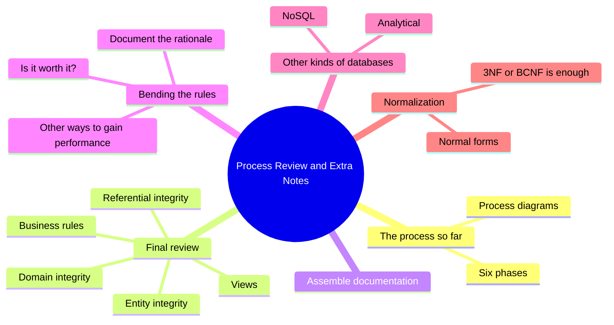
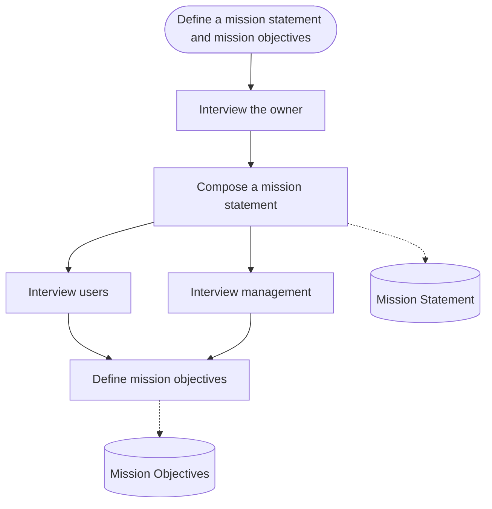
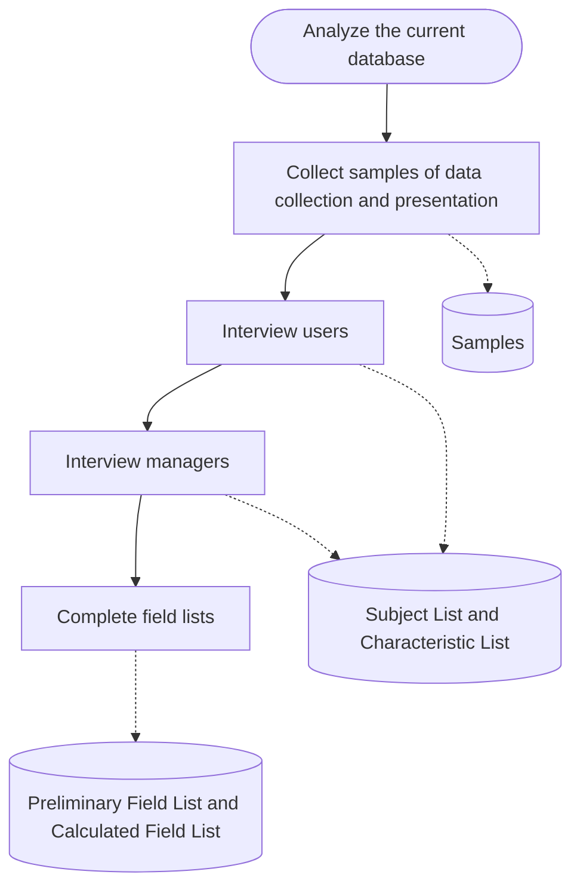
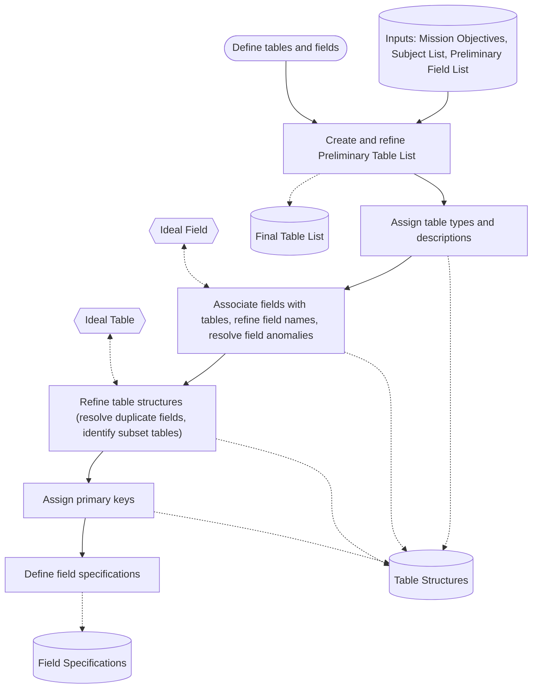
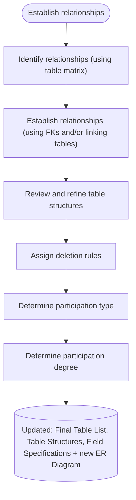
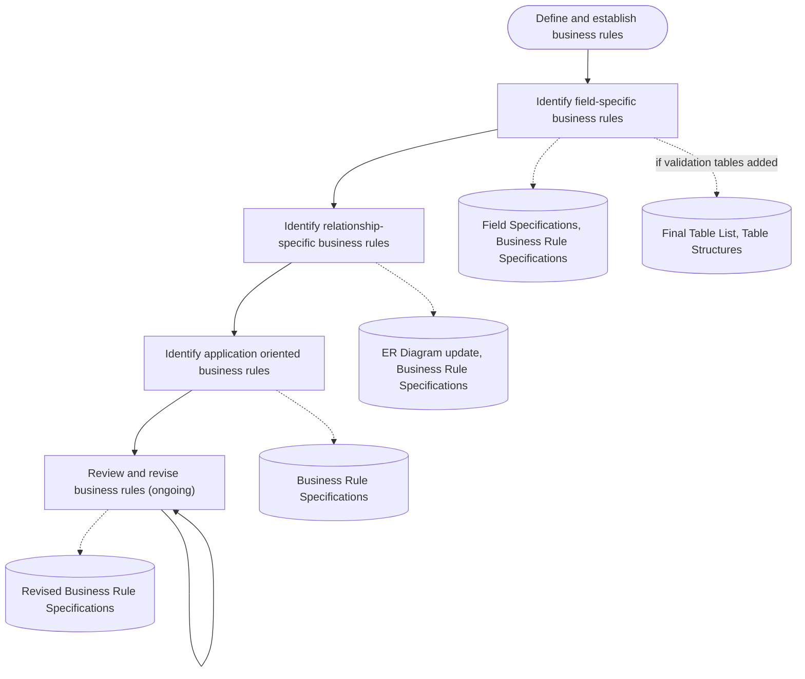
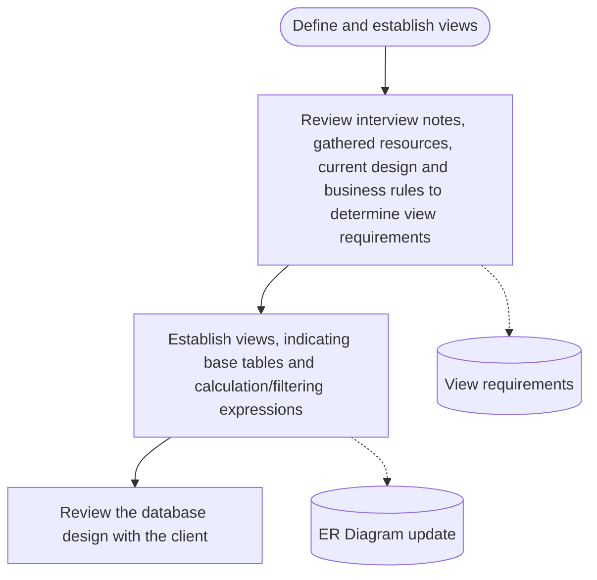
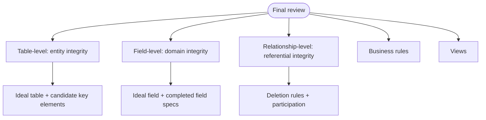
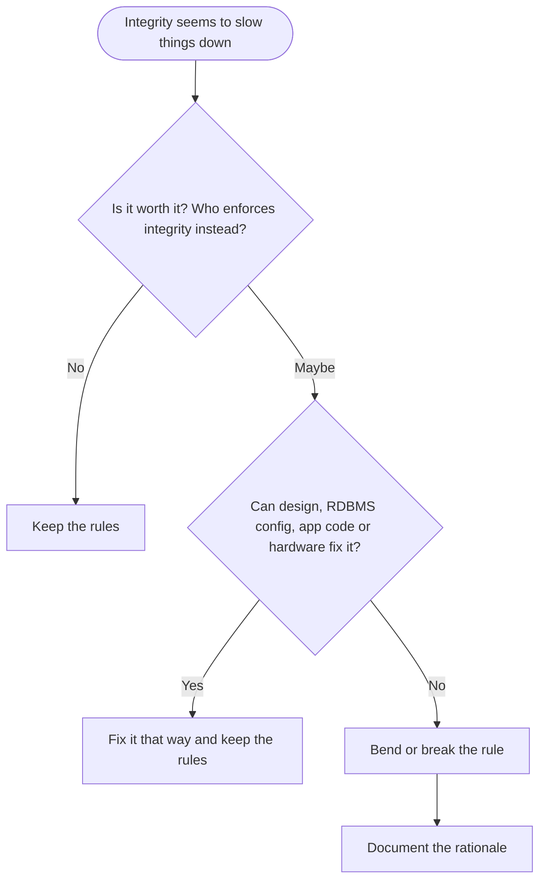
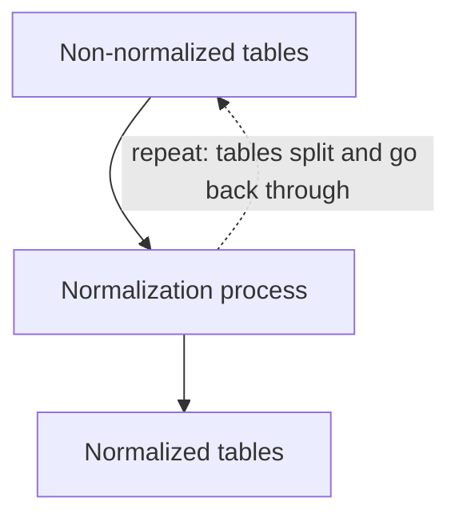

This lecture has no new design step. It walks back through the whole [[Database Design|database design process]] from [[Week 2 - The Database Mission]] to [[Week 6 - Business Rules and Views]], adds a final review and a documentation checklist, and then covers four extra topics:
- when (if ever) to bend the integrity rules
- [[NoSQL]] databases
- [[Analytical Databases|analytical databases]]
- [[Normalization]] and [[Normal Forms|normal forms]]



## The process so far

After working through the design process with your client, you have a database design. It came from six phases:

1. Define the database mission statement and objectives
2. Analyze the current database
3. Define tables and fields
4. Establish relationships
5. Establish business rules
6. Establish views


The slides give one process diagram per phase. In each diagram, the green box is the phase, the trapezoids are the steps in order, and the wavy blue boxes are the **documents** the steps produce. Those documents matter: at the end of the process you hand them over as the full description of the design (see [[#Assemble documentation]]).

### Phase 1: Mission statement and objectives

See [[Week 2 - The Database Mission]].



The owner interview comes first and produces the [[Mission Statement|mission statement]]. Users and management can then be interviewed side by side, and both sets of interviews feed the [[Mission Objectives|mission objectives]].

### Phase 2: Analyze the current database

See [[Week 3 - Analyzing Existing Databases]].



The slide groups all four steps under one bracket that points at the outputs: **Samples**, the **Subject List**, the **Characteristic List**, the **Preliminary Field List**, and the **Calculated Field List**.

### Phase 3: Define tables and fields

See [[Week 4 - Defining Tables and Fields]].



Phase 3 is the first phase that **takes inputs** from earlier phases: the mission objectives, the subject list, and the preliminary field list. The two cloud shapes on the slide, **Ideal Field** and **Ideal Table**, are the checklists you compare your work against while fixing fields and table structures. They come back in the final review.

### Phase 4: Establish relationships

See [[Week 5 - Establishing Relationships]].



This phase updates the documents from phase 3 (new [[Foreign Key|foreign keys]] and [[Linking Tables|linking tables]] change the table list, structures, and field specs) and produces the [[Entity-Relationship Model|ER diagram]].

### Phase 5: Business rules

See [[Week 6 - Business Rules and Views]].



The loop on the last step means business rule review never really ends; rules change as the organization changes.

### Phase 6: Views



> [!tip] A pattern across all six diagrams
> Almost every phase involves talking to people (owner, users, management, client) and almost every phase updates a document from an earlier phase. Design is not a straight line where each step is finished and forgotten. Later phases keep refining the table structures, field specs, and ER diagram.

## Final review: "You're almost done!"

Before you call the design finished, do one last review to make sure the design is **sound**. Check five things:

1. Table-level ([[Entity Integrity|entity]]) integrity
2. Field-level ([[Domain Integrity|domain]]) integrity
3. Relationship-level ([[Referential Integrity|referential]]) integrity
4. [[Business Rules|Business rules]]
5. [[Views]]



### Table-level (entity) integrity

- [ ] Each table meets the requirements of the **ideal table**.
- [ ] Every record in the table is identified by a [[Primary Key|primary key]] value.
- [ ] Each primary key conforms to the elements of a primary key (listed below as the elements of a candidate key).

> [!note] The ideal table
> - Represents a **single subject** (an object or an event)
> - Has a **primary key**
> - Does **not** contain:
>     - multipart fields
>     - multivalued fields
>     - calculated fields
>     - duplicated fields (unless used for relating one table to another)
> - Contains an **absolute minimum of redundant data**

> [!note] Elements of a candidate key
> - Each value for the key uniquely determines one record in the table.
> - Each value *exclusively* identifies the value of every other field in a given record.
> - Its possible values must uniquely identify each record in the table.
> - No two rows have the same value for the key.
> - It has a minimal number of fields.
> - It cannot contain a multipart field.
> - It cannot contain null values (no part may be optional).
> - Its values cannot cause security or privacy breaches.
> - Its value never (or extremely rarely) changes.

The primary key is the [[Candidate Key|candidate key]] you chose, so it has to pass every item on that list.

> [!example] Checking a key
> A Students table uses `StudEmail` as its primary key.
> - Unique and not null? Probably yes.
> - Never (or extremely rarely) changes? No. Students change email addresses.
>
> It fails one element, so it is a poor primary key. A generated `StudentID` passes all of them.

### Field-level (domain) integrity

- [ ] Each field has a **completed** [[Field Specifications|field specification]].
- [ ] Each field conforms to the requirements of the **ideal field**.

> [!note] The ideal field
> - Represents a distinct characteristic of its table's subject
> - Contains only a single value
> - Cannot be deconstructed into smaller components
> - Does not contain a calculated value
> - Is unique within the entire database structure (the only exception is a foreign key repeating a primary key)

> [!example] Fields that fail the ideal field test
> | Field | Problem | Fix |
> |---|---|---|
> | `CustAddress` = "12 Queen St, Sault Ste. Marie, ON" | Can be broken into smaller parts (multipart) | Street, City, Province |
> | `Phones` = "705-555-0101, 705-555-0199" | More than one value (multivalued) | Separate table of phone numbers |
> | `OrderTotal` | Calculated from line items | Remove it; calculate it in a view |

### Relationship-level (referential) integrity

- [ ] Each relationship is properly identified and established.
- [ ] Appropriate [[Deletion Rules|deletion rules]] have been set for each relationship.
- [ ] Degree and type of participation have been set for each relationship.

The slides stay at the design level, but in the physical database a deletion rule usually ends up as part of the foreign key constraint. For example, a Restrict rule in [[SQL]]:

```sql
CREATE TABLE Orders (
    OrderNumber INT PRIMARY KEY,
    CustomerID  INT NOT NULL,
    OrderDate   DATE,
    FOREIGN KEY (CustomerID) REFERENCES Customers (CustomerID)
        ON DELETE RESTRICT
);
```

See [PostgreSQL: Foreign Keys](https://www.postgresql.org/docs/current/ddl-constraints.html#DDL-CONSTRAINTS-FK) for the other options (`CASCADE`, `SET NULL`, and so on).

### Business rules

- [ ] Each rule imposes a **meaningful** constraint.
- [ ] Each rule is defined and established with a [[Business Rule Specification]].
- [ ] Appropriate field specification elements or table relationship characteristics have been adapted according to each business rule.
- [ ] Appropriate [[Validation Tables|validation tables]] have been established.

### Views

- [ ] Each view is built on the **base tables** needed to provide the required information.
- [ ] You've assigned the appropriate fields to each view.
- [ ] Each calculated field provides pertinent information or improves how the view presents its data.
- [ ] Each filter returns the appropriate set of records.
- [ ] Each view has a view diagram documenting the above (in this course, inside the ER diagram).

> [!important] The three kinds of integrity in one line each
> - **Entity integrity**: every table is a clean single subject, and every row can be told apart by a good primary key.
> - **Domain integrity**: every field holds one valid, atomic, non-calculated value, described by a complete field spec.
> - **Referential integrity**: every relationship is set up correctly, with deletion rules and participation defined, so related records stay consistent.

## Assemble documentation

At this point you should have a complete set of files documenting the database design:

| Document | Produced in |
|---|---|
| Mission statement and objectives | Phase 1 |
| Samples and interview notes | Phases 1 and 2 (plus later interviews) |
| Table structures | Phase 3, refined in 4 and 5 |
| Field specifications | Phase 3, updated in 4 and 5 |
| ER diagram (including relationships **and views**) | Phase 4, updated in 5 and 6 |
| Business rule specifications | Phase 5 |

## You're done

Congratulations: you have arrived at a complete database design. The design can be used as the basis for a **database application**.

## If and when to bend or break the rules

A lot of effort has gone into [[Data Integrity|database integrity]]. Sometimes it is tempting to break the rules because enforcing integrity **seems** to be reducing performance.

Is it ever OK? Before you break the rules, ask yourself two questions.

**1. Is it worth it?** Any reduction in data integrity may have to be enforced in **application code** instead. The checking work doesn't disappear. It moves out of the database and into every program that touches the data.

**2. Can the performance be improved some other way?**
- A different (but still sound) database design?
- Better [[RDBMS]] configuration?
- Better application code?
- Better hardware?



> [!important] Always document exceptional cases
> Any time you bend or break the rules, clearly document the **rationale**. Someone maintaining the database later needs to know the redundancy or missing constraint is deliberate, and why.

> [!warning] Common mistake
> "It's slow, so let's drop the foreign key" is usually the wrong first move. Check the cheaper fixes first (design, configuration, code, hardware). Breaking integrity is a last resort, and it creates extra work in the application.

## NoSQL databases

[[NoSQL]] databases make a trade-off between **performance** and **data integrity** in their implementation:
- Higher performance, but only **"eventual" integrity**: the data becomes consistent eventually, not necessarily the instant a change is made.

Their design is quite different from relational databases (the course covers this later):
- Typically, [[Referential Integrity|referential integrity]] must be enforced at the **application level**.
- There are **no foreign keys and no joins**.

So a NoSQL database is a case where the "bend the rules for performance" choice was made at the level of the whole database system.

More: [GeeksforGeeks: Introduction to NoSQL](https://www.geeksforgeeks.org/introduction-to-nosql/)

## Analytical databases

[[Analytical Databases|Analytical databases]] have very different integrity and performance needs from **operational** databases (the kind this course has designed so far):
- **Low-volume writes, high-volume reads.** Data is loaded occasionally and then queried a lot.

Their design process is also quite different (again, covered later):
- [[Data Redundancy|Data redundancy]] is not as big a concern, and is sometimes **desirable**.

| | Operational (relational) | Analytical |
|---|---|---|
| Typical workload | Many writes and reads | Few writes, many reads |
| Redundancy | Kept to an absolute minimum | Acceptable, sometimes wanted |

> [!tip] Why redundancy is less of a problem there
> Redundancy causes trouble when data changes, because every copy must be updated. If data is rarely written, there are few changes to get wrong, and storing data in an already combined form can make heavy reading faster.

## About normal forms

When followed thoroughly, the design process you have learned produces a **normalized** relational database. You haven't been "doing normalization" by name, but the ideal table, ideal field, and candidate key checklists push you to the same result.

### Normalization

> [!note] Definition
> [[Normalization]] is structuring a database so that:
> - [[Data Redundancy|data redundancy]] and **modification problems** are **reduced**, and
> - [[Data Integrity|data integrity]] is **improved**.

In a well normalized database:
- Each piece of information is in only **one** field in the entire database.
- Primary key values **may** be repeated, but only if they are part of a **foreign key**.

> [!example] A modification problem
> | OrderNumber | OrderDate | CustomerID | CustPhone |
> |---|---|---|---|
> | 1001 | 2026-10-01 | 7 | 705-555-0101 |
> | 1002 | 2026-10-09 | 7 | 705-555-0101 |
> | 1003 | 2026-10-20 | 7 | 705-555-0101 |
>
> The customer's phone is stored three times. If they change it and only one row is updated, the database now contains two different phone numbers for the same customer. Moving `CustPhone` into the Customers table stores it once. `CustomerID` still repeats in Orders, which is fine: it is a foreign key.

### Normal forms

> [!note] Definition
> A [[Normal Forms|normal form]] is a table structure that eliminates a certain kind of modification problem.

Normal forms are defined in terms of other normal forms. If a database is in a "higher" normal form, it is also in all the "lower" ones. For example, a database in **3rd normal form (3NF)** is also in 2NF and 1NF.

There are many normal forms and a lot of related terminology. From least to most normalized:

| Abbreviation | Name | Year |
|---|---|---|
| UNF | Unnormalized form | 1970 |
| 1NF | First normal form | 1970 |
| 2NF | Second normal form | 1971 |
| 3NF | Third normal form | 1971 |
| EKNF | Elementary key normal form | 1982 |
| BCNF | Boyce-Codd normal form | 1974 |
| 4NF | Fourth normal form | 1977 |
| ETNF | Essential tuple normal form | 2012 |
| 5NF | Fifth normal form | 1979 |
| DKNF | Domain-key normal form | 1981 |
| 6NF | Sixth normal form | 2003 |

The years are not in order, because the list is sorted by how strict each form is, not by when it was defined.

The slide's table (from [Wikipedia: Database normalization](https://en.wikipedia.org/wiki/Database_normalization#Normal_forms)) lists conditions down the side and normal forms across the top, with a check mark where a form meets the condition. Because higher forms include lower ones, the easiest way to read it is "starting from which form is this condition guaranteed?":

| Condition | First form that meets it |
|---|---|
| Primary key (no duplicate tuples) | 1NF (UNF only partly) |
| Atomic columns (cells cannot have tables as values) | 1NF |
| No partial functional dependencies of non-prime attributes on candidate keys | 2NF |
| No transitive functional dependencies of non-prime attributes on candidate keys | 3NF |
| Every non-trivial functional dependency begins with a superkey or ends with an elementary prime attribute | EKNF |
| Every non-trivial functional dependency begins with a superkey | BCNF |
| Every non-trivial multivalued dependency begins with a superkey | 4NF |
| Every join dependency has a superkey component | ETNF |
| Every join dependency has only superkey components | 5NF |
| Every constraint is a consequence of domain constraints and key constraints | DKNF (6NF is marked as not meeting it) |
| Every join dependency is trivial | 6NF only |

For 6NF, the EKNF through 5NF rows are marked "not applicable" rather than checked.

> [!tip] Plain-language reading of the first four rows
> You don't need the formal terms for this course, but roughly:
> - **Atomic columns**: one value per cell. Same idea as "contains only a single value" in the ideal field.
> - **Primary key**: every row can be told apart. Same as the ideal table's "has a primary key".
> - **No partial dependencies (2NF)**: with a multi-field key, no non-key field depends on only part of the key.
> - **No transitive dependencies (3NF)**: no non-key field depends on another non-key field (like `CustPhone` depending on `CustomerID` in the Orders example above, instead of on `OrderNumber`).

> [!important] What the slides highlight
> - **Many of these conditions correspond to the properties of ideal fields and ideal tables.** The checklists you used are the practical version of the normal form rules.
> - **For most databases, 3NF or BCNF is enough.** The modification problems solved by the higher normal forms are quite rare.

### Traditional normalization vs this course's process

The "traditional" database design process includes a **normalization process**: each table is progressively altered into higher normal forms.



The slide's picture shows non-normalized tables being fed into a "normalization process" funnel, with dashed arrows looping back to the top, and related normalized tables coming out the bottom. The label calls it **tedious, repetitive, and difficult to do correctly**.

The design process from this course avoids most of that by building tables from subjects and characteristics and checking them against the ideal table and ideal field as you go. Again: when followed thoroughly, it produces a normalized relational database.

> [!warning] Common misconception
> Skipping formal normal form analysis doesn't mean the design isn't normalized. If every table passes the ideal table test and every field passes the ideal field test, the result is normally at least 3NF.

Further reading:
- [GeeksforGeeks: Normal Forms in DBMS](https://www.geeksforgeeks.org/normal-forms-in-dbms/)
- [Wikipedia: Database normalization](https://en.wikipedia.org/wiki/Database_normalization)

## Summary

- The design process has six phases: mission, analysis, tables and fields, relationships, business rules, views. Each produces documents that later phases update.
- The final review checks entity, domain, and referential integrity, plus business rules and views.
- Entity integrity rests on the ideal table and the elements of a candidate key. Domain integrity rests on complete field specs and the ideal field. Referential integrity rests on properly established relationships, deletion rules, and participation.
- The finished documentation set is the mission statement and objectives, samples and interview notes, table structures, field specifications, the ER diagram (with views), and business rule specifications.
- Before breaking integrity rules for performance, ask whether it is worth it and whether design, RDBMS configuration, application code, or hardware could fix the problem instead. Always document the rationale.
- NoSQL databases trade integrity for performance (eventual integrity, no FKs or joins, referential integrity in the application).
- Analytical databases have low-volume writes and high-volume reads, so redundancy matters less and can be useful.
- Normalization reduces redundancy and modification problems and improves integrity. Higher normal forms include lower ones; 3NF or BCNF is enough for most databases.

## Exercises

### Exercise 1 (Direct application)
Put these steps in the order they appear in the design process, and name the phase each belongs to:
a) Determine participation degree
b) Compose a mission statement
c) Collect samples of data collection and presentation
d) Assign primary keys
e) Identify application oriented business rules
f) Review the database design with the client

> [!success]- Answer key
> 1. b) Compose a mission statement (phase 1, mission)
> 2. c) Collect samples (phase 2, analyze current database)
> 3. d) Assign primary keys (phase 3, tables and fields)
> 4. a) Determine participation degree (phase 4, relationships)
> 5. e) Identify application oriented business rules (phase 5, business rules)
> 6. f) Review the design with the client (phase 6, views)
>
> Note that d) comes after table structures are refined, and f) is the very last step of the whole process.

### Exercise 2 (Direct application)
A table `Employees` has these fields: EmployeeID (PK), FullName, Skills ("SQL, Python, Excel"), HireDate, YearsEmployed. Which ideal field or ideal table requirements does it break, and which level of integrity does that affect?

> [!success]- Answer key
> - **FullName** is a multipart field: it can be broken into first and last name. Breaks "cannot be deconstructed into smaller components".
> - **Skills** is a multivalued field: it holds several values. Breaks "contains only a single value". Skills would go in their own table, linked to Employees.
> - **YearsEmployed** is calculated from HireDate. Breaks "does not contain a calculated value"; put it in a view instead.
>
> These are field-level (domain) integrity problems, and because the table contains multipart, multivalued, and calculated fields, the table also fails the ideal table, so table-level (entity) integrity is affected too.

### Exercise 3 (Direct application)
Which final review area (entity, domain, referential, business rules, views) does each problem belong to?
a) The Orders to OrderItems relationship has no deletion rule.
b) The `Discount` field has no field specification.
c) A view called `ActiveMembers` returns members whose membership expired last year.
d) The `Products` table has no primary key.
e) A business rule exists in the client's notes but has no Business Rule Specification.

> [!success]- Answer key
> a) Referential (relationship-level): every relationship needs a deletion rule.
> b) Domain (field-level): every field needs a completed field specification.
> c) Views: each filter must return the appropriate set of records; this filter is wrong.
> d) Entity (table-level): every record must be identified by a primary key value.
> e) Business rules: each rule must be defined and established with a Business Rule Specification.

### Exercise 4 (Applied variation)
A team is choosing a primary key for a `Patients` table. Options: (a) Health card number, (b) FirstName + LastName + BirthDate, (c) a generated PatientID. Evaluate each against the elements of a candidate key.

> [!success]- Answer key
> - **(a) Health card number**: unique and stable, but its values **can cause security or privacy breaches** (it is sensitive personal data, and keys get copied into other tables and screens). It fails that element. It may also be missing for some patients, which breaks "cannot contain null values".
> - **(b) Name + BirthDate**: not guaranteed unique (two people can share all three), uses more than a minimal number of fields, and names can change. Fails several elements.
> - **(c) Generated PatientID**: unique, never null, single field, reveals nothing private, never changes. Passes all elements. This is the best choice.

### Exercise 5 (Applied variation)
A developer says: "Checking the foreign key on every insert into `OrderItems` is slowing us down. Let's remove the FK constraint." Using the lecture, write the questions you would ask before agreeing, and say what must happen if the team still removes it.

> [!success]- Answer key
> Questions:
> 1. **Is it worth it?** Without the FK, the database no longer stops an order item from pointing to an order that doesn't exist. Every application that inserts order items would have to check that itself. Is the team ready to write and maintain that code?
> 2. **Can performance be improved another way?**
>    - A different but still sound design?
>    - Better RDBMS configuration (for example, how the database is tuned for this workload)?
>    - Better application code (for example, inserting in batches instead of one at a time)?
>    - Better hardware?
>
> If they still remove it, they must **clearly document the rationale** (what was removed, why, and where the integrity check now lives) so future maintainers know it was deliberate.

### Exercise 6 (Applied variation)
For each scenario, say whether redundancy would be acceptable and why: (a) the operational database of a pharmacy that records each sale as it happens; (b) a reporting database that loads last month's sales once and is queried by analysts all month.

> [!success]- Answer key
> (a) **Not acceptable** (keep it to an absolute minimum). It is an operational database with many writes; every redundant copy is a chance for a modification problem.
>
> (b) **Acceptable, possibly desirable.** It is an analytical database: low-volume writes, high-volume reads. Data rarely changes, so redundant copies rarely go out of sync, and storing data in a ready-to-read form can make the many queries faster.

### Exercise 7 (Challenge)
This table is used by a small music school:

| LessonID | StudentID | StudentName | TeacherID | TeacherName | TeacherPhone | Instruments |
|---|---|---|---|---|---|---|
| 1 | 10 | Ana Lima | 3 | R. Chen | 705-555-0110 | Piano, Voice |
| 2 | 10 | Ana Lima | 4 | M. Diaz | 705-555-0122 | Guitar |
| 3 | 11 | Joe Park | 3 | R. Chen | 705-555-0110 | Piano |

Identify the problems using the ideal table, the ideal field, and the definition of a well normalized database, and describe a better set of tables.

> [!success]- Answer key
> **Problems**
> - The table covers several subjects (lessons, students, teachers). Breaks "represents a single subject".
> - StudentName, TeacherName, and TeacherPhone repeat in several rows. In a well normalized database each piece of information is in only one field; here R. Chen's phone is stored twice and could become inconsistent (a modification problem).
> - Instruments is multivalued ("Piano, Voice").
> - StudentName and TeacherName are multipart.
>
> **Better design**
> - **Students**: StudentID (PK), StudFirstName, StudLastName
> - **Teachers**: TeacherID (PK), TeachFirstName, TeachLastName, TeacherPhone
> - **Instruments**: InstrumentID (PK), InstrumentName
> - **Lessons**: LessonID (PK), StudentID (FK), TeacherID (FK)
> - **Lesson Instruments** (linking table): LessonID (CPK/FK), InstrumentID (CPK/FK)
>
> StudentID and TeacherID still repeat in Lessons, which is allowed because they are foreign keys. Each relationship then needs deletion rules and participation set during the referential integrity check.

### Exercise 8 (Challenge)
A classmate argues: "We never did formal normalization in this course, so our databases are probably only in 1NF." Write a reply using the slides.

> [!success]- Answer key
> The slides say that, when followed thoroughly, the design process produces a **normalized** relational database. Many of the normal form conditions correspond to properties of the ideal field and ideal table:
> - Atomic columns match "contains only a single value" and "cannot be deconstructed".
> - Having a primary key matches the ideal table and the candidate key elements.
> - Removing non-key fields that describe a different subject (the single-subject rule, and fields being unique in the whole database) deals with the dependencies that 2NF and 3NF target.
>
> So a design that passes the final review is normally at least in 3NF, and the slides add that 3NF or BCNF is enough for most databases. The traditional normalization process reaches a similar result but is tedious, repetitive, and hard to do correctly.

## Feynman practice

Write the answers in your own words. Don't look at the note while writing step 1.

### Feynman: The six-phase design process

- [ ] **1. Explain it as if to a 12-year-old.** Imagine you're designing a system to track the books in your class library. Walk through the six phases, from asking the teacher what the library is for to deciding what lists people will see. What do you have in your hands at the end of each phase?
- [ ] **2. Find the gaps.** Reread what you wrote. Mark with `[?]` any word a 12-year-old wouldn't understand (for example "mission objective", "field specification", "participation degree").
- [ ] **3. Go back to the source and simplify.** For each `[?]`, check the matching process diagram. Why does phase 4 update documents from phase 3 instead of making all new ones?
- [ ] **4. Organize and test.** Rewrite the explanation in 3 to 5 sentences. Could you list the six phases and one output of each in under two minutes?

### Feynman: Entity, domain, and referential integrity

- [ ] **1. Explain it as if to a 12-year-old.** Think about a school's attendance sheets. What would it look like if two students had the same ID (entity), if someone wrote "sometimes" in the date box (domain), or if a sheet listed a class that doesn't exist (referential)?
- [ ] **2. Find the gaps.** Mark with `[?]` terms like "candidate key", "multipart field", "deletion rule".
- [ ] **3. Go back to the source and simplify.** For each `[?]`, use the ideal table, ideal field, or candidate key checklist. Which checklist belongs to which kind of integrity?
- [ ] **4. Organize and test.** Rewrite in 3 to 5 sentences. Could you sort any design problem into one of the three integrity levels?

### Feynman: Bending the rules for performance

- [ ] **1. Explain it as if to a 12-year-old.** A store wants checkout to go faster, so someone suggests skipping the receipt check at the door. What's lost, who has to make up for it, and what else could speed up checkout?
- [ ] **2. Find the gaps.** Mark with `[?]` terms like "data integrity", "application code", "RDBMS configuration".
- [ ] **3. Go back to the source and simplify.** For each `[?]`, connect it to the two questions on the "Before you break the rules" slide. Why does the lecture insist on documenting the rationale?
- [ ] **4. Organize and test.** Rewrite in 3 to 5 sentences. Could you explain how NoSQL databases are an example of this same trade-off?

### Feynman: Normalization and normal forms

- [ ] **1. Explain it as if to a 12-year-old.** Your friend's phone number is written in five different notebooks. They change it. What goes wrong, and how would you fix the way the numbers are stored?
- [ ] **2. Find the gaps.** Mark with `[?]` terms like "redundancy", "modification problem", "normal form", "3NF".
- [ ] **3. Go back to the source and simplify.** For each `[?]`, use the Orders/CustPhone example. Why is repeating CustomerID in Orders allowed but repeating CustPhone isn't? Why is a 3NF database automatically in 2NF and 1NF?
- [ ] **4. Organize and test.** Rewrite in 3 to 5 sentences. Could you explain why this course's process ends up normalized without a separate normalization step?

## Flashcards

Copy the block below into a `.txt` file and import it into Anki (File > Import), mapping column 1 to Front, column 2 to Back, and column 3 to Tags.

```
#separator:tab
#html:false
#tags column:3
What are the six phases of the database design process, in order?	Mission statement and objectives; analyze current database; tables and fields; relationships; business rules; views.	csd216 week-07
What does the analysis phase produce?	Samples, Subject List, Characteristic List, Preliminary Field List, Calculated Field List.	csd216 week-07
Which three documents are inputs to "Create and refine Preliminary Table List"?	Mission objectives, Subject List, Preliminary Field List.	csd216 week-07
Which checklist do you use while associating fields with tables and resolving field anomalies?	The ideal field.	csd216 week-07
Which checklist do you use while refining table structures?	The ideal table.	csd216 week-07
What tool is used to identify relationships?	A table matrix.	csd216 week-07
What is the last step of the whole design process?	Review the database design with the client.	csd216 week-07
What five things does the final review check?	Entity integrity, domain integrity, referential integrity, business rules, views.	csd216 week-07
Table-level integrity is also called what?	Entity integrity.	csd216 week-07
Field-level integrity is also called what?	Domain integrity.	csd216 week-07
Relationship-level integrity is also called what?	Referential integrity.	csd216 week-07
What three conditions define table-level (entity) integrity?	Each table meets the ideal table; every record has a primary key value; each PK conforms to the elements of a primary key.	csd216 week-07
Which four kinds of fields must an ideal table NOT contain?	Multipart, multivalued, calculated, and duplicated fields (except for relating tables).	csd216 week-07
When may an ideal table contain a duplicated field?	When the field is used to relate one table to another (a foreign key).	csd216 week-07
Why is a candidate key that can change often a poor choice?	Its value should never (or extremely rarely) change.	csd216 week-07
Can any part of a candidate key be null?	No. No part of the key may be optional.	csd216 week-07
What privacy requirement applies to candidate key values?	They cannot cause security or privacy breaches.	csd216 week-07
What two conditions define field-level (domain) integrity?	Each field has a completed field specification and conforms to the ideal field.	csd216 week-07
List the five properties of an ideal field.	Distinct characteristic of its table's subject; single value; cannot be broken into smaller parts; not calculated; unique in the whole database.	csd216 week-07
What three conditions define relationship-level (referential) integrity?	Each relationship properly identified and established; deletion rules set; degree and type of participation set.	csd216 week-07
What six documents make up the complete design documentation?	Mission statement and objectives; samples and interview notes; table structures; field specifications; ER diagram (with relationships and views); business rule specifications.	csd216 week-07
What can a complete database design be used as?	The basis for a database application.	csd216 week-07
If you reduce data integrity in the database, where may it need to be enforced instead?	In application code.	csd216 week-07
Name four ways to improve performance before breaking integrity rules.	A different but sound design; better RDBMS configuration; better application code; better hardware.	csd216 week-07
What must you always do when you bend or break the rules?	Clearly document the rationale.	csd216 week-07
What trade-off do NoSQL databases make?	Higher performance, but only eventual integrity.	csd216 week-07
In NoSQL databases, where is referential integrity typically enforced?	At the application level (there are no foreign keys or joins).	csd216 week-07
What workload do analytical databases have?	Low-volume writes, high-volume reads.	csd216 week-07
How is redundancy treated in analytical databases?	It is less of a concern and sometimes desirable.	csd216 week-07
What does normalization reduce and what does it improve?	Reduces data redundancy and modification problems; improves data integrity.	csd216 week-07
In a well normalized database, when may primary key values be repeated?	Only when they are part of a foreign key.	csd216 week-07
What is a normal form?	A table structure that eliminates a certain kind of modification problem.	csd216 week-07
If a database is in 3NF, which other normal forms is it in?	2NF and 1NF (a higher form includes all lower ones).	csd216 week-07
Which normal form first requires atomic columns?	1NF.	csd216 week-07
Which normal form removes partial functional dependencies on candidate keys?	2NF.	csd216 week-07
Which normal form removes transitive functional dependencies on candidate keys?	3NF.	csd216 week-07
In BCNF, how must every non-trivial functional dependency begin?	With a superkey.	csd216 week-07
For most databases, which normal forms are enough?	3NF or BCNF.	csd216 week-07
Why are higher normal forms (4NF and above) rarely needed?	The modification problems they solve are quite rare.	csd216 week-07
How does the traditional design process normalize tables?	By progressively altering each table into higher normal forms (tedious, repetitive, hard to do correctly).	csd216 week-07
What does this course's design process produce when followed thoroughly?	A normalized relational database.	csd216 week-07
```

## Tags

#databases #database_design #design_process #data_integrity #entity_integrity #domain_integrity #referential_integrity #primary_key #business_rules #views #nosql #analytical_databases #normalization #normal_forms #documentation #CSD216
