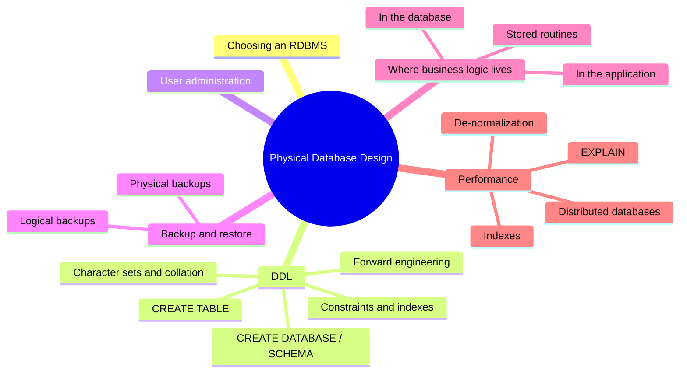
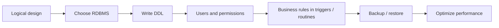
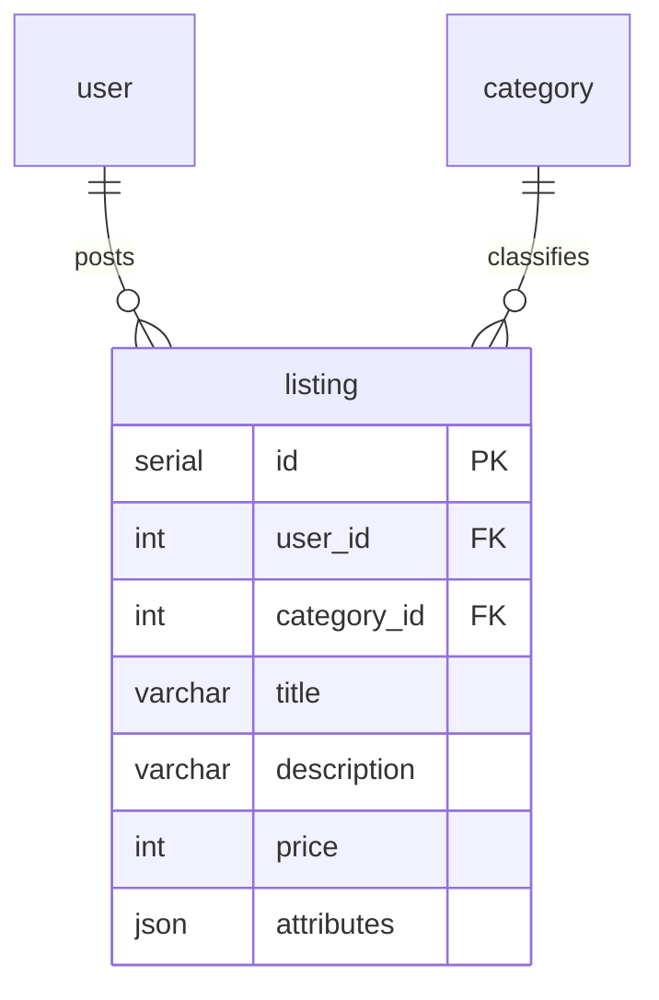
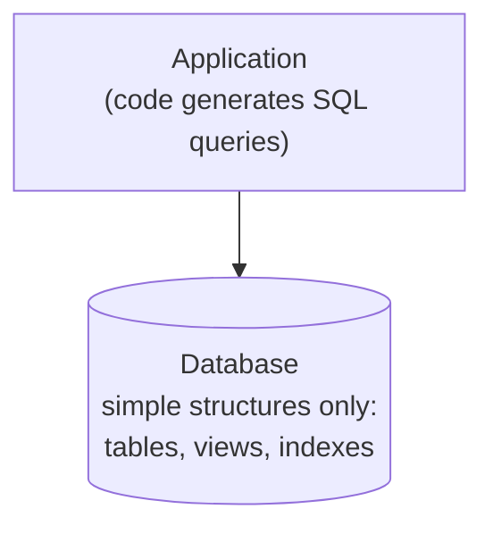
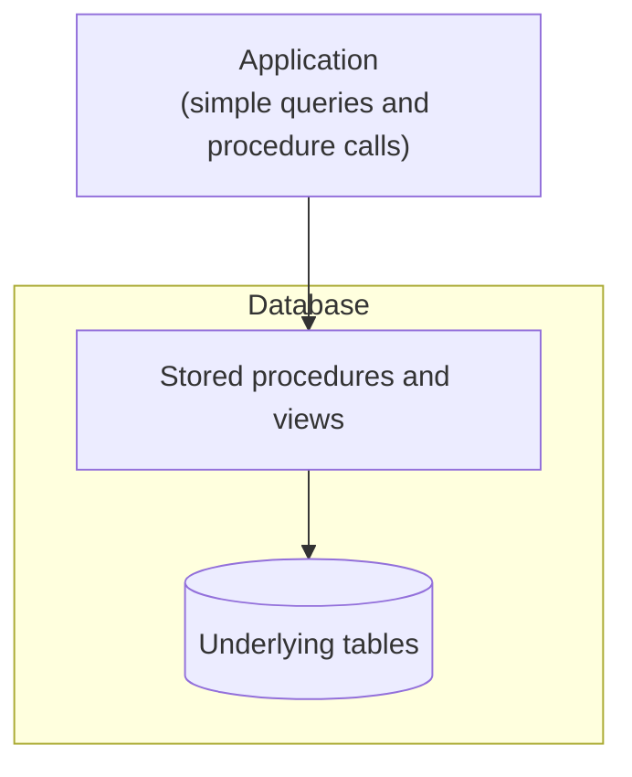
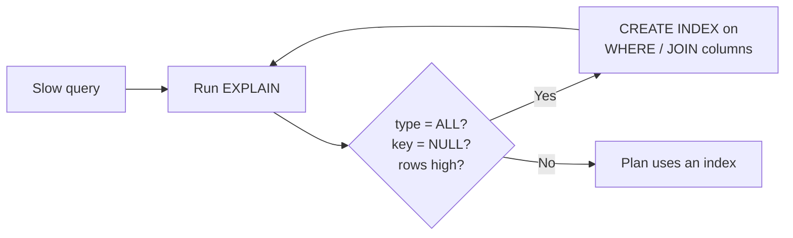
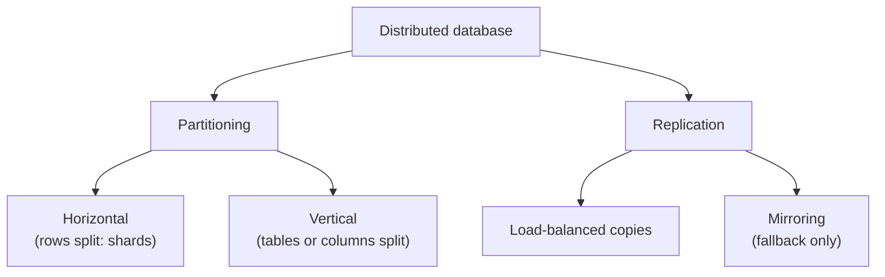
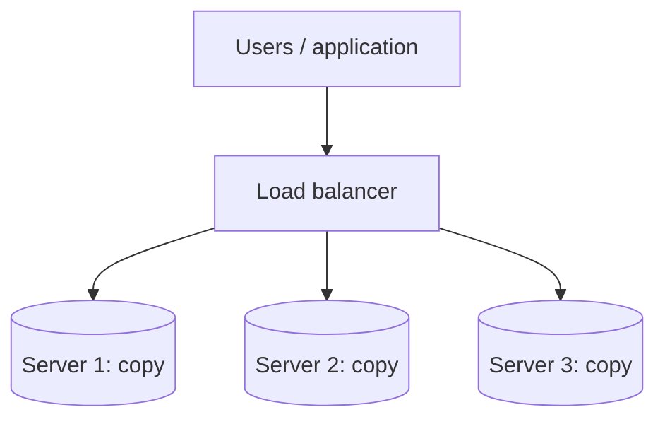

Up to [[Week 7 - Process Review and Extra Notes]], everything in this course was **conceptual** or **logical** design. That work is about the overall structure of the data: which tables, fields, and relationships you need. **Physical design** is the next step. You take the finished logical design and decide how it will actually be implemented on a real system.



## What is physical database design?

> [!note] Definition
> [[Physical Database Design|Physical database design]] involves deciding the **database implementation details**.

| Conceptual / logical design | Physical design |
|---|---|
| Concerned with the overall structure of the data | Concerned with how that structure runs on a real system |
| Identify tables, fields, relationships, etc. | Pick the software, write the SQL, set up users, backups, and performance |

The slides list six jobs that make up physical design:

1. Decide which [[RDBMS]] to use.
2. Write RDBMS-specific [[SQL]] ([[Data Definition Language|DDL]]) to instantiate the logical design.
3. Administer users and permissions.
4. Implement business rules using [[Triggers|triggers]] / [[Stored Routines|stored routines]].
5. Establish backup / restore procedures.
6. Investigate and determine how to optimize database performance.

The rest of the note follows that list.



## Which RDBMS should you use?

All the popular databases are popular for a reason. For typical applications, it probably won't matter which one you choose. Some things to consider:

| Situation | Suggested option |
|---|---|
| Single-user or low-traffic multi-user app | A file-based database like **SQLite** is the simplest to deploy |
| Multi-user app | **MySQL** or **PostgreSQL**: widely used, well documented, and free |
| Requires advanced support | It might be worth paying for **MS SQL Server** or **Oracle** |

> [!note] Slide typo
> The slide reads "postgresql or PostgreSQL", which names the same product twice. The usual pairing for free multi-user databases is MySQL and PostgreSQL, so the first name was most likely meant to be MySQL.

## Data Definition Language (DDL)

> [!note] Definition
> [[Data Definition Language|DDL]] is the subset of SQL concerned with manipulating **database objects** (schemas, tables, indexes).

There are three main DDL statements:

| Statement | What it does |
|---|---|
| `CREATE` | Makes a database object, such as the database itself or a table |
| `DROP` | Removes a database object |
| `ALTER` | Alters a database object |

### DDL vs DML

| | DDL | [[Data Manipulation Language\|DML]] |
|---|---|---|
| Works on | Database **objects**: schemas, tables, indexes | **Data** inside tables, i.e. the values in individual fields |
| Statements | `CREATE`, `DROP`, `ALTER` | `INSERT`, `DELETE`, `UPDATE` |

> [!tip] Memory trick
> **D**efinition builds the container. **M**anipulation changes what is inside it. `DROP TABLE` throws away the whole box (DDL); `DELETE FROM` empties rows out of the box (DML).

> [!warning] Common mistake
> `DROP` and `DELETE` are easy to mix up. `DELETE FROM users;` removes every row but the `users` table is still there. `DROP TABLE users;` removes the table itself, structure and all.

## CREATE SCHEMA / DATABASE

The slides use a classifieds website database called `CLASSifieds-JSON` as the running example.

```sql
CREATE SCHEMA IF NOT EXISTS "CLASSifieds-JSON";
```

- `IF NOT EXISTS` is **optional**. The new schema is only created if one with the same name doesn't already exist, so running the script twice won't throw an error.
- `"CLASSifieds-JSON"` is the schema name. The **double quotes** make sure the name is NOT interpreted as a keyword. (They are also needed here because the name contains a hyphen and mixed case.)

In PostgreSQL, a full database can be created with its text settings:

```sql
CREATE DATABASE "CLASSifieds-JSON"
  WITH ENCODING = 'UTF8'
       LC_COLLATE = 'en_US.UTF-8'
       LC_CTYPE = 'en_US.UTF-8';
```

| Part | Meaning |
|---|---|
| `"CLASSifieds-JSON"` | Database name (quoted so it isn't read as a keyword) |
| `ENCODING = 'UTF8'` | **Character encoding**: the character set you are using |
| `LC_COLLATE = 'en_US.UTF-8'` | **Collation**: how characters are sorted and compared |
| `LC_CTYPE = 'en_US.UTF-8'` | **Character classification**: whether a character is uppercase/lowercase, or a number/letter. This also affects regular expressions |

See [PostgreSQL: CREATE DATABASE](https://www.postgresql.org/docs/current/sql-createdatabase.html).

### Character sets

> [!note] Definition
> A [[Character Sets|character set]] is a mapping from computer-readable numbers to text.

- In PostgreSQL the default character set is **UTF8**.
- Each UTF8 character takes **1 to 4 bytes**. Plain English letters use 1 byte; other scripts use more.
- UTF8 natively supports **non-Latin** characters (Arabic, Chinese, the rest of Unicode, emojis, etc.) without needing workarounds.
- In PostgreSQL, the character set / encoding is specified for the **whole database** when it is created, not at the table or column level.

> [!important] Key idea
> Pick the encoding when you create the database. You can't switch one table to a different encoding later, so getting it right up front saves a migration.

### Collation

> [!note] Definition
> [[Collation]] is how symbols should be sorted relative to each other.

- Each character set has **at least one** collation.
- Different collations sort letters differently:
  - Language-specific collations may provide special sorting rules for that language.
  - Some collations have speed advantages over others.
- PostgreSQL defaults to the operating system's locale (for example `en_US.UTF-8` or `C`).
- Other common collations: **C** (fast, byte-wise sorting) and **POSIX**.

> [!example] Why collation matters
> With byte-wise `C` collation, every uppercase letter comes before every lowercase letter, so `"Zebra"` sorts before `"apple"`. A language-aware collation like `en_US.UTF-8` puts `"apple"` first, which is what a person would expect.

Collation names often include these codes:

| Code | Meaning |
|---|---|
| `ci` | case insensitive (`A` = `a`) |
| `cs` | case sensitive (`A` ≠ `a`) |
| `ai` | accent insensitive (`e` = `é`) |
| `as` | accent sensitive (`e` ≠ `é`) |

## CREATE TABLE

```sql
CREATE TABLE IF NOT EXISTS "CLASSifieds-JSON"."user" (
  -- comma-separated list of COLUMN or CONSTRAINT definitions
);
```

| Part | Meaning |
|---|---|
| `IF NOT EXISTS` | Optional |
| `"CLASSifieds-JSON".` | Optional schema name |
| `"user"` | Table name (quoted because `user` is a reserved word) |

Inside the parentheses goes a comma-separated list of **column** definitions and **constraint** definitions.

### Column definition

```sql
"id" SERIAL PRIMARY KEY
-- OR
"id" INT GENERATED ALWAYS AS IDENTITY PRIMARY KEY
```

A column definition has three parts:

1. **Column name**: `"id"`
2. **Data type** (and any data type-specific constraints): `SERIAL` or `INT`
3. **Column constraints**: `PRIMARY KEY`, `GENERATED ALWAYS AS IDENTITY`, `NOT NULL`, `DEFAULT ...`, etc.

Both lines above create an auto-numbering [[Primary Key|primary key]]. `SERIAL` is PostgreSQL's older shortcut; `GENERATED ALWAYS AS IDENTITY` is the SQL-standard way to do the same thing. See [PostgreSQL: Identity Columns](https://www.postgresql.org/docs/current/ddl-identity-columns.html).

### Primary key constraint

Instead of attaching `PRIMARY KEY` to one column, you can declare it as a separate constraint:

```sql
PRIMARY KEY ("id")
```

The parentheses hold a comma-separated list of columns in the primary key. This form is required for a **composite key** (a key made of more than one column):

```sql
PRIMARY KEY ("order_number", "line_item_number")
```

### Foreign key constraint

```sql
CONSTRAINT "parent_category_id"
  REFERENCES "CLASSifieds-JSON"."category" ("id")
  ON DELETE NO ACTION
  ON UPDATE NO ACTION
```

| Part | Meaning |
|---|---|
| `"parent_category_id"` | Comma-separated list of columns **from this table** in the foreign key |
| `"CLASSifieds-JSON"."category"` | Referenced table name (with optional schema prefix) |
| `("id")` | Comma-separated list of columns **in the referenced table** that this table's FK columns refer to |
| `ON DELETE / ON UPDATE NO ACTION` | Referential integrity constraints. You could also use `CASCADE` instead of `NO ACTION` |

This is where the [[Deletion Rules|deletion rules]] from [[Week 5 - Establishing Relationships]] turn into real SQL. `NO ACTION` blocks the delete if child rows still point at the parent (like the Restrict rule). `CASCADE` deletes (or updates) the child rows along with the parent.

> [!note] Syntax note
> The slide shows this example in shortened form. The standard table-level syntax names the constraint and then lists the FK columns with `FOREIGN KEY (...)`, as in the full example below: `CONSTRAINT "fk_name" FOREIGN KEY ("col") REFERENCES ...`. See [PostgreSQL: Foreign Keys](https://www.postgresql.org/docs/current/ddl-constraints.html#DDL-CONSTRAINTS-FK).

### Index definition

```sql
CREATE INDEX "fk_listing_user_idx"
  ON "CLASSifieds-JSON"."listing" ("user_id" ASC);
```

- `"fk_listing_user_idx"` is the **index name** (optional).
- `("user_id" ASC)` is a comma-separated list of columns to index, each optionally followed by `ASC` or `DESC`.

### Unique index definition

```sql
CREATE UNIQUE INDEX idx_users_phone ON users(phone_number);
```

Same structure, but `UNIQUE` also stops two rows from having the same `phone_number`.

### CHECK constraint

```sql
CHECK (end_date > start_date)
```

The parentheses hold a **Boolean expression**. If the condition evaluates to false for a row being inserted or updated, the database raises an error and rejects the row. This is how a range-of-values business rule from [[Week 6 - Business Rules and Views]] can be enforced in the physical database.

> [!note] About "v8.0.16"
> The slide title says "as of v8.0.16". That version number belongs to **MySQL**, which only started enforcing `CHECK` constraints in 8.0.16 (older versions parsed them and then ignored them). PostgreSQL has supported `CHECK` for a long time.

### All together now

The full `listing` table from the slides:

```sql
CREATE TABLE IF NOT EXISTS "CLASSifieds-JSON"."listing" (
    "id" SERIAL NOT NULL,
    "user_id" INT NOT NULL,
    "category_id" INT NOT NULL,
    "title" VARCHAR(45) NOT NULL,
    "description" VARCHAR(2048) NULL,
    "price" INT NOT NULL,
    "attributes" JSON NOT NULL DEFAULT '{}',
    PRIMARY KEY ("id"),
    CONSTRAINT "fk_listing_user"
        FOREIGN KEY ("user_id")
        REFERENCES "CLASSifieds-JSON"."user" ("id")
        ON DELETE NO ACTION
        ON UPDATE NO ACTION,
    CONSTRAINT "fk_listing_category1"
        FOREIGN KEY ("category_id")
        REFERENCES "CLASSifieds-JSON"."category" ("id")
        ON DELETE NO ACTION
        ON UPDATE NO ACTION
);

-- Note: In Postgres, non-unique indexes must be created after the table
CREATE INDEX "fk_listing_user_idx" ON "CLASSifieds-JSON"."listing" ("user_id" ASC);
CREATE INDEX "fk_listing_category1_idx" ON "CLASSifieds-JSON"."listing" ("category_id" ASC);
```

> [!example] Reading the listing table
> - Each listing belongs to one user (`user_id`) and one category (`category_id`). Both are foreign keys with `NO ACTION`, so you can't delete a user or category that still has listings.
> - `description` is the only column that allows `NULL`.
> - `attributes` is a `JSON` column that defaults to an empty object `'{}'`, which is where the "JSON" in the database name comes from.
> - The two FK columns get their own indexes, created after the table because PostgreSQL doesn't allow a plain `INDEX` clause inside `CREATE TABLE` (MySQL does).



More syntax: [PostgreSQL: CREATE TABLE](https://www.postgresql.org/docs/current/sql-createtable.html), [W3Schools: SQL CREATE TABLE](https://www.w3schools.com/sql/sql_create_table.asp).

## Forward engineering

You should be familiar with DDL syntax, but you rarely have to type all of it by hand. Many ERM applications, such as **pgAdmin's ERD Tool**, **DBeaver**, and **DataGrip**, have a [[Forward Engineering|forward engineering]] tool that automatically generates DDL from a logical model.

The slides compare forward and reverse engineering:


- **Forward engineering** moves left to right: requirements, then design, then implementation. Drawing an ER diagram and generating `CREATE TABLE` scripts from it is forward engineering.
- **Reverse engineering** moves right to left: start from an existing implementation and recover the design (and then the requirements) from it. Generating an ER diagram from an existing database is reverse engineering, which ties back to [[Week 3 - Analyzing Existing Databases]].

## User administration

Server-based databases need user accounts:

- **Administrator account**
  - Has access to the database with full privileges.
  - Should **only** have access to the database(s) it may administer. One server may host many databases, and an admin for one shouldn't be able to touch the others.
- **Application account**: the account your application uses to connect.
- **Others?** Sometimes many people need accounts for different purposes:
  - Reporting, analysis, projection, etc.
  - Database optimization, administration, backup/restore.

For each account, consider what privileges it should be granted:
- Which tables/data should be readable or writable?
- Which operations are permitted?

> [!important] Key idea
> Give each account only the privileges it needs for its job (often called the *principle of least privilege*). A reporting account that only needs to read data should not be able to `DELETE` or `DROP` anything.

### Users in PostgreSQL

- In PostgreSQL, the `postgres` database and the `pg_catalog` schema contain meta information about the server.
- `pg_catalog` contains views with information about the accounts/roles on the server. You can look at them with a simple query:

```sql
SELECT * FROM pg_roles;
```

- SQL can also be used to create users/roles. See the [Database Roles](https://www.postgresql.org/docs/current/user-manag.html) section of the PostgreSQL documentation.

> [!example] Sketch of an application account
> The slides point to the docs rather than showing commands. Something like this would create a login role that can read and write listings but not change the schema:
> ```sql
> CREATE ROLE classifieds_app WITH LOGIN PASSWORD 'change-me';
> GRANT SELECT, INSERT, UPDATE, DELETE
>   ON "CLASSifieds-JSON"."listing" TO classifieds_app;
> ```

## Backup / restore processes

It is important to establish a reliable backup/restore process for any production database. Backups should be performed often enough that data loss is minimal and the lost data can be recovered manually if needed.

> [!warning] IMPORTANT
> **Test your restore process to confirm that it works!** A backup you have never restored is a guess. You only find out it is broken on the day you need it.

There are two kinds of backup, and it is best to do **both** regularly:

| | [[Logical Backup\|Logical backup]] | [[Physical Backup\|Physical backup]] |
|---|---|---|
| What is saved | SQL that can regenerate the database: schema (DDL) and data (DML) exported as SQL files | The physical directories and files the RDBMS uses to store the database |
| Pros | Can be used to migrate to a different version of the RDBMS, or even a completely different RDBMS | Can include all server logs and configuration settings; smaller file size; simple matter of copying files |
| Cons | No server configuration or log files are saved; larger files; takes longer to perform | Can usually only be restored on the same hardware/software stack as the original database |

### Logical backups in PostgreSQL

In PostgreSQL, the **pg_dump** tool creates logical backups, and `psql` runs the resulting SQL file to restore it.

Create a logical backup:

```bash
pg_dump -U username -d database_name > backup.sql
```

Restore a logical backup:

```bash
psql -U username -d database_name -f backup.sql
```

- `-U` is the user to connect as.
- `-d` is the database name.
- `>` redirects pg_dump's output into the file `backup.sql`.
- `-f` tells psql to run the commands in that file.

See [PostgreSQL: pg_dump](https://www.postgresql.org/docs/current/app-pgdump.html) and [PostgreSQL: Backup and Restore](https://www.postgresql.org/docs/current/backup.html).

> [!tip] Which one would you use?
> Moving from PostgreSQL 15 to 17, or to a different RDBMS? Use a logical backup, because SQL text can be read by the new system. Rebuilding the exact same server after a disk failure, including its config and logs? A physical backup is faster and more complete.

## Physical databases and applications

There are two typical architectures for database-driven applications. The difference is where the **business logic** lives.

### Business logic in the application

The application code generates SQL queries to retrieve data. This is often done through an [[ORM]] (object-relational mapper). The database holds only simple structures: tables, views, indexes.



- **Pros**
  - Testing and debugging are easier in application code.
  - Simpler database structure.
- **Cons**
  - More work to use the same database for multiple applications. This usually involves writing a data layer library or service that every app shares.

### Business logic in the database

The application uses simple queries and stored procedure calls. [[Stored Procedures|Stored procedures]] and [[Views|views]] inside the database give access to the data in the underlying tables.



- **Pros**
  - Simple data retrieval code in the application.
  - Easier to write multiple applications that use the same database, since the rules are in one place.
- **Cons**
  - More complexity in the database.
  - Testing and debugging SQL is harder to automate.

> [!example] Same rule, two places
> Rule: "A listing's price cannot be negative."
> - Logic in the application: the web app's code checks `price >= 0` before it sends the `INSERT`. A second app (say, a mobile app) must repeat that check or share a library.
> - Logic in the database: a `CHECK (price >= 0)` constraint or a trigger rejects bad rows no matter which app sends them.

### Stored routines

Most RDBMSs have an extended set of SQL commands that add code structures like conditions, loops, and procedures.

- This makes SQL a complete programming language.
- The syntax is **less portable** than other parts of SQL. PostgreSQL's PL/pgSQL, MySQL's procedure language, and SQL Server's T-SQL all look different.

There are three types of [[Stored Routines|stored routines]]:

| Type | Purpose |
|---|---|
| [[User-Defined Functions\|User-defined function]] | Custom calculation functions (like `CONCAT`, `SUBSTR`, etc.) that can be used in expressions within SQL statements |
| [[Stored Procedures\|Stored procedure]] | Custom in-database business logic that can be executed with a procedure call, usually to retrieve data |
| [[Triggers\|Trigger]] | Custom business rule validation before/after inserts, updates, or deletes |

This is where the **application oriented business rules** from Week 6 can land. A rule like "a room cannot have overlapping bookings" can't be expressed with field specs, but a trigger can check for an overlap before each insert. The slides refer to the *Stored Routines* section of the PostgreSQL Basics website for syntax. See also [PostgreSQL: CREATE TRIGGER](https://www.postgresql.org/docs/current/sql-createtrigger.html) and [PostgreSQL: CREATE FUNCTION](https://www.postgresql.org/docs/current/sql-createfunction.html).

## Database performance: indexes

> [!note] Definition
> Database engines use an [[Indexes|index]] to look up which row a value is in. It works like a textbook index: a place to look up which page(s) a topic is on. Indexes are managed by the DBMS.

| Effect | Why |
|---|---|
| **Speed up** searches and comparisons | The engine jumps to matching rows instead of reading every row |
| **Slow down** inserts | Every insert has to add the row to the table AND update the index |

So indexes should be used **judiciously**: add them where they help reads, and don't put them on everything.

### Which columns need an index?

- **Primary keys** should always have an index, because they are used to look up specific rows.
  - Example: `SELECT * FROM sometable WHERE id = 123;`
  - Without an index, the engine would have to search through each row until it found the right one. With an index, the lookup is direct.
- **Foreign keys** should always have an index, because they are used in join predicates (the `ON a.id = b.a_id` part of a join).
- Most RDBMSs automatically add primary and foreign key indexes. The slide's screenshot of the `inventory` table shows a `PRIMARY` index plus `idx_fk_film_id` and `idx_store_id_film_id` next to the foreign keys `fk_inventory_film` and `fk_inventory_store`.
- Beyond those, it's up to database admins to analyze application performance and decide which additional indexes are needed.

> [!warning] PostgreSQL and foreign key indexes
> PostgreSQL automatically indexes primary keys and `UNIQUE` columns, but it does **not** automatically index foreign key columns (MySQL's InnoDB engine does). That is why the `listing` example above creates `fk_listing_user_idx` and `fk_listing_category1_idx` by hand.

### Indexes for slow WHERE clauses

Slow queries can often be sped up by adding an index over the columns used in the `WHERE` clause.

```sql
SELECT * FROM users
WHERE first_name = 'Bob' AND last_name = 'Hope';
```

Adding this index gives the engine a place to look up which rows have a particular combination of first and last name:

```sql
CREATE INDEX my_idx ON users(first_name, last_name);
```

### Unique indexes

Indexes can also enforce **uniqueness** on columns that are not the primary key:

```sql
CREATE UNIQUE INDEX email_unique ON your_table_name (email ASC);
```

Now two rows can't share the same email, even though `email` isn't the PK. This implements the *Uniqueness = Unique* field spec element from [[Week 4 - Defining Tables and Fields]].

## Database performance: EXPLAIN

- The `EXPLAIN` command can be added in front of any query.
- The RDBMS then shows information about **how** the query will run (the *query execution plan*) instead of the usual results.
- You can use it to find slow queries and decide where to add indexes.

### Worked example (MySQL Workbench, sakila sample database)

**Step 1: explain the query before adding an index.**

```sql
USE sakila;

EXPLAIN
SELECT *
FROM rental
WHERE rental_date >= '2006-05-01';
```

The `rental` table at this point has indexes on `PRIMARY`, `idx_fk_inventory_id`, `idx_fk_customer_id`, and `idx_fk_staff_id`, but nothing on `rental_date`.

| type | possible_keys | key | rows | filtered | Extra |
|---|---|---|---|---|---|
| ALL | NULL | NULL | 16012 | 33.33 | Using where |

The RDBMS has to search over **16k rows** to run this query. `type = ALL` means a full table scan, and `key = NULL` means no index is used.

**Step 2: create an index on the filtered column and explain again.**

```sql
CREATE INDEX rental_date ON rental(rental_date);

EXPLAIN
SELECT *
FROM rental
WHERE rental_date >= '2006-05-01';
```

The new index is a BTREE, non-unique, on the `rental_date` column.

| type | possible_keys | key | key_len | rows | filtered | Extra |
|---|---|---|---|---|---|---|
| range | rental_date | rental_date | 5 | 1 | 100.00 | Using index condition |

Now the RDBMS uses the index to do direct lookups. The estimated rows examined dropped from 16,012 to 1.



> [!tip] How to read the EXPLAIN columns used here
> - `type`: how rows are accessed. `ALL` = full table scan (slow on big tables), `range` = an index range lookup.
> - `possible_keys` / `key`: indexes that could be used / the one actually chosen.
> - `rows`: the estimated number of rows the engine will examine.
> - `Extra`: notes like "Using where" (filtering after reading rows) or "Using index condition" (filtering with the index).

PostgreSQL also has `EXPLAIN` (and `EXPLAIN ANALYZE`, which runs the query and reports real timings), though its output looks different. See [PostgreSQL: Using EXPLAIN](https://www.postgresql.org/docs/current/using-explain.html) and [MySQL: EXPLAIN Output Format](https://dev.mysql.com/doc/refman/8.0/en/explain-output.html).

## Database performance: de-normalization

- [[Normalization]] decreases data redundancy and increases data integrity. That is good.
- A well-normalized database offers the most reporting flexibility.
- But it also needs [[Joins|joins]] to pull all your normalized data back together, and joins can be slow.
- In some situations it's worth re-introducing data redundancy to increase performance. This is [[Denormalization|de-normalization]].

> [!warning] Rule from the slides
> **Do NOT de-normalize unless performance metrics warrant it!** Measure first (for example with `EXPLAIN` and timings). Only bend the design when the numbers show a real problem. This matches the "is it worth it?" discussion in [[Week 7 - Process Review and Extra Notes]].

> [!example] De-normalization
> A report lists every listing with its category name. Normally that needs a join between `listing` and `category`. If measurements show the join is too slow at scale, you could store `category_name` directly in `listing`. Reads get faster, but now the name lives in two places, and renaming a category means updating many listing rows.

## Database performance: distributed databases

Sometimes one server can't handle the amount of data or processing a system needs. Many DBMSs can **distribute** a database over several servers, called a [[Server Cluster|server cluster]].

There are two main ways to distribute a database, and a system can use both at the same time:
- [[Partitioning]]
- [[Replication]]



### Partitioning

Partitioning breaks a database into pieces that are each hosted by different servers. It can increase performance by:
- splitting the processing between servers, and
- placing servers nearer to users.

| | Horizontal partitioning | Vertical partitioning |
|---|---|---|
| What is split | The **rows** of a table | Whole **tables**, or a table's **columns** |
| Name of each piece | A **shard** | (no special name on the slides) |
| Example | Customers from Canada on one server, international customers on another | Some tables on one server and other tables on another; or some columns on one server and the rest on another |

> [!example] Why split by column?
> It can help to separate columns that change often from columns that rarely change. Then you can put an index on the rarely-changing columns without paying the index cost on every frequent write to the busy columns. (Remember: indexes make inserts slower.)

### Replication

Replication stores **copies** of a database on separate servers.

- It often uses a **load balancing** server that sends each request to the least busy server.
- Having several servers handle database processing increases performance.
- It also increases **availability**: if one server goes down, the others can keep handling traffic.
- **Mirroring** is a special kind of replication where the copy exists only as a fallback in case the main server dies. It doesn't share the normal workload.



> [!tip] Partitioning vs replication in one line each
> Partitioning: each server holds a **different piece** of the data. Replication: each server holds the **same data**.

### Disadvantages of distributed databases

- Choosing a distributed architecture takes careful thought. A bad partitioning strategy can make performance **worse**.
- Keeping data on distributed servers synchronized can be difficult:
  - Operations that span multiple partitions have to be synchronized.
  - Data takes time to replicate across servers, so the replicated servers may not all have the same data at every moment.
- Managing distributed databases can be challenging and expensive.

> [!example] Bad partitioning
> If customers are sharded by country but most reports join every customer with every order across all countries, nearly every query has to contact every shard and merge the results. That can be slower than one server.

## Summary

- Conceptual/logical design decides the structure; physical design decides how it is implemented: RDBMS choice, DDL, users, business-rule code, backups, and performance.
- For typical apps the RDBMS choice matters little: SQLite for simple/low-traffic, MySQL or PostgreSQL for multi-user, SQL Server or Oracle if you need paid advanced support.
- DDL (`CREATE`, `DROP`, `ALTER`) works on objects; DML (`INSERT`, `UPDATE`, `DELETE`) works on data.
- In PostgreSQL, encoding (UTF8 by default), collation, and character classification are set when the database is created.
- `CREATE TABLE` holds column definitions (name, type, constraints) and table constraints (`PRIMARY KEY`, `FOREIGN KEY ... REFERENCES`, `CHECK`). In PostgreSQL, non-unique indexes are created after the table.
- Forward engineering tools generate DDL from a logical model.
- Create separate accounts (admin, application, others) and give each only the privileges it needs.
- Take both logical (`pg_dump`) and physical backups regularly, and test that restores work.
- Business logic can live in the application (often via an ORM) or in the database (stored procedures, views, triggers). Each has trade-offs.
- Indexes speed up reads and slow down inserts. Index PKs, FKs, and columns used in slow `WHERE` clauses. Use `EXPLAIN` to check.
- De-normalize only when performance metrics justify it.
- Distributed databases use partitioning (horizontal shards or vertical splits) and/or replication (copies, load balancing, mirroring), at the cost of synchronization and management effort.

Further reading:
- [GeeksforGeeks: DDL, DML, DCL and TCL commands](https://www.geeksforgeeks.org/sql-ddl-dql-dml-dcl-tcl-commands/)
- [W3Schools: SQL CREATE INDEX](https://www.w3schools.com/sql/sql_create_index.asp)
- [PostgreSQL: Table Partitioning](https://www.postgresql.org/docs/current/ddl-partitioning.html)
- [PostgreSQL: Collation Support](https://www.postgresql.org/docs/current/collation.html)

## Exercises

### Exercise 1 (Direct application)
Classify each statement as DDL or DML:
a) `ALTER TABLE listing ADD COLUMN sold BOOLEAN;`
b) `UPDATE listing SET price = 50 WHERE id = 7;`
c) `DROP INDEX my_idx;`
d) `INSERT INTO category (name) VALUES ('Bikes');`
e) `CREATE UNIQUE INDEX email_unique ON users (email);`

> [!success]- Answer key
> a) **DDL**: it changes the structure of a table (an object).
> b) **DML**: it changes data in existing rows.
> c) **DDL**: it removes an object (an index).
> d) **DML**: it adds a row of data.
> e) **DDL**: it creates an object. It also has a data effect (it enforces uniqueness), but the statement itself defines an object.
>
> The quick test: does the statement change a *container* (table, index, schema) or the *contents*?

### Exercise 2 (Direct application)
Write a PostgreSQL `CREATE TABLE` statement for a `category` table in the `"CLASSifieds-JSON"` schema with:
- `id`: auto-generated integer primary key
- `name`: up to 45 characters, required
- `parent_category_id`: optional integer that refers to another category's `id` (a category can have a parent category). Deleting a parent should be blocked while children exist.

> [!success]- Answer key
> ```sql
> CREATE TABLE IF NOT EXISTS "CLASSifieds-JSON"."category" (
>     "id" INT GENERATED ALWAYS AS IDENTITY PRIMARY KEY,
>     "name" VARCHAR(45) NOT NULL,
>     "parent_category_id" INT NULL,
>     CONSTRAINT "fk_category_parent"
>         FOREIGN KEY ("parent_category_id")
>         REFERENCES "CLASSifieds-JSON"."category" ("id")
>         ON DELETE NO ACTION
>         ON UPDATE NO ACTION
> );
>
> CREATE INDEX "fk_category_parent_idx"
>     ON "CLASSifieds-JSON"."category" ("parent_category_id" ASC);
> ```
> - `SERIAL PRIMARY KEY` is also acceptable for `id`.
> - `parent_category_id` is `NULL`able because top-level categories have no parent.
> - The FK refers to the same table (a self-referencing relationship). `NO ACTION` blocks deleting a parent that still has children.
> - The FK index is created separately, after the table, because PostgreSQL doesn't index FKs automatically and doesn't accept non-unique indexes inside `CREATE TABLE`.

### Exercise 3 (Direct application)
A database must store customer names written in Portuguese, Arabic, and Japanese. Which character set should it use, at what level is it set in PostgreSQL, and when?

> [!success]- Answer key
> **UTF8.** It natively supports non-Latin characters with no workarounds, using 1 to 4 bytes per character. In PostgreSQL the encoding is set for the **whole database**, at the moment it is **created** (`CREATE DATABASE ... WITH ENCODING = 'UTF8'`). It is not set per table or column, so it has to be right from the start.

### Exercise 4 (Applied variation)
A search page sorts usernames and must treat `"Jose"`, `"jose"`, and `"José"` as the same name. Which collation properties (using the naming codes) do you need, and why would plain `C` collation be a bad fit?

> [!success]- Answer key
> You need a collation that is **case insensitive (`ci`)** and **accent insensitive (`ai`)**: `ci` makes `Jose` = `jose`, and `ai` makes `Jose` = `José`.
>
> `C` collation sorts **byte-wise**. It is fast, but it treats uppercase and lowercase as different values (and puts all uppercase before lowercase), and it treats accented letters as completely different characters. So it would neither match nor sort these names the way users expect.

### Exercise 5 (Applied variation)
A team has a web app and a new mobile app that both use the same database. Business rules are currently written in the web app's code via an ORM. The developers keep forgetting to copy rule changes to the mobile app. Which architecture are they using, which problem from the slides is this, and what are the trade-offs of switching?

> [!success]- Answer key
> They use **business logic in the application**. The slides list its con: *more work to use the same database for multiple applications*, which usually means writing a shared data layer library or service.
>
> Options:
> 1. Build a shared data layer library/service both apps call. Rules stay in application code, where testing and debugging are easier.
> 2. Move rules into the database (**business logic in database**) with stored procedures, views, and triggers. Both apps get the same rules automatically and their data code becomes simpler. The cost is more complexity in the database, and testing/debugging SQL is harder to automate.
>
> Either option removes the copy-the-rule problem; the choice depends on whether the team is stronger at app-side testing or at SQL.

### Exercise 6 (Applied variation)
A company's database server holds three databases: `payroll`, `classifieds`, and `inventory`. List the accounts you would create for the `classifieds` database and the privileges each one should get.

> [!success]- Answer key
> One reasonable answer:
> - **classifieds admin**: full privileges on `classifieds` **only**. No access to `payroll` or `inventory` (the slides stress that an admin account should only reach the database(s) it administers).
> - **classifieds application account**: `SELECT`, `INSERT`, `UPDATE`, `DELETE` on the tables the app uses. No `CREATE`, `DROP`, or `ALTER`, so a bug or attack through the app can't change the schema.
> - **reporting/analysis account**: `SELECT` only, perhaps only on certain tables or views.
> - **backup account**: enough read access to run `pg_dump` on `classifieds`.
>
> For each account the two questions are: which tables/data can it read or write, and which operations can it perform?

### Exercise 7 (Challenge)
You run `EXPLAIN` on this query against a 2-million-row `orders` table:

```sql
SELECT * FROM orders
WHERE customer_id = 42 AND status = 'SHIPPED';
```

The output shows `type = ALL`, `key = NULL`, and `rows = 2,000,000`. The table receives about 50,000 new orders per hour. What do you do, how do you check that it worked, and what risk should you keep in mind?

> [!success]- Answer key
> 1. The plan shows a **full table scan** (`ALL`, no key, every row examined). Add an index over the columns in the `WHERE` clause:
>    ```sql
>    CREATE INDEX idx_orders_customer_status ON orders(customer_id, status);
>    ```
>    `customer_id` is probably also a foreign key, so it should have an index anyway.
> 2. **Run `EXPLAIN` again.** You expect `key` to name the new index, `type` to change from `ALL` to an index lookup such as `ref` or `range`, and `rows` to drop sharply.
> 3. **Risk:** indexes slow down inserts. Every one of the 50,000 inserts per hour now also updates this index. One well-chosen index is usually worth it, but don't add an index for every possible query. Use them judiciously and measure insert performance as well.

### Exercise 8 (Challenge)
An online store serves customers in Canada and Europe. European users complain the site is slow, the single server is overloaded at peak times, and management also wants the store to stay up if a server fails. Propose a distributed design using the terms from the lesson, and name two problems you would need to watch for.

> [!success]- Answer key
> **Design:**
> - **Horizontal partitioning (sharding)** of customer and order rows by region: a Canada shard on a Canadian server and a Europe shard on a European server. This splits the processing and puts servers nearer to the users.
> - **Replication** of each shard to one or more copies behind a **load balancer**, which spreads peak traffic and keeps the site running if one server dies. (If a copy is only meant as a standby, that is **mirroring**.)
> - The slides allow partitioning and replication in the same system.
>
> **Problems to watch:**
> 1. **Synchronization**: an operation that spans both shards (a global sales report, or a customer who moves from Canada to Europe) must be coordinated, and replicas may briefly hold different data while changes propagate.
> 2. **Bad partitioning risk and cost**: if most queries need data from both regions, sharding by region could make performance worse. Distributed systems are also more challenging and expensive to manage.

## Feynman practice

Write the answers in your own words. Don't look at the note while writing step 1.

### Feynman: Logical vs physical design, and DDL vs DML

- [ ] **1. Explain it as if to a 12-year-old.** Compare drawing the floor plan of a house with actually building it: choosing the bricks, installing the locks, buying insurance. Which part is logical design and which is physical? Where do `CREATE TABLE` and `INSERT` fit in that story?
- [ ] **2. Find the gaps.** Reread what you wrote. Mark with `[?]` any word a 12-year-old wouldn't understand (for example "RDBMS", "instantiate", "schema", "database object").
- [ ] **3. Go back to the source and simplify.** For each `[?]`, write an analogy or example. Why does `DROP TABLE` count as DDL but `DELETE FROM` counts as DML?
- [ ] **4. Organize and test.** Rewrite the explanation in 3 to 5 sentences. Could you name all six physical design jobs from memory?

### Feynman: Character sets and collation

- [ ] **1. Explain it as if to a 12-year-old.** Imagine a secret code where every letter is a number. How is that like a character set? Then explain why two dictionaries in different languages might put the same words in a different order, and how that relates to collation.
- [ ] **2. Find the gaps.** Mark with `[?]` terms like "UTF8", "byte-wise", "locale", "case insensitive".
- [ ] **3. Go back to the source and simplify.** For each `[?]`, use an example. Why does `C` collation put "Zebra" before "apple"? Why must the encoding be chosen when the database is created?
- [ ] **4. Organize and test.** Rewrite in 3 to 5 sentences. Could you explain what `ci`, `cs`, `ai`, and `as` mean to a classmate?

### Feynman: Logical vs physical backups

- [ ] **1. Explain it as if to a 12-year-old.** One way to save a Lego castle is to write down the building instructions; another is to photograph the exact pieces in the exact box. Which is a logical backup and which is a physical backup? What can each one do that the other can't?
- [ ] **2. Find the gaps.** Mark with `[?]` terms like "pg_dump", "migrate", "hardware/software stack", "production database".
- [ ] **3. Go back to the source and simplify.** For each `[?]`, give an example. Why do the slides say to test the restore process, and why do both kinds of backup?
- [ ] **4. Organize and test.** Rewrite in 3 to 5 sentences. Could you write the `pg_dump` and `psql` commands from memory?

### Feynman: Indexes and EXPLAIN

- [ ] **1. Explain it as if to a 12-year-old.** You need every page about "volcanoes" in a 600-page book. How is using the index at the back different from reading every page? Now explain why adding a new chapter to the book takes longer when you must also update the index.
- [ ] **2. Find the gaps.** Mark with `[?]` terms like "join predicate", "full table scan", "query execution plan", "judiciously".
- [ ] **3. Go back to the source and simplify.** For each `[?]`, use the `rental_date` example. What changed in the `type`, `key`, and `rows` columns after the index was created, and what does each change mean?
- [ ] **4. Organize and test.** Rewrite in 3 to 5 sentences. Could you tell someone which columns should always be indexed and why?

### Feynman: De-normalization and distributed databases

- [ ] **1. Explain it as if to a 12-year-old.** A school library is too crowded. One plan opens a second library for older students (each has different books). Another plan builds identical libraries in two neighbourhoods. Which is partitioning and which is replication? Where does a "shard" fit, and what is a mirror library for?
- [ ] **2. Find the gaps.** Mark with `[?]` terms like "redundancy", "load balancing", "availability", "synchronized".
- [ ] **3. Go back to the source and simplify.** For each `[?]`, give an example. Why do the slides warn against de-normalizing without performance metrics? How can a bad partitioning strategy make things slower?
- [ ] **4. Organize and test.** Rewrite in 3 to 5 sentences, including one advantage and one disadvantage of distributing a database.

## Flashcards

Copy the block below into a `.txt` file and import it into Anki (File > Import), mapping column 1 to Front, column 2 to Back, and column 3 to Tags.

```
#separator:tab
#html:false
#tags column:3
What is physical database design?	Deciding the database implementation details (as opposed to the overall structure decided in conceptual/logical design).	csd216 week-08
What does conceptual/logical design focus on?	The overall structure of data: tables, fields, relationships, etc.	csd216 week-08
Name the six tasks of physical database design.	Choose an RDBMS; write DDL; administer users/permissions; implement business rules with triggers/stored routines; set up backup/restore; optimize performance.	csd216 week-08
Which kind of database is simplest to deploy for single-user or low-traffic apps?	A file-based database like SQLite.	csd216 week-08
When might it be worth paying for MS SQL Server or Oracle?	When you require advanced support.	csd216 week-08
What is DDL?	The subset of SQL that manipulates database objects (schemas, tables, indexes).	csd216 week-08
What are the three main DDL statements?	CREATE, DROP, ALTER.	csd216 week-08
What is DML?	The subset of SQL that manipulates data in tables (the data in individual fields).	csd216 week-08
What are the three DML statements named in the lecture?	INSERT, DELETE, UPDATE.	csd216 week-08
What does IF NOT EXISTS do in CREATE SCHEMA or CREATE TABLE?	Only creates the object if one with the same name doesn't already exist.	csd216 week-08
Why is a schema or table name put in double quotes in PostgreSQL DDL?	So the name is not interpreted as a keyword (and to keep special characters/case).	csd216 week-08
What is a character set?	A mapping from computer-readable numbers to text.	csd216 week-08
What is PostgreSQL's default character set?	UTF8.	csd216 week-08
How many bytes does a UTF8 character take?	1 to 4 bytes.	csd216 week-08
At what level is the encoding specified in PostgreSQL?	For the whole database when it is created, not per table or column.	csd216 week-08
What is collation?	How symbols are sorted and compared relative to each other.	csd216 week-08
What does LC_CTYPE control?	Character classification: upper/lowercase, number/letter; it also affects regular expressions.	csd216 week-08
What is the C collation known for?	Fast, byte-wise sorting.	csd216 week-08
In collation names, what do ci, cs, ai, and as mean?	Case insensitive, case sensitive, accent insensitive, accent sensitive.	csd216 week-08
What are the three parts of a column definition?	Column name, data type (with type-specific constraints), column constraints.	csd216 week-08
Name two ways to declare an auto-numbered integer primary key in PostgreSQL.	SERIAL PRIMARY KEY, or INT GENERATED ALWAYS AS IDENTITY PRIMARY KEY.	csd216 week-08
How do you declare a composite primary key?	PRIMARY KEY ("col1", "col2") as a table constraint.	csd216 week-08
In a foreign key constraint, what follows REFERENCES?	The referenced table (optionally schema-qualified) and the list of its columns the FK points to.	csd216 week-08
What option can replace NO ACTION in ON DELETE / ON UPDATE?	CASCADE.	csd216 week-08
What does a CHECK constraint contain?	A Boolean expression; an error is raised if it evaluates to false.	csd216 week-08
In PostgreSQL, when must non-unique indexes be created?	After the table, with a separate CREATE INDEX statement.	csd216 week-08
What does a forward engineering tool do?	Automatically generates DDL from a logical model.	csd216 week-08
Name three tools with forward engineering features.	pgAdmin's ERD Tool, DBeaver, DataGrip.	csd216 week-08
What is reverse engineering in database design?	Recovering the design (and requirements) from an existing implementation.	csd216 week-08
Which databases should an administrator account have access to?	Only the database(s) it may administer.	csd216 week-08
What two questions should you ask about each account's privileges?	Which tables/data are readable/writable, and which operations are permitted.	csd216 week-08
Where does PostgreSQL keep views with information about roles?	The pg_catalog schema (e.g. SELECT * FROM pg_roles;).	csd216 week-08
What is the most important step of any backup process, per the slides?	Test the restore process to confirm it works.	csd216 week-08
What is a logical backup?	Exporting the schema (DDL) and data (DML) as SQL files that can regenerate the database.	csd216 week-08
What is a physical backup?	Copying the directories and files the RDBMS uses to store the database.	csd216 week-08
What is the main advantage of a logical backup?	It can migrate to a different RDBMS version or a completely different RDBMS.	csd216 week-08
What are the downsides of a logical backup?	No server config or log files saved; larger files; slower than physical backups.	csd216 week-08
What is the main limitation of a physical backup?	It can usually only be restored on the same hardware/software stack.	csd216 week-08
Which PostgreSQL command creates a logical backup?	pg_dump -U username -d database_name > backup.sql	csd216 week-08
Which command restores a pg_dump SQL file?	psql -U username -d database_name -f backup.sql	csd216 week-08
How often should you do logical and physical backups?	Both, regularly.	csd216 week-08
Business logic in the application is often implemented via what?	An ORM.	csd216 week-08
Main pro and con of business logic in the application?	Pro: easier testing/debugging and a simpler database. Con: harder to share the database across multiple apps (needs a data layer library/service).	csd216 week-08
Main pro and con of business logic in the database?	Pro: simple app code and easy multi-app use. Con: more database complexity; SQL testing/debugging harder to automate.	csd216 week-08
What do stored routines add to SQL?	Code structures like conditions, loops, and procedures, making SQL a complete programming language.	csd216 week-08
Why is stored routine code less portable?	Its syntax differs more between RDBMSs than other parts of SQL.	csd216 week-08
What is a user-defined function used for?	Custom calculations usable in expressions within SQL statements (like CONCAT or SUBSTR).	csd216 week-08
What is a stored procedure used for?	Custom in-database business logic run with a procedure call, usually to retrieve data.	csd216 week-08
What is a trigger used for?	Custom business rule validation before/after inserts, updates, or deletes.	csd216 week-08
What does a database index do?	Lets the engine look up which row a value is in, like a textbook index.	csd216 week-08
What is the main cost of an index?	It slows down inserts, because the index must be updated along with the table.	csd216 week-08
Why should primary keys always be indexed?	They are used to look up specific rows.	csd216 week-08
Why should foreign keys always be indexed?	They are used in join predicates.	csd216 week-08
Which columns are good candidates for extra indexes on a slow query?	The columns in the WHERE clause.	csd216 week-08
How can an index enforce uniqueness on a non-PK column?	CREATE UNIQUE INDEX on that column.	csd216 week-08
What does the EXPLAIN command show?	The query execution plan: how the RDBMS will run the query, instead of the results.	csd216 week-08
In MySQL EXPLAIN output, what do type = ALL and key = NULL mean?	A full table scan with no index used.	csd216 week-08
In the rental_date example, what happened to the rows estimate after adding the index?	It dropped from 16,012 to 1, and type changed from ALL to range.	csd216 week-08
Why can a well-normalized database be slow?	It needs joins to pull normalized data back together, and joins can be slow.	csd216 week-08
When should you de-normalize?	Only when performance metrics warrant it.	csd216 week-08
What is a server cluster?	A database distributed over several servers.	csd216 week-08
What are the two main ways to distribute a database?	Partitioning and replication (they can be combined).	csd216 week-08
What is partitioning?	Breaking a database into pieces, each hosted by a different server.	csd216 week-08
What is horizontal partitioning, and what is each piece called?	Splitting a table's rows between servers; each piece is a shard.	csd216 week-08
What is vertical partitioning?	Putting different tables, or different columns of a table, on different servers.	csd216 week-08
Why split frequently-changing columns from rarely-changing ones?	To index the rarely-changing columns without the insert/update penalty of the frequent writes.	csd216 week-08
What is replication?	Storing copies of a database on separate servers.	csd216 week-08
What does a load balancer do in replication?	Sends traffic to the least busy server.	csd216 week-08
What is mirroring?	Replication where the copy is strictly a fallback in case the main server dies.	csd216 week-08
Name two synchronization problems of distributed databases.	Operations spanning partitions must be synchronized; replicas may temporarily hold different data.	csd216 week-08
Can partitioning make performance worse?	Yes, a bad partitioning strategy can make performance worse.	csd216 week-08
```

## Tags

#databases #physical_database_design #sql #ddl #dml #postgresql #collation #character_sets #indexes #explain #backup #stored_procedures #triggers #denormalization #partitioning #replication #distributed_databases #CSD216
