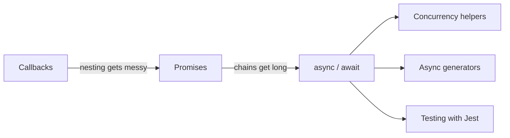
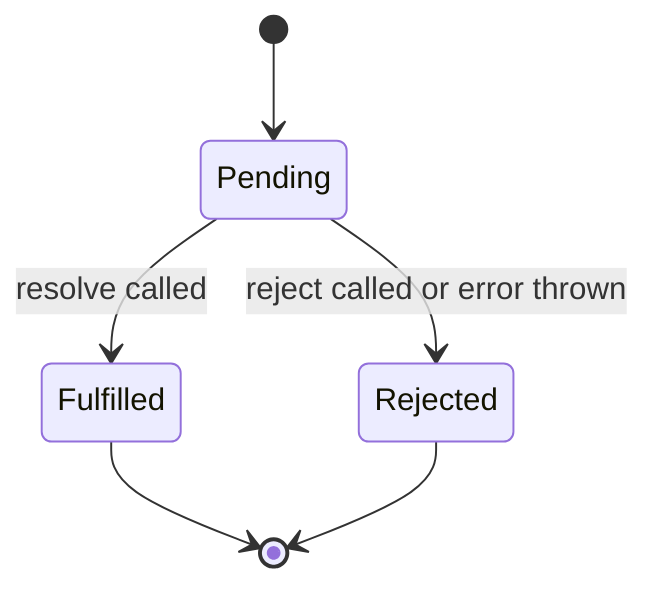
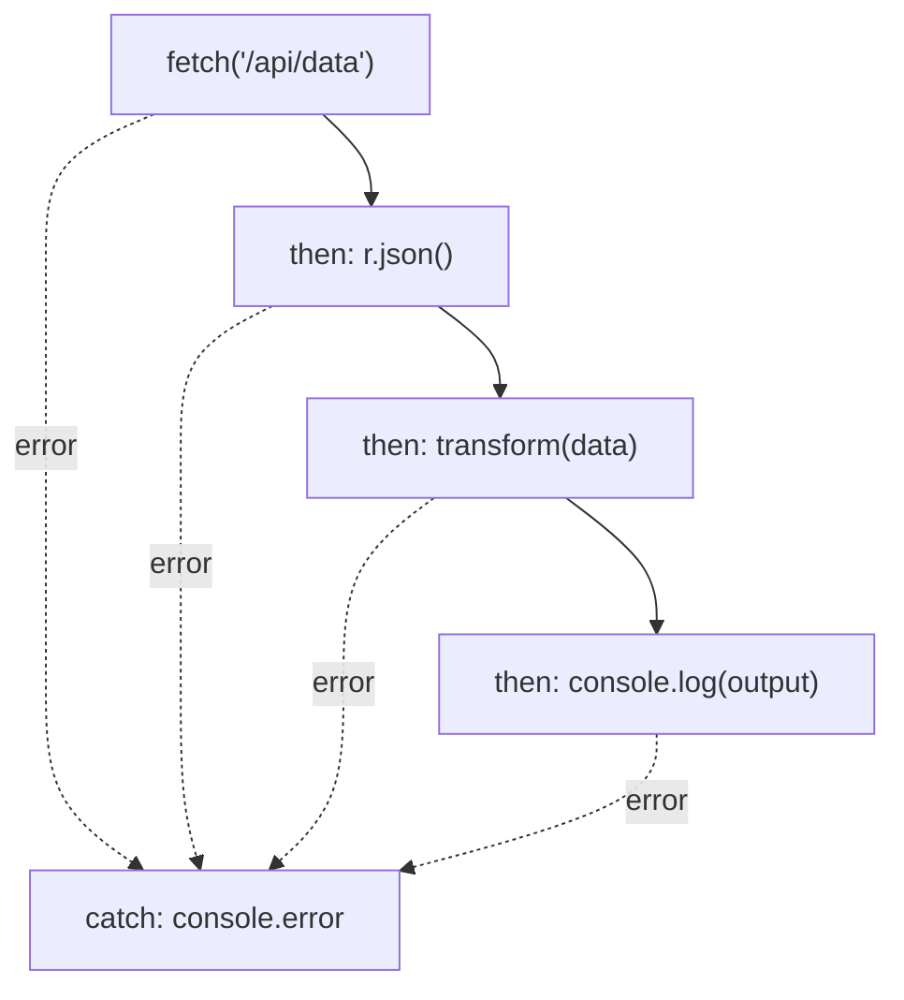
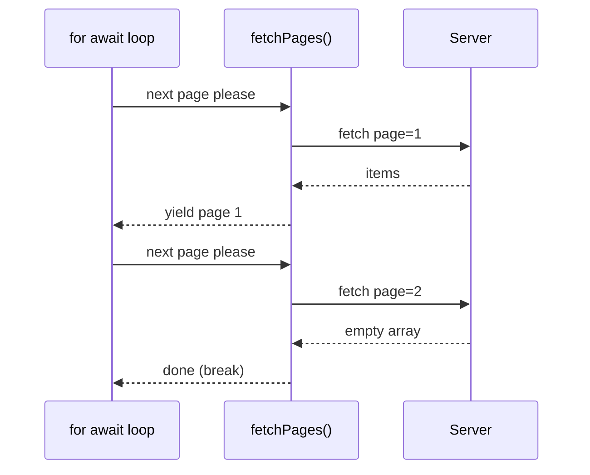
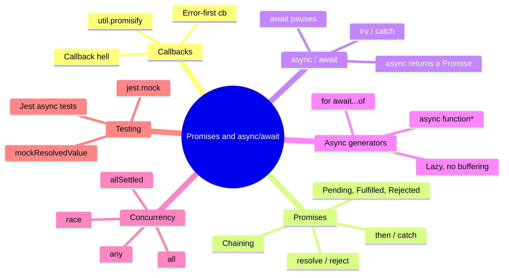

# What this lecture is about

Some work in [[JavaScript]] takes time: reading a file, waiting for a timer, or asking a server for data with `fetch`. JavaScript doesn't stop and wait for that work to finish. It starts the task, keeps running the rest of your code, and comes back to the result later. Code written this way is called **[[Asynchronous Programming|asynchronous]]** (async) code.

This week covers the three ways JavaScript has handled async code over the years, from oldest to newest, plus the tools for running several tasks at once and for testing async code.

| Section | Key topics | Why it matters |
|---|---|---|
| Callbacks | Syntax, "sadness" | Functional and common |
| Promises | Syntax, flow, state | Declarative async; error propagation |
| Async/await | Syntactic sugar | Linear, readable code |
| Concurrency | `Promise.all`, `Promise.race` | Parallelism, timing |
| Promise utilities | `Promise.allSettled`, `Promise.any` | Robust error handling |
| Testing async code | Jest + async | Reliability |

> [!tip]
> The "sadness" next to callbacks on the slide is a joke about **callback hell**, which you'll see in a moment. Each later section of the lecture is a way of escaping it.



# Callbacks: classic async

> [!note] Definition
> A **[[Callbacks|callback]]** is a function you pass to another function, so that function can call it back when its work is done.

## Callback signature

```javascript
function asyncTask(cb) {
  setTimeout(() => cb(null, "done"), 500);
}
```

`asyncTask` receives a function `cb`. After 500 ms (using `setTimeout` from [[Week 2 - JavaScript Events]]), it calls `cb` with two arguments: `null` and `"done"`.

That order follows the **error-first convention**: `cb(err, result)`.

- The **first** argument is always the error. If nothing went wrong, it's `null`.
- The **second** argument is the result.

> [!example] Using `asyncTask`
> ```javascript
> asyncTask((err, result) => {
>   if (err) {
>     console.error('Something went wrong:', err);
>     return;
>   }
>   console.log(result); // "done" (after 500 ms)
> });
> ```
> The caller checks `err` first. This pattern is everywhere in older [[Node.js]] code, such as `fs.readFile`.

## Callback hell

Problems start when one async step depends on the one before it. Each step has to go *inside* the previous callback:

```javascript
readFile("a.txt", (err, a) => {
  readFile("b.txt", (err, b) => {
    readFile("c.txt", (err, c) => {
      console.log(a, b, c);
    });
  });
});
```

This shape, where the code drifts further to the right with every step, is called **[[Callback Hell|callback hell]]** (or the "pyramid of doom"). It's hard to read and hard to change. Notice also that none of the `err` values are checked. Doing that properly would add an `if (err)` block at every level and make it even messier.

## Mitigating callback hell

The slides list four ways out:

1. **Named callbacks.** Pull each nested function out and give it a name, so the code reads top to bottom instead of nesting.
2. **Higher-order wrappers.** Write a [[Higher-Order Functions|higher-order function]] (a function that takes or returns functions) that hides the repeated nesting or error checking.
3. **Callback to Promise** with `util.promisify`. [[Node.js]] has a helper that turns an error-first callback function into a function that returns a Promise.
4. **Async/await**, covered later in this note.

> [!example] Named callbacks
> ```javascript
> function handleA(err, a) {
>   readFile("b.txt", (err, b) => handleB(err, a, b));
> }
> function handleB(err, a, b) {
>   readFile("c.txt", (err, c) => console.log(a, b, c));
> }
> readFile("a.txt", handleA);
> ```
> Still callbacks, but each step now has a name and the nesting stays shallow.

> [!example] `util.promisify`
> ```javascript
> const util = require('util');
> const fs = require('fs');
>
> const readFileAsync = util.promisify(fs.readFile);
>
> readFileAsync('a.txt', 'utf8')
>   .then(text => console.log(text))
>   .catch(err => console.error(err));
> ```
> `promisify` only works on functions that follow the error-first convention, since it needs to know which argument is the error.

# Promises: foundations

> [!note] Definition
> A **[[Promises|Promise]]** is an object that represents a value you don't have *yet*. It's a placeholder for the future result of an async task, which will eventually either succeed or fail.

## Promise syntax

```javascript
// new Promise executor: (resolve, reject) => {}
const p = new Promise((resolve, reject) => {
  if (success) resolve('ok');
  else reject(new Error('fail'));
});
```

- You create a Promise with `new Promise(...)` and pass it a function called the **executor**.
- JavaScript gives the executor two functions: `resolve` and `reject`.
- Call `resolve(value)` when the work succeeded, and `reject(error)` when it failed.

> [!tip]
> Reject with an `Error` object (`new Error('fail')`), not a plain string. An `Error` carries a message *and* a stack trace showing where it happened, which makes debugging easier.

## Basic Promise usage

```javascript
new Promise((resolve, reject) => {
  if (Math.random() > 0.5) resolve('yay');
  else reject('nope');
})
.then(console.log)
.catch(console.error);
```

Half the time this prints `yay` through `.then`, and the other half it prints `nope` through `.catch`. Passing `console.log` directly works because `.then` calls whatever function you give it with the result.

## Promise states

A Promise is always in one of three states:

| State | Meaning |
|---|---|
| **Pending** | The work hasn't finished yet. This is the starting state. |
| **Fulfilled** | `resolve` was called. The Promise now holds a value. |
| **Rejected** | `reject` was called (or an error was thrown). The Promise now holds a reason. |

The only possible moves are `Pending → Fulfilled` and `Pending → Rejected`. Once a Promise leaves pending, it is **settled** and never changes again. Calling `resolve` a second time, or `reject` after `resolve`, does nothing.



> [!important]
> "Settled" means "fulfilled **or** rejected". You'll need this word for `Promise.allSettled` and `Promise.race` later.

## Basic `then` / `catch`

```javascript
p
  .then(result => console.log('Success:', result))
  .catch(err => console.error('Error:', err));
```

- `.then(fn)` runs `fn` with the value when the Promise is fulfilled.
- `.catch(fn)` runs `fn` with the error when the Promise is rejected.

# Promise chaining

## Linear flow

Every `.then` returns a **new Promise**, so you can attach another `.then` to it. Whatever one step returns becomes the input of the next step.

```javascript
fetch('/api/data')
  .then(r => r.json())
  .then(data => transform(data))
  .then(output => console.log(output))
  .catch(console.error);
```

Step by step:

1. `fetch` (the [[Fetch API]]) sends the request and returns a Promise of a `Response` object `r`.
2. `r.json()` reads the response body as JSON. That's async too, so it returns another Promise. When a `.then` returns a Promise, the chain waits for it before moving on.
3. `transform(data)` changes the data in some way.
4. The final result gets logged.
5. A single `.catch` at the end handles an error from **any** step above it.



> [!important] Error propagation
> If any step fails, the chain skips all remaining `.then` calls and jumps straight to the next `.catch`. This is what the overview table means by "error propagation": you write the error handling once instead of checking `err` at every level as with callbacks.

Compare this to the callback hell example: the code reads top to bottom, and it doesn't drift to the right.

## Early return

```javascript
async function example() {
  const res = await fetch('/api/data');
  if (!res.ok) throw new Error('Network');
  return res.json();
}
```

This uses `async`/`await` (explained in the next section), but the idea belongs to chaining: if something is wrong, stop early.

- `res.ok` is `true` only when the HTTP status is a success (200 to 299).
- If it's not ok, `throw` exits the function immediately, so `res.json()` never runs. The Promise returned by `example()` becomes **rejected** with that error.

> [!warning] `fetch` doesn't reject on HTTP errors
> A `404` or `500` response still *fulfills* the `fetch` Promise, because the server did answer. `fetch` only rejects when the request couldn't be made at all (no network, for example). That's why the `if (!res.ok) throw ...` check is needed.

# async/await: declarative async

`async`/`await` is **[[Syntactic Sugar|syntactic sugar]]** on top of Promises. It doesn't add new abilities. It lets you write Promise-based code that reads like normal step-by-step code.

## Async function declaration

```javascript
async function getUser(id) {
  const resp = await fetch(`/api/users/${id}`);
  if (!resp.ok) throw new Error(resp.statusText);
  return resp.json();
}
```

> [!note] The two keywords
> - **`async`** before a function makes it **always return a Promise**. If you `return` a value, the Promise fulfills with it. If you `throw`, the Promise rejects.
> - **`await`** pauses the function until a Promise settles, then gives you its value. It can only be used inside an `async` function (or at the top level of a module).

The `/api/users/${id}` part is a template literal: with `id = 42`, the URL becomes `/api/users/42`. `resp.statusText` is the text that comes with the HTTP status, like `"Not Found"`.

## Error handling

With `async`/`await`, errors are caught with a normal `try`/`catch`:

```javascript
try {
  const user = await getUser(42);
  console.log(user);
} catch (e) {
  console.error('Failed:', e);
}
```

If `getUser` throws (bad status) or `fetch` rejects (no network), execution jumps to `catch`.

| Promise style | async/await style |
|---|---|
| `.then(value => ...)` | `const value = await ...` |
| `.catch(err => ...)` | `try { ... } catch (err) { ... }` |
| `return` a value from `.then` | `return` a value from the `async` function |

> [!warning] Common mistake: forgetting `await`
> `const user = getUser(42);` without `await` gives you the **Promise**, not the user. `console.log(user)` would print something like `Promise { <pending> }`.

# Async generators

A regular [[Generators|generator]] (`function*`) can pause with `yield` and hand out values one at a time. An **[[Async Generators|async generator]]** (`async function*`) does the same, but it can also `await` between values. It produces a sequence of values that arrive over time.

## Example: fetching pages

```javascript
async function* fetchPages() {
  let page = 1;
  while (true) {
    const res = await fetch(`/api/items?page=${page++}`);
    const data = await res.json();
    if (!data.length) break;
    yield data;
  }
}
```

What happens:

1. It starts at page 1. `page++` uses the current value in the URL, then adds 1 for next time.
2. It fetches that page and reads the JSON.
3. If the page is empty (`data.length` is `0`), there's nothing left, so `break` ends the generator.
4. Otherwise, `yield data` hands this page to whoever is consuming the generator and **pauses** until the next page is requested.

## Consuming an async generator

```javascript
for await (const page of fetchPages()) {
  console.log('Page:', page);
}
```

`for await...of` is the loop made for async generators. Each pass waits for the next yielded value.

> [!important] No buffering
> The pages are not all downloaded first and then looped over. Each page is fetched only when the loop asks for it and processed as soon as it arrives. If you `break` out of the loop early, the remaining pages are never fetched.



## Async generators as lazy sequences

**Lazy** means a value is only produced when someone asks for it.

```javascript
async function* rangeAsync(start, end, step = 1) {
  for (let i = start; i <= end; i += step) {
    yield await Promise.resolve(i); // simulating async work
  }
}
```

```javascript
for await (const n of rangeAsync(1, 5)) {
  console.log(n); // 1 → 5
}
```

This prints `1`, `2`, `3`, `4`, `5`. `Promise.resolve(i)` creates a Promise that is already fulfilled with `i`. It stands in for real async work, like a database call, so you can see the pattern without a server. `step = 1` is a default parameter: if you don't pass a step, it counts by 1.

# Concurrency

So far, every `await` waited for one task before starting the next. When tasks **don't depend on each other**, it's faster to start them all at once and wait for them together. JavaScript has four built-in helpers for this, and each takes an array of Promises.

| Method | Waits until | Result |
|---|---|---|
| `Promise.all` | **all** succeed, or **one** fails | Array of values, or the first error |
| `Promise.allSettled` | **all** are settled (success or failure) | Array of `{ status, value / reason }` objects |
| `Promise.any` | **one** succeeds, or **all** fail | The first successful value |
| `Promise.race` | **one** settles (success or failure) | Whatever settled first, value or error |

> [!tip] How to tell them apart
> Ask two questions: do you wait for **one** or **all**, and do you care about **success only** or **any outcome**?
> - all + stops at first failure → `all`
> - all + any outcome → `allSettled`
> - one + success only → `any`
> - one + any outcome → `race`

## `Promise.all`

```javascript
const [a, b, c] = await Promise.all([
  fetch('/a'), fetch('/b'), fetch('/c')
]);
```

All three requests start at the same time. The results come back as an array **in the same order as the input**, no matter which request finished first, and [[Destructuring|array destructuring]] puts them into `a`, `b`, and `c`.

## `Promise.race`

```javascript
const first = await Promise.race([
  fetch('/slow'), fetch('/fast')
]);
console.log('First response', await first.json());
```

Whichever request settles first wins. Here `/fast` probably answers first, so `first` is its response.

> [!warning]
> `race` doesn't care whether the winner succeeded. If `/fast` failed quickly, the whole `race` would reject with that error, even if `/slow` would have succeeded later. (The slide says "regardless of success *of* failure"; it means "success *or* failure".)

## `Promise.allSettled`

```javascript
const results = await Promise.allSettled([
  fetch('/good'), fetch('/bad')
]);
results.forEach(r => console.log(r.status, r.value || r.reason));
```

`allSettled` never rejects. It waits for everything, then gives you one object per Promise:

| If the Promise... | Object looks like |
|---|---|
| fulfilled | `{ status: 'fulfilled', value: ... }` |
| rejected | `{ status: 'rejected', reason: ... }` |

That's why the log uses `r.value || r.reason`: only one of the two exists on each object.

## `Promise.any`

```javascript
const success = await Promise.any([
  fetch('/slow'), fetch('/fast')
]);
console.log('First success', await success.json());
```

Like `race`, but failures are ignored. It gives you the first Promise that **succeeds**. It only rejects if **every** Promise fails.

## `Promise.all` vs `Promise.allSettled`

- `Promise.all` returns a single Promise that resolves to an array of values, but **only** if *all* the Promises succeed.
- If any fail, it rejects with the error from the first one that failed, and you lose the results of the ones that succeeded.
- `Promise.allSettled` returns an array of results that includes each Promise's state (fulfilled or rejected) and its value or reason.
- That makes it useful when you want to handle **partial success or failure**, for example retrying only the requests that failed.

> [!example] Retrying only the failures
> ```javascript
> const urls = ['/a', '/b', '/c'];
> const results = await Promise.allSettled(urls.map(u => fetch(u)));
>
> const failedUrls = urls.filter((url, i) => results[i].status === 'rejected');
> console.log('Need to retry:', failedUrls);
> ```

# Testing async code

## Jest + async/await

**[[Jest]]** is a JavaScript testing framework. Install it as a development dependency (needed while building, not when the app runs):

```bash
npm install --save-dev jest
```

Tests go in files like `__tests__/api.test.js`. Jest finds them automatically.

```javascript
// __tests__/api.test.js
test('fetch data', async () => {
  const data = await fetch('/api');
  expect(data).toBeDefined();
});
```

- `test(name, fn)` defines one test.
- Making the test function `async` and using `await` tells Jest to **wait** for the async work before deciding whether the test passed.
- `expect(value).toBeDefined()` passes if the value is not `undefined`.

> [!warning] Two problems with this slide example
> - Tests run in [[Node.js]], not in a browser, so there's no page URL for `'/api'` to be relative to. `fetch('/api')` throws an "invalid URL" error there. A real test would use a full URL like `http://localhost:3000/api`, or better, mock the request (next section).
> - `data` is the `Response` object, not the parsed JSON. You'd need `await data.json()` to get the actual data.

> [!warning] Common mistake: not waiting in a test
> If a test starts async work but doesn't `await` it (or return the Promise), Jest finishes the test before the work is done. The test can pass even though the code is broken.

## Mocking external calls

Real network calls make tests slow and unreliable: the server might be down, or the data might change. **[[Mocking]]** replaces the real module with a fake one whose answers you control.

```javascript
jest.mock('axios');
const { getUser } = require('../api');
test('getUser returns user', async () => {
  axios.get.mockResolvedValue({ data: { id: 1, name: 'Bob' } });
  const user = await getUser(1);
  expect(user.name).toBe('Bob');
});
```

1. `jest.mock('axios')` replaces every function in the [[Axios]] library (an HTTP client) with a fake.
2. `getUser` is loaded from your own `api.js`, which uses `axios` internally.
3. `axios.get.mockResolvedValue(...)` says: "when `axios.get` is called, return a Promise that fulfills with this object." No real request is sent.
4. The test calls `getUser(1)` and checks that it got Bob back.

> [!warning] Missing import on the slide
> The test uses `axios.get` but never imports `axios`, so it would fail with `ReferenceError: axios is not defined`. Add this after `jest.mock`:
> ```javascript
> const axios = require('axios');
> ```
> Because of `jest.mock('axios')`, this `require` returns the **mocked** version, the same one `api.js` gets.

| Mock helper | Makes the fake function return |
|---|---|
| `mockResolvedValue(x)` | a Promise that fulfills with `x` |
| `mockRejectedValue(err)` | a Promise that rejects with `err` (used in Exercise 8) |

# Visual overview



# Summary

- Async code starts a task and handles the result later, without blocking the rest of the program.
- Callbacks follow the error-first convention `cb(err, result)`. Nesting dependent callbacks leads to callback hell. Named callbacks, higher-order wrappers, `util.promisify`, and async/await all reduce it.
- A Promise is created with `new Promise((resolve, reject) => ...)` and moves from **pending** to either **fulfilled** or **rejected**. Once settled, it never changes.
- `.then` handles success and `.catch` handles failure. Each `.then` returns a new Promise, so steps can be chained, and one `.catch` at the end handles errors from any step.
- `async` functions always return a Promise, `await` pauses until a Promise settles, and errors are handled with `try`/`catch`. Throwing early (`if (!res.ok) throw ...`) rejects the returned Promise.
- `fetch` doesn't reject on HTTP error codes, so check `res.ok`.
- Async generators (`async function*`) yield values over time. `for await...of` consumes them one at a time, with no buffering.
- `Promise.all` waits for all or fails on the first error; `allSettled` waits for all and reports each outcome; `any` gives the first success; `race` gives the first to settle.
- Jest tests can be `async` and `await` results. `jest.mock` plus `mockResolvedValue` replaces real network calls with fake, predictable ones.

# Exercises

### Exercise 1 (Direct application)
The `asyncTask(cb)` function from the slides uses an error-first callback. Write a function `asyncTaskPromise()` that returns a Promise instead, by wrapping `asyncTask` with `new Promise`. Then use it with `.then`/`.catch`.

> [!success]- Answer key
> ```javascript
> function asyncTaskPromise() {
>   return new Promise((resolve, reject) => {
>     asyncTask((err, result) => {
>       if (err) reject(err);
>       else resolve(result);
>     });
>   });
> }
>
> asyncTaskPromise()
>   .then(result => console.log(result)) // "done"
>   .catch(err => console.error(err));
> ```
> The callback's two arguments map directly onto the executor's two functions: an error goes to `reject`, a result goes to `resolve`. This is exactly what `util.promisify(asyncTask)` does for you automatically, and it only works because `asyncTask` follows the error-first convention.

### Exercise 2 (Direct application)
Write a function `wait(ms)` that returns a Promise which fulfills after `ms` milliseconds. Use it to log `"1 second later"` after one second, first with `.then` and then with `await`.

> [!success]- Answer key
> ```javascript
> function wait(ms) {
>   return new Promise(resolve => setTimeout(resolve, ms));
> }
>
> // With then
> wait(1000).then(() => console.log('1 second later'));
>
> // With await
> async function run() {
>   await wait(1000);
>   console.log('1 second later');
> }
> run();
> ```
> `setTimeout` calls `resolve` after the delay, which moves the Promise from pending to fulfilled. This Promise can never fail, so the executor doesn't need `reject` at all. With `await`, the function pauses on the `wait` line, and the log runs after the second has passed.

### Exercise 3 (Direct application)
Rewrite this chain using `async`/`await` and `try`/`catch`. Also add a check that throws `new Error('Network')` if the response is not ok.

```javascript
fetch('/api/data')
  .then(r => r.json())
  .then(data => transform(data))
  .then(output => console.log(output))
  .catch(console.error);
```

> [!success]- Answer key
> ```javascript
> async function loadData() {
>   try {
>     const r = await fetch('/api/data');
>     if (!r.ok) throw new Error('Network');
>     const data = await r.json();
>     const output = transform(data);
>     console.log(output);
>   } catch (err) {
>     console.error(err);
>   }
> }
> loadData();
> ```
> Each `.then(x => ...)` becomes a line with `const x = await ...`. `transform` isn't async in this example, so it doesn't need `await` (adding it wouldn't break anything). The single `.catch` at the end becomes one `try`/`catch` around everything. The `res.ok` check matters because `fetch` fulfills even for a 404 or 500.

### Exercise 4 (Applied variation)
Predict what each line logs:

```javascript
const p1 = Promise.resolve(1);
const p2 = Promise.reject(new Error('boom'));
const p3 = Promise.resolve(3);

async function run() {
  try {
    console.log('all:', await Promise.all([p1, p2, p3]));
  } catch (e) {
    console.log('all failed:', e.message);
  }

  const settled = await Promise.allSettled([p1, p2, p3]);
  settled.forEach(r => console.log(r.status, r.value ?? r.reason.message));

  console.log('any:', await Promise.any([p2, p3]));
}
run();
```

> [!success]- Answer key
> ```
> all failed: boom
> fulfilled 1
> rejected boom
> fulfilled 3
> any: 3
> ```
> - `Promise.all` rejects as soon as one input rejects, so the `catch` runs with `p2`'s error. The values `1` and `3` are lost.
> - `Promise.allSettled` never rejects. It gives one object per input with `status` and either `value` or `reason`, in input order.
> - `Promise.any` ignores the rejected `p2` and returns the first fulfilled value, `3`.
>
> (`??` returns the right side only when the left is `null` or `undefined`. It's used instead of `||` so that a fulfilled value like `0` would still print.)

### Exercise 5 (Applied variation)
Fix the callback hell example from the slides using `util.promisify` and `async`/`await`. Write two versions: one that reads the files **one after another**, and one that reads them **at the same time**. Which is faster, and why is the second version allowed here?

> [!success]- Answer key
> ```javascript
> const util = require('util');
> const fs = require('fs');
> const readFile = util.promisify(fs.readFile);
>
> // One after another
> async function sequential() {
>   const a = await readFile('a.txt', 'utf8');
>   const b = await readFile('b.txt', 'utf8');
>   const c = await readFile('c.txt', 'utf8');
>   console.log(a, b, c);
> }
>
> // At the same time
> async function parallel() {
>   const [a, b, c] = await Promise.all([
>     readFile('a.txt', 'utf8'),
>     readFile('b.txt', 'utf8'),
>     readFile('c.txt', 'utf8')
>   ]);
>   console.log(a, b, c);
> }
> ```
> The parallel version is faster: total time is roughly the slowest single read, instead of the sum of all three. It's allowed because reading `b.txt` doesn't need anything from `a.txt`. If step 2 needed step 1's result, you'd have to use the sequential version. Both versions should be wrapped in `try`/`catch` (or followed by `.catch`) to handle a missing file.

### Exercise 6 (Applied variation)
Write an async generator `countdownAsync(n)` that yields `n`, `n - 1`, ... down to `1`, waiting one second before each value (use `wait` from Exercise 2). Consume it with `for await...of` and log `"Liftoff!"` at the end.

> [!success]- Answer key
> ```javascript
> async function* countdownAsync(n) {
>   for (let i = n; i >= 1; i--) {
>     await wait(1000);
>     yield i;
>   }
> }
>
> async function run() {
>   for await (const n of countdownAsync(3)) {
>     console.log(n);
>   }
>   console.log('Liftoff!');
> }
> run();
> ```
> Output, one line per second: `3`, `2`, `1`, then `Liftoff!`. It's the same pattern as `rangeAsync`, counting down, and the `await` inside the generator is real waiting instead of `Promise.resolve`. The loop only asks for the next number after logging the previous one, so this is a lazy sequence: nothing is computed ahead of time.

### Exercise 7 (Challenge)
Write `fetchWithTimeout(url, ms)`. It should return the parsed JSON if the request finishes within `ms` milliseconds, and reject with `new Error('Timeout')` otherwise. Which of the four concurrency helpers fits, and why not the others?

> [!success]- Answer key
> ```javascript
> function timeout(ms) {
>   return new Promise((_, reject) =>
>     setTimeout(() => reject(new Error('Timeout')), ms)
>   );
> }
>
> async function fetchWithTimeout(url, ms) {
>   const res = await Promise.race([fetch(url), timeout(ms)]);
>   if (!res.ok) throw new Error(res.statusText);
>   return res.json();
> }
>
> try {
>   const data = await fetchWithTimeout('/api/data', 2000);
>   console.log(data);
> } catch (e) {
>   console.error('Failed:', e.message);
> }
> ```
> `Promise.race` fits because you want whichever **settles** first, and the timer's *rejection* has to be able to win. `Promise.any` would ignore the timeout rejection and keep waiting for `fetch`. `Promise.all` and `allSettled` would wait for both, so the timeout would never cut anything short. The `_` in `(_, reject)` is a convention for "I don't use this parameter."

### Exercise 8 (Challenge)
Here is the `api.js` file tested on the slides:

```javascript
// api.js
const axios = require('axios');

async function getUser(id) {
  const res = await axios.get(`/api/users/${id}`);
  return res.data;
}

module.exports = { getUser };
```

Write a Jest test that checks `getUser` **rejects** with the message `"Network"` when the request fails. Don't send a real request.

> [!success]- Answer key
> ```javascript
> // __tests__/api.test.js
> jest.mock('axios');
> const axios = require('axios');
> const { getUser } = require('../api');
>
> test('getUser rejects when the request fails', async () => {
>   axios.get.mockRejectedValue(new Error('Network'));
>   await expect(getUser(1)).rejects.toThrow('Network');
> });
> ```
> - `jest.mock('axios')` plus `require('axios')` gives the test the same fake `axios` that `api.js` uses (and fixes the missing import from the slide).
> - `mockRejectedValue` is the failure version of `mockResolvedValue`: `axios.get` now returns a rejected Promise.
> - `expect(promise).rejects.toThrow(...)` waits for the Promise and passes only if it rejects with a matching error. The `await` in front of `expect` is required. Without it, the test would finish before the check runs.
>
> This also explains the slide's success test: the mock returns `{ data: {...} }` because `getUser` returns `res.data`.

# External resources

- [Eloquent JavaScript, Ch. 11: Asynchronous Programming](https://eloquentjavascript.net/11_async.html) (the slides call it Ch. 14; in the current online edition it's Ch. 11)
- [MDN: Promise](https://developer.mozilla.org/en-US/docs/Web/JavaScript/Reference/Global_Objects/Promise)
- [MDN: Using promises](https://developer.mozilla.org/en-US/docs/Web/JavaScript/Guide/Using_promises)
- [MDN: async function](https://developer.mozilla.org/en-US/docs/Web/JavaScript/Reference/Statements/async_function)
- [MDN: for await...of](https://developer.mozilla.org/en-US/docs/Web/JavaScript/Reference/Statements/for-await...of)
- [MDN: Iteration protocols (including async iteration)](https://developer.mozilla.org/en-US/docs/Web/JavaScript/Reference/Iteration_protocols)
- [Node.js docs: util.promisify](https://nodejs.org/api/util.html#utilpromisifyoriginal)
- [Node.js docs: Stream](https://nodejs.org/api/stream.html)
- [Jest: Testing asynchronous code](https://jestjs.io/docs/asynchronous)
- [Jest: Mock functions](https://jestjs.io/docs/mock-functions)
- [javascript.info: Promises, async/await](https://javascript.info/async)
- [W3Schools: JavaScript Promises](https://www.w3schools.com/js/js_promise.asp)

# Tags

#webdevelopment #javascript #async #promises #asyncawait #testing #jest #nodejs #frontend #software
