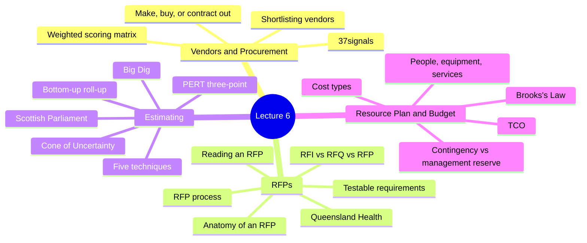
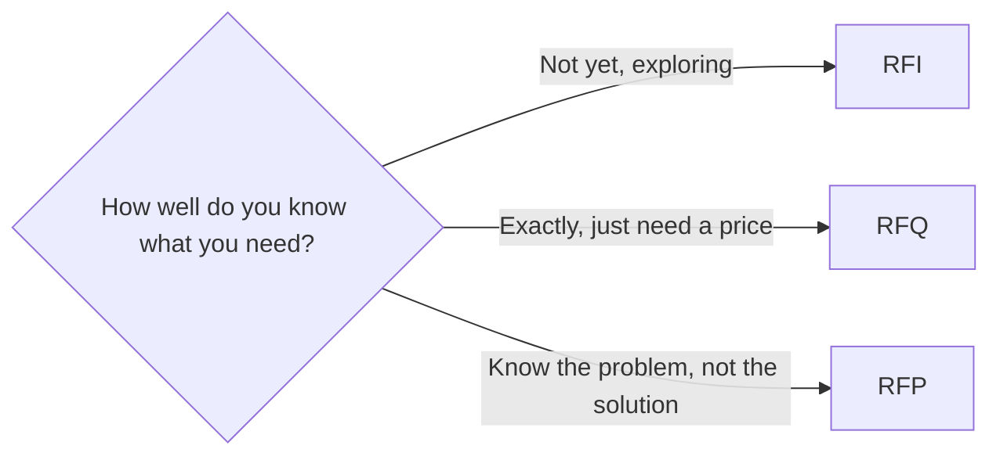
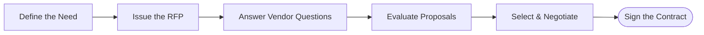
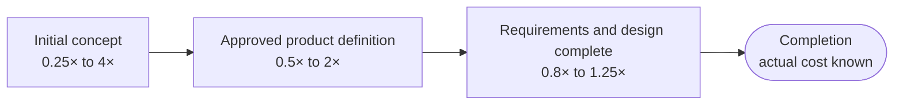
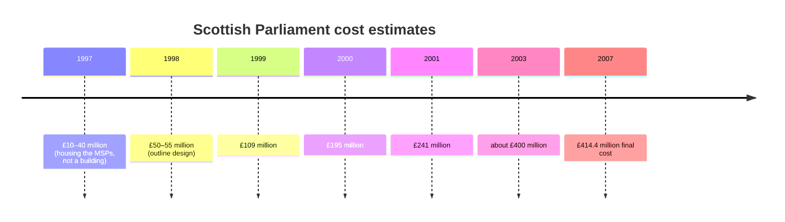
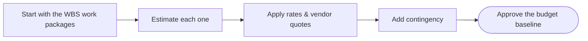
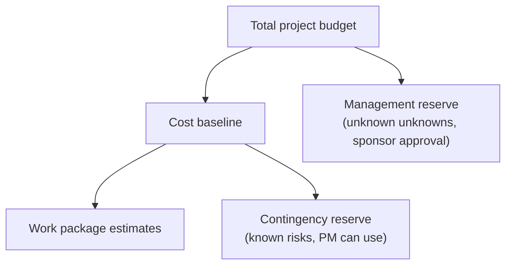

> [!note] What this lecture covers
> Last week you broke the project into a [[Work Breakdown Structure]] and a [[Work Detail Breakdown]]. This week puts money and outside help on top of that structure. Part 1 asks whether you should build, buy, or contract out each piece, and how to compare [[Vendors|vendors]] fairly. Part 2 covers the [[Request for Proposal]] (RFP), the document you use to get vendors to bid. Part 3 explains the main [[Estimating Techniques|estimating techniques]] and why early estimates are so wide. Part 4 turns all of that into a [[Resource Plan|resource plan]] and a [[Budgeting|budget]] with reserves. Part 5 prepares you for Lab 6.

> [!example] Benjamin Franklin, *Advice to a Young Tradesman* (1748)
> "Remember that time is money."
>
> Every case study in this lecture proves the quote in some way. Delays raise costs, rushing causes expensive mistakes, and an hour of someone's work always has a price, even on a student team.



---
# Part 1: Vendors & Procurement

## Make, Buy, or Contract It Out?

For anything your project needs (a system, a service, a piece of software), you have three basic options. This choice is called the [[Make-or-Buy Decision|make-or-buy decision]], and it's part of [[Procurement Management|procurement]].

| Option | What it means | What you gain | What it costs you |
|---|---|---|---|
| **Build in-house** | Your own team designs and builds it | Maximum control and fit to your needs | You carry all the cost, schedule, and skills risk, and you own the maintenance forever |
| **Buy off-the-shelf or subscribe** | Commercial software or a [[SaaS]] product (Software as a Service, sold by subscription) | Faster to start, and the vendor shares the maintenance | You adapt your process to the product, and you depend on the vendor |
| **Contract it out** | Hire a vendor or consultancy to build or run it | Skills and capacity your team doesn't have | You now manage a contract, and the vendor's incentives are not exactly yours |

> [!example] One need, three answers
> Say your college needs a room-booking system.
> - **Build:** the IT team writes its own booking app. It fits perfectly, but they'll be fixing bugs in it for years.
> - **Buy:** you subscribe to an existing booking SaaS. It's running next week, but staff have to work the way the product works.
> - **Contract:** you hire a software firm to build it for you. You get skills you lack, but the firm makes more money if the job grows, and you don't.

> [!warning] "Contract out" doesn't mean "hand off"
> Hiring a vendor moves the work, not the responsibility. You still have to manage the contract and check the results, because what's good for the vendor isn't always what's good for your project.

## Finding and Shortlisting Vendors

The lecture gave five habits for picking vendors without being steered by a good sales pitch:

1. **Define must-haves first.** Write down what the solution must do *before* you look at any product. Otherwise the demos end up defining your requirements for you.
2. **Research beyond the sales pitch.** Use the sources from Lecture 3: case studies, analyst reports, open-source history, and professional communities.
3. **Talk to references.** Ask for customers of a similar size with a similar project, and ask them what went *wrong*, not only what went well.
4. **Test with your own data and scenario.** A demo with perfect sample data proves nothing about your messy real data. Run a trial yourself.
5. **Check the exit.** Can you get your data out? What happens if the vendor is bought by another company or raises its prices? [[Vendor Lock-in|Lock-in]] is a cost, even if it isn't on the quote.

> [!tip] Requirements before demos
> A slick demo shows the features the vendor is proud of. If you haven't written your must-haves yet, those features quietly become your "requirements," and you end up judging every other vendor by one company's strengths.

## Comparing Vendors Fairly: The Weighted Scoring Matrix

A [[Weighted Scoring Matrix|weighted scoring matrix]] lets you compare vendors on several criteria at once, giving each criterion a weight that reflects how much it matters to you.

**How it works:**
1. List the criteria and give each a weight. The weights add up to 100%.
2. Score each vendor on each criterion (here, from 1 to 5).
3. Multiply each score by its weight and add the results. The total is the weighted score out of 5.

| Criterion | Weight | Vendor A | Vendor B | Vendor C |
|---|---|---|---|---|
| Functionality | 30% | 4 | 5 | 3 |
| [[Total Cost of Ownership]] | 25% | 3 | 2 | 5 |
| Support & training | 20% | 5 | 3 | 3 |
| Security & compliance | 15% | 4 | 4 | 3 |
| Track record & references | 10% | 3 | 4 | 3 |
| **Weighted score (out of 5)** | **100%** | **3.85** | **3.60** | **3.50** |

Here is how Vendor A's score is calculated:

```
(4 × 0.30) + (3 × 0.25) + (5 × 0.20) + (4 × 0.15) + (3 × 0.10)
=   1.20   +   0.75    +   1.00    +   0.60    +   0.30
=   3.85
```

> [!important] The best features don't always win
> Vendor B has the best functionality (5 out of 5), but Vendor A wins once cost, support, and security are weighted in. Agree on the weights **before** you see the proposals, so they reflect your priorities and not a favourite vendor someone already likes.

> [!warning] Setting weights after the fact
> If you choose the weights after reading the proposals, it's easy (even without meaning to) to tune them until your favourite vendor comes out on top. Then the matrix just decorates a decision that was already made.

## Case 1: 37signals Leaves the Cloud

> [!example] The decision
> **37signals** is the company behind [[Basecamp]], the tool this class uses. It ran its products on a public cloud provider, with a cloud bill of about **$3.2 million a year**. It re-ran the numbers on a basic make-or-buy question: keep renting computing from the cloud, or buy its own servers and run them itself.

> [!example] The result (the company's own figures)
> - It spent about **$700,000 on new servers**, which it says was fully recouped during 2023.
> - The cloud bill dropped from about **$3.2 million to $1.3 million a year** (the remaining $1.3 million was cloud storage).
> - It estimated about **$2 million saved in 2024**, and projected **well over $10 million** saved over five years.

> [!important] Lessons from 37signals
> - **Make-or-buy is never permanent.** Costs, scale, and prices change, so revisit the decision as the project's situation changes.
> - **Compare options over the same time horizon, including recurring costs.** A low startup price can hide an expensive five years, and the reverse is also true. Here, buying servers cost more up front but less over time.
> - **These are one company's figures for its own situation.** Your project's numbers will differ, so run them for your project instead of copying someone else's answer.

---
# Part 2: Requests for Proposals (RFPs)

## RFI, RFQ, or RFP?

There are three common documents for asking vendors for something. They differ in how much you already know about what you need.

| Document | What it says | When to use it | Binding? |
|---|---|---|---|
| **[[Request for Information]] (RFI)** | "What's out there?" | Early on, to learn what vendors offer | Not an invitation to bid; binds neither side |
| **[[Request for Quotation]] (RFQ)** | "Here's exactly what we need. What will it cost?" | When the specifications are already known and price is the main deciding factor | Invitation to bid on price |
| **[[Request for Proposal]] (RFP)** | "Here's our problem. Show us how you'd solve it." | When you want vendors to propose their own approach | Invitation to bid; you judge more than price |



> [!example] Telling them apart
> - "We're thinking about a learning management system. What kinds of products exist?" is an **RFI**.
> - "We need 20 access points of model X. Quote us a price." is an **RFQ**.
> - "Our students can't get reliable Wi-Fi in the library. Propose a solution, a plan, and a price." is an **RFP**. Vendors are judged on approach, experience, and support as well as price.

## Anatomy of an RFP

A good RFP has six main parts:

| Section | What goes in it |
|---|---|
| **Background & purpose** | Who you are, the problem you're solving, and why the project exists. Pull this from your [[Project Charter]]. |
| **Scope & requirements** | What the solution must do. Separate **mandatory requirements** from **nice-to-haves**, and write them so they can be tested. |
| **Timeline & submission rules** | Key dates (question deadline, due date, decision date), the required format, and where to send the proposal. |
| **Evaluation criteria & weights** | How proposals will be scored. Publishing the weights tells vendors what matters and protects you from a challenge later. |
| **Pricing format & budget** | A required pricing template, so every vendor quotes the same things and the bids can be compared side by side. |
| **Vendor qualifications & terms** | Company background, references, relevant experience, and the contract terms the vendor must accept. |

> [!tip] Your earlier work feeds the RFP
> The background comes from your Charter, and the scope comes from your WBS. The evaluation criteria and weights are the same weighted scoring matrix from Part 1, published in advance.

> [!note] Why publish the weights?
> If a losing vendor complains that the decision was unfair, published weights show that every bid was judged by the same rules, announced before anyone submitted. That's what "protects you from a challenge" means.

## The RFP Process, Start to Finish



> [!important] Same information, same deadline
> Every vendor gets the same information and the same deadline. Questions and answers are shared with **all** bidders, so no one has an advantage. If one vendor asks a clever question and only they get the answer, the competition stops being fair.

## Writing Requirements Vendors Can Actually Bid On

| Vague: hard to bid, hard to score | Clear: testable, comparable |
|---|---|
| "The system must be fast and secure." | "Pages must load in under 2 seconds with 500 users online at once." |
| "We need good reporting." | "Must produce a weekly attendance report as a PDF and CSV." |
| "The vendor should provide reasonable support." | "Support by phone and email, 8 a.m. to 6 p.m. Eastern, weekdays, with a 4-hour response to urgent issues." |

With vague requirements, two vendors will read them differently, price them differently, and you can't fairly compare the bids. One vendor's "fast" is another's "slow."

> [!tip] Same thinking as SMART
> Clear requirements use the same [[SMART Criteria|SMART]] thinking you used for your Charter's success criteria. Ask of each requirement: could someone test this and say "pass" or "fail"?

## Where to Find Real RFPs

| Site | What it is | Why it matters to you |
|---|---|---|
| **[CanadaBuys](https://canadabuys.canada.ca)** | Federal tender notices; the online home for doing business with the Government of Canada and the broader public sector | Search real IT tenders and see how requirements and criteria are written |
| **[Ontario Tenders Portal](https://ontariotenders.app.jaggaer.com)** | Bidding portal for the Government of Ontario and broader public sector organizations | Free to register and view opportunities posted by ministries and broader public sector organizations |
| **[OECM](https://oecm.ca)** | Not-for-profit collaborative sourcing partner for Ontario's education sector | Shows how institutions like colleges buy IT together through marketplace agreements |
| **[SAM.gov](https://sam.gov)** | U.S. federal contract opportunities | Large library of IT requirements, useful for comparison |

> [!important] For Lab 6
> Choose at least one real IT RFP from a site like these and review it before you write your own.

## How to Read an RFP in Ten Minutes

Read these parts, in roughly this order:

1. **Dates first.** Find the question deadline and the submission deadline. A great proposal that arrives late is usually disqualified.
2. **Mandatory requirements.** Failing one of these usually eliminates the bid, whatever the price.
3. **Evaluation criteria and weights.** The weights show what the buyer cares about most. If cost is 20% and technical approach is 50%, price alone won't win.
4. **Budget and pricing format.** Is there a stated ceiling? A required template? This tells you how the bids will be compared.
5. **Deliverables, timeline, and terms.** What will actually be delivered, by when, and under what contract conditions?

> [!tip] Reading from the vendor's side
> These five steps are what a vendor does when deciding whether to bid. Knowing them helps you write a better RFP, because you can check that your own dates, mandatory items, and weights are easy to find.

## Case 2: Queensland Health Payroll

> [!example] The project
> The Queensland government in Australia contracted **IBM**, as lead contractor, on a **fixed-price contract of A$6.19 million** to build a new payroll system for Queensland Health, its public health department.

> [!warning] The failure
> The system went live roughly **two and a half years later** than contracted and barely worked. The cost of developing and operating it properly was later estimated at about **A$1.2 billion**. The Commission of Inquiry blamed serious shortcomings in contract and project management, and "unwarranted urgency and a lack of diligence" by State officials, and called it "an example of serious failure."

> [!important] Lessons from Queensland Health
> - **A fixed price protects you only if the scope is well defined.** The inquiry found poor scoping decisions and a failure to hold the vendor to account for a working payroll system. A [[Fixed-Price Contract|fixed-price contract]] fixes the price of *what's written down*. If the scope is unclear, the "fixed" price isn't fixed at all.
> - **Urgency is the enemy of [[Due Diligence|due diligence]].** Rushing the procurement meant problems were found after the contract was signed, when they were most expensive to fix.
> - **Payroll looks routine but isn't.** Canadian coverage drew a direct comparison to [[Phoenix Pay System|Phoenix]], the pay system from Lecture 5. Payroll is a classic example of work that looks simple and hides huge complexity in the requirements.

---
# Part 3: Estimating Techniques

## The Cone of Uncertainty

The [[Cone of Uncertainty]] shows how far off an estimate can be, depending on *when* in the project you make it.

| When the estimate is made | Typical range (actual ÷ estimate) | High-to-low spread |
|---|---|---|
| Initial concept (an idea) | about 0.25× to 4× | 16× |
| Approved product definition | about 0.5× to 2× | about 4× |
| Requirements and design complete | about 0.8× to 1.25× | about 1.6× |

> [!example] What the numbers mean
> If you estimate $100,000 at the initial-concept stage, the real cost could land anywhere from about **$25,000 to $400,000**. Once requirements and design are complete, the same $100,000 estimate would typically land between about **$80,000 and $125,000**.

The slide's diagram draws this as a cone lying on its side: wide on the left at the project start (rough, high-risk estimates), narrowing through the middle as estimates are refined, and closing to a point at completion, when the final budget and schedule are known.



> [!important] Decisions narrow the cone, not time
> Early estimates are wide by nature. The cone narrows only as **decisions remove uncertainty**, not just because time passes. Spending more time estimating at the concept stage does **not** make the estimate more accurate. (Steve McConnell, via Construx.)

> [!warning] Treating an early guess as a promise
> An estimate from the wide end of the cone should be presented as a **range**, not a single number. If you give a sponsor one number at the concept stage, it will be remembered as a commitment. The Scottish Parliament case below shows what happens next.

## Five Estimating Techniques

| # | Technique | How it works | Strength | Weakness |
|---|---|---|---|---|
| 1 | **[[Expert Judgment]]** | Ask people who have done similar work | Fast and useful | Only as good as the experts' experience and honesty |
| 2 | **[[Analogous Estimating\|Analogous]]** | Start from the actual cost or duration of a similar past project and adjust it | Quick, good for early estimates | Depends on how similar the past project really is |
| 3 | **[[Parametric Estimating\|Parametric]]** | A unit rate times a quantity, e.g. cost per workstation × number of workstations | Accurate when the rate is reliable | Wrong rate, wrong estimate |
| 4 | **[[Bottom-Up Estimating\|Bottom-Up]]** | Estimate every work package and task from your WBS, then add them up | Most accurate | Most effort |
| 5 | **[[Three-Point Estimating\|Three-Point]]** | Estimate optimistic, most likely, and pessimistic values and combine them | Shows the uncertainty instead of hiding it | Needs three honest numbers per task |

> [!example] The same project, estimated four ways
> Setting up a new computer lab with 30 workstations:
> - **Expert judgment:** the senior technician says, "Labs like this usually take us about three weeks."
> - **Analogous:** "Last year's 20-seat lab cost $40,000. This one is 50% bigger, so roughly $60,000."
> - **Parametric:** "Each workstation costs $1,500 fully installed. 30 × $1,500 = $45,000."
> - **Bottom-up:** cost every work package in the WBS (furniture, cabling, imaging, testing) and add them up.

> [!tip] Use more than one
> Each technique has a blind spot, so the lecture's advice is to use **more than one** and compare. If the analogous and bottom-up estimates are far apart, that gap tells you something is missing or misjudged.

## Three-Point Estimating: A Worked Example

For each task, ask for three numbers:

- **a** = optimistic (everything goes well)
- **m** = most likely
- **b** = pessimistic (things go wrong)

Then combine them using [[PERT]]:

```
PERT estimate:   E  = (a + 4m + b) ÷ 6
Spread:          SD = (b − a) ÷ 6
```

**SD** stands for *standard deviation*, a measure of how spread out the possible results are. A bigger SD means more uncertainty. PERT is the technique from the 1950s Polaris program that you met in Lecture 5.

> [!example] Configuring the firewall rules
> - a = 2 days
> - m = 5 days
> - b = 14 days
>
> ```
> PERT:  (2 + 4×5 + 14) ÷ 6 = (2 + 20 + 14) ÷ 6 = 36 ÷ 6 = 6 days
> SD:    (14 − 2) ÷ 6 = 12 ÷ 6 = 2 days
> ```
>
> A simple average of the three, (2 + 5 + 14) ÷ 3 = **7 days**, gives a different answer.

> [!important] Why the answer is above "most likely"
> The most likely value is 5 days, but the PERT estimate is 6. The long pessimistic tail (14 days is much further from 5 than 2 is) pulls the estimate up. That's useful information for the schedule and for the [[Risk Register|risk register]]: this task has more room to go wrong than to go right.

> [!note] Why "4m"?
> PERT gives the most likely value four times the weight of each extreme, so the result stays close to "most likely" while still feeling the pull of the optimistic and pessimistic cases. The divisor is 6 because 1 + 4 + 1 = 6.

## Bottom-Up Estimating: Rolling Up Your WBS

Bottom-up estimating takes the hours from your Work Detail Breakdown, multiplies each by a labour rate, and adds everything up. Here is the Campus Wi-Fi example from Lecture 5 (illustrative hours and rates):

| WBS ID | Work package | Hours | Rate | Cost |
|---|---|---|---|---|
| 1.1 | Coverage survey report | 24 | $60/hr | $1,440 |
| 1.2 | Access-point placement plan | 16 | $60/hr | $960 |
| 3.1 | Cabling installed | 60 | $55/hr | $3,300 |
| 3.2 | Access points mounted | 34 | $55/hr | $1,870 |
| 4.2 | Staff training delivered | 12 | $60/hr | $720 |
| | **Labour total** | **146** | | **$8,290** |

> [!tip] This is why Lab 5 came first
> You can only roll up what you've already broken down, and your Work Detail Breakdown gives the hours. Notice that 3.2 "Access points mounted" is 34 hours, the same total as the five tasks you listed for it last week.

## Case 3: The Scottish Parliament Building

> [!example] The project
> Plans for a new Scottish Parliament building at Holyrood in Edinburgh started with figures of **£10–40 million in 1997**. That was a Scottish Office figure for housing the MSPs (Members of the Scottish Parliament), not a finished building. When the design was chosen in 1998, the estimate was **£50–55 million**, based on only an outline design.

> [!warning] The failure
> The estimates kept climbing:



The final cost was roughly **eight times the 1998 estimate**. The [[Fraser Inquiry]] found:
- an unrealistic early estimate;
- a rigid programme;
- a brief that stressed design over cost;
- a contract type chosen without evaluating its financial risks.

> [!important] Lessons from the Scottish Parliament Building
> - **An early estimate belongs at the wide end of the cone.** An estimate built on an outline design should have been presented as a **range with a clear caveat**, not as a single number that politicians then treated as a commitment.
> - **Cost must stay a priority alongside quality.** The brief stressed design and quality, and was never updated as the cost picture changed.
> - **Bad news must travel upward.** The inquiry found that ministers were not told of cost concerns, and officials ignored their cost consultants' advice.

## Case 4: Boston's Big Dig

> [!example] The project
> The **Central Artery/Tunnel Project** replaced an elevated highway through downtown Boston with an underground tunnel and added a new Charles River crossing. It was originally estimated at about **$2.8 billion**, with completion scheduled for **1998**.

> [!warning] The failure
> By the time construction began, the estimate had already risen to **$5.8 billion**. The project finished in **December 2007**, about nine years after the original target, at a cost of about **$14.6 billion**. Causes included:
> - a **seven-year environmental review**, during which inflation raised costs;
> - difficult ground conditions;
> - redesigns;
> - an owner with little experience of a project of this scale.

> [!important] Lessons from the Big Dig
> - **Delay costs money even when nothing is built.** A seven-year approval period meant inflation was already eating the original estimate before work started. ("Time is money.")
> - **Conditions you haven't investigated are risks you haven't priced.** In construction it's the ground. In IT, the equivalent is the [[Legacy Systems|legacy systems]] and data you haven't examined.
> - **Oversight matters as much as estimating.** An owner that depends on its contractor to supervise itself loses the ability to challenge the numbers.

---
# Part 4: Resource Plan & Budget

## What Goes in a Resource Plan?

A [[Resource Plan|resource plan]] lists everything the project needs to get the work done. It has three groups:

| Group | What to include |
|---|---|
| **People** | Which roles and skills you need, for how many hours, and whether those people are actually available. Include their cost rate, even for a student team. |
| **Equipment, software & cloud** | Hardware, licences, and subscriptions, plus test or staging environments. Note which are **one-time** purchases and which are **recurring**. |
| **Services & vendors** | Contractors, consultants, training, and support agreements. Link each to the vendor evaluation or RFP that will select it. |

> [!tip] Why put a rate on student hours?
> Your team isn't paid, but your time still has a cost. Putting a rate on it lets you build a realistic budget and practise the same habits you'll need on a paid project.

## Real-World Example: Brooks's Law

> [!example] Brooks's Law
> In *The Mythical Man-Month* (1975), **Fred Brooks**, who managed IBM's OS/360 software project, wrote that **adding manpower to a late software project makes it later**. This is known as [[Brooks's Law]].

**Why it happens:**
- New people have to be trained by the people who are already busy, so the experienced team slows down.
- Communication grows quickly with team size. A team of **5** has **10** possible pairs of people to coordinate. A team of **10** has **45**.

The number of pairs follows the formula:

```
pairs = n × (n − 1) ÷ 2

n = 5   →  5 × 4 ÷ 2  = 10
n = 10  →  10 × 9 ÷ 2 = 45
```

Doubling the team from 5 to 10 more than quadruples the communication paths.

> [!important] For your resource plan
> Don't assume that doubling the people halves the time. Check availability, plan onboarding, and add people **early**, not as a rescue.

## Sources of Project Costs

Costs can be sorted three different ways. Each way asks a different question.

| Classification | The two types | Examples | Why it matters |
|---|---|---|---|
| **[[Direct and Indirect Costs\|Direct vs. Indirect]]** | **Direct:** caused by this project. **Indirect:** shared costs that support many projects | Direct: team labour, hardware, licences, vendor fees. Indirect: office space, utilities, general admin, general IT support | Budget the direct costs. Know the indirect ones, because your organization may allocate them to you |
| **[[Fixed and Variable Costs\|Fixed vs. Variable]]** | **Fixed:** doesn't change with the amount of use. **Variable:** scales with use or size | Fixed: a licence fee, a hardware purchase. Variable: cloud usage, per-user pricing, hourly contractors | Variable costs are where surprises hide. Ask, "What happens to this bill if usage doubles?" |
| **One-Time vs. Recurring** | **One-time:** paid once. **Recurring:** paid again and again | One-time: setup, purchase, implementation, initial training. Recurring: subscriptions, support contracts, maintenance, monitoring | A project's budget ends at go-live; the recurring costs don't |

> [!warning] The cost that outlives the project
> When the project closes, the team moves on, but the subscription bill keeps arriving. If the recurring costs weren't in the business case, someone else inherits a cost nobody planned for.

## Total Cost of Ownership (TCO)

> [!note] Definition
> **[[Total Cost of Ownership]] (TCO)** is the full cost of a solution over its useful life: purchase or build, implementation, training, support, upgrades, and the cost of eventually replacing it or getting your data out.

- **The purchase price is often the smallest number you'll see.** A "free" tool still costs setup time, training, and the support burden on your team.
- **Compare options over the same time horizon.** 3 to 5 years is common. This is the lens that made 37signals' cloud decision worth revisiting.
- **Put TCO in your vendor evaluation.** It was 25% of the scoring matrix in Part 1, so a low sticker price can't win by itself.

> [!example] Sticker price vs. TCO
> Tool X costs $0 to buy but needs 80 hours of setup and 10 hours of support a month. Tool Y costs $3,000 a year but needs almost no setup. Over three years, with staff time at $60/hr, Tool X's "free" option costs:
> ```
> setup:    80 h × $60            =  $4,800
> support:  10 h × 36 months × $60 = $21,600
> total:                            $26,400
> ```
> Tool Y costs $9,000 over the same period. The free tool turns out to be the expensive one.
>
> *(These numbers are made up to show the idea. They are not from the slides.)*

## Building the Project Budget



> [!important] The budget is a roll-up of the WBS
> Anything not in the WBS has no cost line, and every cost line should trace back to a WBS element. That's the same rule as last week ("if it isn't in the WBS, it isn't in the project"), now applied to money. The approved result is the [[Cost Baseline|budget baseline]].

## Example Budget: Campus Wi-Fi Expansion (Illustrative)

| Category | Basis | Cost |
|---|---|---|
| Labour | 146 hours from the WBS roll-up | $8,290 |
| Access points | 20 units × $420 | $8,400 |
| Network switches | 2 units × $1,100 | $2,200 |
| Cabling & mounting materials | Vendor quote | $1,850 |
| Controller software licence | 3-year subscription | $1,500 |
| **Subtotal** | | **$22,240** |
| Contingency (15%) | Estimate uncertainty and known risks | $3,336 |
| **Total budget** | | **$25,576** |

Look at the **Basis** column. Each line uses one of the techniques from Part 3:
- labour is **bottom-up** (from the WBS roll-up);
- access points and switches are **parametric** (units × unit price);
- cabling comes from a **vendor quote**.

The contingency is 15% of the subtotal: $22,240 × 0.15 = $3,336.

> [!important] Notice the recurring cost
> The controller licence continues after go-live, so the 3-year basis is part of the TCO, not a footnote.

## Contingency vs. Management Reserve

| | **[[Contingency Reserve]]** | **[[Management Reserve]]** |
|---|---|---|
| **Covers** | Risks you already know about, plus estimate uncertainty ("known unknowns") | The "unknown unknowns," problems no one could predict |
| **Part of the cost baseline?** | Yes | No. In [[PMBOK]] it sits outside the cost baseline but is part of the total project budget |
| **Who can spend it** | The project manager, for those identified risks | Not the PM alone. Using it normally requires approval from the sponsor or management |
| **How much** | Many organizations start at 10–20%, adjusted for how uncertain the estimates are. Your sponsor's policy decides | Set by the organization |
| **Why it exists** | The earlier you are in the Cone of Uncertainty, the more you need | Keeps the unexpected visible and controlled instead of quietly absorbed into the budget |



> [!example] Telling the two apart
> - You know the old building might have asbestos behind the walls where cables will run. You add money in case removal is needed. That's **contingency**: a known risk.
> - Halfway through, a supplier goes bankrupt and every access point must be re-sourced at a higher price. Nobody saw it coming. That's what the **management reserve** is for, and the PM has to ask the sponsor to release it.

---
# Part 5: This Week in Lab & Looking Ahead

## Lab 6

1. **Bring** your approved WBS from Lab 5, especially the table with owners and hour estimates, plus your Work Detail Breakdown.
2. **In Lab 6 you will:**
   - review a real IT RFP;
   - write a resource plan;
   - estimate costs using **at least two techniques**;
   - build a budget with contingency;
   - draft an RFP for one item your project needs to buy.
3. **Upload** your budget and RFP draft to Basecamp's **Docs & Files**, as planned for this week.

---
# Key Takeaways

- **Make, buy, or contract is a decision to compare, not assume.** Use a weighted scoring matrix and total cost of ownership, and agree on the weights before you see the proposals.
- **An RFP is a requirements document first.** Clear, testable requirements, published evaluation criteria, and a standard pricing format let you compare bids fairly.
- **Estimates are ranges that narrow over time.** Use more than one technique, show uncertainty with three-point estimates, and build the final numbers bottom-up from your WBS.
- **Budget the whole life, with a reserve.** Include recurring costs and add contingency so surprises are planned for instead of absorbed.

---
# Exercises

### Exercise 1 (Direct application)
For each situation, say whether you'd send an RFI, an RFQ, or an RFP, and why.
(a) Your college needs 40 copies of a specific laptop model with a set configuration.
(b) Your team has heard of "digital signage" systems but doesn't know what's on the market.
(c) The library's study-room booking process is chaotic, and you want vendors to suggest a solution.

> [!success]- Answer key
> - (a) **RFQ.** The specification is fully known (model and configuration), so price is the main deciding factor.
> - (b) **RFI.** You're still asking "what's out there?" It's an early learning step and binds neither side.
> - (c) **RFP.** You know the problem but not the solution. Vendors propose their own approach, and you judge approach, experience, and support as well as price.

### Exercise 2 (Direct application)
A task has these estimates: optimistic 3 days, most likely 6 days, pessimistic 15 days. Calculate the PERT estimate, the standard deviation, and the simple average. Why are they different?

> [!success]- Answer key
> ```
> PERT: (3 + 4×6 + 15) ÷ 6 = (3 + 24 + 15) ÷ 6 = 42 ÷ 6 = 7 days
> SD:   (15 − 3) ÷ 6 = 12 ÷ 6 = 2 days
> Simple average: (3 + 6 + 15) ÷ 3 = 24 ÷ 3 = 8 days
> ```
> PERT gives the most likely value four times the weight, so it stays closer to 6 than the simple average does. Both are above the most likely value because the pessimistic tail (9 days above m) is much longer than the optimistic one (3 days below m). That tells you this task is more likely to run late than early, which belongs in the schedule and the risk register.

### Exercise 3 (Direct application)
Rewrite each vague requirement so a vendor could bid on it and you could test it:
(a) "The website should be easy to use on phones."
(b) "Backups must be done regularly."
(c) "The system should handle lots of users."

> [!success]- Answer key
> Many good answers exist. Examples:
> - (a) "All pages must display correctly, without horizontal scrolling, on screens 360 pixels wide and up, in the latest versions of Chrome and Safari."
> - (b) "The system must take a full backup every night at 2 a.m. Eastern, keep 30 days of backups, and restore a backup within 4 hours of a request."
> - (c) "The system must support 1,000 users logged in at once, with pages loading in under 2 seconds."
>
> The test, like SMART: can someone check it and say "pass" or "fail"? Each rewrite names a number, a time, or a format.

### Exercise 4 (Applied variation)
Using the scoring matrix from Part 1, the steering committee decides that **cost matters most**. The new weights are: Functionality 20%, TCO 40%, Support 20%, Security 10%, Track record 10%. Recalculate the three scores. Who wins now? What does this say about when the weights should be chosen?

> [!success]- Answer key
> ```
> A: 4×0.20 + 3×0.40 + 5×0.20 + 4×0.10 + 3×0.10 = 0.80 + 1.20 + 1.00 + 0.40 + 0.30 = 3.70
> B: 5×0.20 + 2×0.40 + 3×0.20 + 4×0.10 + 4×0.10 = 1.00 + 0.80 + 0.60 + 0.40 + 0.40 = 3.20
> C: 3×0.20 + 5×0.40 + 3×0.20 + 3×0.10 + 3×0.10 = 0.60 + 2.00 + 0.60 + 0.30 + 0.30 = 3.80
> ```
> **Vendor C wins** (3.80), A is second (3.70), and B drops to last (3.20). The scores didn't change, only the weights did, and the winner changed. That's exactly why the lecture says to agree on the weights **before** seeing the proposals: whoever controls the weights after the fact controls the result.

### Exercise 5 (Applied variation)
Your team grows from 4 people to 8 people two weeks before a deadline. Using Brooks's Law, explain what is likely to happen. How many communication pairs are there before and after?

> [!success]- Answer key
> ```
> 4 people: 4 × 3 ÷ 2 = 6 pairs
> 8 people: 8 × 7 ÷ 2 = 28 pairs
> ```
> Doubling the team almost **quintuples** the communication paths. On top of that, the four original members now have to stop and train the new four, so less real work gets done right when time is shortest. Brooks's Law says this usually makes a late project later. The lecture's advice: add people early, plan onboarding, and don't assume twice the people means half the time.

### Exercise 6 (Applied variation)
Classify each cost in three ways (direct/indirect, fixed/variable, one-time/recurring):
(a) A cloud hosting bill charged per hour of server use.
(b) A share of the college's electricity bill assigned to your project.
(c) Buying 20 access points.
(d) A yearly support contract with the Wi-Fi vendor.

> [!success]- Answer key
> | Cost | Direct/Indirect | Fixed/Variable | One-time/Recurring |
> |---|---|---|---|
> | (a) Cloud hosting per hour | Direct | Variable | Recurring |
> | (b) Share of electricity | Indirect | Fixed (for the project; the share is allocated) | Recurring |
> | (c) 20 access points | Direct | Fixed | One-time |
> | (d) Yearly support contract | Direct | Fixed | Recurring |
>
> Item (a) is the one to watch: variable costs are "where surprises hide." Ask what happens to that bill if usage doubles. Item (d) continues after go-live, so it belongs in the TCO.

### Exercise 7 (Applied variation)
The Wi-Fi project now needs a 25-unit installation instead of 20 access points, and the sponsor's policy sets contingency at 20% because the building is old. Using the example budget from Part 4, recalculate the subtotal, contingency, and total. (Keep every other line the same.)

> [!success]- Answer key
> ```
> Access points: 25 × $420 = $10,500
> Subtotal: $8,290 + $10,500 + $2,200 + $1,850 + $1,500 = $24,340
> Contingency (20%): $24,340 × 0.20 = $4,868
> Total: $24,340 + $4,868 = $29,208
> ```
> In real life the labour line would also rise, since mounting 5 more access points takes more hours. A bottom-up budget should be re-rolled from the WBS whenever the scope changes, which is why "anything not in the WBS has no cost line."

### Exercise 8 (Challenge)
At the concept stage, a manager asks you for "the cost" of a new student portal. Your analogous estimate is $200,000. Using the Cone of Uncertainty and the Scottish Parliament case, explain how you would present this estimate, and what would make the range narrower later.

> [!success]- Answer key
> At the initial-concept stage the typical range is about **0.25× to 4×**, so the honest answer is roughly **$50,000 to $800,000**, with $200,000 as a central figure. Present it as a **range with a clear caveat** ("this is based on a concept only, and will narrow once requirements and design are approved"), not as one number.
>
> The Scottish Parliament's £50–55 million estimate was based on an outline design but was treated by politicians as a commitment. The final cost was about eight times higher.
>
> The range narrows only as **decisions remove uncertainty**: approving the product definition (about 0.5× to 2×), then finishing requirements and design (about 0.8× to 1.25×). Spending more time estimating now won't help. Making decisions will. You'd also re-estimate with a second technique (bottom-up from a WBS) once one exists.

### Exercise 9 (Challenge)
Your team must choose between two learning-tool options over a 3-year horizon:
- **Option 1 (Build):** 300 hours of developer time at $50/hr, then 8 hours/month of maintenance.
- **Option 2 (Subscribe):** $250/month SaaS, plus 20 hours of setup at $50/hr. Data export is only possible in a proprietary format.

Calculate the 3-year TCO for each. Which would you recommend, and what non-price factor from the lecture should you raise?

> [!success]- Answer key
> ```
> Option 1: build      300 × $50           = $15,000
>           maintain   8 × 36 × $50        = $14,400
>           total                            $29,400
>
> Option 2: setup      20 × $50            =  $1,000
>           subscribe  $250 × 36           =  $9,000
>           total                            $10,000
> ```
> On TCO, **Option 2** is far cheaper over 3 years. But the lecture says to **check the exit**: a proprietary export format means **lock-in**, and "lock-in is a cost, even if it isn't on the quote." Ask what happens if the vendor raises prices or is acquired. You might still choose Option 2, but you'd score this risk in your weighted matrix (e.g. under security/compliance or track record) and try to negotiate an open export format. Like 37signals, revisit the decision later, since make-or-buy is never permanent.

### Exercise 10 (Challenge)
You're writing an RFP for a help-desk ticketing system for your project. Draft one short line for each of the six RFP sections, and list two things you would do during the process to keep it fair.

> [!success]- Answer key
> Example (many correct answers exist):
> - **Background & purpose:** "Sault College IT runs a 6-person help desk that tracks requests by email. Requests get lost, and we need a ticketing system (from our Charter)."
> - **Scope & requirements:** Mandatory: "Must create a ticket from an email within 1 minute," "Must report average response time weekly as CSV." Nice-to-have: "Mobile app for technicians."
> - **Timeline & submission rules:** "Questions due March 1; proposals due March 15 by 2 p.m. Eastern as a single PDF to the procurement inbox; decision by April 1."
> - **Evaluation criteria & weights:** Functionality 35%, TCO 25%, Support 20%, Security 10%, References 10%.
> - **Pricing format & budget:** "Use the attached template: one-time setup, per-user monthly fee, training, and 3-year total."
> - **Vendor qualifications & terms:** "Two references from organizations of similar size; vendor must allow full data export in CSV."
>
> Keeping it fair: (1) give every vendor the same information and deadline; (2) share every question and answer with all bidders. Publishing the weights in advance also protects you from a challenge later.

---
# Feynman Practice

Write each explanation in your own words, without looking at the notes. Where the steps below say to mark a word, use `(?)` to flag it.

## Feynman: Make, buy, or contract, and the weighted scoring matrix
- [ ] **1. Explain it as if to a 12-year-old.** You need a birthday cake. You could bake it, buy one at the store, or pay a neighbour to bake it. What do you gain and lose with each choice? Then: how would you pick between three bakeries if you care about taste more than price?
- [ ] **2. Find the jargon.** Reread what you wrote. Mark with `(?)` any word a 12-year-old wouldn't understand (e.g. "SaaS," "vendor," "lock-in," "weighted score").
- [ ] **3. Simplify.** For each `(?)`, write an analogy or example. Why did Vendor B, with the best features, lose to Vendor A? Why must the weights be set before you see the proposals?
- [ ] **4. Organize and test.** Rewrite it in 3-5 sentences. Could you explain in 2 minutes why 37signals changed its make-or-buy decision?

## Feynman: The RFP
- [ ] **1. Explain it as if to a 12-year-old.** Your class wants a company to run the school trip. How is asking "what trips exist?" different from "how much for this exact trip?" and from "here's our problem, show us your best plan"?
- [ ] **2. Find the jargon.** Mark with `(?)` words like "RFI," "RFQ," "mandatory requirement," "evaluation criteria," "pricing template."
- [ ] **3. Simplify.** Explain why "the system must be fast" is a bad requirement, using an example of two vendors reading it differently. Why are vendor questions and answers shared with everyone?
- [ ] **4. Organize and test.** In 3-5 sentences, explain what goes in an RFP and what the Queensland Health case says about fixed prices and rushing.

## Feynman: The Cone of Uncertainty
- [ ] **1. Explain it as if to a 12-year-old.** If someone asks how long a road trip will take before you've picked the destination, how good is your guess? How does your guess change once you've picked the city, then the route?
- [ ] **2. Find the jargon.** Mark with `(?)` words like "estimate range," "spread," "product definition," "caveat."
- [ ] **3. Simplify.** Using the Scottish Parliament building, explain why a single early number is dangerous. Why doesn't spending more time estimating at the start make the estimate better?
- [ ] **4. Organize and test.** Rewrite it in 3-5 sentences, including what actually makes the cone narrow.

## Feynman: Estimating techniques and PERT
- [ ] **1. Explain it as if to a 12-year-old.** How could you guess how long your homework will take: ask an older sibling, remember last week's homework, count pages times minutes per page, or add up each subject one by one?
- [ ] **2. Find the jargon.** Mark with `(?)` words like "analogous," "parametric," "bottom-up," "optimistic," "pessimistic," "standard deviation."
- [ ] **3. Simplify.** Using the firewall example, explain why the PERT answer (6 days) is higher than the "most likely" answer (5 days). What does the long pessimistic tail tell the team?
- [ ] **4. Organize and test.** In 3-5 sentences, explain why you should use more than one technique, and why bottom-up needs a WBS first.

## Feynman: Budget, TCO, and reserves
- [ ] **1. Explain it as if to a 12-year-old.** A "free" video game asks for money every month for new levels. Is it really free? And why would your parents keep two separate piggy banks: one for things they know might break, and one for total surprises?
- [ ] **2. Find the jargon.** Mark with `(?)` words like "total cost of ownership," "recurring," "variable cost," "contingency reserve," "management reserve," "cost baseline."
- [ ] **3. Simplify.** Using the Wi-Fi budget, explain why the 3-year controller licence matters after go-live. Using the Big Dig, explain how delay costs money even when nothing is being built.
- [ ] **4. Organize and test.** Rewrite it in 3-5 sentences, including who is allowed to spend each type of reserve and why Brooks's Law matters for your resource plan.

---
# Flashcards (Anki)

Copy the block below into a `.txt` file and import it in Anki via **File > Import** (Basic note type, fields separated by tab).

```
#separator:tab
#html:false
#tags column:3
What are the three options in a make-or-buy decision?	Build in-house, buy off-the-shelf or subscribe (SaaS), or contract it out to a vendor.	csd318 lecture-06 procurement
What is the main downside of building in-house?	You carry all the cost, schedule, and skills risk, and you own the maintenance forever.	csd318 lecture-06 procurement
What is the main trade-off of buying off-the-shelf or SaaS?	Faster to start and the vendor shares maintenance, but you adapt your process to the product and depend on the vendor.	csd318 lecture-06 procurement
What is the main risk of contracting work out?	You must manage a contract, and the vendor's incentives are not exactly yours.	csd318 lecture-06 procurement
Why should you define must-haves before looking at any vendor product?	Otherwise the demos will define your requirements for you.	csd318 lecture-06 vendors
What should you ask vendor references about?	What went wrong, not just what went well, ideally from customers of similar size and project.	csd318 lecture-06 vendors
Why test a vendor's product with your own data?	A demo with perfect sample data proves nothing about your messy real data.	csd318 lecture-06 vendors
What does "check the exit" mean when choosing a vendor?	Make sure you can get your data out and know what happens if the vendor is acquired or raises prices; lock-in is a cost even if it isn't on the quote.	csd318 lecture-06 vendors
How is a vendor's weighted score calculated?	Multiply each criterion score by its weight (weights total 100%) and add the results.	csd318 lecture-06 scoring-matrix
When should evaluation weights be agreed on, and why?	Before seeing the proposals, so they reflect your priorities rather than a favourite vendor.	csd318 lecture-06 scoring-matrix
In the lecture's matrix, why did Vendor A beat Vendor B despite B having the best features?	Once cost (TCO), support, and security were weighted, A scored 3.85 versus B's 3.60.	csd318 lecture-06 scoring-matrix
What did 37signals decide, and roughly what did its cloud bill drop to?	It moved from renting cloud computing to buying its own servers (~$700,000); the cloud bill fell from about $3.2M to $1.3M a year.	csd318 lecture-06 case-study
What are the main lessons from 37signals leaving the cloud?	Make-or-buy is never permanent; compare options over the same time horizon including recurring costs; run your own numbers.	csd318 lecture-06 case-study
What is an RFI used for?	Early learning about what vendors offer ("What's out there?"); it is not an invitation to bid and binds neither side.	csd318 lecture-06 rfp
When do you use an RFQ?	When specifications are already known and price is the main deciding factor.	csd318 lecture-06 rfp
How is an RFP different from an RFQ?	An RFP describes the problem and asks vendors to propose their own solution; you evaluate approach, experience, and support, not just price.	csd318 lecture-06 rfp
Where does an RFP's background and purpose section come from?	The Project Charter.	csd318 lecture-06 rfp
How should requirements in an RFP's scope section be written?	Separate mandatory requirements from nice-to-haves, and write them so they can be tested.	csd318 lecture-06 rfp
Why publish evaluation criteria and weights in an RFP?	It tells vendors what matters and protects you from a challenge later.	csd318 lecture-06 rfp
Why does an RFP require a pricing template?	So every vendor quotes the same things and bids can be compared side by side.	csd318 lecture-06 rfp
What are the six steps of the RFP process?	Define the need, issue the RFP, answer vendor questions, evaluate proposals, select and negotiate, sign the contract.	csd318 lecture-06 rfp-process
How do you keep the RFP process fair to all vendors?	Give everyone the same information and deadline, and share all questions and answers with all bidders.	csd318 lecture-06 rfp-process
Why are vague requirements like "the system must be fast" a problem in an RFP?	Vendors read and price them differently, so the bids can't be fairly compared.	csd318 lecture-06 requirements
Name a Canadian site where you can find real government IT RFPs.	CanadaBuys (federal) or the Ontario Tenders Portal (Ontario).	csd318 lecture-06 rfp
What is OECM?	A not-for-profit collaborative sourcing partner for Ontario's education sector, through which institutions like colleges buy IT together.	csd318 lecture-06 rfp
When reading an RFP, what should you check first, and why?	The dates (question and submission deadlines), because a late proposal is usually disqualified.	csd318 lecture-06 reading-rfp
What usually happens if a bid fails a mandatory requirement?	It is usually eliminated, whatever the price.	csd318 lecture-06 reading-rfp
What do an RFP's evaluation weights reveal?	What the buyer cares about most; e.g. if cost is 20% and technical approach 50%, price alone won't win.	csd318 lecture-06 reading-rfp
What was the original contract value of the Queensland Health payroll system, and what did it end up costing?	A$6.19 million fixed price; the cost to develop and operate it properly was later estimated at about A$1.2 billion.	csd318 lecture-06 case-study
According to the Queensland Health case, when does a fixed price protect you?	Only when the scope is well defined.	csd318 lecture-06 case-study
Why is urgency called the enemy of due diligence?	Rushing procurement means problems are found after the contract is signed, when they are most expensive.	csd318 lecture-06 case-study
What is the typical estimate range at the initial-concept stage of the Cone of Uncertainty?	About 0.25× to 4× (a 16× spread).	csd318 lecture-06 cone-of-uncertainty
What is the typical estimate range once requirements and design are complete?	About 0.8× to 1.25× (about a 1.6× spread).	csd318 lecture-06 cone-of-uncertainty
What makes the Cone of Uncertainty narrow?	Decisions that remove uncertainty, not simply the passing of time.	csd318 lecture-06 cone-of-uncertainty
Does spending more time estimating at the concept stage make the estimate more accurate?	No. Only decisions that remove uncertainty narrow the range.	csd318 lecture-06 cone-of-uncertainty
What is expert judgment estimating, and its main limitation?	Asking people who have done similar work; it is only as good as their experience and honesty.	csd318 lecture-06 estimating
What is analogous estimating?	Starting from the actual cost or duration of a similar past project and adjusting it; quick and good for early estimates.	csd318 lecture-06 estimating
What is parametric estimating?	A unit rate times a quantity (e.g. cost per workstation × number of workstations); accurate when the rate is reliable.	csd318 lecture-06 estimating
What is bottom-up estimating?	Estimating every work package and task from the WBS, then adding them up; most accurate and most effort.	csd318 lecture-06 estimating
What is the main benefit of three-point estimating?	It shows the uncertainty instead of hiding it.	csd318 lecture-06 estimating
What is the PERT estimate formula?	E = (a + 4m + b) ÷ 6, where a = optimistic, m = most likely, b = pessimistic.	csd318 lecture-06 pert
What is the PERT spread (standard deviation) formula?	SD = (b − a) ÷ 6.	csd318 lecture-06 pert
For the firewall example (a=2, m=5, b=14), what are the PERT estimate and SD?	PERT = 6 days; SD = 2 days.	csd318 lecture-06 pert
Why was the firewall PERT estimate (6 days) above the most likely value (5 days)?	The long pessimistic tail (14 days) pulled the estimate up.	csd318 lecture-06 pert
Why did Lab 5 (WBS) have to come before budgeting?	You can only roll up what you've already broken down; the Work Detail Breakdown gives the hours.	csd318 lecture-06 bottom-up
How much did the Scottish Parliament building's final cost compare to the 1998 estimate?	About eight times higher: £414.4 million versus £50–55 million.	csd318 lecture-06 case-study
How should the Scottish Parliament's early estimate have been presented?	As a range with a clear caveat, not a single number treated as a commitment.	csd318 lecture-06 case-study
What communication lesson does the Scottish Parliament case teach?	Bad news must travel upward; ministers weren't told of cost concerns and officials ignored their cost consultants.	csd318 lecture-06 case-study
What was the Big Dig's original estimate and final cost?	About $2.8 billion originally; about $14.6 billion when finished in December 2007.	csd318 lecture-06 case-study
How did the Big Dig show that delay costs money even when nothing is built?	A seven-year environmental review let inflation eat the original estimate before work started.	csd318 lecture-06 case-study
In IT, what is the equivalent of the Big Dig's uninvestigated ground conditions?	The legacy systems and data you haven't examined.	csd318 lecture-06 case-study
What oversight lesson does the Big Dig teach?	An owner that depends on its contractor to supervise itself loses the ability to challenge the numbers.	csd318 lecture-06 case-study
What are the three groups in a resource plan?	People; equipment, software and cloud; services and vendors.	csd318 lecture-06 resource-plan
Why include a cost rate for people even on a student team?	Everyone's time has a cost, and the budget must reflect it.	csd318 lecture-06 resource-plan
What is Brooks's Law?	Adding manpower to a late software project makes it later (Fred Brooks, The Mythical Man-Month, 1975).	csd318 lecture-06 brooks-law
Why does adding people to a late project slow it down?	New people must be trained by busy team members, and communication pairs grow quickly (5 people = 10 pairs; 10 people = 45).	csd318 lecture-06 brooks-law
What is the difference between direct and indirect costs?	Direct costs are caused by this project (labour, hardware, licences); indirect costs are shared across projects (office space, utilities, admin).	csd318 lecture-06 cost-types
Why are variable costs risky?	They scale with use or size, so surprises hide there; ask what happens if usage doubles.	csd318 lecture-06 cost-types
Why do recurring costs matter after go-live?	The project budget ends at go-live, but recurring costs (subscriptions, support, maintenance) continue.	csd318 lecture-06 cost-types
What is Total Cost of Ownership (TCO)?	The full cost of a solution over its useful life: purchase/build, implementation, training, support, upgrades, and replacement or data exit.	csd318 lecture-06 tco
What time horizon is common for comparing TCO?	3 to 5 years.	csd318 lecture-06 tco
Why include TCO in the vendor scoring matrix?	So a low sticker price can't win by itself.	csd318 lecture-06 tco
What are the five steps for building a project budget?	Start with WBS work packages, estimate each one, apply rates and vendor quotes, add contingency, approve the budget baseline.	csd318 lecture-06 budget
What is the relationship between the budget and the WBS?	The budget is a roll-up of the WBS; anything not in the WBS has no cost line, and every cost line traces to a WBS element.	csd318 lecture-06 budget
What does a contingency reserve cover?	Known risks and estimate uncertainty; it is part of the cost baseline and the PM can use it.	csd318 lecture-06 reserves
What contingency range do many organizations start with?	10–20%, adjusted for how uncertain the estimates are.	csd318 lecture-06 reserves
What does a management reserve cover?	The "unknown unknowns," problems no one could predict.	csd318 lecture-06 reserves
In PMBOK, where does the management reserve sit?	Outside the cost baseline, but inside the total project budget.	csd318 lecture-06 reserves
Who must approve use of the management reserve?	The sponsor or management; the PM can't spend it alone.	csd318 lecture-06 reserves
Why do you need more contingency early in a project?	The earlier you are in the Cone of Uncertainty, the wider your estimates and the more reserve you need.	csd318 lecture-06 reserves
```

---
# Further Reading

- [PMI (Project Management Institute)](https://www.pmi.org)
- [Investopedia: Request for Proposal (RFP)](https://www.investopedia.com/terms/r/request-for-proposal.asp)
- [Investopedia: Total Cost of Ownership](https://www.investopedia.com/terms/t/totalcostofownership.asp)
- [Investopedia: Make-or-Buy Decision](https://www.investopedia.com/terms/m/make-or-buy-decision.asp)
- [Atlassian: Agile project management and estimation](https://www.atlassian.com/agile)
- [Construx (Steve McConnell's company, source of the Cone of Uncertainty slide)](https://www.construx.com)
- [CanadaBuys](https://canadabuys.canada.ca) and [SAM.gov](https://sam.gov) (real RFPs for Lab 6)

---
# Tags

#project-management #CSD318 #procurement #vendors #make-or-buy #rfp #rfi #rfq #weighted-scoring-matrix #estimating #cone-of-uncertainty #pert #three-point-estimating #bottom-up-estimating #resource-plan #brooks-law #budgeting #tco #contingency-reserve #management-reserve #case-studies #PMBOK
