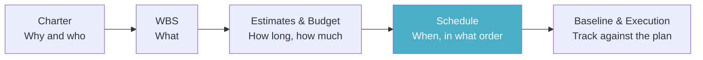
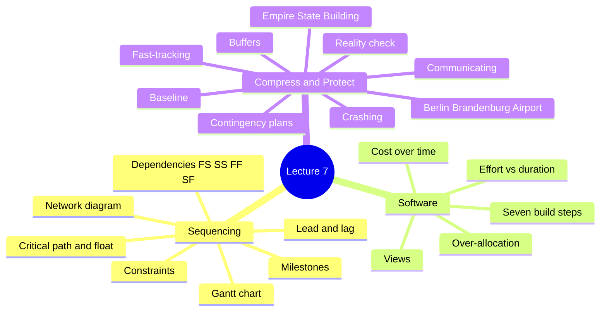
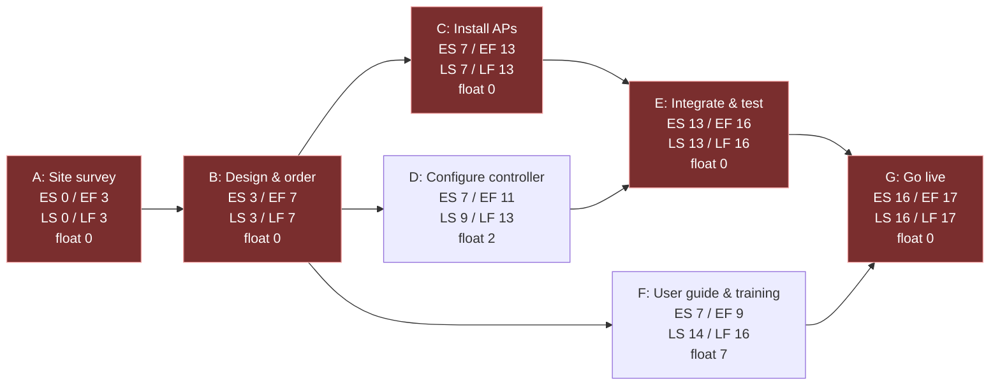
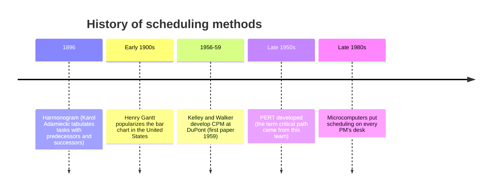
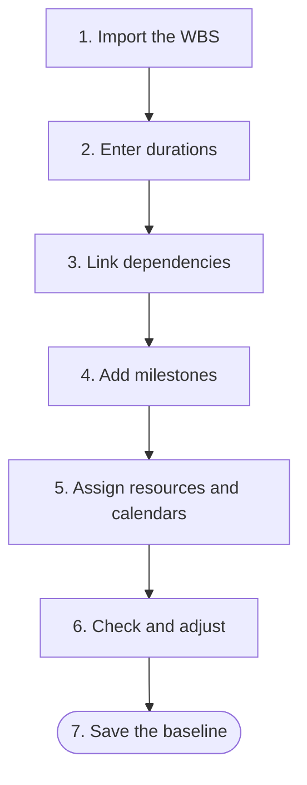
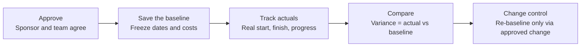

> [!note] What this lecture covers
> So far you have a [[Project Charter]] (why and who), a [[Work Breakdown Structure]] (what), and [[Estimating Techniques|estimates]] and a [[Budgeting|budget]] (how long and how much). Test #1 covered those three. This lecture turns them into a [[Project Schedule|schedule]]: *when* each piece of work happens and *in what order*. Part 1 covers sequencing the work and finding the [[Critical Path]]. Part 2 shows how to build the schedule in software, with resources, calendars, and costs. Part 3 covers compressing the schedule, protecting it with buffers, checking it, and saving a [[Schedule Baseline|baseline]]. Part 4 prepares you for Lab 7.



> [!important] What you should be able to do after this lecture (CO4)
> - **Sequence the work:** link WBS work packages with dependencies, leads, lags, and milestones.
> - **Find the critical path:** calculate the earliest and latest dates and the float for a small network.
> - **Build it in PM software:** durations, resources, calendars, and a saved baseline.
> - **Balance resources and budget:** spot over-allocation and tie the schedule to the cost plan.
> - **Compress and protect it:** crashing, fast-tracking, buffers, and contingency plans.
> - **Reality-check the plan:** test the schedule before you commit to it.

> [!example] Dwight D. Eisenhower, 1957
> "Plans are worthless, but planning is everything."
>
> The schedule you build this week will change. Building it still forces you to work out the order of the work, who does it, and where the risks are, and that thinking stays useful after the dates move.



---
# Part 1: Sequencing the Work

## What a Schedule Adds to Your Plan

Each planning document answers a different question. The schedule is the first one that puts the work on a calendar.

| Document | Question it answers | What it leaves out |
|---|---|---|
| **WBS** | *What* must be produced (deliverables and work packages) | When, in what order, and by whom |
| **Estimates & budget** | *How much*: hours, durations, and costs for each work package | Which weeks the work happens in. A package can be 40 hours of effort without saying when |
| **Schedule** | *When*: start and finish dates, the order of the work, who does it, and which tasks have no room to slip | Nothing new; it combines the other two with a calendar |

> [!note] Definition
> A **project schedule** is where the plan meets the calendar. It takes the work packages from the WBS and the durations from your estimates, puts them in order, assigns people, and produces real dates.

## Dependencies: What Has to Happen Before What

A [[Task Dependencies|dependency]] is a link between two tasks. Task A is the **predecessor** (it comes first) and task B is the **successor** (it depends on A). There are four types.

| Type | Rule | How common | Example from the slides |
|---|---|---|---|
| **[[Finish-to-Start]] (FS)** | B cannot **start** until A **finishes** | The most common type | Install access points, then test coverage |
| **Start-to-Start (SS)** | B can **start** once A has **started** (A doesn't have to be finished) | Common for overlapping work | Start the test plan, then start building the test environment |
| **Finish-to-Finish (FF)** | B cannot **finish** until A **finishes** | Less common | Finish development, then finish testing |
| **Start-to-Finish (SF)** | B cannot **finish** until A **starts** | Rare | New system starts, then the old system shuts down |

The slide drew each type as two bars, A on top and B below:

```
Finish-to-Start (FS)          Start-to-Start (SS)
A  ######                     A  ########
B        ######               B     ########
   (B starts when A ends)        (B starts after A starts)

Finish-to-Finish (FF)         Start-to-Finish (SF)
A  ########                   A       ######
B     ######                  B  #####
   (B ends after A ends)         (B ends once A starts)
```

> [!tip] How to remember them
> Read the name as "A's ___ controls B's ___". In **Finish-to-Start**, A's *finish* controls B's *start*. In **Start-to-Finish**, A's *start* controls B's *finish*. The first word is always about the predecessor and the second word is always about the successor.

> [!example] Why SF makes sense for a system cut-over
> You can't switch off the old payroll system (B) until the new one is up and running (A starts). The old system's *finish* waits for the new system's *start*. If you shut the old one down first, nobody gets paid in between.

## Lead, Lag, and Constraints

| Term | What it does | Example from the slides |
|---|---|---|
| **[[Lead and Lag\|Lead]]** | Lets a successor start **before** its predecessor finishes | Begin writing the user guide 3 days before the build finishes, because the screens are already stable |
| **[[Lead and Lag\|Lag]]** | A required **wait** between two tasks | Allow a 5-day lag after sending an [[Request for Proposal\|RFP]] so vendors can ask questions, or a 2-day lag after ordering equipment |
| **[[Schedule Constraints\|Constraint]]** | A fixed rule on a task, such as "Must finish on" a certain date | A hard date typed into a task |

> [!warning] Use constraints sparingly
> A hard date typed into a task overrides the dependency logic. Once that happens, the software can no longer move the task when something slips, and it can't show you the true critical path. Use a constraint only when a date really is fixed from outside (for example, a government deadline), not as a shortcut for "this is when I hope it happens."

> [!note] Lead vs lag in one line
> A lead *overlaps* two tasks (negative waiting time). A lag *adds a gap* between them (positive waiting time).

## Milestones: Checkpoints, Not Work

> [!note] Definition
> A **[[Milestones|milestone]]** marks an event, such as charter approved, WBS signed off, vendor selected, user acceptance complete, or go-live. It has a duration of **0 days** because no work happens "inside" it. It just records that something is done.

- **Summary tasks roll up work.** The higher WBS levels become [[Summary Tasks|summary tasks]] in the schedule. A summary task shows the start, finish, and total duration of everything beneath it.
- **Use milestones for hand-offs.** Every deliverable that another team or the sponsor depends on deserves a milestone.
- **Do not overuse them.** If everything is a milestone, nothing stands out. Aim for a handful that a sponsor would recognize.

> [!example] Good and bad milestones
> "Vendor selected" is a good milestone: the sponsor cares about it and procurement hands off to the build team at that point. "Sent email to vendor #3" is not. It's a small step of work the sponsor would never ask about.

## Worked Example: Campus Wi-Fi Expansion (Illustrative)

The slides used one example for the whole of Part 1. Durations are in working days, and the numbers were invented for teaching.

| ID | Activity | Duration (days) | Depends on |
|---|---|---|---|
| A | Site survey | 3 | none |
| B | Design & order equipment | 4 | A |
| C | Install access points | 6 | B |
| D | Configure controller software | 4 | B |
| E | Integrate & test coverage | 3 | C, D |
| F | Write user guide & train help desk | 2 | B |
| G | Go live | 1 | E, F |

> [!tip] The quick question from the slide
> The durations add up to **23 days**. But C, D, and F all depend only on B, so they can run **at the same time**. What's the shortest the project could possibly take?
>
> The answer is **17 days**. The next section shows how to get it.

## The Network Diagram: Forward and Backward Pass

A [[Network Diagram|network diagram]] draws each task as a box and each dependency as an arrow. You then make two passes through it. This is the [[Critical Path Method]] (CPM).



**How to read a box on the slide:** the top corners are the **earliest start / earliest finish** (from the forward pass), and the bottom corners are the **latest start / latest finish** (from the backward pass). Red boxes have zero float.

### Step 1: The forward pass (earliest dates)

Go left to right. For each task:

```
Earliest Start (ES)  = the largest EF of all its predecessors (0 for the first task)
Earliest Finish (EF) = ES + duration
```

| Task | ES | Calculation | EF |
|---|---|---|---|
| A | 0 | 0 + 3 | 3 |
| B | 3 | 3 + 4 | 7 |
| C | 7 | 7 + 6 | 13 |
| D | 7 | 7 + 4 | 11 |
| F | 7 | 7 + 2 | 9 |
| E | **13** (larger of C = 13 and D = 11) | 13 + 3 | 16 |
| G | **16** (larger of E = 16 and F = 9) | 16 + 1 | 17 |

The project's earliest finish is **day 17**.

> [!warning] Pick the *largest* predecessor EF
> E can't start until **both** C and D are done. D finishes on day 11, but C isn't done until day 13, so E waits until 13. Taking the smaller number is the most common mistake in the forward pass.

### Step 2: The backward pass (latest dates)

Go right to left, starting from the project finish (17). For each task:

```
Latest Finish (LF) = the smallest LS of all its successors (project finish for the last task)
Latest Start (LS)  = LF − duration
```

| Task | LF | Calculation | LS |
|---|---|---|---|
| G | 17 | 17 − 1 | 16 |
| E | 16 | 16 − 3 | 13 |
| F | 16 | 16 − 2 | 14 |
| C | 13 | 13 − 6 | 7 |
| D | 13 | 13 − 4 | 9 |
| B | **7** (smallest of C = 7, D = 9, F = 14) | 7 − 4 | 3 |
| A | 3 | 3 − 3 | 0 |

### Step 3: Float

```
Float = LS − ES   (or LF − EF, which gives the same number)
```

| Task | LS − ES | Float |
|---|---|---|
| A, B, C, E, G | same start dates | **0** |
| D | 9 − 7 | **2** |
| F | 14 − 7 | **7** |

The tasks with zero float form the critical path: **A → B → C → E → G = 3 + 4 + 6 + 3 + 1 = 17 days**.

## The Critical Path and Float

> [!note] Critical path
> The **[[Critical Path|critical path]]** is the longest chain of dependent tasks. It sets the shortest possible project duration. In the Wi-Fi example it is A → B → C → E → G, 17 days. Any delay on it delays the finish date, day for day.

> [!note] Float (slack)
> **[[Float (Slack)|Float]]**, also called **slack**, is how long a task can slip without delaying the project. Critical tasks have zero float. Configure controller software (D) has **2 days** of float. The user guide and training (F) has **7**.

> [!important] Why it matters
> The critical path tells you where to focus your attention, where to put your best people, and where you have room to move work. Watch **near-critical paths** too: if D uses up its 2 days of float, it becomes critical, and from then on any delay to D delays go-live.

> [!warning] "Longest path" gives the "shortest project"
> This sounds backwards at first. The critical path is the *longest* chain of work, and the project can't finish until that chain is done. So the length of the longest chain is the *shortest* time the whole project can take.

## The Same Schedule as a Gantt Chart

A [[Gantt Chart]] shows the same information as bars on a timeline. The slide drew critical tasks in red, non-critical tasks in blue, and float as a dashed box after the blue bars. In text form:

```
Working day         0   2   4   6   8   10  12  14  16
                    |   |   |   |   |   |   |   |   |
A Site survey       ######                                critical
B Design & order          ########                        critical
C Install APs                     ############            critical
D Configure ctrl                  ########....            float 2
E Integrate & test                            ######      critical
F User guide                      ####..............      float 7
G Go live                                         ##      critical

## = one working day of work    .. = one day of float (room to slip)
```

> [!tip] Network diagram or Gantt chart?
> They hold the same data. The network diagram makes the **logic** (which task depends on which) easy to see. The Gantt chart makes the **timing** (what happens in which week) easy to see. Sponsors usually prefer the Gantt chart.

## Where These Ideas Come From



| When | What happened |
|---|---|
| **1896** | Polish researcher **Karol Adamiecki** created the **harmonogram**, a table of tasks with their predecessors and successors. |
| **Early 1900s** | **Henry Gantt** popularized the bar chart in the United States through his books. |
| **1956 to 1959** | **Kelley and Walker** developed the **Critical Path Method** at DuPont. The first paper was published in 1959. |
| **Late 1950s** | **[[PERT]]** was developed around the same time as CPM. The term "critical path" came from the PERT team. |
| **Late 1980s** | Microcomputers put schedule calculation on every project manager's desk. |

> [!important] The software does the same math
> Modern PM software automates the same logic you just did by hand: durations plus dependencies produce dates, a critical path, and float.

---
# Part 2: Building the Schedule in Software

## Building the Schedule, Step by Step



1. **Import the WBS.** Work packages become tasks. Higher WBS levels become summary tasks.
2. **Enter durations.** Use your Lab 6 estimates. Convert hours of effort into working days.
3. **Link dependencies.** Mostly Finish-to-Start. Every task needs a predecessor and a successor.
4. **Add milestones.** A few meaningful checkpoints, such as approvals and go-live.
5. **Assign resources and calendars.** Who does each task, how much of their time it takes, and when they are actually available.
6. **Check and adjust.** Find the critical path and any over-allocated people, then fix them.
7. **Save the baseline.** Freeze the approved plan so you can measure progress against it.

> [!tip] "Every task needs a predecessor and a successor"
> A task with no successor is a dead end: if it slips, the software won't move anything after it, so the delay is invisible. Every task should lead, eventually, to the final milestone. (The only exceptions are the project start and the project finish.)

## One Schedule, Several Views

PM software shows the same data in different ways for different people.

| View | What it shows | Best for |
|---|---|---|
| **Gantt / Timeline** | Bars on a calendar with dependencies and the critical path | Sponsors, and checking the logic |
| **Board / List** | Tasks as cards in columns such as To Do, Doing, Done | The team's day-to-day work |
| **Calendar** | Deadlines, milestones, and meetings by date | Reminders, and for people outside the project |
| **Workload** | Hours per person per week | Spotting over-allocated and idle people before they become a problem |

> [!note] The board view
> The board view is the same idea as a [[Kanban]] board from [[Agile]] methods. It's the same schedule underneath, shown in the format the team uses every day.

## Effort Is Not Duration

> [!note] Two different numbers
> - **[[Effort vs Duration|Effort]]** (also called *work*) is the total number of person-hours a task needs.
> - **Duration** is how many working days pass on the calendar from start to finish.
>
> They differ because people are not always available full time.

Task: configure 12 network switches (24 hours of effort).

| Assignment | Effort | Availability | Duration |
|---|---|---|---|
| 1 technician, full time | 24 hours | 8 hours/day | 3 working days |
| 1 technician, shared with other work | 24 hours | 4 hours/day | 6 working days |
| 2 technicians, full time | 24 hours | 16 hours/day | 1.5 working days* |

```
Duration = Effort ÷ Available hours per day

24 ÷ 8  = 3 days
24 ÷ 4  = 6 days
24 ÷ 16 = 1.5 days*
```

\* Only if the work splits cleanly between two people. Adding people to a task adds coordination too. This is [[Brooks's Law]] from last week.

> [!important] In the software
> Enter the **effort** and the **people**, and the software calculates the duration from their calendars. Set working days, holidays, and each person's availability, or the dates will be fiction.

> [!warning] Treating a part-time person as full time
> A student who can give the project 10 hours a week will not finish a 40-hour task in one week. If the calendar says "full time" for everyone, every date in the schedule will be too early.

## Over-Allocation: When One Person Is Booked Twice

**[[Over-Allocation|Over-allocation]]** means a person is booked for more hours than they can work.

| Task | Mon | Tue | Wed | Thu |
|---|---|---|---|---|
| Configure switches (Dana) | 8 h | 8 h | 8 h | none |
| Test coverage (Dana) | none | 8 h | 8 h | 8 h |
| **Dana's total** | **8 h** | **16 h** | **16 h** | **8 h** |

On Tuesday and Wednesday, Dana is booked for 16 hours in an 8-hour day, which is **200%**.

**Your options:**

| Option | What you do | Effect on the end date |
|---|---|---|
| **[[Resource Leveling\|Level]]** | Delay one task until Dana is free | The end date **may move** |
| **[[Resource Smoothing\|Smooth]]** | Shift work only within its float | The end date **holds** |
| **Reassign or add help** | Give a task to someone with spare time | End date can hold, at some cost |
| **Re-scope** | Cut or simplify work through [[Change Control\|change control]] | Less work, so the date can hold |

> [!example] Level or smooth?
> In the Wi-Fi network, F (user guide) has 7 days of float. If the same person were booked on D and F at the same time, you could **smooth** by pushing F later, inside its float, and go-live would not move. If both clashing tasks were on the critical path, there would be no float to use, so you would have to **level** (and accept a later finish), reassign, or re-scope.

## Applying the Budget: Cost Over Time

Once the schedule has dates, you can see **when** the money gets spent, not only how much.

| Month | 1 | 2 | 3 | 4 | 5 | 6 |
|---|---|---|---|---|---|---|
| Planned cumulative cost ($000, illustrative) | 4 | 12 | 26 | 41 | 50 | 54 |

```
$000
 60 |
 50 |                              *------*  54
 40 |                       * 41   50
 30 |
 20 |                * 26
 10 |         * 12
  0 |  * 4
    +--------------------------------------
       M1     M2     M3     M4     M5     M6
```

The line starts slow, climbs steeply in the middle months when most of the work happens, then flattens near the end. This shape is called an **[[S-Curve]]**.

- **Cost-load the schedule.** Tie each cost line from Lab 6 to the task that causes it.
- **Recurring costs and purchases land in specific months**, and that matters for [[Cash Flow|cash flow]].
- **The S-curve is your [[Cost Baseline|cost baseline]].** Later, you compare actual spending to it.
- **Resources with different rates** make the same task cost different amounts.

> [!example] Why the month matters
> Twenty access points at $420 each are $8,400. If they're all ordered in month 2, the organization needs that cash in month 2, even though the project runs for six months. The total budget doesn't tell you that. The cost-loaded schedule does.

---
# Part 3: Compressing, Protecting & Reality-Checking

## Schedule Too Long? Two Ways to Compress It

| | **[[Crashing]]** | **[[Fast-Tracking]]** |
|---|---|---|
| **What you do** | Add resources to critical-path tasks to finish them sooner | Do tasks in parallel that were planned in sequence |
| **What it costs** | More money: overtime, extra people, faster delivery | No extra money, but more risk and rework |
| **Limits** | Diminishing returns: more people means more coordination ([[Brooks's Law]]) | Works only when the overlap is real, such as starting the build before every detail of the design is final |
| **How to choose** | Pick the critical tasks that save the most time for the least extra cost | Rework risk rises if the earlier task changes after the later one has started |

> [!important] Both work only on the critical path
> Shortening a task that has float doesn't change the finish date. In the Wi-Fi example, crashing F (7 days of float) from 2 days to 1 saves nothing: the project still takes 17 days, because A → B → C → E → G didn't change.

> [!warning] Compression can create a new critical path
> If you shorten C in the Wi-Fi example by 2 days, the C path becomes 15 days, but the D path (A → B → D → E → G = 3 + 4 + 4 + 3 + 1) is also 15. Now **both** paths are critical. Always recalculate after compressing.

## Case 1: Building the Empire State Building

> [!example] The project
> The owners wanted the building ready for occupancy by **May 1, 1931**. To make that date, **design and construction ran at the same time**: demolition began in **October 1929**, and the steel drawings were not finished until **mid-January 1930**, while excavation and foundation work were already under way.
>
> There was almost no room on the site to store materials, so steel was ordered one *lift* (two floors) at a time and delivered **just in time**, by rail, barge, and truck.

> [!example] The result
> The building was completed on **April 11, 1931**, about three weeks ahead of the owners' target and roughly **13 months** after construction began. In July 1930, crews placed **22 stories of steel in 22 working days**.
>
> Inspectors walked the site every day, recording how much work was done, and the daily reports were used to compare actual labour with the plan.

> [!important] Lessons from the Empire State Building
> - **Fast-tracking works when the overlaps are planned.** Starting construction before the design was finished only worked because the work was sequenced tightly and coordinated.
> - **Logistics belong in the schedule.** Just-in-time deliveries were part of the plan from the start.
> - **Track daily.** Inspectors recording actual progress let the team see slippage early and respond.
> - **Fast-tracking trades time for risk.** In general, a design change after the next stage has started means rework, so only overlap work that is stable.

## Case 2: Berlin Brandenburg Airport

> [!example] The project
> Berlin's new airport, Brandenburg (**BER**), was originally planned to open on **30 October 2011**.
>
> Weeks before the planned **June 2012** opening, the opening was postponed: the **fire protection and smoke-extraction system did not work**. The original design called for a single exhaust system. Revised plans called for multiple systems controlled by about **90 km of wiring**. The terminal's planned passenger capacity had also been raised, and **no general contractor** was appointed to coordinate the many smaller contracts.

> [!warning] The result
> The opening date was announced and cancelled several times. BER finally opened on **31 October 2020**, about **nine years late**.
>
> Reported costs exceeded **€7 billion**, more than three times the roughly **€2 billion** originally estimated (as reported by Euronews). Even in **2018**, an inspection found **863 issues** in the electrical wiring alone.

> [!important] Lessons from Berlin Brandenburg Airport
> - **A date is not a schedule.** Announcing an opening before the critical systems were proven turned each delay into a public failure.
> - **Changing requirements means re-planning.** When the design and capacity grew, the plan and the schedule did not absorb the change.
> - **Someone must own integration.** With no general contractor, no one was accountable for making the pieces work together.
> - **Late problems are the most expensive ones.** Test critical systems early and report problems honestly while there is still time to fix them.

> [!tip] Compare the two cases
> Both projects overlapped design and construction. The Empire State Building planned its overlaps, tracked progress every day, and kept the design stable. BER kept changing the design after building had started and had nobody coordinating the pieces. Overlap helped one project and hurt the other because of how it was managed.

## Where Does the Safety Margin Go?

Every schedule needs some safety time. The question is where you put it.

| Approach | How it works | Problem or benefit |
|---|---|---|
| **Padding every task** | Safety time is hidden inside each estimate | It tends to get used up. Work expands to fill the time available ([[Parkinson's Law]]), and people start late because they feel they have time to spare |
| **A visible buffer** | Use realistic task estimates and put the safety time in one place, such as at the end of the critical path | Everyone can see it being consumed. This is the idea behind [[Critical Chain Scheduling\|critical chain scheduling]] |
| **Size it by uncertainty** | Add more contingency to high-risk, poorly understood work and less to routine work | The earlier you are in the project, the more uncertain the estimates ([[Cone of Uncertainty]]) |

> [!example] Hidden padding vs a visible buffer
> Five tasks each estimated at "really 4 days, but I'll say 5 to be safe" give 25 days, with 5 days of safety hidden inside. Each person sees 5 days and starts slowly, so the safety disappears task by task. Instead, schedule each at 4 days (20 days) and put a **5-day project buffer** at the end. The total is the same, but now you can see how much of the buffer has been used, and the PM can step in when it starts running low.

## Contingency Planning: Triggers and Plan B

A [[Contingency Plan|contingency plan]] decides *in advance* what you'll do if a specific risk happens. Each plan has a **trigger** (the measurable sign that the risk is happening) and an **owner** (the person who acts).

| Risk to the schedule | Trigger | Plan B | Owner |
|---|---|---|---|
| Equipment delivery is late | Order not confirmed 5 days after the order date | Use the backup supplier; reuse existing hardware for testing | Purchasing lead |
| Key team member unavailable | Absent more than 3 working days | Cross-trained teammate takes over; adjust assignments | Project manager |
| Test environment not ready | Not available by the planned start of testing | Test in a temporary environment; fast-track documentation work | Technical lead |
| Vendor questions delay the RFP | More than 10 unanswered questions at the lag deadline | Extend the question period once; use the schedule buffer | Procurement lead |

These examples are illustrative. Link each plan to a risk from your own [[Risk Register|risk register]], and keep the buffer for risks that actually threaten the critical path.

> [!tip] What makes a good trigger
> A trigger is a number or a date that anyone can check, like "5 days after the order date" or "more than 3 working days." "If things look bad" is not a trigger, because nobody agrees on when that moment arrives.

## Reality-Check the Plan Before You Commit

Before you commit to the schedule, run these six checks:

- [ ] **Work backward from the deadline.** Does the calculated finish date meet it, and with how much buffer?
- [ ] **Check the logic.** Every task should connect to a predecessor and a successor, leading to the final milestone.
- [ ] **Check the people.** Nobody is over 100% for weeks, and holidays, reading week, and other commitments are in the calendar.
- [ ] **Compare with similar projects.** Does your total duration look plausible next to comparable work ([[Analogous Estimating|analogous estimating]])?
- [ ] **Ask the task owners.** Have each person review their tasks and durations and commit to them.
- [ ] **Look at near-critical paths.** Tasks with only a little float become critical with one slip.

## Common Schedule Mistakes

| Mistake | Why it hurts | Fix |
|---|---|---|
| Typing in dates instead of linking tasks | Nothing moves when something slips, and the critical path is wrong | Use dependencies; let the software calculate the dates |
| Every task is Finish-to-Start, no overlap | The schedule is longer than necessary, with no use of leads or fast-tracking | Model real overlaps with leads and SS links |
| Durations ignore availability | Dates assume full-time people who are not full time | Set calendars and resource availability |
| No milestones, or too many | Sponsors can't see progress, or the signal gets lost | A handful of meaningful checkpoints |
| No buffer anywhere | Any slip on the critical path moves the end date | Add visible contingency at the end or at key hand-offs |

## The Baseline: Your Yardstick for Change



> [!note] Definition
> The **[[Schedule Baseline|baseline]]** is a frozen copy of the approved schedule (dates and costs). As the project runs, you record what actually happened and compare it to the baseline. The difference is the **[[Variance|variance]]**:
> ```
> Variance = actual − baseline
> ```

> [!important] The schedule will change, and that is fine
> The baseline lets you see how far the schedule has moved, and why, instead of arguing about what the plan used to be. You only **re-baseline** through an approved change ([[Change Control|change control]]), so the yardstick can't quietly move to make the project look on time.

> [!example] Variance in practice
> The baseline says E (integrate and test) finishes on day 16. It actually finishes on day 18. The variance is +2 days, and because E is on the critical path, go-live moves 2 days too. With the baseline saved, you can show the sponsor exactly where the 2 days came from.

## Communicating the Schedule

One schedule, published in the views each audience needs.

| For the sponsor | For the team |
|---|---|
| Milestones and key dates, not every task | The task list or board with owners and due dates |
| A one-page timeline or summary Gantt view | What is due this week, and who is waiting on whom |
| What changed since the last update, and why | Which tasks are on the critical path |
| Where the buffer stands | Where to flag a problem early |

---
# Part 4: This Week in Lab & Looking Ahead

## Lab 7

1. **Bring** your WBS (Lab 5) and your estimates and budget (Lab 6).
2. **In Lab 7 you will** build and present your project timeline as a Gantt chart:
   - enter your work packages;
   - link dependencies;
   - add milestones;
   - assign your team.
3. **Find** your critical path, check for over-allocated people, and decide where your buffer goes.
4. **Publish** your schedule view and milestones to [[Basecamp]], as planned for this week.

## Looking Ahead

- **Quiz 6** covers this lecture: dependencies, the critical path and float, resources, compression, buffers, and the baseline.
- **Next lecture:** Leading and Performing the Project, covering leadership, status updates, [[Scope Creep|scope creep]], and quality.
- **Lab 8** asks you to write a status report and keep an issue log, using the schedule you build this week as the baseline.
- **Test 2** draws on the schedule, leading the project, monitoring, and closing.

---
# Key Takeaways

- **The critical path sets the finish date.** Any delay on it delays the project, and float tells you where you have room.
- **Effort is not duration.** Build calendars and availability into the schedule, or the dates are fiction.
- **Compress with care.** Crashing costs money, fast-tracking costs risk, and both work only on the critical path.
- **Protect and baseline the plan.** Add visible buffers, reality-check the plan, then save the baseline and manage change.

---
# Exercises

### Exercise 1 (Direct application)
Name the dependency type (FS, SS, FF, or SF) for each pair.
(a) You can't paint the walls until the drywall is finished.
(b) Data migration can start as soon as the database build starts, working on the tables already created.
(c) The documentation can't be finished until the software is finished.
(d) The temporary help-desk phone line can't be shut off until the new phone system starts.

> [!success]- Answer key
> - (a) **Finish-to-Start.** Painting (B) can't *start* until drywall (A) *finishes*. The most common type.
> - (b) **Start-to-Start.** Migration (B) can *start* once the database build (A) has *started*.
> - (c) **Finish-to-Finish.** Documentation (B) can't *finish* until the software (A) *finishes*. You can start writing earlier, but the last pages wait for the final version.
> - (d) **Start-to-Finish.** The old line (B) can't *finish* until the new system (A) *starts*. This is the cut-over pattern from the slides (new system starts, old system shuts down).

### Exercise 2 (Direct application)
For each situation, say whether it is a **lead**, a **lag**, or a **constraint**.
(a) After pouring a concrete floor, you must wait 3 days for it to cure before installing equipment.
(b) Training materials start 2 days before testing ends, because the screens won't change.
(c) A task is set to "Must finish on March 31" because a grant ends that day.

> [!success]- Answer key
> - (a) **Lag.** A required wait between two tasks, like the 2-day lag after ordering equipment in the slides.
> - (b) **Lead.** The successor starts before its predecessor finishes, like writing the user guide 3 days before the build finishes.
> - (c) **Constraint.** A hard date. This one is justified because the date comes from outside the project, but the lecture says to use constraints sparingly because they override the logic and can hide the true critical path.

### Exercise 3 (Direct application)
A task needs **30 hours** of effort. How long will it take (in working days, 8-hour days) if it's done by:
(a) one person full time;
(b) one person available 50% of the time;
(c) two people full time?
What warning applies to (c)?

> [!success]- Answer key
> ```
> (a) 30 ÷ 8  = 3.75 working days
> (b) 30 ÷ 4  = 7.5 working days
> (c) 30 ÷ 16 = 1.875 working days (about 1.9)
> ```
> Answer (c) is only true if the work splits cleanly between two people. Adding people adds coordination time too (Brooks's Law), so the real duration will usually be longer than 1.875 days.

### Exercise 4 (Applied variation)
Calculate ES, EF, LS, LF, and float for this network, and find the critical path and project duration.

| ID | Duration | Depends on |
|---|---|---|
| P | 2 | none |
| Q | 5 | P |
| R | 3 | P |
| S | 4 | R |
| T | 2 | Q, S |
| U | 1 | T |

> [!success]- Answer key
> **Forward pass** (ES = largest predecessor EF; EF = ES + duration):
> ```
> P: ES 0,  EF 2
> Q: ES 2,  EF 7
> R: ES 2,  EF 5
> S: ES 5,  EF 9
> T: ES 9 (larger of Q = 7 and S = 9),  EF 11
> U: ES 11, EF 12
> ```
> **Backward pass** (LF = smallest successor LS; LS = LF − duration):
> ```
> U: LF 12, LS 11
> T: LF 11, LS 9
> S: LF 9,  LS 5
> Q: LF 9,  LS 4
> R: LF 5,  LS 2
> P: LF 2 (smallest of Q = 4 and R = 2),  LS 0
> ```
> **Float** (LS − ES): P 0, Q **2**, R 0, S 0, T 0, U 0.
>
> **Critical path:** P → R → S → T → U = 2 + 3 + 4 + 2 + 1 = **12 days**. Q has 2 days of float. The trap: Q is the longest single task (5 days), but it's *not* on the critical path, because R + S together (7 days) are longer.

### Exercise 5 (Applied variation)
In the Wi-Fi example, the supplier says equipment will take time to arrive, so you add a **2-day lag** between B (design & order) and C (install access points). D and F still depend on B with no lag. Recalculate the project duration and the float of D and F. Is the critical path the same?

> [!success]- Answer key
> ```
> A: 0 to 3
> B: 3 to 7
> C: starts 7 + 2 lag = 9, finishes 9 + 6 = 15
> D: 7 to 11
> F: 7 to 9
> E: starts at the larger of C (15) and D (11) = 15, finishes 18
> G: starts at the larger of E (18) and F (9) = 18, finishes 19
> ```
> The project now takes **19 days**.
>
> Backward pass: G LS 18, E LS 15. D: LF 15, LS 11, float = 11 − 7 = **4**. F: LF 18, LS 16, float = 16 − 7 = **9**.
>
> The critical path is still A → B → C → E → G, now including the 2-day lag. The lag landed on the critical path, so it moved go-live day for day. D and F both gained float, because the lag delayed E and G but not them.

### Exercise 6 (Applied variation)
In the Wi-Fi project, the same technician, Sam, is assigned to both **D** (configure controller, days 7 to 11) and **F** (user guide and training, days 7 to 9), full time on each. What's the problem, and how would you fix it without moving go-live? Is that leveling or smoothing?

> [!success]- Answer key
> On days 7 to 9, Sam is booked on two full-time tasks at once: **200% over-allocated**.
>
> F has **7 days of float** (latest start 14). Move F to start after D finishes: F runs from day 11 to day 13. That's still before its latest finish (16), so E, G, and go-live don't move.
>
> That's **smoothing**: shifting work only within its float, so the end date holds. Moving D instead would be worse, because D only has 2 days of float, and pushing it 2 days (to finish on day 13) would make it critical.

### Exercise 7 (Applied variation)
Your sponsor wants the Wi-Fi project shortened. For each idea, say whether it is **crashing** or **fast-tracking**, and whether it would actually shorten the project:
(a) Pay overtime so the user guide (F) is done in 1 day instead of 2.
(b) Bring in a second installation crew so C takes 4 days instead of 6.
(c) Start configuring the controller software (D) before the equipment design (B) is fully finished.

> [!success]- Answer key
> - (a) **Crashing**, but it saves **nothing**. F has 7 days of float and isn't on the critical path, so the project still takes 17 days. Extra money spent for no gain.
> - (b) **Crashing**, and it works: C is critical. The C path drops to 15 days. But the D path (A → B → D → E → G) is also 15 days, so D is now critical too, and its float is gone. Recalculate after compressing.
> - (c) **Fast-tracking.** It costs no extra money, but if the design changes after D has started, D needs rework. It only makes sense if the parts of the design that D depends on are already stable. Note that this alone won't shorten the project unless C's path is also shortened, because D isn't critical.

### Exercise 8 (Challenge)
The sponsor wants the Wi-Fi project in **15 days** instead of 17. Your team gives these (invented) crashing options:

| Task | Can be cut by | Extra cost per day cut |
|---|---|---|
| C (install) | up to 2 days | $500/day |
| D (configure) | up to 1 day | $200/day |
| E (integrate & test) | up to 1 day | $300/day |
| F (user guide) | up to 1 day | $100/day |

What's the cheapest way to reach 15 days? Show your reasoning.

> [!success]- Answer key
> You need to cut 2 days from the critical path A → B → C → E → G. Only C and E are on it. D and F have float, so crashing them buys nothing (even though F is the cheapest).
>
> **Option 1: cut C by 2 days** = 2 × $500 = **$1,000**. C path = 15. D path = 3 + 4 + 4 + 3 + 1 = 15. Works, but D now has zero float.
>
> **Option 2: cut E by 1 day and C by 1 day** = $300 + $500 = **$800**.
> ```
> C path: 3 + 4 + 5 + 2 + 1 = 15
> D path: 3 + 4 + 4 + 2 + 1 = 14   (D keeps 1 day of float)
> F path: 3 + 4 + 2 + 1      = 10
> ```
> **Option 2 is cheapest at $800**, and it leaves D with 1 day of float, which is safer. Cutting E is the best first move because E is on *both* the C path and the D path, so one day off E shortens both. This follows the lecture's rule: choose the critical tasks that save the most time for the least extra cost.

### Exercise 9 (Challenge)
A teammate builds the team's Lab 7 schedule like this: every task is Finish-to-Start; each person is set to 8 hours/day even though everyone has other courses; the dates for three tasks were typed in by hand; there are 25 milestones; and each task estimate has an extra 20% "just in case." Using the lecture, list the problems and how you'd fix each.

> [!success]- Answer key
> 1. **All Finish-to-Start.** The schedule is longer than it needs to be. Fix: model real overlaps with leads and SS links where the work allows.
> 2. **Everyone at 8 hours/day.** Effort is not duration; dates assume full-time people who aren't. Fix: set each person's real availability and the calendar (holidays, reading week, other courses).
> 3. **Typed-in dates.** Nothing moves when something slips, and the critical path is wrong. Fix: remove the hard dates, link dependencies, let the software calculate.
> 4. **25 milestones.** If everything is a milestone, the signal is lost. Fix: keep a handful the sponsor would recognize (approvals, hand-offs, go-live).
> 5. **20% padding in every task.** Hidden padding gets used up (Parkinson's Law, late starts). Fix: use realistic estimates and move the safety time into a visible buffer at the end of the critical path, sized by uncertainty.
>
> Then run the reality check: deadline and buffer, logic, people, comparison with similar projects, task-owner review, near-critical paths. Only after that, save the baseline.

### Exercise 10 (Challenge)
Your project depends on a vendor API that the vendor says will be ready "around week 4." Your integration task (on the critical path) starts in week 5. Write one row of a contingency plan (risk, trigger, Plan B, owner) and explain where your buffer should go.

> [!success]- Answer key
> Example (many good answers exist):
>
> | Risk | Trigger | Plan B | Owner |
> |---|---|---|---|
> | Vendor API not ready for integration | No working test endpoint by the end of week 4 | Build against a mock API using the vendor's documentation; move non-API work forward; use part of the project buffer | Technical lead |
>
> The trigger is a date anyone can check. The owner is one named role. The risk threatens the critical path, so it justifies using the **visible project buffer** at the end of the critical path. A buffer placed on a task with float would do nothing to protect the finish date. This risk should also be in the team's risk register, linked to this plan.

---
# Feynman Practice

Write each explanation in your own words, without looking at the notes. Where the steps below say to mark a word, use `(?)` to flag it.

## Feynman: Dependencies, leads, lags, and milestones
- [ ] **1. Explain it as if to a 12-year-old.** When you make breakfast, which steps have to wait for others (you can't butter toast before it's toasted), and which can start while something else is still going (the kettle boils while the bread toasts)? Where does a "wait" fit in, like letting tea steep?
- [ ] **2. Find the jargon.** Reread what you wrote. Mark with `(?)` any word a 12-year-old wouldn't understand (e.g. "predecessor," "Finish-to-Start," "lead," "lag," "constraint," "milestone").
- [ ] **3. Simplify.** For each `(?)`, write an analogy or example. Why is "new system starts, then old system shuts down" Start-to-Finish? Why does a milestone last 0 days?
- [ ] **4. Organize and test.** Rewrite it in 3-5 sentences. Could you explain in 2 minutes why typing hard dates into tasks breaks the schedule?

## Feynman: The forward pass, backward pass, and critical path
- [ ] **1. Explain it as if to a 12-year-old.** Four friends are getting ready for a trip, and the car can only leave when the slowest one is ready. Who decides when you leave? Who can relax for a bit, and how long?
- [ ] **2. Find the jargon.** Mark with `(?)` words like "earliest start," "latest finish," "forward pass," "backward pass," "critical path."
- [ ] **3. Simplify.** Using the Wi-Fi example, explain why E starts on day 13 and not day 11. Why is the *longest* chain the one that sets the *shortest* possible project time?
- [ ] **4. Organize and test.** In 3-5 sentences, explain how to find the critical path of a small network without a computer.

## Feynman: Float and near-critical paths
- [ ] **1. Explain it as if to a 12-year-old.** If you have homework due Friday that takes one evening, how many evenings can you put it off? What happens if you put it off until Thursday and then get sick?
- [ ] **2. Find the jargon.** Mark with `(?)` words like "float," "slack," "near-critical," "zero float."
- [ ] **3. Simplify.** Explain why D (2 days of float) needs more attention than F (7 days), even though neither is critical yet.
- [ ] **4. Organize and test.** Rewrite it in 3-5 sentences, including how float helps you fix an over-allocated person without moving the end date.

## Feynman: Effort, duration, and over-allocation
- [ ] **1. Explain it as if to a 12-year-old.** A puzzle takes 6 hours to finish. How many days does it take if you work on it 2 hours a day? What if your friend helps? Is it always twice as fast?
- [ ] **2. Find the jargon.** Mark with `(?)` words like "effort," "duration," "availability," "over-allocation," "leveling," "smoothing."
- [ ] **3. Simplify.** Using Dana's table, explain what "200%" means. What's the difference between leveling and smoothing in terms of the end date?
- [ ] **4. Organize and test.** In 3-5 sentences, explain why the lecture says the dates are "fiction" without calendars.

## Feynman: Compressing, protecting, and baselining
- [ ] **1. Explain it as if to a 12-year-old.** You're late for a school project. You could ask more friends to help (costs pizza) or start drawing the poster before the research is done (might have to redo it). Which is which, and what could go wrong with each?
- [ ] **2. Find the jargon.** Mark with `(?)` words like "crashing," "fast-tracking," "buffer," "Parkinson's Law," "trigger," "baseline," "variance."
- [ ] **3. Simplify.** Use the Empire State Building and BER to explain when overlapping design and construction works and when it fails. Why is one visible buffer better than padding every task?
- [ ] **4. Organize and test.** Rewrite it in 3-5 sentences, including why you only re-baseline through an approved change.

---
# Flashcards (Anki)

Copy the block below into a `.txt` file and import it in Anki via **File > Import** (Basic note type, fields separated by tab).

```
#separator:tab
#html:false
#tags column:3
What question does a project schedule answer that the WBS and budget do not?	When, and in what order: start and finish dates, sequence, who does the work, and which tasks have no room to slip.	csd318 lecture-07 schedule
What does a Finish-to-Start (FS) dependency mean?	B cannot start until A finishes. It is the most common type.	csd318 lecture-07 dependencies
What does a Start-to-Start (SS) dependency mean?	B can start once A has started; A does not have to be finished.	csd318 lecture-07 dependencies
What does a Finish-to-Finish (FF) dependency mean?	B cannot finish until A finishes (e.g. finish development, then finish testing).	csd318 lecture-07 dependencies
What does a Start-to-Finish (SF) dependency mean, and give the slide's example.	B cannot finish until A starts. Rare. Example: the new system starts, then the old system shuts down.	csd318 lecture-07 dependencies
What is a lead?	It lets a successor start before its predecessor finishes (e.g. start the user guide 3 days before the build finishes).	csd318 lecture-07 lead-lag
What is a lag?	A required wait between two tasks (e.g. a 5-day lag after sending an RFP for vendor questions).	csd318 lecture-07 lead-lag
Why should schedule constraints like "Must finish on" be used sparingly?	A hard date overrides the dependency logic, so the software can no longer show the true critical path.	csd318 lecture-07 constraints
What is the duration of a milestone?	0 days. It marks an event, not work.	csd318 lecture-07 milestones
What do higher WBS levels become in a schedule?	Summary tasks, which show the start, finish, and duration of everything beneath them.	csd318 lecture-07 milestones
How many milestones should a schedule have?	A handful that a sponsor would recognize; if everything is a milestone, nothing is.	csd318 lecture-07 milestones
In the forward pass, how do you find a task's earliest start?	Take the largest earliest finish of all its predecessors (0 for the first task).	csd318 lecture-07 cpm
In the backward pass, how do you find a task's latest finish?	Take the smallest latest start of all its successors (the project finish for the last task).	csd318 lecture-07 cpm
How is float calculated?	Float = latest start − earliest start (or latest finish − earliest finish).	csd318 lecture-07 float
What is the critical path?	The longest chain of dependent tasks; it sets the shortest possible project duration.	csd318 lecture-07 critical-path
What happens if a critical-path task is delayed by 2 days?	The project finish date is delayed by 2 days (day for day).	csd318 lecture-07 critical-path
What is float (slack)?	How long a task can slip without delaying the project. Critical tasks have zero float.	csd318 lecture-07 float
What is the critical path and duration of the Wi-Fi example?	A → B → C → E → G = 3 + 4 + 6 + 3 + 1 = 17 days.	csd318 lecture-07 critical-path
Why should you watch near-critical paths?	A task with only a little float becomes critical after one slip (e.g. D's 2 days of float).	csd318 lecture-07 float
In a Gantt chart, what does the dashed area after a bar show?	Float: how far the task can slip without delaying the project.	csd318 lecture-07 gantt
Who created the harmonogram, and when?	Karol Adamiecki, a Polish researcher, in 1896.	csd318 lecture-07 history
Who popularized the bar chart in the United States?	Henry Gantt, in the early 1900s.	csd318 lecture-07 history
Where and by whom was the Critical Path Method developed?	At DuPont by Kelley and Walker, 1956 to 1959.	csd318 lecture-07 history
What are the seven steps for building a schedule in software?	Import the WBS, enter durations, link dependencies, add milestones, assign resources and calendars, check and adjust, save the baseline.	csd318 lecture-07 software
Which schedule view is best for spotting over-allocated people?	The workload view (hours per person per week).	csd318 lecture-07 views
Which schedule view is best for sponsors and checking the logic?	The Gantt / timeline view.	csd318 lecture-07 views
What is the difference between effort and duration?	Effort is total person-hours of work; duration is the working days that pass on the calendar.	csd318 lecture-07 effort-duration
A 24-hour task is done by one technician at 4 hours/day. What is the duration?	6 working days (24 ÷ 4).	csd318 lecture-07 effort-duration
Why might two technicians not halve a task's duration?	Only if the work splits cleanly; adding people also adds coordination.	csd318 lecture-07 effort-duration
What is over-allocation?	A person booked for more hours than they can work (e.g. 16 hours in an 8-hour day, 200%).	csd318 lecture-07 resources
What is resource leveling?	Delaying a task until the person is free; the end date may move.	csd318 lecture-07 resources
What is resource smoothing?	Shifting work only within its float, so the end date holds.	csd318 lecture-07 resources
What does it mean to cost-load a schedule?	Tie each cost line from the budget to the task that causes it, so you can see when money is spent.	csd318 lecture-07 cost
What is the S-curve used for?	It is the cost baseline: planned cumulative cost over time, later compared with actual spending.	csd318 lecture-07 cost
What is crashing?	Adding resources to critical-path tasks to finish sooner; it costs more money.	csd318 lecture-07 compression
What is fast-tracking?	Doing tasks in parallel that were planned in sequence; no extra money, but more risk and rework.	csd318 lecture-07 compression
Why does crashing a task with float not help?	It isn't on the critical path, so the finish date doesn't change.	csd318 lecture-07 compression
How did the Empire State Building builders fast-track the project?	Design and construction ran at the same time; steel drawings weren't finished while excavation and foundations were under way.	csd318 lecture-07 case-study
How was steel delivered for the Empire State Building, and why?	One lift (two floors) at a time, just in time, because there was almost no room on site to store materials.	csd318 lecture-07 case-study
When was the Empire State Building completed, relative to its target?	April 11, 1931, about three weeks ahead of the May 1, 1931 target.	csd318 lecture-07 case-study
How did the Empire State Building team track progress?	Inspectors walked the site daily, and daily reports compared actual labour with the plan.	csd318 lecture-07 case-study
Why was the Berlin Brandenburg Airport opening postponed in 2012?	The fire protection and smoke-extraction system did not work.	csd318 lecture-07 case-study
How late did Berlin Brandenburg Airport open, and at what cost?	31 October 2020, about nine years late; reported costs exceeded €7 billion vs roughly €2 billion estimated.	csd318 lecture-07 case-study
What integration lesson does Berlin Brandenburg Airport teach?	Someone must own integration; with no general contractor, no one was accountable for making the pieces work together.	csd318 lecture-07 case-study
What is the problem with padding every task estimate?	The padding gets used up: work expands to fill the time (Parkinson's Law) and people start late.	csd318 lecture-07 buffers
What is a visible buffer?	Safety time put in one place (e.g. at the end of the critical path) using realistic task estimates, so everyone can see it being consumed.	csd318 lecture-07 buffers
Which scheduling approach is based on a visible buffer?	Critical chain scheduling.	csd318 lecture-07 buffers
How should contingency be sized?	By uncertainty: more for high-risk, poorly understood work and less for routine work.	csd318 lecture-07 buffers
What are the four columns of a schedule contingency plan?	Risk to the schedule, trigger, Plan B, owner.	csd318 lecture-07 contingency
What is the main problem with typing dates instead of linking tasks?	Nothing moves when something slips, and the critical path is wrong.	csd318 lecture-07 mistakes
What is a schedule baseline?	A frozen copy of the approved schedule's dates and costs, used to measure progress.	csd318 lecture-07 baseline
How is schedule variance defined in the lecture?	Variance = actual versus baseline.	csd318 lecture-07 baseline
When should you re-baseline a schedule?	Only through an approved change (change control).	csd318 lecture-07 baseline
What schedule information does the sponsor need?	Milestones and key dates, a one-page timeline or summary Gantt, what changed and why, and where the buffer stands.	csd318 lecture-07 communication
What schedule information does the team need?	The task list or board with owners and due dates, what is due this week and who waits on whom, critical-path tasks, and where to flag problems.	csd318 lecture-07 communication
```

---
# Further Reading

- [PMI (Project Management Institute)](https://www.pmi.org)
- [Atlassian: Gantt charts](https://www.atlassian.com/agile/project-management/gantt-chart)
- [Atlassian: Kanban boards](https://www.atlassian.com/agile/kanban/boards)
- [Investopedia: Critical Path Method](https://www.investopedia.com/terms/c/criticalpathmethod.asp)
- [Investopedia: Parkinson's Law](https://www.investopedia.com/terms/p/parkinsons-law.asp)

---
# Tags

#project-management #CSD318 #scheduling #project-schedule #dependencies #lead-lag #milestones #network-diagram #critical-path #cpm #float #gantt-chart #effort-vs-duration #resource-leveling #resource-smoothing #over-allocation #s-curve #crashing #fast-tracking #buffers #critical-chain #contingency-planning #schedule-baseline #change-control #case-studies
