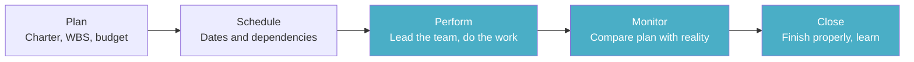
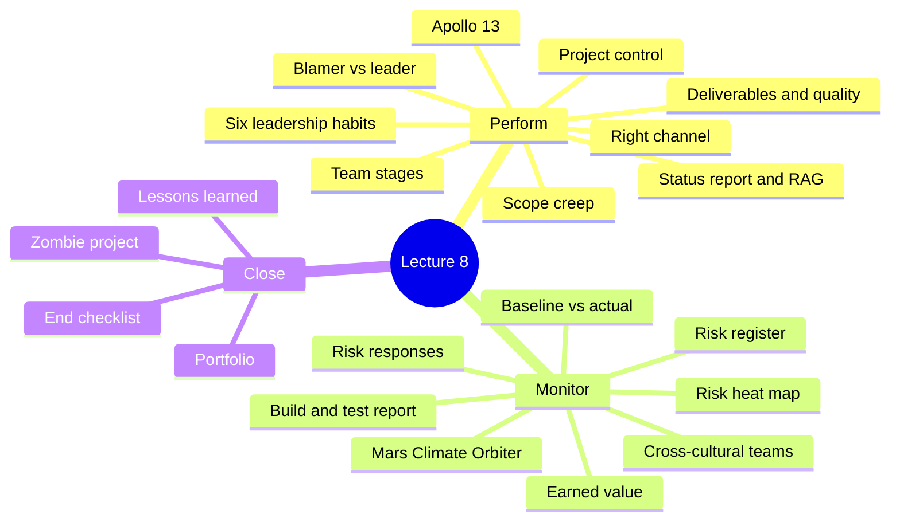
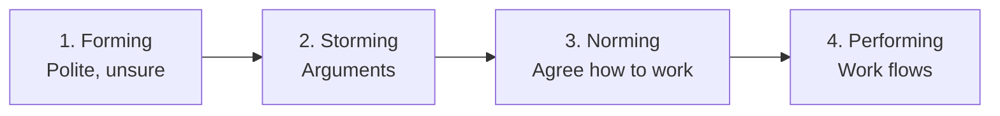
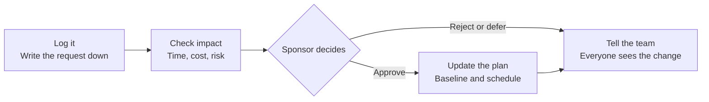
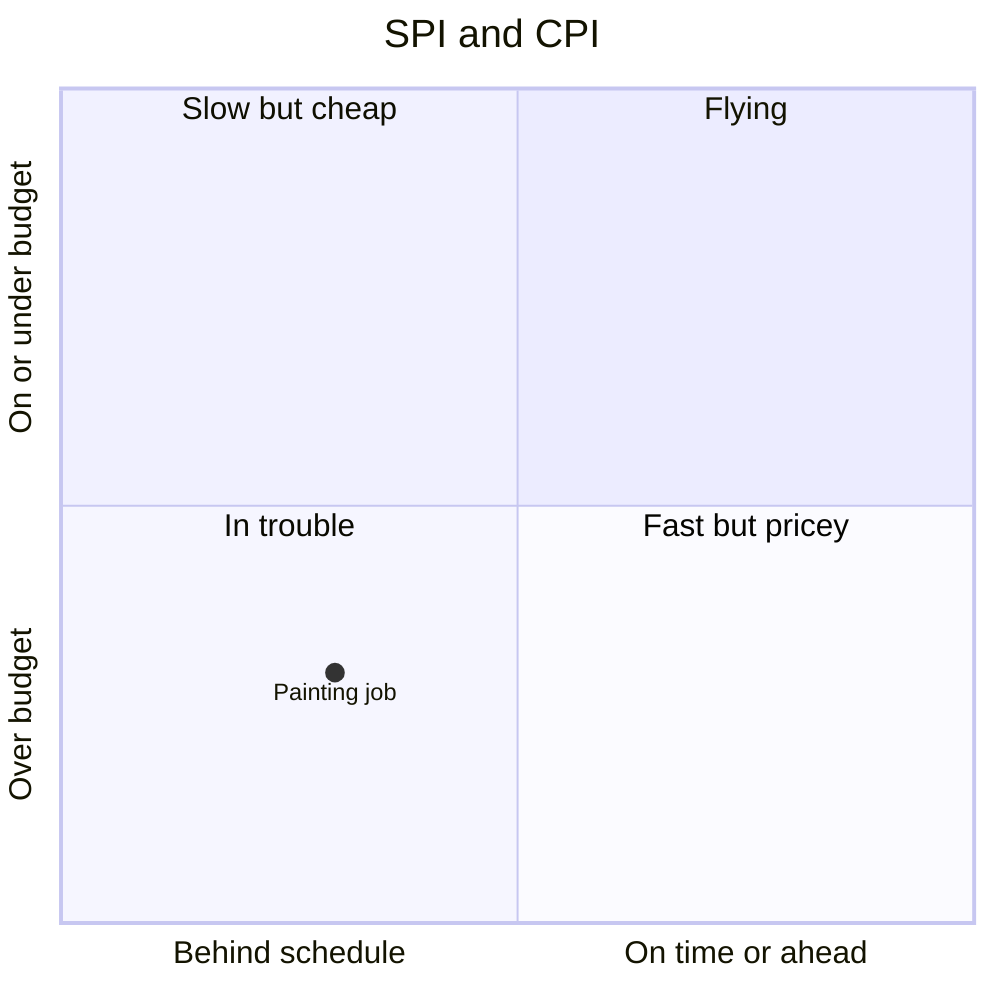
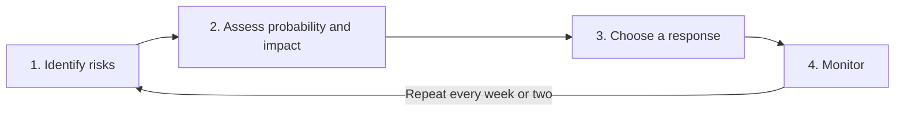
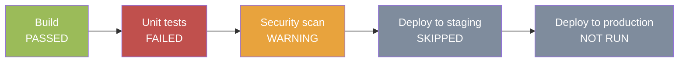
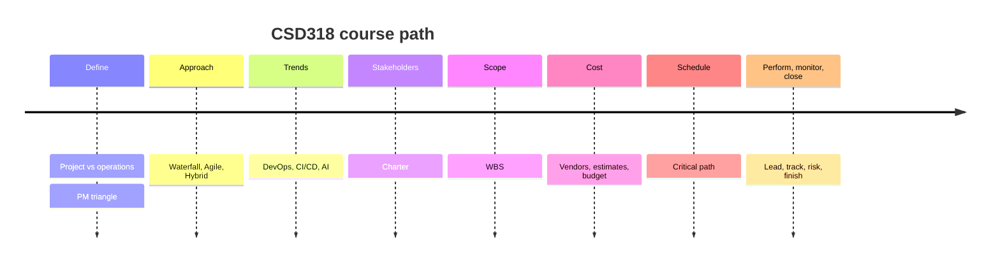

> [!note] What this lecture covers
> By now the plan exists: a [[Project Charter]], a [[Work Breakdown Structure]], a [[Budgeting|budget]], and a [[Project Schedule|schedule]]. This is the last stretch of the [[Project Lifecycle|project life cycle]]. Part 1 is about **performing** the work: leading the team, communicating, reporting status, handling [[Scope Creep|scope creep]], and protecting quality. Part 2 is about **monitoring and controlling**: comparing the baseline with reality, [[Earned Value Management|earned value]], [[Risk Management|risk management]], working across cultures, and reading build reports. Part 3 is about **closing** the project properly. Part 4 ties the whole course together.



> [!important] The idea behind the whole lecture
> "A plan is a prediction. This lecture is about what to do when reality disagrees with it."
>
> Your schedule from Lecture 7 said what *should* happen. From here on, the job is to notice early when things go differently and do something about it.

| Phase | What you do in it |
|---|---|
| **Perform** | Lead the team, keep everyone informed, handle "can you just add..." requests, and deliver work the customer actually wants |
| **Monitor** | Track progress against the plan, measure it with earned value, manage risks before they bite, and read your build and test reports |
| **Close** | Finish properly: get sign-off, tidy up, learn from the experience, and turn it into a portfolio piece |



---
# Part 1: Leading & Performing the Project

## The Deadline Was Missed: Two Kinds of Project Manager

The lecture opens with a missed deadline and two ways a project manager can react to it.

| | The Blamer | The Leader |
|---|---|---|
| **What they say** | "Whose fault is this? Nobody leaves until it's fixed." | "What got in the way, and what do you need from me?" |
| **What happens next** | People stop telling you about problems. | Problems come out early, while they are small. |
| | Bad news arrives late, when it is expensive. | The team feels safe to ask for help. |
| | The same mistakes happen again next [[Sprint\|sprint]]. | You fix the process, not just the person. |

> [!important] Why blaming backfires
> A project manager only knows about a problem if someone tells them. If telling you gets people punished, they keep quiet, and you find out when the problem has grown large and expensive. The leader's question makes it safe to report problems, so they show up while they are still cheap to fix.

## Six Leadership Habits for Project Managers

| Habit | What it looks like in practice |
|---|---|
| **Set a clear goal** | "Demo-ready login page by Friday" beats "work on login". The first has a result and a date; the second could mean anything. |
| **Communicate early** | Tell the sponsor about a delay when it is a day, not a month. |
| **Remove blockers** | Your teammate is waiting on an access request, so you chase it for them. |
| **Share the credit, own the problems** | Praise the team in public; take responsibility with the sponsor. |
| **Be fair and consistent** | The same rules apply to the quiet person and the loud one. |
| **Lead by example** | If you ask for weekly updates, post yours first and on time. |

> [!tip] A quick self-check
> Most of these habits are things you *do for the team*, such as chasing an access request, telling the sponsor about a delay, or posting your own update first. [[Leadership]] in this lecture is less about giving orders and more about clearing the path so other people can work.

## How Teams Grow: Forming, Storming, Norming, Performing

New teams go through predictable stages, known as [[Tuckman's Stages of Team Development|Tuckman's stages]]. The slide drew them as a staircase going up, and each stage needs something different from the leader.



| Stage | What it looks like | Leader's job |
|---|---|---|
| **1. Forming** | Polite introductions in the group chat. Nobody is sure who does what yet. | Be clear about goals and roles. |
| **2. Storming** | Arguments about the plan and the workload. Someone says, "I thought you were doing that." | Stay calm. Settle roles and decisions. |
| **3. Norming** | You agree how to work: stand-ups, naming files, who approves what. | Write the team rules down. |
| **4. Performing** | Work flows. People fix each other's problems without being asked. | Get out of the way and celebrate. |

> [!warning] Storming is normal
> Arguments in stage 2 do not mean the team is broken. Almost every team goes through it. The mistake is ignoring it and hoping it goes away. The leader settles who owns what, and the team moves on to norming.

> [!example] A class project team
> Week 1: everyone says hi in the group chat and nobody picks a task (forming). Week 2: two people both build the same page and argue about whose version to keep (storming). Week 3: the team agrees on a file naming rule and that one person approves merges (norming). Week 5: someone sees a broken link in another person's section and just fixes it (performing).

## Right Message, Right Channel

Part of [[Communication Management|communication]] is choosing *how* to send a message, not only what to say.

| Situation | Best channel | Why |
|---|---|---|
| The system is down right now | Phone call | Fastest way to reach a person |
| A decision the team must be able to find later | Message board post (e.g., [[Basecamp]]) | Searchable, with a clear record |
| A quick question for one teammate | Chat message | Light and quick |
| Tension on the team | Talk live (video or in person) | Tone gets lost in text |
| The weekly update for the sponsor | Written [[Status Report\|status report]] | Consistent and easy to scan |

> [!tip] How to pick a channel
> Ask two questions. How **urgent** is it? (Urgent means phone.) Does someone need to **find it later**? (Then it must be written somewhere searchable.) Anything emotional goes live, because tone gets lost in text.

## Case 1: Apollo 13 and the "Mailbox"

> [!example] The problem
> In April 1970, an oxygen tank exploded in the Apollo 13 spacecraft on its way to the Moon. The crew had to use the lunar module as a lifeboat.
>
> Then a second problem appeared. The lunar module's carbon dioxide filters were meant for **two astronauts for 45 hours**, not three astronauts for the trip home. The command module had enough filters, but they were a **different shape and size**.

> [!example] The solution
> Engineers on the ground designed an adapter out of things that were already on the spacecraft: plastic covers ripped from procedure manuals, duct tape, and other items on board. It was nicknamed **"the mailbox"**. The ground controller described it to the crew step by step over about an hour.
>
> The crew built it, and carbon dioxide levels began dropping right away. All three astronauts returned safely on April 17.

### Lessons from Apollo 13

- **A clear goal helps teams solve problems.** Everyone knew the goal: get the crew home safely.
- **Work with what you have.** The solution used materials already on board, not a perfect part from a supplier.
- **Clear instructions matter.** The ground team described the steps and the crew followed them, one at a time.
- **Practice helps.** Flight controllers had run many simulations of spacecraft problems before the real thing.

> [!important] Link to the leadership habits
> Apollo 13 is the "set a clear goal" habit at its most extreme. With one shared goal, nobody wasted time arguing about priorities.

## Project Control: Keeping an Eye on the Dashboard

[[Project Control|Project control]] means checking regularly where you are, so surprises stay small. The lecture names three tools.

| Tool | What it is |
|---|---|
| **Plan vs. actual** | Every week, compare what you planned with what happened. Late by 2 days? Over budget by 5%? Do not wait for the end to find out. |
| **[[Issue Log]] and [[Change Log]]** | An *issue log* lists problems that **have already happened**. A *change log* lists **requests to change scope**. Both have an owner, a date, and a status for each entry. |
| **Short regular meetings** | Ten focused minutes beat an hour of waffle. What is done, what is next, what is blocked? Then everyone goes back to work. |

> [!note] Issue log vs change log
> - **Issue log:** "The test server crashed on Tuesday." This already happened and needs fixing.
> - **Change log:** "The client wants a dark mode." Someone is asking to change what you build.
>
> A third list, the [[Risk Register|risk register]], comes in Part 2. It holds things that *might* happen.

## The One-Page Weekly Status Report

The slide shows an example report for a Campus Wi-Fi Expansion project, marked **AMBER**:

> [!example] Status Report: Campus Wi-Fi Expansion (example) | AMBER
> **Done:** Site survey finished for all 5 buildings.
> **Next:** Order access points; start installing in Building A.
> **Blockers:** Waiting on door-access approval for Building C.
> **Risks:** Equipment delivery takes 6 weeks; the deadline is tight.
> **Need from you:** Approval for Building C access by Friday.

**Why it works:**
- It is short enough to read in a minute.
- The bad news is in it, not hidden.
- It asks for something specific, with a date.
- It uses the same format every week, so changes stand out.

> [!tip] The five headings to remember
> **Done, Next, Blockers, Risks, Need from you.** The last one matters most. A status report that never asks the sponsor for anything gives them no reason to act.

## Red, Amber, Green (and the Watermelon Report)

Most status reports use a [[RAG Status|RAG]] (Red, Amber, Green) colour to summarize the project's health.

| Colour | Meaning |
|---|---|
| **GREEN** | On track. Small variances are inside the buffer or [[Float\|float]]. |
| **AMBER** | At risk. A problem is developing, but there is still time to recover. Say so now. |
| **RED** | Off track. The plan will not work without help or a decision. |

> [!warning] The watermelon report
> A [[Watermelon Report|watermelon project]] is **green outside, red inside**. The status report says green, but the real project is in trouble. It happens when people are afraid to report bad news (the Blamer problem again). The sponsor then finds out when it is too late to help.
>
> Amber exists so you can raise a problem *before* it becomes red. Use it.

### Try It: What Colour Is It?

The slides gave three situations to classify. Try them before opening the answers.

| # | Situation |
|---|---|
| 1 | A task is 3 days late, but it has 5 days of float, and nothing depends on it yet. |
| 2 | The key vendor has not confirmed delivery, and the deadline is in two weeks. |
| 3 | The sponsor has not approved the budget, so work cannot start. It is 3 days overdue. |

> [!success]- Answers from the slides
> | # | Call | Why |
> |---|---|---|
> | 1 | **GREEN** | It is late, but the float absorbs it. Mention it in the report so no one is surprised. |
> | 2 | **AMBER** | The date is at risk, but there is time. Call the vendor today and line up a backup. |
> | 3 | **RED** | Work is blocked and only the sponsor can unblock it. Ask for the decision, with a date. |

## Scope Creep: "Can You Just...?"

[[Scope Creep]] is the slow growth of a project through small, unapproved additions. It usually sounds innocent:

- "Can you just add a dark mode?"
- "While you're in there, can you also..."
- "My boss thinks it would be cool if..."

Each request looks small, but together they eat the schedule and budget. The lecture's advice: **respond with a process, not a yes or a no.** This process is [[Change Control|change control]].



> [!example] What to say
> "Great idea. Let me work out what it would cost and get it approved."
>
> You don't say no, which could upset the customer, and you don't say yes, which would quietly grow the scope. The sponsor makes the call once they can see the cost in time, money, and risk.

> [!warning] Who decides?
> The project manager does not approve scope changes alone, and neither does the developer who got asked. The **sponsor** decides: approve, reject, or defer.

## Deliverables That Make the Customer Happy

| Practice | What it means |
|---|---|
| **Agree on "Done"** | You order a burger and get a perfectly cooked steak. Great steak, wrong order. Write [[Acceptance Criteria\|acceptance criteria]] *before* work starts so everyone knows what "finished" means. |
| **Show progress early** | A demo every couple of weeks beats a big reveal at the end. A customer who has seen it grow will not be surprised. |
| **Get sign-off in writing** | A short acceptance form or email: "We have received X and it meets the agreed criteria." It protects both sides and starts the closing checklist. |

> [!note] Why the burger example matters
> The steak was good quality, but it wasn't what the customer asked for. A deliverable can be well built and still fail if it doesn't match what was agreed. Acceptance criteria written in advance stop that argument from happening at the end.

## Quality: Build It Right, Not Fix It Later

[[Quality Management|Quality]] has three parts in this lecture:

| Step | What it means |
|---|---|
| **Prevent** | Clear requirements, shared standards, and checklists. Like measuring twice before you cut. The cheapest defect is the one that never happens. |
| **Check early** | Peer reviews, testing as you go, and a [[Definition of Done]] such as: code reviewed, tests pass, documented, customer-accepted. |
| **Fix fast** | A typo found today costs a minute. The same typo found after launch costs a support ticket, an apology, and a patch. Fix problems while they are small. |

> [!important] The cost of a defect grows with time
> The same small mistake costs more the later you find it. That is the reason for preventing defects first, checking early, and fixing fast.

---
# Part 2: Monitoring & Controlling the Project

## Tracking Progress: Baseline vs. Actual

The [[Schedule Baseline|baseline]] you saved in Lecture 7 is the plan you measure against. The slide showed an 8-week project with the planned bars and the actual bars stacked together:

```
            Wk1  Wk2  Wk3  Wk4  Wk5  Wk6  Wk7  Wk8  Wk9
Design   B  [=========]
         A  [=========]                                   on plan
Build    B            [==============]
         A            [===================]               1 week late
Test     B                           [=========]
         A                                [=========]     1 week late
Go-live  B                                     [====]
         A                                          [=]   now Week 9

B = baseline (the plan)   A = actual
```

| Phase | Planned | Actual | Status |
|---|---|---|---|
| Design | Weeks 1-2 | Weeks 1-2 | On plan |
| Build | Weeks 3-5 | Weeks 3-6 | Running late (1 extra week) |
| Test | Weeks 6-7 | Weeks 7-8 | Running late (pushed by Build) |
| Go-live | Week 8 | **Projected for Week 9** | Running late |

> [!example] Reading the chart
> Build overran by a week. Test depended on Build, so it started a week late too, and go-live moved from Week 8 to Week 9. One late phase on the [[Critical Path|critical path]] pushed everything after it. Comparing the bars every week would have shown this in Week 5, when there was still time to react.

## Earned Value in Plain English: Painting 10 Rooms

[[Earned Value Management|Earned value]] answers two questions with numbers: **are we ahead or behind?** and **are we over or under budget?** The lecture explains it with a painting job.

> [!example] The painting job
> **The job:** Paint 10 identical rooms. Budget: $200 per room, so $2,000 in total.
> **The plan:** 5 rooms finished by the end of Week 2.
> **Reality check:** At the end of Week 2, only 4 rooms are finished. You have spent $1,000 so far.
>
> So, are we ahead or behind? Over or under budget?

> [!note] The idea
> Earned value gives work a dollar value: finished work is "earned" at its budgeted price. Then you can compare the plan, the work done, and the money spent **in the same units** (dollars).

## Three Numbers: PV, EV, AC

| Number | Name | What it measures | Painting example |
|---|---|---|---|
| **PV** | [[Planned Value]] | The value of the work you *planned* to finish by now | 5 rooms × $200 = **$1,000** |
| **EV** | [[Earned Value]] | The budgeted value of the work you *actually finished* | 4 rooms × $200 = **$800** |
| **AC** | [[Actual Cost]] | The money you *actually spent* | **$1,000** |

The slide showed these as a bar chart at the end of Week 2:

```
$1,200 |
$1,000 |  ████              ████
  $800 |  ████    ████      ████
  $600 |  ████    ████      ████
  $400 |  ████    ████      ████
  $200 |  ████    ████      ████
    $0 +--------------------------
          PV      EV        AC
        $1,000   $800     $1,000
```

> [!important] What the three numbers say
> You spent exactly what the plan said ($1,000), but got less done ($800 worth of work).

> [!tip] How to remember them
> - **PV** = what you *promised*.
> - **EV** = what you *earned* (did).
> - **AC** = what it *actually cost*.
>
> EV is the one in every formula, because it is the only one that measures finished work.

## Four Simple Formulas

| Question | Formula | Painting example | Result |
|---|---|---|---|
| Ahead or behind? ([[Schedule Variance]]) | **SV = EV − PV** | $800 − $1,000 | **−$200** |
| Over or under budget? ([[Cost Variance]]) | **CV = EV − AC** | $800 − $1,000 | **−$200** |
| Schedule efficiency ([[Schedule Performance Index\|SPI]]) | **SPI = EV ÷ PV** | $800 ÷ $1,000 | **0.8** |
| Cost efficiency ([[Cost Performance Index\|CPI]]) | **CPI = EV ÷ AC** | $800 ÷ $1,000 | **0.8** |

> [!important] Rule of thumb
> - **1.0** means on plan.
> - **Above 1.0** is good.
> - **Below 1.0** is trouble.
>
> At 0.8 you are earning 80 cents of progress for every dollar you planned or spent.

> [!tip] Reading the signs of the variances
> For SV and CV, **negative is bad** and positive is good. A negative SV means you are behind schedule; a negative CV means you are over budget. Both formulas start with EV, so the same pattern holds as for the indexes: more work earned is better.

## Reading the Numbers: Four Kinds of Project

Put SPI and CPI together and every project lands in one of four boxes:

| | **CPI ≥ 1** (spending wisely) | **CPI < 1** (costing too much) |
|---|---|---|
| **SPI ≥ 1** (on or ahead of time) | **Flying.** Ahead and under budget. Enjoy it, but check that quality is not slipping. | **Fast but pricey.** On time, but costing too much. Check rates, overtime, and rework. |
| **SPI < 1** (behind schedule) | **Slow but cheap.** Behind schedule, but spending wisely. Look for blockers or missing people. | **In trouble.** Late and over budget. Time to talk to the sponsor about options. |



> [!example] The painting job
> SPI = 0.8 and CPI = 0.8, so the painting job is **in trouble**: late and over budget. Time to talk to the sponsor.

> [!warning] "Flying" is not automatically good news
> A project that looks fast and cheap might be cutting corners. That is why the slide says to check that quality is not slipping.

## Risk: Murphy Is on Your Team

| | Explanation |
|---|---|
| **Everyday risk** | You plan an outdoor picnic. There is a chance of rain. That is a risk: uncertain, and it matters. If it starts to rain, it becomes an **issue**. |
| **Project risk** | Your vendor might deliver late. A teammate might get sick. The projector might fail on demo day. Any of these could change your schedule, budget, or quality. |

> [!note] Risk vs issue
> - A **risk** *might* happen in the future. It goes in the [[Risk Register|risk register]].
> - An **issue** *has* happened. It goes in the [[Issue Log|issue log]].
>
> When the rain starts, the risk becomes an issue.

### The Risk Management Loop



[[Risk Management]] is a loop, not a one-time task. You go round it every week or two, because new risks appear and old ones change.

## Probability × Impact: The Risk Heat Map

A [[Probability and Impact Matrix|risk heat map]] rates each risk on two things: how **likely** it is (probability) and how **bad** it would be (impact). Risks in the top-right corner need attention first.

| Impact ↓ / Probability → | **Low** | **Medium** | **High** |
|---|---|---|---|
| **High** | Amber: (1) Projector fails on demo day | Red | Red |
| **Medium** | Green | Amber: (2) A teammate gets sick | Red: (3) Vendor delivers late |
| **Low** | Green | Green | Amber: (4) Typo on a slide |

| # | Risk | Probability | Impact |
|---|---|---|---|
| 1 | Projector fails on demo day | Unlikely | High |
| 2 | A teammate gets sick | Possible | Medium |
| 3 | Vendor delivers late | Likely | Medium |
| 4 | Typo on a slide | Likely | Low |

> [!tip] Reading the map
> Green means watch it. Amber means have a plan. Red means act now. Risk 3 (vendor delivers late) is the only red one, so it gets attention first. Risk 1 is unlikely but would hurt badly, which is why it is amber and not green.

## Four Ways to Respond to a Risk

| Response | What it means | Everyday example (wedding) | Project example |
|---|---|---|---|
| **Avoid** | Change the plan so the risk cannot happen | Hold the wedding indoors | Drop the risky feature |
| **Mitigate** | Reduce the chance or the damage | Rent a tent | Test early; train a backup person |
| **Transfer** | Move the risk to someone else | Buy event insurance | A warranty or an insurance policy |
| **Accept** | Do nothing now, and be ready | Bring some umbrellas | Set aside contingency money or time |

> [!warning] Mitigate vs avoid
> Avoiding a risk removes it completely (no outdoor wedding, so no rain problem). Mitigating it only makes it smaller (the tent keeps guests dry, but it can still rain). If the risk can still happen after your response, you mitigated it.

## A Simple Risk Register

A [[Risk Register|risk register]] is the table where you write down each risk, how you rated it, what you'll do about it, and who is responsible. The slide gave these illustrative examples:

| Risk | Chance | Impact | Response | Owner |
|---|---|---|---|---|
| Equipment arrives late | Medium | High | **Mitigate:** order early; name a backup supplier | Purchasing lead |
| Key teammate is sick | Medium | Medium | **Mitigate:** cross-train a second person | Project manager |
| Requirements change late | High | Medium | **Avoid:** sign off requirements; use change control | Project manager |
| Demo environment fails | Low | High | **Mitigate:** rehearse and keep a recorded backup | Technical lead |

> [!tip] For your own project
> The slide says these are illustrative examples: use the risks from your own project. Every row needs a named **owner**, because a risk that belongs to everyone usually gets handled by no one.

## Case 2: The Mars Climate Orbiter

> [!example] The project
> In 1998 NASA launched the Mars Climate Orbiter. Two teams produced numbers that had to work together. One piece of ground software, supplied by Lockheed Martin, reported thruster results in **US pound-force seconds**. The navigation software expected **metric newton-seconds**, as the specification required.
>
> The values were off by a factor of about **4.45**, and nobody caught it.

> [!example] The result
> On September 23, 1999, contact with the spacecraft was lost as it arrived at Mars. The total cost of the mission was reported as about **$327.6 million**.
>
> At least two navigators had noticed earlier that the position did not look right, but their concerns were dismissed because they **did not fill out the form** to document them. A senior NASA official later said the failure was in the checks and balances that should have detected the error.

### Lessons from the Mars Climate Orbiter

- **Check where two teams' work meets.** The error lived at the interface, where one team's output became another team's input.
- **Write down units and formats**, and test that both sides follow them.
- **Make it easy to raise a concern.** A worry that gets dismissed over paperwork is a risk that was never managed.
- **Escalate early.** If the numbers look wrong, say so loudly, and keep saying it until someone checks.

> [!important] The two cases side by side
> Apollo 13 went badly at first and ended well because people communicated clearly. The Mars Climate Orbiter failed because two teams never checked each other's units and a warning got dismissed over a form. Both are about communication more than technology.

## Leading Virtual and Cross-Cultural Teams

| Challenge | Problem | What to do |
|---|---|---|
| **Time zones** | 9 a.m. for you may be midnight for a teammate. | Post times with the zone (e.g., "2:00 p.m. Eastern"), rotate meeting times, and record decisions in writing. |
| **Dates and calendars** | Is 04/05/2027 April 5th or May 4th? | Use **2027-05-04** or write the month out. Work weeks and holidays differ too, so check each person's calendar. |
| **Communication style** | Some people are very direct; others hint politely. A "yes" may mean "I heard you." | Ask open questions and confirm in writing. |

> [!tip] Open questions
> "Is that OK?" invites a polite "yes". "What would you need to finish this by Friday?" makes the person give real information. Then confirm the answer in writing.

> [!note] The date format link
> The 2027-05-04 format (year-month-day) is the international standard and can only be read one way. This connects to the Mars Climate Orbiter lesson: write down units and formats so both sides read them the same.

## Idioms Don't Travel

Idioms are phrases whose meaning isn't in the words. Teammates who learned English as an additional language, or who come from a different English-speaking culture, may read them literally.

| What you said | What they might hear | Say this instead |
|---|---|---|
| "Let's touch base." | Touch what base? | "Let's have a quick check-in." |
| "Give me a ballpark figure." | A figure from a stadium? | "Give me a rough estimate." |
| "That's low-hanging fruit." | A gardening tip | "That's a quick, easy win." |
| "Don't boil the ocean." | Why would I boil it? | "Don't try to do too much at once." |
| "The ball is in your court." | A sports match | "It is your turn to act." |

## Reading a Build & Test Report

In software projects, a [[CI-CD|CI/CD pipeline]] produces a report every time code is built. A project manager should be able to read one. The slide's example:

| Stage | Status | Detail |
|---|---|---|
| Build | **PASSED** (green) | 1 min 12 s |
| Unit tests | **FAILED** (red) | 3 of 212 tests failed |
| Security scan | **WARNING** (amber) | 2 medium findings |
| Deploy to staging | **SKIPPED** (grey) | Blocked by failed tests |
| Deploy to production | **NOT RUN** (grey) | Waiting on earlier stages |



**How to read it:**
- **Red stops the line.** Fix it before anything ships.
- **Read the first failure, not the last.** Later stages often fail *because* an earlier one did (here, staging was skipped only because the tests failed).
- **Green is only as good as the tests behind it.** A pass with weak tests proves very little.
- **Watch trends.** Tests that sometimes fail are a warning.

> [!warning] Green does not always mean safe
> This is the watermelon problem again. A pipeline can be all green while the tests skip the important parts. Ask what the tests actually check.

---
# Part 3: Closing the Project

## Why Closing Matters: The Zombie Project

A [[Project Closure|project that never closes]] keeps going like a zombie: invoices still arrive, accounts stay open, and nobody knows who owns the problems. Closing has three parts:

| Step | What to do | What goes wrong if you skip it |
|---|---|---|
| **Finish** | Get the customer's sign-off. Pay the last invoices and close the contracts. | The work is never really "done" and the vendor keeps billing. |
| **Hand over** | Give the support team the documents, passwords, and a walkthrough. | The first problem after launch becomes a mystery nobody can solve. |
| **Learn** | Write down what worked and what did not, while it is fresh. | Next month you will have forgotten, and the next team will repeat your mistakes. |

## The Project End Checklist

- [ ] **Deliverables accepted:** customer sign-off, in writing.
- [ ] **Open issues closed or handed over:** nothing is left "in someone's head".
- [ ] **Contracts and money wrapped up:** final invoices paid, vendor agreements closed.
- [ ] **Everything archived:** files, code, and documents stored where the next team can find them.
- [ ] **Access cleaned up:** accounts and permissions removed or transferred.
- [ ] **Team released and thanked:** tell people it is over and say thank you.
- [ ] **Lessons learned recorded:** and shared with the people who will use them.

> [!tip] Where the checklist starts
> The written sign-off from Part 1 ("We have received X and it meets the agreed criteria") is the first item. Getting it is what starts the closing checklist.

## Lessons Learned That Actually Get Used

[[Lessons Learned]] are only useful if they turn into actions for next time. The slide's format has four columns:

| What went well (keep) | What did not (fix) | Action for next time | Owner |
|---|---|---|---|
| A 10-minute check-in every week kept everyone in sync. | Requirements changed late in the project. | Get requirements signed off before work starts. | Project manager |
| Early demos caught two misunderstandings. | The vendor delivery was a surprise. | Confirm delivery dates in writing two weeks ahead. | Purchasing lead |
| A shared folder structure saved time. | Nobody owned testing. | Name a test owner at kickoff. | Technical lead |

> [!important] Ground rules for a lessons-learned session
> 1. Compare plan with reality.
> 2. Focus on the process, not on blame.
> 3. End with actions that have owners.

> [!warning] The common mistake
> A list of complaints ("the vendor was bad") with no action and no owner changes nothing. Each "what did not work" needs a concrete action and a named person, or the next team repeats the mistake.

## Build Your Project Portfolio

A [[Project Portfolio|portfolio]] shows employers what you can do. The documents from this course make a good one.

| What to include | Make it shine |
|---|---|
| [[Project Charter]] and [[Stakeholder Register\|stakeholder register]] | Add a one-page summary for each project. |
| [[Work Breakdown Structure\|WBS]] and Work Detail Breakdown | Say what **your** role was. |
| Schedule ([[Gantt Chart\|Gantt]] view) and budget | Remove private or confidential details. |
| Risk register and status reports | Keep it online and easy to share. |
| Lessons learned | |

---
# Part 4: Putting It All Together

## The Whole Course on One Page

| # | Topic | Core idea |
|---|---|---|
| 1 | Define the project | Project vs. operations, the PM triangle |
| 2 | Choose an approach | [[Waterfall]], [[Agile]], Hybrid, and tools |
| 3 | Research & trends | DevOps, CI/CD, remote teams, AI |
| 4 | Stakeholders & Charter | Who cares, and what we agreed |
| 5 | Scope & WBS | Break the work into pieces |
| 6 | Vendors, estimates & budget | RFPs, estimating, and cost |
| 7 | Build the schedule | Dependencies and critical path |
| **8** | **Perform, monitor & close** | **Lead, track, manage risk, finish well** |



## What's Next: Test 2 and Your Own Project

| | |
|---|---|
| **Test 2** | Covers the schedule, performing, monitoring, and closing. Expect concept and scenario questions like the examples in this lecture: what would you do, and why? |
| **Your own project** | Pick a topic, form your team, and build a planning package: Charter, stakeholders, WBS, schedule, budget, and risks. |
| **After the course** | The [[CAPM]] needs no experience, and the [[PMP]] builds on real project experience. Keep your portfolio ready and keep practicing. |

> [!tip] Studying for Test 2
> The slide says to expect scenario questions. Practise the "Try it" RAG exercise, the earned value formulas, and the four risk responses until you can explain *why* each answer is right, not only what it is.

---
# Key Takeaways

- **Lead, don't blame.** Problems that surface early are cheap to fix.
- **Compare plan with reality every week.** Status reports, RAG, and earned value show where you really are.
- **Manage risk before it manages you.** Identify it, rate it, choose a response, and review it.
- **Control change.** "Can you just...?" becomes a logged, assessed, approved request.
- **Close properly and learn.** Sign-off, hand-over, lessons learned, and a portfolio piece.

---
# Exercises

### Exercise 1 (Direct application)
A team is building a website with **20 pages**, budgeted at **$500 per page** ($10,000 total). The plan says **10 pages** should be finished by the end of Week 4. At the end of Week 4, **12 pages** are finished and the team has spent **$7,000**.
Calculate PV, EV, AC, SV, CV, SPI, and CPI. Which of the four kinds of project is this?

> [!success]- Answer key
> ```
> PV = 10 pages × $500 = $5,000   (what was planned)
> EV = 12 pages × $500 = $6,000   (what was actually done, at budget price)
> AC = $7,000                      (what was spent)
>
> SV  = EV − PV = 6,000 − 5,000 = +$1,000   (ahead of schedule)
> CV  = EV − AC = 6,000 − 7,000 = −$1,000   (over budget)
> SPI = EV ÷ PV = 6,000 ÷ 5,000 = 1.2
> CPI = EV ÷ AC = 6,000 ÷ 7,000 ≈ 0.86
> ```
> SPI ≥ 1 and CPI < 1, so this is **fast but pricey**: ahead of time but costing too much. The slide's advice is to check rates, overtime, and rework. The team may be getting ahead by working paid overtime.

### Exercise 2 (Direct application)
For each action, name the risk response (avoid, mitigate, transfer, or accept):
(a) The team buys an extended warranty for the new servers.
(b) The team removes a payment feature that depends on an untested third-party library.
(c) The team sets aside one extra week in the schedule in case the client is slow to review.
(d) The team asks a second developer to learn the database so the project doesn't depend on one person.

> [!success]- Answer key
> - (a) **Transfer.** The warranty moves the cost of a hardware failure to the supplier, like the warranty or insurance example in the slides.
> - (b) **Avoid.** Changing the plan so the risk cannot happen, like "drop the risky feature."
> - (c) **Accept.** Do nothing about the cause now, but be ready with contingency time.
> - (d) **Mitigate.** It reduces the damage if the key person is away. It matches "train a backup person" and "cross-train a second person" from the risk register.

### Exercise 3 (Direct application)
Pick the best channel for each message and give the reason:
(a) The team agreed to switch from MySQL to PostgreSQL, and new members will need to know why.
(b) Two teammates have been arguing in comments on a pull request for two days.
(c) The production website is down during a client demo.
(d) You want to ask one teammate where a file is.

> [!success]- Answer key
> - (a) **Message board post** (e.g., Basecamp). It is a decision the team must be able to find later, so it needs to be searchable with a clear record.
> - (b) **Talk live** (video or in person). There is tension, and tone gets lost in text. Two more days of written comments will probably make it worse.
> - (c) **Phone call.** It's urgent, and a phone call is the fastest way to reach a person.
> - (d) **Chat message.** A quick question for one person, light and quick.

### Exercise 4 (Applied variation)
Your project is building a mobile app. This week: the login screen was finished; the payment screen is next; the testing team is waiting for test phones that IT has not ordered; the app store review may take longer than planned; and you need the sponsor to approve the purchase of the test phones by Wednesday. Write a one-page status report in the lecture's format and give it a RAG colour, with a reason.

> [!success]- Answer key
> Example:
>
> **Status Report: Mobile App | AMBER**
> - **Done:** Login screen finished.
> - **Next:** Build the payment screen.
> - **Blockers:** Testing is waiting for test phones; IT has not ordered them.
> - **Risks:** App store review may take longer than planned.
> - **Need from you:** Approval to buy the test phones by Wednesday.
>
> **Amber** fits best: a problem is developing (testing is blocked and the store review is a risk), but there is still time to recover if the sponsor approves the phones. It isn't red yet because one decision by Wednesday unblocks the work. If the sponsor didn't approve and testing could not start, it would turn red. The bad news is in the report and the request has a date, which is what makes the format work.

### Exercise 5 (Applied variation)
Halfway through your project, a client says: "While you're in there, can you also add an export-to-PDF button? It should be quick." Your developer says it's probably 3 days of work, and the current schedule has no float on that part. Describe what you would say and each step you would follow.

> [!success]- Answer key
> **What to say:** "Great idea. Let me work out what it would cost and get it approved." You don't say yes (that would be scope creep) and you don't say no.
>
> **Steps (change control):**
> 1. **Log it** in the change log, with the requester, the date, and the status.
> 2. **Check impact:** about 3 days of work on a part with no float, so the finish date likely moves 3 days. Add the cost of those days and any risk (e.g., new testing).
> 3. **Sponsor decides:** approve, reject, or defer (e.g., to a later version).
> 4. **Update the plan:** if approved, update the baseline and schedule.
> 5. **Tell the team** so everyone sees the change.
>
> The point about float matters: with no float, the 3 days go straight onto the end date, so the sponsor needs to know that before deciding.

### Exercise 6 (Applied variation)
Name the team stage and the leader's job in each case:
(a) Two developers both say "I thought you were doing the database."
(b) The team has just been formed and nobody has posted in the shared folder yet.
(c) One teammate notices another's failing test and fixes it without being asked.
(d) The team agrees that every pull request needs one reviewer before merging.

> [!success]- Answer key
> - (a) **Storming.** Leader's job: stay calm and settle roles and decisions. Decide who owns the database.
> - (b) **Forming.** Leader's job: be clear about goals and roles.
> - (c) **Performing.** Leader's job: get out of the way and celebrate.
> - (d) **Norming.** Leader's job: write the team rules down so they stick (e.g., in the team charter or on the message board).

### Exercise 7 (Applied variation)
Your pipeline report shows: Build PASSED; Unit tests PASSED (but only 4 tests exist for the whole app); Security scan FAILED (1 high finding); Deploy to staging SKIPPED; Deploy to production NOT RUN. A developer says, "Tests passed, so we're basically fine, staging just didn't run." What's wrong with this, using the lecture's four reading rules?

> [!success]- Answer key
> - **Red stops the line.** The security scan failed, and that must be fixed before anything ships.
> - **Read the first failure, not the last.** The first failure is the security scan. Staging was skipped *because* of it, so "staging just didn't run" misreads the cause.
> - **Green is only as good as the tests behind it.** Four unit tests for a whole app is very little coverage. "Tests passed" proves almost nothing here.
> - **Watch trends.** Check whether the scan or tests have failed on and off before.
>
> Calling this "basically fine" is a watermelon report: it looks green on the outside and isn't.

### Exercise 8 (Challenge)
A project's team leads mark every weekly report **green**. At the end of Week 6, you check the earned value: PV = $60,000, EV = $42,000, AC = $56,000. Calculate SPI and CPI, classify the project, and explain what the gap between the reports and the numbers tells you and what you would do as the project manager.

> [!success]- Answer key
> ```
> SPI = 42,000 ÷ 60,000 = 0.70
> CPI = 42,000 ÷ 56,000 = 0.75
> SV  = 42,000 − 60,000 = −$18,000
> CV  = 42,000 − 56,000 = −$14,000
> ```
> Both indexes are below 1, so the project is **in trouble**: late and over budget. You are earning 70 cents of progress per planned dollar and 75 cents per dollar spent.
>
> The reports say green and the numbers say red, so this is a **watermelon report**. The most likely cause is that people don't feel safe reporting bad news (the Blamer problem).
>
> What to do:
> - Change the report to **red** and talk to the sponsor about options now, as the four-kinds slide advises.
> - Ask the team the Leader's question: "What got in the way, and what do you need from me?"
> - Make amber a safe colour to use, so the next problem shows up early.
> - Compare plan vs actual every week from now on, so the gap can't hide for six weeks again.

### Exercise 9 (Challenge)
Your team has developers in Toronto, Lagos, and Manila. A teammate posts in chat: "Let's touch base on the API, deadline is 03/04, ball's in your court." Two weeks later, the Manila team delivers data in a format the Toronto code can't read. Using both cross-cultural slides and the Mars Climate Orbiter lessons, identify what went wrong and rewrite the message.

> [!success]- Answer key
> **Problems:**
> - **Idioms:** "touch base" and "ball's in your court" may not be understood.
> - **Ambiguous date:** 03/04 could be March 4th or April 3rd.
> - **No time zone** for any meeting.
> - **Wrong channel:** an important decision about the API was made in chat, not recorded somewhere searchable.
> - **Interface not specified:** like the Mars Climate Orbiter, the failure happened where one team's output became another team's input. Formats were never written down or tested on both sides.
>
> **Rewritten message (posted on the message board):**
> "Let's have a quick check-in about the API on Tuesday at 9:00 a.m. Eastern (we'll rotate times next week). The deadline is 2027-04-03. The data format is attached as a written spec; please confirm in writing that your side follows it, and we'll add a test that checks both sides. It is your turn to act: please reply with any questions by Monday."

### Exercise 10 (Challenge)
Your team project has just been demoed and the client said "looks great" in the meeting. A teammate says, "We're done, let's stop." Using the project end checklist and the zombie-project slide, list what is still missing and what could go wrong if you stop now. Then write one lessons-learned row in the lecture's format.

> [!success]- Answer key
> **Missing items and their risks:**
> - **Written sign-off.** "Looks great" in a meeting isn't acceptance. Without "We have received X and it meets the agreed criteria," the client can come back later and say it isn't finished.
> - **Open issues** closed or handed over, so nothing is left in someone's head.
> - **Contracts and money:** final invoices paid, vendor agreements closed, or a vendor keeps billing.
> - **Archive** files, code, and documents where the next team can find them.
> - **Access cleanup:** remove or transfer accounts and permissions.
> - **Hand-over** to whoever supports it: documents, passwords, walkthrough. Otherwise the first bug after launch is a mystery.
> - **Release and thank** the team.
> - **Lessons learned**, recorded and shared.
>
> **Example lessons-learned row:**
>
> | What went well (keep) | What did not (fix) | Action for next time | Owner |
> |---|---|---|---|
> | Demos every two weeks kept the client happy. | We almost closed without written acceptance. | Add "written sign-off" as a milestone in the schedule. | Project manager |
>
> It follows the ground rules: compares plan with reality, focuses on the process (not on who forgot), and ends with an action that has an owner.

---
# Feynman Practice

Write each explanation in your own words, without looking at the notes. Where the steps below say to mark a word, use `(?)` to flag it.

## Feynman: Leading the team and the four team stages
- [ ] **1. Explain it as if to a 12-year-old.** Think of a new sports team at the start of a season. Why would a coach who yells "whose fault is this?" after a loss end up hearing about problems later than a coach who asks "what got in the way?" How does the team change from the first practice to the end of the season?
- [ ] **2. Find the jargon.** Reread what you wrote. Mark with `(?)` any word a 12-year-old wouldn't understand (e.g. "sponsor," "blocker," "forming," "storming," "norming," "performing").
- [ ] **3. Simplify.** For each `(?)`, write an analogy or example. Why is storming a normal stage and not a sign the team is broken? What does "remove blockers" look like for a student team?
- [ ] **4. Organize and test.** Rewrite it in 3-5 sentences. Could you explain in 2 minutes why the leader's job changes at each stage?

## Feynman: Status reports, RAG, and the watermelon report
- [ ] **1. Explain it as if to a 12-year-old.** If your parents ask "how's school going?" every week, what's the difference between always saying "fine" and telling them early that you're struggling in math? What's a watermelon answer?
- [ ] **2. Find the jargon.** Mark with `(?)` words like "status report," "RAG," "amber," "float," "variance," "blocker."
- [ ] **3. Simplify.** Using the "Try it" table, explain why a task that is 3 days late can still be green. Why does amber exist at all?
- [ ] **4. Organize and test.** In 3-5 sentences, explain what makes the one-page status report work, including why the "Need from you" line matters.

## Feynman: Earned value (PV, EV, AC)
- [ ] **1. Explain it as if to a 12-year-old.** You're paid $10 per lawn you mow. You planned to mow 5 lawns by Saturday but mowed 4, and spent $50 on gas. How would you work out whether you're behind and whether you spent too much?
- [ ] **2. Find the jargon.** Mark with `(?)` words like "planned value," "earned value," "actual cost," "variance," "SPI," "CPI."
- [ ] **3. Simplify.** Using the painting example, explain why EV appears in every formula. What does "0.8" mean in cents and dollars?
- [ ] **4. Organize and test.** Rewrite it in 3-5 sentences, including how SPI and CPI together place a project in one of the four boxes.

## Feynman: Managing risk
- [ ] **1. Explain it as if to a 12-year-old.** You're planning a birthday party in the park. What could go wrong? Which problems are likely, which would ruin the day, and what could you do about each one?
- [ ] **2. Find the jargon.** Mark with `(?)` words like "risk," "issue," "probability," "impact," "heat map," "mitigate," "transfer," "risk register," "owner."
- [ ] **3. Simplify.** Use the wedding examples to explain the difference between avoid and mitigate. Use the Mars Climate Orbiter to explain why a dismissed worry is "a risk that was never managed."
- [ ] **4. Organize and test.** In 3-5 sentences, explain the risk loop and why it repeats every week or two.

## Feynman: Scope creep and closing the project
- [ ] **1. Explain it as if to a 12-year-old.** You agreed to bake 12 cupcakes for a class party. Then someone asks for "just" a few with sprinkles, then gluten-free ones, then a cake. What happens to your evening? And when the party is over, what's left to do before you're really finished?
- [ ] **2. Find the jargon.** Mark with `(?)` words like "scope creep," "change control," "baseline," "acceptance criteria," "sign-off," "hand-over," "lessons learned."
- [ ] **3. Simplify.** Explain why "Great idea. Let me work out what it would cost and get it approved" is better than both yes and no. What is a zombie project?
- [ ] **4. Organize and test.** Rewrite it in 3-5 sentences, including why lessons learned need actions with owners.

---
# Flashcards (Anki)

Copy the block below into a `.txt` file and import it in Anki via **File > Import** (Basic note type, fields separated by tab).

```
#separator:tab
#html:false
#tags column:3
What does this lecture mean by "a plan is a prediction"?	The plan says what should happen; the work of performing, monitoring, and closing is about reacting when reality differs from it.	csd318 lecture-08 overview
What question does the Leader ask after a missed deadline?	"What got in the way, and what do you need from me?"	csd318 lecture-08 leadership
Why does blaming people after a missed deadline backfire?	People stop reporting problems, so bad news arrives late, when it is expensive, and the same mistakes repeat.	csd318 lecture-08 leadership
Give the lecture's example of a clear goal.	"Demo-ready login page by Friday" (instead of "work on login").	csd318 lecture-08 leadership
What does "share the credit, own the problems" mean?	Praise the team in public; take responsibility with the sponsor.	csd318 lecture-08 leadership
What does "lead by example" mean for weekly updates?	If you ask for weekly updates, post yours first and on time.	csd318 lecture-08 leadership
What happens in the Forming stage, and what is the leader's job?	Polite introductions, nobody sure who does what. Leader: be clear about goals and roles.	csd318 lecture-08 team-stages
What happens in the Storming stage, and what is the leader's job?	Arguments about the plan and workload ("I thought you were doing that"). Leader: stay calm, settle roles and decisions.	csd318 lecture-08 team-stages
What happens in the Norming stage, and what is the leader's job?	The team agrees how to work (stand-ups, file naming, approvals). Leader: write the team rules down.	csd318 lecture-08 team-stages
What happens in the Performing stage, and what is the leader's job?	Work flows; people fix each other's problems unasked. Leader: get out of the way and celebrate.	csd318 lecture-08 team-stages
What is the best channel when the system is down right now?	A phone call, the fastest way to reach a person.	csd318 lecture-08 communication
What is the best channel for a decision the team must find later?	A message board post (e.g., Basecamp): searchable, with a clear record.	csd318 lecture-08 communication
Why should tension on the team be handled live?	Tone gets lost in text.	csd318 lecture-08 communication
What second problem did the Apollo 13 crew face after the explosion?	The lunar module's CO2 filters were meant for two astronauts for 45 hours, and the command module's filters were a different shape and size.	csd318 lecture-08 case-study
What was the Apollo 13 "mailbox"?	An adapter built from items already on board (manual covers, duct tape) that let the command module's filters work, described step by step by ground control.	csd318 lecture-08 case-study
Name the four lessons from Apollo 13.	A clear goal, work with what you have, clear instructions, and practice (simulations).	csd318 lecture-08 case-study
What is the difference between an issue log and a change log?	An issue log lists problems that have already happened; a change log lists requests to change scope.	csd318 lecture-08 control
What three fields does every issue or change log entry have?	An owner, a date, and a status.	csd318 lecture-08 control
What three questions does a short regular meeting answer?	What is done, what is next, what is blocked?	csd318 lecture-08 control
What are the five headings of the one-page weekly status report?	Done, Next, Blockers, Risks, Need from you.	csd318 lecture-08 status-report
Why does the one-page status report use the same format every week?	So changes stand out.	csd318 lecture-08 status-report
What does GREEN mean in RAG status?	On track; small variances are inside the buffer or float.	csd318 lecture-08 rag
What does AMBER mean in RAG status?	At risk; a problem is developing but there is still time to recover. Say so now.	csd318 lecture-08 rag
What does RED mean in RAG status?	Off track; the plan will not work without help or a decision.	csd318 lecture-08 rag
What is a watermelon report?	A status that is green outside but red inside: it looks on track, but the project is really in trouble.	csd318 lecture-08 rag
A task is 3 days late with 5 days of float and nothing depends on it. What colour?	Green: the float absorbs it, but mention it so no one is surprised.	csd318 lecture-08 rag
The sponsor hasn't approved the budget and work can't start (3 days overdue). What colour?	Red: only the sponsor can unblock it. Ask for the decision, with a date.	csd318 lecture-08 rag
What is scope creep?	The project growing through small unapproved "can you just...?" additions.	csd318 lecture-08 scope-creep
What are the five steps for handling a "can you just...?" request?	Log it, check impact (time, cost, risk), sponsor decides, update the plan, tell the team.	csd318 lecture-08 change-control
Who decides whether a scope change is approved?	The sponsor: approve, reject, or defer.	csd318 lecture-08 change-control
What does the burger-and-steak example teach?	A well-made deliverable that isn't what was ordered still fails; write acceptance criteria before work starts.	csd318 lecture-08 deliverables
What does a written sign-off say, and why is it useful?	"We have received X and it meets the agreed criteria." It protects both sides and starts the closing checklist.	csd318 lecture-08 deliverables
What are the three parts of quality in this lecture?	Prevent, check early, fix fast.	csd318 lecture-08 quality
Give an example of a Definition of Done.	Code reviewed, tests pass, documented, customer-accepted.	csd318 lecture-08 quality
Why fix defects while they are small?	A typo found today costs a minute; after launch it costs a support ticket, an apology, and a patch.	csd318 lecture-08 quality
What does earned value do?	Gives work a dollar value (finished work is earned at its budgeted price) so plan, work done, and money spent use the same units.	csd318 lecture-08 earned-value
What is Planned Value (PV)?	The budgeted value of the work planned to be finished by now.	csd318 lecture-08 earned-value
What is Earned Value (EV)?	The budgeted value of the work actually finished.	csd318 lecture-08 earned-value
What is Actual Cost (AC)?	The money actually spent so far.	csd318 lecture-08 earned-value
What is the formula for Schedule Variance?	SV = EV − PV.	csd318 lecture-08 earned-value
What is the formula for Cost Variance?	CV = EV − AC.	csd318 lecture-08 earned-value
What is the formula for SPI?	SPI = EV ÷ PV.	csd318 lecture-08 earned-value
What is the formula for CPI?	CPI = EV ÷ AC.	csd318 lecture-08 earned-value
In the painting example, what are PV, EV, and AC at the end of Week 2?	PV $1,000 (5 rooms), EV $800 (4 rooms), AC $1,000.	csd318 lecture-08 earned-value
What does an SPI or CPI of 0.8 mean?	You are earning 80 cents of progress for every dollar planned or spent (below 1.0 is trouble).	csd318 lecture-08 earned-value
SPI < 1 and CPI ≥ 1: which kind of project, and what do you check?	Slow but cheap: look for blockers or missing people.	csd318 lecture-08 earned-value
SPI ≥ 1 and CPI < 1: which kind of project, and what do you check?	Fast but pricey: check rates, overtime, and rework.	csd318 lecture-08 earned-value
SPI ≥ 1 and CPI ≥ 1: which kind of project, and what do you check?	Flying: enjoy it, but check that quality is not slipping.	csd318 lecture-08 earned-value
SPI < 1 and CPI < 1: which kind of project, and what do you do?	In trouble: talk to the sponsor about options.	csd318 lecture-08 earned-value
What is the difference between a risk and an issue?	A risk is uncertain and might happen; an issue has already happened (the rain started).	csd318 lecture-08 risk
What are the four steps of the risk loop?	Identify, assess probability and impact, choose a response, monitor and repeat every week or two.	csd318 lecture-08 risk
What two dimensions does a risk heat map use?	Probability and impact.	csd318 lecture-08 risk
On the heat map, why is "vendor delivers late" red?	It is likely (high probability) with medium impact.	csd318 lecture-08 risk
What does it mean to avoid a risk?	Change the plan so it cannot happen (e.g., hold the wedding indoors; drop the risky feature).	csd318 lecture-08 risk-response
What does it mean to mitigate a risk?	Reduce the chance or the damage (e.g., rent a tent; test early; train a backup person).	csd318 lecture-08 risk-response
What does it mean to transfer a risk?	Move it to someone else (e.g., event insurance; a warranty).	csd318 lecture-08 risk-response
What does it mean to accept a risk?	Do nothing now but be ready (e.g., bring umbrellas; set aside contingency money or time).	csd318 lecture-08 risk-response
What are the five columns of the lecture's risk register?	Risk, chance, impact, response, owner.	csd318 lecture-08 risk-register
What caused the Mars Climate Orbiter loss?	Ground software reported pound-force seconds while navigation expected metric newton-seconds; values were off by about 4.45.	csd318 lecture-08 case-study
Why were the navigators' early concerns about the Mars Climate Orbiter dismissed?	They did not fill out the form to document them.	csd318 lecture-08 case-study
What is the main Mars Climate Orbiter lesson about interfaces?	Check where two teams' work meets; write down units and formats and test both sides follow them.	csd318 lecture-08 case-study
How should you write dates for an international team?	Year-month-day (e.g., 2027-05-04) or write the month out.	csd318 lecture-08 cross-cultural
How should meeting times be posted for a virtual team?	With the time zone (e.g., "2:00 p.m. Eastern"); also rotate meeting times and record decisions in writing.	csd318 lecture-08 cross-cultural
Why ask open questions on a cross-cultural team?	Some people hint politely and a "yes" may only mean "I heard you."	csd318 lecture-08 cross-cultural
What should you say instead of "give me a ballpark figure"?	"Give me a rough estimate."	csd318 lecture-08 idioms
In a build report, why read the first failure, not the last?	Later stages often fail or are skipped because an earlier stage failed.	csd318 lecture-08 build-report
What does "green is only as good as the tests behind it" mean?	A passing pipeline proves little if the tests are weak or missing.	csd318 lecture-08 build-report
What do tests that sometimes fail indicate?	A warning; watch the trend.	csd318 lecture-08 build-report
What are the three parts of closing a project?	Finish, hand over, learn.	csd318 lecture-08 closing
What is a zombie project?	A project never properly closed: not really done, the vendor keeps billing, and no one can solve post-launch problems.	csd318 lecture-08 closing
What does the support team need at hand-over?	The documents, passwords, and a walkthrough.	csd318 lecture-08 closing
What are the seven items on the project end checklist?	Deliverables accepted, open issues closed or handed over, contracts and money wrapped up, everything archived, access cleaned up, team released and thanked, lessons learned recorded.	csd318 lecture-08 closing
What are the four columns of the lessons-learned table?	What went well (keep), what did not (fix), action for next time, owner.	csd318 lecture-08 lessons-learned
What are the three ground rules for lessons learned?	Compare plan with reality, focus on the process not blame, end with actions that have owners.	csd318 lecture-08 lessons-learned
What should a project portfolio include?	Charter and stakeholder register, WBS and Work Detail Breakdown, schedule and budget, risk register and status reports, lessons learned.	csd318 lecture-08 portfolio
How do you make a portfolio stand out?	A one-page summary per project, say what your role was, remove confidential details, keep it online and easy to share.	csd318 lecture-08 portfolio
What is the difference between the CAPM and the PMP?	The CAPM needs no experience; the PMP builds on real project experience.	csd318 lecture-08 certification
```

---
# Further Reading

- [PMI (Project Management Institute)](https://www.pmi.org)
- [PMI: CAPM certification](https://www.pmi.org/certifications/certified-associate-capm)
- [PMI: PMP certification](https://www.pmi.org/certifications/project-management-pmp)
- [Investopedia: Earned Value Management](https://www.investopedia.com/terms/e/earned-value-management.asp)
- [Investopedia: Scope Creep](https://www.investopedia.com/terms/s/scope-creep.asp)
- [Atlassian: Definition of Done](https://www.atlassian.com/agile/project-management/definition-of-done)
- [Atlassian: Retrospectives (lessons learned)](https://www.atlassian.com/team-playbook/plays/retrospective)
- [Scrum.org: What is a Sprint Retrospective?](https://www.scrum.org/resources/what-is-a-sprint-retrospective)

---
# Tags

#project-management #CSD318 #leadership #team-development #tuckman #communication #status-report #rag-status #watermelon-report #project-control #issue-log #change-log #scope-creep #change-control #acceptance-criteria #quality-management #definition-of-done #schedule-baseline #earned-value #spi #cpi #risk-management #risk-register #risk-heat-map #risk-response #virtual-teams #cross-cultural-teams #ci-cd #project-closure #lessons-learned #portfolio #case-studies
